# 蓝色大肥鱼 · 小鲸 🐳

住在 Mac 桌面上的蓝发鲸鱼娘。摸摸头会开心，戳一下会吓一跳，没人聊天时也会悄悄摇尾巴。

**v0.9.4 · macOS 14+ · Apple 芯片 · AppKit + WKWebView**


## 她会怎么陪你玩？

| 你做什么 | 小鲸的反应 |
| --- | --- |
| 摸摸头 | 眯起眼睛、歪头蹭蹭，脸红，尾巴也开心地摆起来。 |
| 戳戳身子 | 吓得缩肩、收手、轻轻一跳，嘴巴变成小小的「O」，发梢和裙摆慢半拍回弹。 |
| 移动鼠标 | 眼睛先追过去，头部跟着转，长发、呆毛和蝴蝶结各自轻晃。鼠标离开角色窗口也能跟随。 |
| 拎起来挪个窝 | 身体轻微悬摆，头发和鲸尾跟着惯性晃动，放下后慢慢回稳。 |
| 什么也不做 | 呼吸、摇尾、发梢、袖口、衣摆和手指的小动作持续叠加，偶尔张望、侧耳、轻晃或打个瞌睡。 |
| 喊「小鲸小鲸」 | 轻响两声、侧耳听你说话，接入你配置的对话模型；回复后可以短暂接着聊。 |
| 和她聊天 | 可接入兼容 Chat Completions 的服务；启用 MiniMax 后能听到回复，口型跟着音频时间线变化，停顿时闭嘴。 |
| 交给她一个任务 | 选择项目后，她能读写文件、搜索、运行终端命令；执行过程可查看，需要批准的动作会停下来等你。 |
| 递给她一份文件 | 添加图片、PDF、Word、Excel 或 PPT，让她读内容、对照数据；视觉模型还能看图和 PDF 页，附件可直接预览。 |
| 闲着看视频 | 开启屏幕陪伴后，她偶尔转头看看、歪头想想，再用 MiniMax 轻声评论一两句。相似画面会跳过。 |

原生桌面版支持透明悬浮、透明区域点击穿透、置顶、右键缩放、收起和暂停动画。运行时不需要开发服务器，也不携带 Electron、Chromium 或 Node.js。

短句气泡会随文字收缩，长句自动换行。唤醒提示音在本地播放，不消耗语音额度；回复合成失败时会显示简短原因。

## 先让她住到桌面上

已构建的 `.app` 可以直接运行。源码构建需要 Node.js/npm 和含 Swift 6.1 及以上的 Xcode 工具链；日常安装包还需要本机有效的 Apple Development 或 Developer ID Application 签名证书。

```sh
npm ci
npm run native:build
npm run native:open
```

产物位于 `build/蓝色大肥鱼.app`。有多个有效证书时，通过 `BLUEFATFISH_SIGN_IDENTITY` 指定证书名称或 SHA-1；构建不会退回临时签名，以保持更新时的钥匙串身份稳定。

独立开发验收包可用 `npm run native:sign-check -- /绝对路径/独立验收.app` 进行无需私钥的本地签名。该命令仅接受声明 `BlueFatFishAcceptanceOnly=true` 且使用独立 `com.xjs.bluefatfish.*` 标识的应用，拒绝日常安装包；正式构建的签名流程保持不变。

首次构建会下载固定版本的 sherpa-onnx 原生库和唤醒模型，并校验 SHA-256；MCP 使用固定版本的官方 Swift SDK，传递依赖由 `native-mcp/Package.resolved` 固定。应用运行不再下载这些库。当前角色素材、动画和示例音频已在仓库中，无需调用 Tripo 或重新生成。

只想看网页互动样片：

```sh
npm ci
npm run dev
```

打开 <http://127.0.0.1:4173/>。网页用于角色调试；原生聊天、钥匙串和麦克风唤醒在 macOS 应用中使用。

## 常用操作

| 操作 | 用途 |
| --- | --- |
| 单击头部／身体 | 摸摸头／戳一下 |
| 按住角色拖动 | 移动位置 |
| 双击角色 | 打开聊天 |
| 右键角色／菜单栏鱼图标 | 大小滑条、聊天、设置、停止录音、收起、退出 |
| Return／Shift + Return | 发送／换行 |
| 设置中的 ⌘S | 保存设置 |
| 「小鲸小鲸」／「停止录音」 | 唤醒／关闭采音 |
| 聆听气泡「停止」／聊天窗口 Esc | 立即停止录音 |

打开设置后填写对话接口、模型和 Token，点击「检测」检查连接。模型列表、视觉能力、思考程度、上下文预算和回复上限均可配置；服务未声明的能力会保留为未知，手动选择不会让模型获得原本不支持的能力。

语音回复可单独启用 MiniMax，默认 `speech-02-hd`、`female-shaonv`，语速 0.98。保存后的 Token 以首尾片段显示，可点击复制、更换或移除。旧钥匙串条目无法访问时，需要在应用内重新粘贴保存一次。

语音默认等待约 3 秒停顿再接话，设置中可选 2／3／5 秒。识别器中途分段或重置结果时，会保留前半句并接着听。

聆听气泡会一直保留「停止」按钮；聊天侧栏、语音设置和右键菜单也可停止录音。聆听时说「停止录音」「停止聆听」「别听了」或「关闭麦克风」会立即停止，不必等背景音安静。停止会释放麦克风并关闭唤醒，点击「开启语音」可重新开始。单轮聆听最多 60 秒，超时自动停采，已有转写追加到输入框，不自动发送。


## 原生任务工作台

工作区和任务在左侧，会话与输入在中间，计划、产物、来源和变更在右侧。窗口变窄时收起记录栏，仍可从顶部打开完整记录。输入框固定在底部；翻看较早消息时，流式回复不会把你强行拉回末尾。

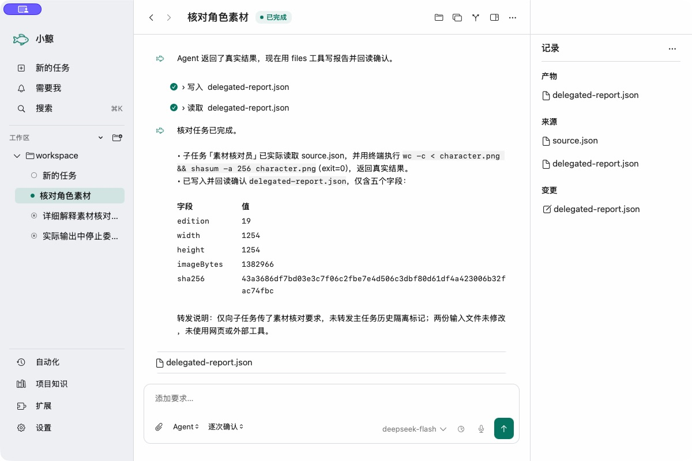

⌘K 按标题、用户消息或助手回复搜索任务，上下键预选，回车或点击打开。正文结果会定位并标记命中文字；Esc 收起搜索并清除标记。⌘F 在当前任务正文内查找，显示匹配数量；回车／⇧回车或上下按钮逐处定位，Esc 关闭。草稿不计入结果，Markdown 保持原排版；可在「设置 → 快捷键」改键、清除或恢复默认。选择、记录栏切换和工具展开使用简短过渡，并遵循系统的「减弱动态效果」。

⌘G 打开快速任务切换，可按任务名或工作区筛选未归档任务，跨「编程／通用」选择，用上下键预选、回车打开、Esc 取消。⌘B 或顶部侧栏按钮收起／展开当前窗口的左侧栏；收起后按 ⌘K 搜索会重新展开。两项都可在「设置 → 快捷键」修改、清除或恢复默认，各窗口独立切换任务和侧栏。

设置按「个人、集成、编码、其他」分组，搜索可直接进入连接器等具体页面。插件、Skills、指令、MCP、Hooks、智能体、团队、记忆与规则在居中的右侧内容列中查看、编辑和保存；子配置在页内进入与返回。Hooks 按事件分组，显示实际处理器数量、来源和启用状态。未保存的配置会在离开前提示，返回对话保留任务草稿，小窗口可滚动查看。

「设置 → 外观」可选择跟随系统、浅色或深色，以及 12／14／16／18 号对话字体，即时保存并更新已打开的窗口。设置侧栏的返回与搜索固定在顶部；插件启用配置支持 ⌘S，并分别保存用户、项目和本机范围。以上已在独立签名候选验收；日常应用已更新至源码 `bf6a50e`，正常启动、设置入口与返回原任务已核对，原配置和聊天记录保持。完整差距见 [Qoder TODO](docs/QODER-PARITY-TODO.md)。

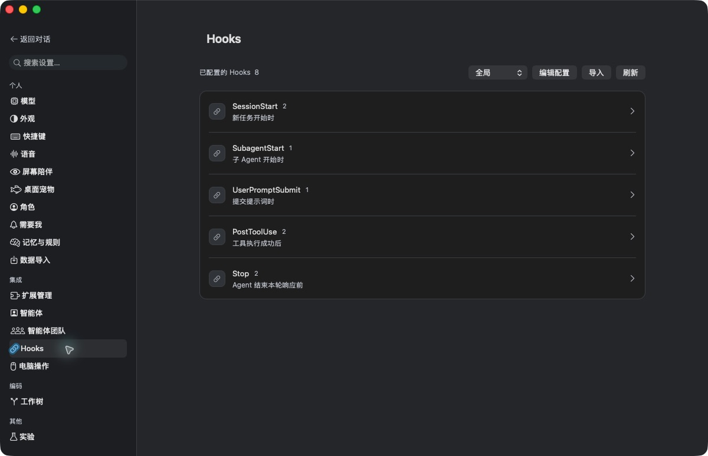

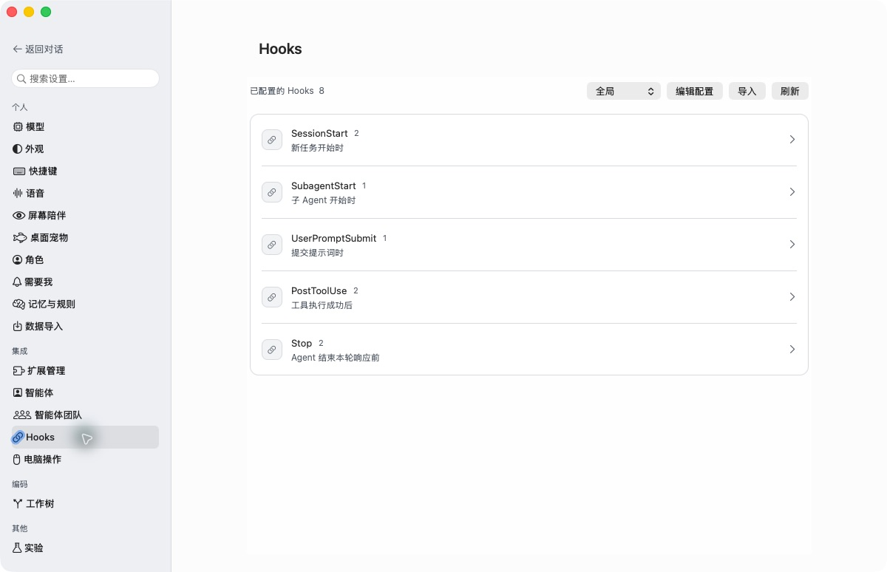

## 让小鲸动手做事

点击「新的任务」，选择项目文件夹和模式。问答和计划只读项目；Agent 可以实施修改；目标模式会保留计划、执行记录和完成证据。支持工具调用的 Chat Completions 模型才能执行这些工具，已用配置中的 `deepseek-flash` 跑通真实文件任务。

- 任务独立保存，支持搜索、重命名、置顶、归档、分支和停止后继续；每个任务保留自己的输入草稿。最多同时执行两项，其余排队。
- 回复下方可复制原文、标记有帮助／无帮助，或从该回复创建分支。反馈仅保存在本机；回复分支保留此前对话、附件、Skill 和画布历史，沿用当前项目文件与原任务执行限制。
- 已记录文件修改的要求下方可审阅并撤回该回合及之后的文件，保留对话和草稿。后来的用户修改、缺失检查点或并行操作会阻止自动恢复；中断后可从任务操作恢复撤回前文件。
- 普通任务的用户要求旁可编辑并重发，先审阅相关文件撤回，再从修改处继续；编辑前的完整对话保存在归档，未发送草稿保留。无工作区或没有完整检查点时，明确提示仅替换对话。
- 任务操作可开始独立侧任务，在原生标签页中处理并从主任务记录找回。设置中的“可恢复侧任务”只影响新建项；临时侧任务关闭后移除对话，保留项在退出后仍可重开，未完成的文件记录会留下恢复入口。
- 输入框里的模型按钮为当前任务选择模型，支持服务目录、搜索与直接输入 ID，也可跟随默认；切换保留历史和草稿，不修改全局默认。
- 输入框工具栏的上下文入口可查看当前估算、上次请求和实际报告用量；有上次请求时显示占用百分比。详情按钮或 `/compact` 可手动整理，原始历史保留，短历史无收益时不调用模型。任务回顾页可查看实际执行记录，并明确生成或更新独立回顾。
- 输入框的回形针、文件拖入或文件粘贴可添加附件，无需先选择项目；每条消息最多6个、每个20 MB，添加后先留在草稿，显式发送后才用于任务。草稿、执行中追加和提问答复都保留文件引用。可只发文件，点文件名打开系统预览或提取文字，按页／工作表切换；来源记录也能回到对应附件。
- 在访达选择支持的文件并通过「打开方式 → 蓝色大肥鱼」进入独立的通用问答草稿；原任务和其他窗口的草稿先保存。连续打开分别准备草稿，不自动发送；安装后的应用注册为可选查看器。
- 输入 `/canvas` 制作可交互画布，从任务结果或「记录 → 产物」打开。支持 React／Recharts、预览与 TSX 源码切换、保存、历史恢复，以及交互 HTML、源码和当前截图导出。
- 画布批注将实际截图、源码版本和文字加入原任务草稿，发送后继续修改同一画布。源码、历史和未保存草稿随任务独立保留；画布使用本地运行资源，禁止联网及访问原生接口。组织发布继续完善。
- 任务结果内显示画布实际截图；「查看快照」打开当时的静态结果，「打开画布」进入当前可编辑版本。历史截图保留原始来源版本，不随后续筛选或修改变化。
- 在画布「导出 → 打包为 Skill…」填写名称、触发要求、数据来源和格式约定，保存工作流与当前源码模板。在「扩展 → 导入」后，可用 `/skill:名称` 按当前任务的实际数据重新生成。
- 文件浏览、读取、搜索、创建和精确替换；终端返回真实输出与退出码。执行中可补充要求，尚未执行的旧动作会让位于新要求；空输入框右下角变为停止按钮，也可以发送「停止任务」。
- 任务顶部的「打开终端」可直接输入命令，也可从记录侧栏的「添加标签页」打开。终端从项目、Git 工作树或无工作区任务自己的目录启动，支持新建会话、向右或向下分屏、浅色和深色。收起面板会保留会话。关闭会话会结束它的 Shell 和作业。
- 默认允许项目文件修改，运行命令和联网前确认；也可切换逐次确认或项目内自动执行。拒绝后模型会收到拒绝结果。
- 「设置 → 电脑操作」管理独立开关、辅助功能和屏幕录制权限，默认关闭。开启后，可让 Agent 查找指定应用、确认连接一个窗口，读取控件或截取该窗口，并逐次确认点击、输入、快捷键、拖动和滚动；每次动作后回读实际状态。停止、归档、禁用或退出会断开连接，分支与其他任务不继承窗口引用。系统权限、密码及高影响操作仍由用户手动处理。
- 桌面操作优先使用可访问控件；坐标操作需要未变化的实际截图，坐标单位为窗口点数。窗口移动、缩放、关闭或应用重启后需重新连接；尚未包含前台快捷截图、操作录制与回放、外部浏览器登录连接。这些能力继续保留在完整实现清单中。
- 「记录」查看计划、产物、来源、日志和文件差异；文本产物可预览、编辑和保存。文件工具、命令和 MCP 执行期间的本地文件变化保留检查点，支持内容、删除、链接和权限恢复；撤回前核对实际状态，保留后续修改。
- 「Git」在任务右侧审阅，可放大或收起；切换任务保留各自的文件选择与提交说明。推送、添加远端、安全报告、依赖检查和任务内工作树创建／管理在同一工作区进入与返回。可查看本轮文件变化、未提交、未暂存、已暂存、指定提交与分支差异；分别显示整个来源与所选文件的增删统计。可切换统一／并排视图和换行，左右显示对应版本与行号，滚动保持对齐。逐文件暂存、取消暂存或恢复未暂存内容；恢复保留暂存区并保存可撤销检查点，未跟踪文件移入系统废纸篓。
- 「Git → 更多操作 → 安全检查」扫描选中的未提交、未暂存或已暂存文件。暂存区按 Git 对象读取，工作区按当前文件读取。结果显示疑似凭据、JavaScript／TypeScript／Python 的危险代码模式、行号和处理建议。可定位差异，或审阅后启用 JavaScript／TypeScript 的 TLS 证书校验并撤销这次修复。
- 「Git → 更多操作 → 安全检查 → 轻量语义检查所选文件」追踪 Python 和 JavaScript／TypeScript 的请求输入、变量传播及同一文件内的函数调用，检查进入 SQL、Shell 和动态代码执行的已知路径。报告中的「数据流位置」可选择输入、变量或调用处，再定位差异；「上次语义报告」可重新查看当前任务的结果。
- 「Git → 更多操作 → 依赖漏洞」可检查整个项目或所选依赖文件。Git 项目可切换工作区和暂存区，普通项目文件夹也可检查。结果显示依赖版本、风险、公告和公告中的修复版本，重新打开可查看该任务上次的报告。
- 本轮变化使用执行前的实际工作版本，保留原有未暂存内容及 Git 索引。命令失败、停止和超时后仍核对已落盘的部分变化；两次操作之间出现其他修改时建立新的检查点。已知并行操作仅供审阅，应用中断后保留执行前快照并提示核对。自动采集遵循 Git 跟踪及非忽略文件范围，跳过凭据、应用私有目录和外链目标；外部服务状态及同一时段的其他编辑仍需独立核对。
- 从「未提交」提交所选文件的工作区版本；从「已暂存」只提交已审阅的暂存版本，保留同一文件后续未暂存修改和其他文件的暂存内容。模型提交始终需要确认，沿用 `git_diff` 的来源；暂存区、HEAD 或分支变化后重新审阅。按本地配置执行 Hook 和签名，提交前的 Hook 改变已审阅快照时中止，不自动推送。
- 「推送」选择已配置远端、地址和目标分支，检查远端后审阅待推送提交与差异，再确认发送；「提交并推送」先提交所选文件，再打开同一推送审阅。支持添加远端、设置上游、停止和只读核对上次结果。仅发送已审阅的提交，未提交内容留在本地；提交或远端变化时重新审阅，不提供强推、删除分支或全部推送。专用模型推送工具始终需要确认。
- 输入区的「本地／工作树」在发送前选择执行位置。新建工作树可选起点分支，在任务工作区预览后创建，可选择带入当前修改；新任务保留草稿、附件与模型，发送后执行位置固定。Git 操作菜单也可进入同一创建页面。
- 带入的修改在新工作树中保持未暂存，原项目的工作文件、暂存区和分支保留；非忽略的未跟踪文件可带入，忽略文件不自动复制。冲突或预览后的来源变化会阻止创建。工作树放在项目的 `.bluefatfish/worktrees/`，由 Git 本地忽略。连接项目外的共享 Git 元数据前会确认。
- 「工作树」列出实际检出、关联任务和回收记录。可备份并回收本应用创建的工作树，再恢复实际文件、忽略文件及暂存状态；备份引用保留基准和暂存对象，支持 Git 清理后恢复。分支保留，关联任务的归档状态随回收／恢复更新。原分支变化或被占用时恢复到新的 `recovered/` 分支，不覆盖现有路径。运行中／待确认的关联任务、锁定、子仓库和特殊文件会阻止回收。任务内的管理、回收和恢复审阅使用页内流程；「设置 → 工作树」可在右侧选择已登记项目、进入管理并返回，未选择工作区也可使用。
- 「设置 → 工作树」可选择自动回收的范围和保留期。默认关闭，初始设置为仅已归档任务、30 天；开启或更改已开启的设置前需确认。按任务活动和实际文件修改时间计时，包含忽略文件；当前任务、固定任务、运行或等待中的关联任务、Git 操作和锁定检出受保护。回收先完整备份文件与暂存区，备份和分支长期保留，不自动清除。
- 长记录按需生成摘要，用户消息保留原文，预算内保留最近几轮完整操作；原始记录仍可分段查回，工具请求和回复保持配对。摘要由已配置模型结合用户原始要求生成。
- 「设置 → 记忆与规则」或「记录 → 记忆」可编辑全局／项目记忆、用户／项目指令、`AGENTS.local.md` 和任务摘要；「有效指令」显示当前来源及引用。成功读取子目录文件后载入对应嵌套指令；项目外引用须在该任务中明确允许，可随时撤销。对话里明确要求记住的信息，确认后才会保存。
- 「项目知识」先显示已登记的项目，可按状态、语言和项目名筛选，切换网格或列表，再进入 Wiki、知识卡片或检索。检索命中带行号和文件哈希；索引在本机增量更新，不调用模型，也不常驻扫描。支持中文短词，Git 仓库遵循忽略规则，跳过隐藏文件、凭据和构建目录。
- 「项目知识 → Repo Wiki」首次同时生成 Wiki 与知识卡片，共用源码索引版本和冻结规划；可从 Wiki 直接查看对应语言的卡片。支持暂停、沿用原任务继续，以及确认后重新生成；已完成部分、原任务和草稿保留。后续 Wiki 和卡片分别维护。可审阅 Git 提交差异后增量更新；自动更新与自动导出默认关闭，按语言保存，开启前确认。写后回读并核对实际源码引用，校验完成后发布；旧版文档保留。当前为开发候选，真实模型生成验收尚待完成，日常应用仍保留前一稳定版本。见 [Wiki 使用说明](docs/REPO-WIKI.md)。
- Wiki 更多菜单可将当前语言的文档与引用资源导出到项目，再从项目预览导入；替换前保留原版本，可预览恢复。导入前后的文件变化、未保存草稿和外部编辑会阻止覆盖。使用本应用的开放文件格式，支持通过 Git 传递；也可成套导入、导出和恢复 Wiki 与知识卡片。Qoder 私有导出格式与云端团队拉取继续开发。
- Wiki 更多菜单中的「自动引用 Wiki」按项目保存，默认开启。关闭后，普通任务不再提供 Wiki 自动提示或专用读取工具；文档阅读、生成和已有对话历史保留。此设置与知识卡片的自动引用独立。
- 「项目知识 → 知识卡片」管理架构、代码规范与技术栈，按工作区、分支和语言保存。支持中英文生成、单卡编辑、源码引用、版本恢复与项目导入导出；自动更新、自动导出默认关闭，启用前确认。规划中的 `knowledgecard.notes` 在每次生成时冻结，独立指导卡片内容。`/knowledge-edit` 可指定 Wiki 或卡片，核对原文与源码后经单次批准保存，保留旧版；两者分别维护。
- 回复支持基础 Markdown：标题、加粗、链接和代码。Markdown 产物与 Wiki 可切换预览／原文，阅读表格、本地图片、代码块和离线 Mermaid 图表；图表可双击放大。可在预览中就地编辑正文、代码和表格单元格，共用原文草稿，保存时保留原编码、文件标记、换行与未修改的源码。外部文件变化时保留草稿并打开比较，可查看并排差异或两份全文；确认后采用磁盘版本或覆盖文件，覆盖前的版本保留在修改检查点。支持章节目录、跨文件链接及只读源码行定位。选文可加入原任务草稿，保留已有内容，不自动发送。见[图表与选文](docs/AGENT-READING.md)。
- 文本可按 UTF-8、UTF-16／32、GB18030、Big5、Shift JIS、Windows-1252 或 ISO-8859-1 重新打开；自动模式只识别 Unicode 标记和 UTF-8。重开不改写文件，未保存草稿需先确认。保存沿用打开时的编码，不能无损表示的文字会阻止保存并保留草稿；来源窗口始终只读。
- 任务中的 MP4／WebM 产物、文件来源及 Markdown 工作区视频链接进入独立文件标签页，可暂停、拖动进度或明确选择“新窗口”；不提供视频编辑。同次运行中切换任务或标签页会暂停并保留播放位置。播放原件的只读快照，刷新读取最新文件，关闭标签页释放预览；预览限500MB，格式或编码不可播放时可用系统应用打开。
- 任务执行、等待和完成与角色状态衔接；语音仍使用已有唤醒和 MiniMax 设置。切换任务会同步角色和语音状态。

手动终端使用当前 macOS 账户的权限。Agent 的终端工具通过 macOS 原生隔离限制在项目和任务临时目录内，停止和超时会结束普通子进程组。系统工具与 Homebrew 安装目录可读，联网命令需要单独批准。项目内容和工具结果会发送给已配置的模型服务，Agent 终端进程不继承应用的 Token。

Git 操作需要已安装的 Xcode 命令行工具。仓库初始化、模型预览／创建工作树、手动完整文件检查、回收和恢复均需确认；自动回收按明确启用的保留设置运行。隔离范围无法执行项目外 Hook 或访问签名配置时会报告失败，不跳过这些步骤；失败后可在 Git 窗口刷新状态。带入修改暂不支持稀疏检出、子模块或未解决冲突，修改过大时要求缩小范围。自动回收只处理有本应用来源记录的工作树，外部工作树清理仍在实现清单中。

安全检查使用随应用分发的 Gitleaks、ast-grep 和 Opengrep 分析内核，扫描在本机完成。每次最多选 50 个变更文件，扫描完整 UTF-8 文本，单文件最多 1 MB，总计最多 10 MB。报告列出跳过的文件及原因，凭据命中只显示规则和位置。语义检查覆盖内置的 Flask／Django 与 req／request 输入规则及已知调用，不覆盖跨文件数据流；报告保存规则、位置和文件校验信息，定位前核对文件版本。

依赖漏洞检查使用 OSV-Scanner 和本机公告库，只下载所需生态的公开公告。首次获取 npm 公告库需要下载约 220 MB（2026-11-11），之后复用本机缓存。结果显示公告库日期，更新失败时标明使用缓存。支持 npm／pnpm／Yarn／Bun、Rust、Go、Python、Gradle、NuGet、PHP、Ruby、Dart 和 Elixir 的依赖文件。Go 显示 `go.mod` 声明的版本，`requirements.txt` 需要自包含的固定版本。每次最多 150 个文件，单文件 12 MB，总计 64 MB。 [OSV 离线扫描](https://google.github.io/osv-scanner/usage/offline-mode/)

推送沿用现有全局 Git／SSH 凭据。认证连接只读取独立提交快照和所需凭据；项目 `pre-push` 检查在原工作区范围内运行，不取得联网或凭据权限。仅配置在项目中的自定义认证命令不复制到连接进程。中断或失败后先核对上次结果，再决定是否重新准备推送。

项目索引使用系统 SQLite，单文件最多 512KB、总文本 16MB、最多 5000 个文件；界面显示跳过和覆盖状态。命中后核对实际文件哈希，文件已变化时不会返回旧片段；保留修改时间的外部编辑可用「重建」刷新。Wiki 是模型生成的项目资料，重要结论仍应核对当前代码。Wiki 生成使用已配置模型；自动更新默认关闭，明确开启后才会按 Git 提交增量维护。

每条消息最多 6 个附件，单文件 20MB，UTF-8 文本 2MB。文件复制到任务私有目录，未发送的草稿不会交给模型；任务分支保留自己的副本。图片和扫描 PDF 使用本机 OCR；启用视觉后，模型读取时会收到实际图片或 PDF 页，上下文不足 16384 时每轮一张，否则最多两张，长边最多 1536 像素。新读取的图片会保留到真实模型回复；预算紧张时可移出已查看图片，原文件与历史仍保留，图像数据不写进聊天正文。Word／Excel／PPT 提取文字与表格，不解读内嵌图片或图表；Excel 读取已保存的公式缓存，不重新计算公式。提取范围与缺失缓存会明确标出。

已实现的核心与各阶段实际验收记录见 [实现清单](docs/AGENT-PLAN.md)。团队／云端共享、完整 Wiki 维护、扩展生态、远程接入及其余桌面 Agent 能力仍在推进；完整 IDE 编辑器不在本项目范围。

开发候选的浏览器默认进入当前任务工作区，每任务最多 8 个网页标签；明确选择「新窗口」可移出，再用「回到任务」移回同一浏览器。切换任务、文件和网页标签保留本次运行的页面与输入，各任务的网站数据隔离且不写入磁盘。支持公开网页、本机预览、页面读取、点击／填写／选择、导航、滚动及复制链接与截图。问答模式、无工作区也可打开与读取网页，模型操作继续遵循原有任务权限和审批；导航、切换或目标变化后不能复用旧引用。

「标注页面」默认在浏览器标签内进入子页面，支持框选、箭头、画笔、撤销与清除。切换任务保留未添加的图形和要求，关闭或退出时可继续编辑；模型关闭、归档与删除不能直接丢弃标注。添加后图片与要求进入所属任务草稿，再点击发送。Agent 也可通过 `browser_screenshot` 查看当前网页；截图保留来源、时间与视口，关闭浏览器后仍能预览。macOS 14.4 及以上只捕获本应用的任务浏览器窗口并裁出网页区域，无需整屏录制权限；14.0—14.3 使用软件快照，会提示视频和 3D 内容可能缺失。锁屏期间会要求解锁后重新截图。

真实 `deepseek-flash` 已按保存的 8192 上下文、512 回复预算完成公开计算器表单，核对网站结果并切换保留的两个标签；金额由独立计算验证。同一预算下，模型也已读取实际网页截图，识别圆点颜色、双手姿势及两处不同标注中的按钮文字。当前仍是未发布候选，其他完整对标能力继续按清单推进。

浏览器及标注任务工作区的最终候选通过 48 项工作区、34 项浏览器核心检查，并完成实际多标签、任务往返、页内框选／箭头、添加到草稿、关闭与退出保护、浅深色及 800 点窄窗口检查。同版本重开后 37 份持久文件的内容和权限保持，四份实际标注图片与要求保留；本轮模型请求为 0。已添加内容随任务保存，浏览器标签与临时网站数据在关闭后清除；标签页持久恢复和日常发布仍待完成，日常应用仍为 `bf6a50e`。

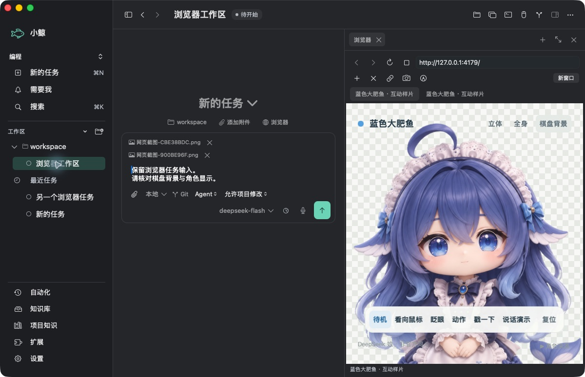

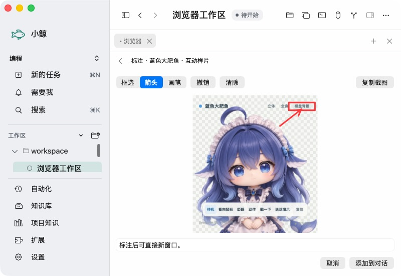

任务窗口采用项目分组的工作台：左侧搜索、需要我与归档，中间为对话、工具记录和输入，右侧查看实际计划、产物、来源与变更。窄窗口收起右栏，通过记录按钮打开完整记录；新任务使用居中的输入区域。桌宠与活动任务窗口重叠时退到窗口下方，原有浮动偏好保留。

开发候选的「需要我」已迁入工作台主页面，待关注与历史分别保留筛选；列表、详情、答复及批准／拒绝可在同一窗口完成。进入设置后可返回原收件箱，任务输入与未发送答复继续保留。独立本地签名候选已通过 43 项收件箱及 30 项相关设置检查，并完成浅深色、800 点窄窗口、键盘与同版本重开检查；本轮模型请求为 0，日常应用仍为 `bf6a50e`，尚未包含这项迁移。

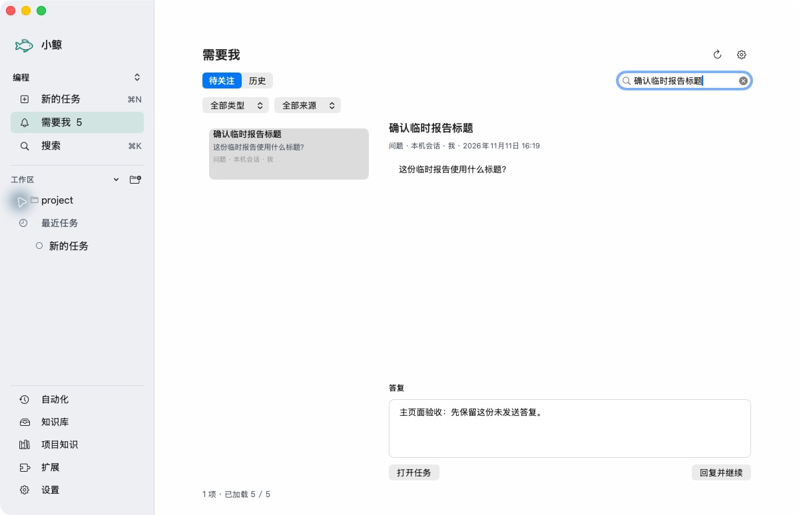

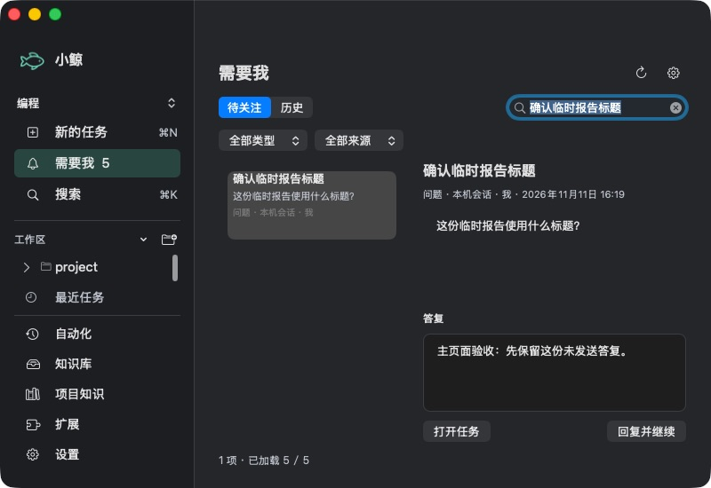

开发候选的「自动化」已迁入工作台主页面，可切换计划与运行记录，页内新建、编辑、保存、归档与恢复。从会话草稿继续配置后，保存状态同步至原任务；离开未保存内容时保留明确选择，保存状态持续显示。正常／窄窗口、浅深色、键盘、实际草稿保存与同版本重开已验，日常应用尚未更新此项。

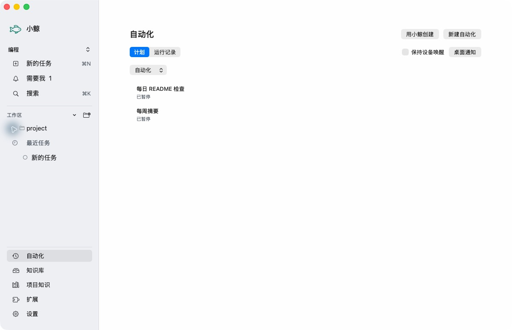

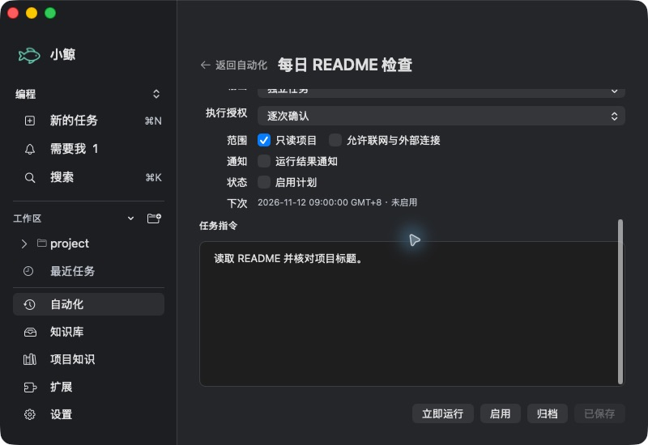

开发候选的「知识库／项目知识」已迁入工作台主内容区：资料库、文件、文档、项目 Wiki、规划、卡片、检索与来源可在同一窗口进入和返回。知识库新建与重命名使用页内表单；未保存的名称、文档、规划和卡片均保留离开前的确认。无工作区也可管理用户资料、查看项目目录。

同一候选通过 118 项页面、30 项相关设置和 26 项知识库核心检查，并完成正常／窄窗口、浅深色、实际导入、文件比较与保存及重开核对；54 份持久文件的内容和权限保持。本轮使用公开文档的手工导入与编辑，模型请求为 0。日常应用尚未更新需要我、自动化、知识中心及 Git 任务工作区迁移；其余长流程和复杂阅读排版继续见 [Qoder TODO](docs/QODER-PARITY-TODO.md)。

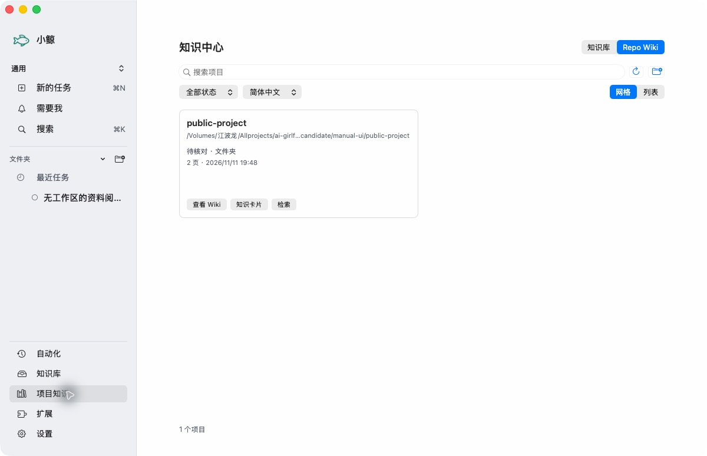

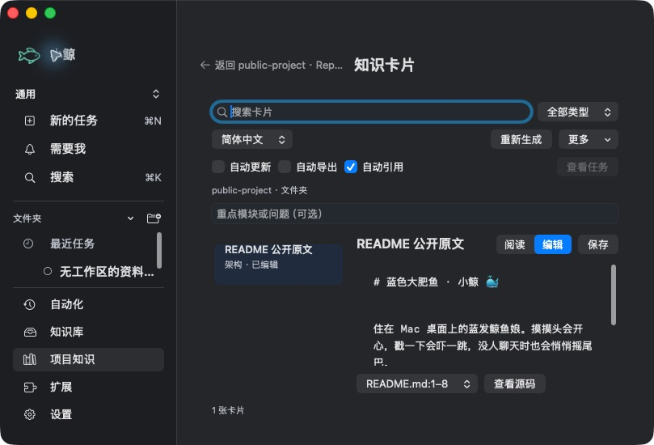

后续候选将 Wiki、整套项目知识和卡片的导入预览、版本选择及恢复迁入页内。左侧选择文档或卡片，右侧阅读完整正文；恢复先选择历史版本，再明确应用，原版本保留。过期预览要求重新核对，取消后返回原页并清除读取提示。最终同一程序通过 185 项相关检查，并完成实际导入、恢复、长文末尾、浅深色与窄窗口验收；同版本重开后，172 份持久文件权限保持、170 份字节一致，仅两处导航选中值变化，任务草稿和知识历史保留。模型请求为 0，日常包待更新。

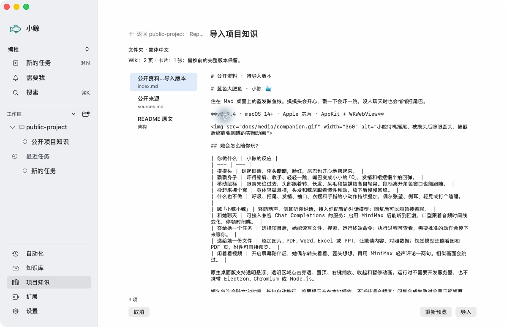

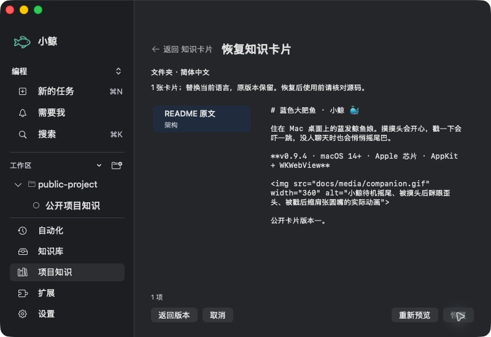

「自动化」管理本机的单次、每天、每周和固定间隔计划，保存时区、到期时间、项目、模型与执行者；可生成独立任务或在同一任务中保留历史。需要应用在计划时段运行；错过超过一分钟时记入历史，不补跑。暂停只阻止未来调度，停止当前执行通过任务窗口处理；上一轮仍在执行或等待审批时跳过重复运行。变更项目、执行者或授权范围会中止相关当前执行，后续按新配置运行。执行仍受只读、联网、逐工具和所属任务权限限制，不通过定时运行绕开审批。

运行记录支持分页、按日/周/月分组和状态筛选，可打开实际任务、结果或错误。结果与待处理事项显示为应用内未读状态；桌面通知需要手动开启系统授权。可选择应用运行期间保持设备唤醒；退出和重新打开不会自动重放结果未知的旧操作。当前为本机自动化核心，云端、对话生成计划、更多触发器与附件选择继续完善。

「设置 → 智能体」可新建或导入独立职责、模型、工具白名单、只读及联网范围，也可预览代码审阅、实施、研究与协调模板后填写。导入及模板默认停用；从配置启动新任务，或由模型使用 `agents` 工具组查找并同步委派。子任务独立保存输入、用量与结果，审批回到所属任务，停止主任务会停止子任务；委派只能收紧原有项目和权限范围。可选择已安装 Skills 和已配置 MCP，配置逐工具的默认、允许、确认或禁止规则。Skill 按任务保存只读副本；MCP 仅展示所选连接器，建立连接仍须确认。明确允许的工具可跳过该 Agent 默认审批，但不能扩大主任务的审批、项目、工具或联网范围；禁止规则同时拦截 MCP 的实际工具名。更改范围会停止相关未完成任务并断开连接，历史保留。外部 MCP 不受项目隔离约束，使用时需关闭只读项目并允许外部连接。插件与云端仍待继续。

新任务标题旁可选择执行者，发送前切换默认助手、Agent 或本机团队，保留当前草稿与附件。「设置 → 智能体团队」支持空白配置或审阅模板、一名负责人和一到四名成员。启用团队同时启用成员，停用团队保留成员独立使用。团队负责人只可委派给本次成员，等待真实结果后汇总；成员独立上下文、工具范围、审批和执行记录沿所属任务收紧。普通任务也可通过 `delegate_task` 的 `team_id` 等待团队最终结果。修改团队职责或成员会中止其未完成任务，历史保留；跨设备、归档管理及更完整团队能力继续开发。

「扩展」管理本机 Skills 与自定义命令，可搜索、新建、导入、编辑、启停和移到废纸篓。Skill 支持 `SKILL.md`、资源文件夹、ZIP 与 `.skill`；命令使用 Markdown。输入 `/` 可筛选候选，用上下键和 Enter／Tab 选择，再补充要求并发送；从管理窗口使用扩展也只会加入草稿。命令支持 `$ARGUMENTS`，子目录以冒号分组，如 `audit/handoff.md` 对应 `/audit:handoff`；候选会加上 `skill:` 或 `command:` 前缀区分类型。

「设置 → 扩展管理 → 插件」可导入一个本地插件 ZIP，审阅作者、版本与组件后安装，再启用插件。支持 `.qoder-plugin/plugin.json` 或 `.claude-plugin/plugin.json`、Skills、命令、MCP 与参考资料；组件使用插件名前缀，例如 `/skill:sales-workbench:review-sales`。从插件窗口使用 Skill／命令只加入原任务草稿，发送后才调用模型。组件随父插件统一启停和移除，源码只读；停用后拒绝继续载入或读取该插件的 Skill 资源，已有任务记录保留。

插件 MCP 支持 manifest 内的 `mcpServers` 对象、相对 JSON 路径或路径数组；未声明时读取 `.mcp.json`，其次 `mcp.json`。可安装只有连接器的插件。从组件列表选择 MCP 后点击「配置连接器」，在现有管理器保存配置并单独启用，再明确连接；安装与父插件启用不会启动程序。支持 stdio、`http`／`streamable-http`、环境变量、HTTP 请求头、`cwd` 与以毫秒计的 `timeout`。`${QODER_PLUGIN_ROOT}`、`${CLAUDE_PLUGIN_ROOT}`、`${PLUGIN_ROOT}` 展开为已安装资源目录；其他变量由用户在本机配置中填写，不读取应用进程的环境凭据，也不自动安装依赖。自定义 Agent 可像选择独立 MCP 一样分配插件连接器。停用、移除或修改配置会断开相关连接，重新启用后须重新连接；旧确认和旧工具引用不会恢复。移除保留本机连接配置与钥匙串凭据，便于从废纸篓恢复插件。

插件包与展开资源分别不超过 20MB，单个资源不超过 2MB。最多64个插件、共64个插件连接器，每个插件最多16个连接器。安装不覆盖同名插件，拒绝不安全路径、路径别名、过期或被修改的资源。当前插件内 Agent、Hooks、规则、依赖及 SDK 权限尚未接入，包含这些要求的包会明确拒绝安装；旧式 SSE、WebSocket、OAuth、信任／工具过滤配置、市场、发布、更新及办公插件继续开发。

全局扩展放在应用数据的 `extensions/skills` 和 `extensions/commands`，项目扩展放在 `.bluefatfish/skills` 和 `.bluefatfish/commands`。也会发现 `~/.qoder`、`~/.agents/skills` 及项目内 `.qoder`／`.agents` 的对应文件；共享来源可查看和停用，通过「打开来源」管理原件。应用管理的全局同名扩展优先，其次是共享全局，最后是项目；停用优先来源后不会自动启用另一份同名文件。

Agent 可按描述查找并载入 Skill，`disable-model-invocation: true` 的 Skill 只允许用户手动选择。资源复制到任务私有临时目录，说明、来源与版本随记录保留；脚本仍通过终端工具遵循原有模式、审批、网络和项目边界。资源为只读副本，使用相应解释器运行脚本。Skill 单文件资源上限 2MB、总量 20MB；不导入凭据、隐藏文件或外部链接。

「设置 → 扩展管理 → 连接器」支持新建、JSON 导入、编辑、启停、连接、工具目录和断开。支持 stdio 本机程序与 Streamable HTTP（JSON／SSE），HTTP 可保存 Bearer Token 和自定义请求头，本机服务可设置环境变量与工作目录；填写的凭据保存在钥匙串，保存后配置编辑器只显示占位符。可从 `mcpServers` 对象选择一项导入，保存前不会启动程序；本机程序需要已安装并填写绝对路径，应用不自动安装服务。

Agent 通过 `mcp` 工具组先读取简短目录，再按名称把工具原始参数 schema 提供给模型；每次只载入近期需要的工具。连接、工具调用和资源读取沿任务审批与逐工具规则执行；问答／计划不能连接或调用，Wiki 不使用外部连接器。MCP 本机程序按当前账户权限运行，外部服务按其自身权限运行，均不受项目终端隔离约束。连接与目录版本绑定到任务；配置变化、停用、断开后重连和重启使旧调用失效。重复连接会复用当前会话，当前状态跨历史整理保留。断开结束本机进程组；超时或断线不自动重放，也不代表外部操作已回滚。OAuth 登录、其余插件组件、Hooks、市场和演进建议仍按完整清单推进。

任务输入栏的 MCP 入口或连接器管理页的「资料与提示词」可浏览资源、填写展开后的 URI 模板、预览提示词参数结果。资源加入当前任务附件；提示词由用户加入草稿后发送，助手示例不会伪造为已发生的回复。附件保存来源 URI、连接配置版本、读取时间与内容哈希，未发送草稿不能被模型读取。目录或资源更新会使旧预览失效，可选择「跟踪更新」。工具和资源返回的图片可进入实际视觉上下文；音频、不透明二进制和压缩包保留文件但不自动转写或展开。

连接器需要用户提供信息时，可在当前任务点击「回答」，也可从「需要我」进入原任务。表单显示请求来源，支持文本、数字、日期和选项；确认才提交，拒绝或取消不发送字段。网页确认会先显示目标地址，点击后才打开，完成后按连接器要求继续。断开连接会结束未处理的问询；不会重放旧请求。

「设置 → Hooks」管理 `command`、`http`、`prompt`、`agent` 四类处理器，支持同步和后台执行，可编辑或导入全局／项目 JSON，并逐项启停。全局配置为应用数据的 `extensions/hooks.json`，项目配置为 `.bluefatfish/hooks.json`；也会合并 `~/.qoder/settings.json` 和项目 `.qoder/settings.json`、`settings.local.json` 中的 Hooks。发现与保存均不会自动授权运行。启用前显示实际命令或地址、规则和工具范围；配置或同级 `hooks/` 资源改变后需重新审核。

命令从 stdin 接收事件 JSON，可在输入、工具执行、审批和任务结束等环节运行；同步命令的退出码 2 可阻止输入、执行或结束，`PreToolUse.updatedInput` 在重新校验与审批后用于真实工具。会话内已确认的同一次触发不会因审批恢复而重跑。被拒绝的输入和答复不会进入主任务的模型上下文或被主任务历史工具查回；启用模型／HTTP 输入校验时，校验处理器会收到待检查的这次事件。原始工具结果始终保留，处理器补充输出另存为上下文。Hook 的 `allow` 目前仍走原有审批，`PermissionRequest` 参数／权限改写会明确停止；问答／计划的命令只读项目，Wiki 不执行 Hooks。取消会终止命令进程组，并立即停止任务，不再启动结束处理器。

分组 `async: true` 可将四类处理器放到后台，命令条目的 `async` 可覆盖分组。后台结果只作为后续轮次的补充资料，不阻止已继续的动作、不改写工具参数或代替审批；`statusMessage` 显示实际进度，任务记录可直接打开对应日志。命令的 `asyncRewake: true` 在退出码 2 时可提醒模型继续，支持 `rewakeMessage` 和最多 300 字符的 `rewakeSummary`；待审批、有新要求或执行范围已变化时不会抢先恢复。每条用户输入最多自动唤醒 3 次；后台并发最多每任务 16 项、全局 32 项。停止、停用、配置或执行范围变化会取消活动工作；重启和分支只保留历史，不重放未完成处理器。后台工作仍运行时可以提交新要求。

命令可指定 `shell: "bash"`；`powershell` 需要本机已安装 `pwsh`。设置 `args` 数组时直接执行程序，忽略 `shell`，每项原样传递，不展开引号、变量或通配符。`env` 合并到命令环境，通过应用保存的值进入钥匙串，编辑器和授权记录只保留名称与占位符；外部来源文件中的明文仍由其所有者管理。命令可读取应用进程环境，隔离启动器和 Hook 上下文变量不能覆盖，受保护值不能用于改写工具参数。旧版命令授权需要重新审核。

四类处理器均支持 `if`，例如 `Write|Edit(*.json)` 或 `Bash(git *)`；工具名沿用 matcher 规则，括号内按主要参数做通配符匹配。普通名称完整匹配，不命中相似名称；不匹配时不会启动命令或模型。`once` 只对会话配置生效，文件配置中的同名字段不会执行后删除处理器；会话级注册仍待接入。

HTTP 处理器 POST 事件 JSON，接收 HookOutput JSON；不跟随重定向、不共享 Cookie 或 HTTP 登录状态，不自动重放失败请求。通过应用保存的 Header 值进入钥匙串，并绑定来源条目和完整地址；导入与编辑使用遮蔽占位符，改地址需重新填写凭据。Header 中的 `${NAME}` 在调用时读取应用环境，`allowedEnvVars` 可指定白名单；省略时允许引用所有变量，空数组禁止插值。缺少变量、不在白名单或展开后包含非法控制字符时，不发送请求。「清除凭据」停用处理器并清除对应钥匙串条目。外部来源文件直接填写的 Header 值仍由该文件所有者管理。HTTP 服务按其自身权限处理数据。

`prompt` 使用任务的模型连接完成一次独立判断，返回 `{ok, reason}`；`agent` 创建可查看的校验任务，按 `tools` 白名单读取项目、搜索或执行只读命令，最后通过 `StructuredOutput` 提交结论。两者仅接收规则和当前事件，可用 `model` 指定同一连接支持的模型。校验任务不接受新的用户任务，不执行写入、交互提问、外部连接器或递归 Agent；终端联网需在 Hook 中显式允许。模型用量、实际工具和判断依据随子任务记录保留，主事件关联该记录。停用或取消会结束活动校验与 HTTP 请求。当前 `FileChanged` 只来自原生文件写入与编辑；完整权限输出、会话级 Hooks、外部文件监听及常规协作事件继续完善。

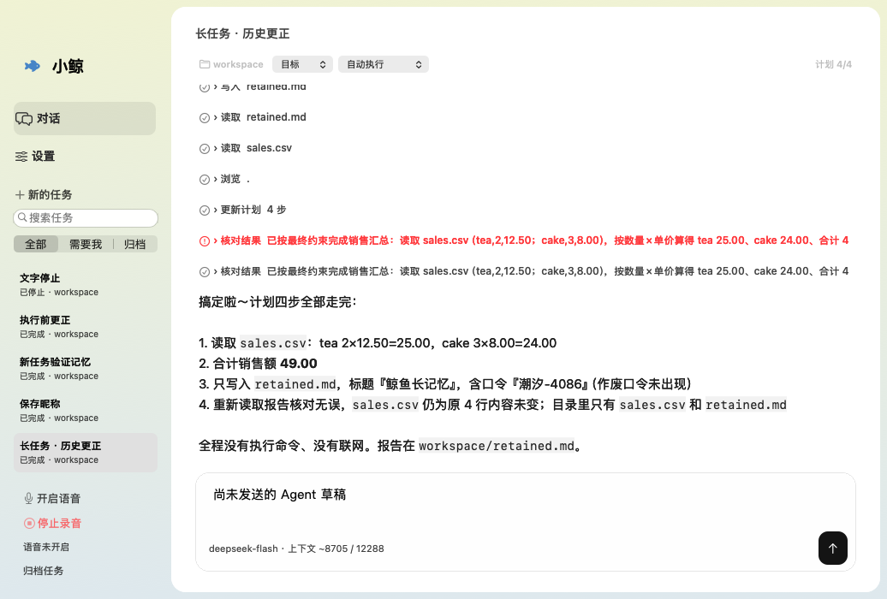

Git 任务工作区候选已通过 171 项相关原生检查，并核对实际提交、推送、浅深色和重开；模型请求为 0。以下为独立验收应用，日常包待更新。

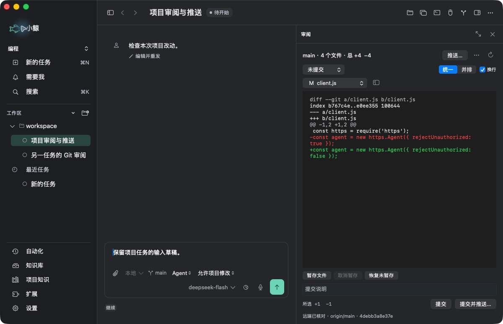

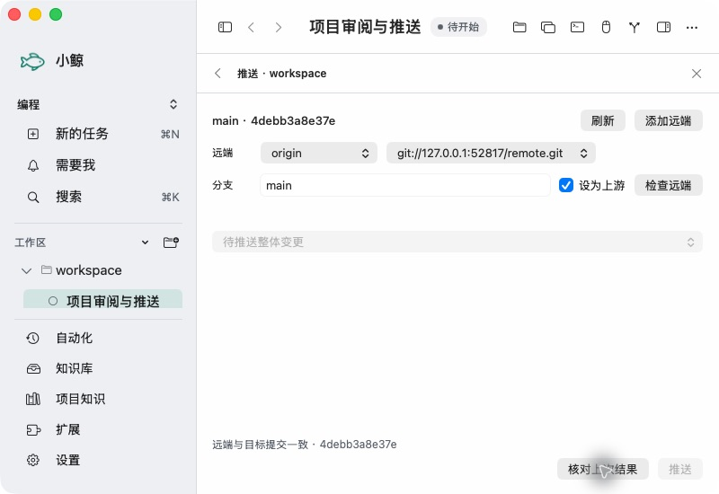

任务记录、上下文／任务回顾／请求记录，以及 Markdown／文本文件已接入任务工作区标签页；文件比较在原文件标签页内进入与返回。切换任务和标签页保留未保存草稿，关闭文件时确认；保存沿用原编码、文件版本检查和修改检查点。浏览器、其余工作区整合及日常包更新继续见 [Qoder TODO](docs/QODER-PARITY-TODO.md)。

记录／详情／文本阶段候选通过 132 项任务工作区、87 项 Git 和 118 项知识中心检查。实际窗口核对文件选择、任务／标签切换、未保存保护、快捷键保存、过期比较、覆盖检查点、采用磁盘版本、预览内编辑及同版重开；模型请求为 0。以下两张为最终程序的原始窗口截图，日常包待更新。

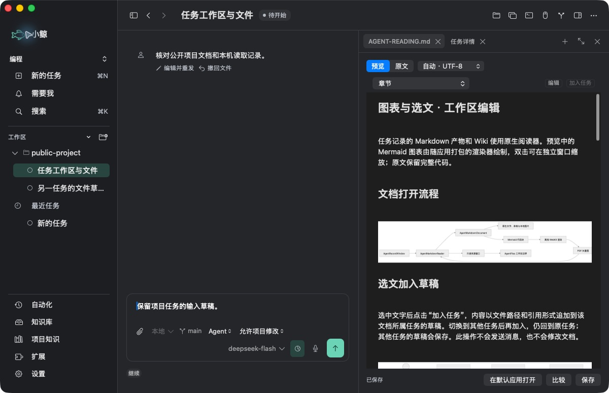

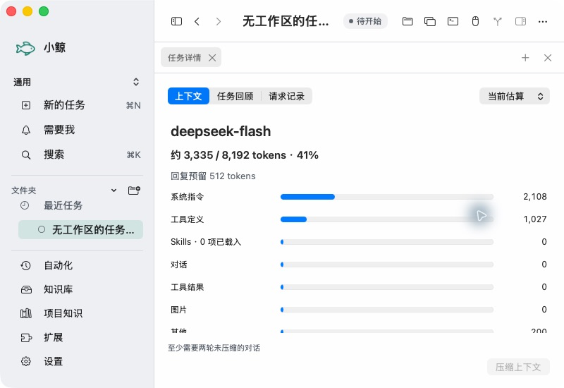

Office 的 DOCX／XLSX／PPTX 与每份 Canvas 已进入独立任务标签页，切换保留编辑器和未保存源码，Skill 打包在原画布内进入与返回。关闭或退出前等待办公编辑器处理最后输入；未保存时可继续编辑。Word 按实际页面适配工作区，工具栏跟随应用主题。三种文件的实际输入、保存与另存副本、画布交互和打包、浅深色、窄窗口及同版本重开已有独立验收记录；本轮应用模型请求为 0，日常包待更新。

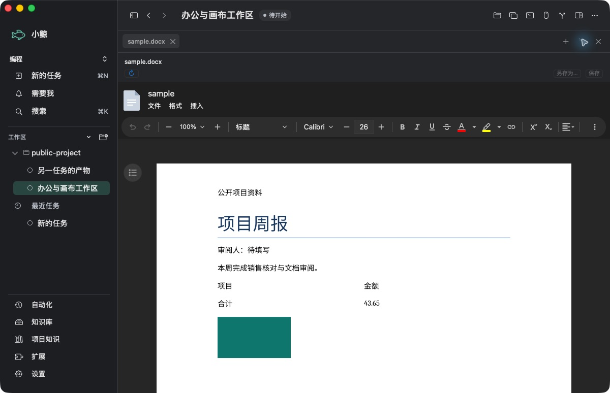

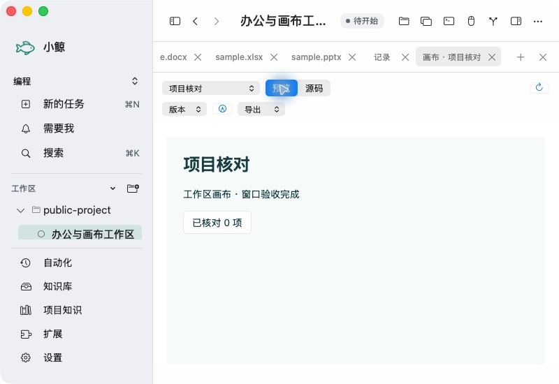

工作树创建、列表、关联任务和回收记录已进入任务工作区，回收／恢复先在原页审阅对象与影响，再明确确认。窄工作面按列表与详情上下排列，放大后可并列显示。任务内阶段候选通过 450 项相关检查，实际窗口已核对首次布局、任务往返、浅深色、窄窗口和页内审阅；实际创建流程也有前一候选的窗口记录。该阶段指定临时记录的最终窗口回收／恢复点击待确认，日常包更新仍列在 [Qoder TODO](docs/QODER-PARITY-TODO.md)。本轮模型请求为 0，开发验收不需要解锁钥匙串。

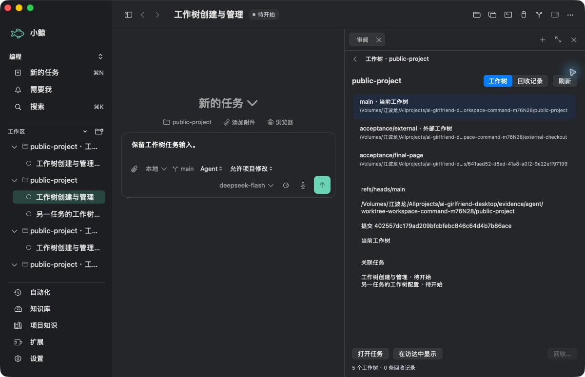

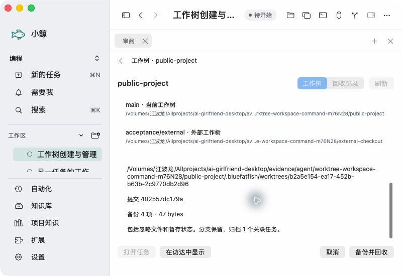

「设置 → 工作树」的全局管理也已进入右侧内容页。进入管理再返回可保留项目与未应用设置，离开时可继续编辑；保存反馈对应实际保存结果。此阶段最终同一优化程序通过 309 项相关检查；实际无工作区入口、管理与返回、未保存保护、保存、关联任务跳转、浅深色、窄窗口和同版本重开已验。原任务输入与资料保留，自动回收在页面验收中始终关闭；模型请求为 0，日常包待更新。

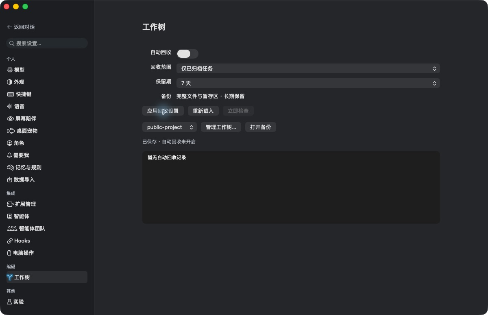

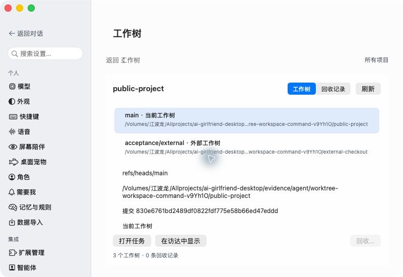

视频任务标签页候选通过 59 项视频工作区、17 项原播放器核心与 132 项记录／文本检查，共 208 项。实际 MP4／WebM 播放、暂停、全屏、文档链接、系统文件选择、任务往返、新窗口和关闭均已核对；重开后 13 份原资料的字节与权限保持，模型请求为 0。以下为同一最终程序的原始截图；日常发布、标签页持久恢复及知识中心独立阅读页面的视频整合仍待完成。

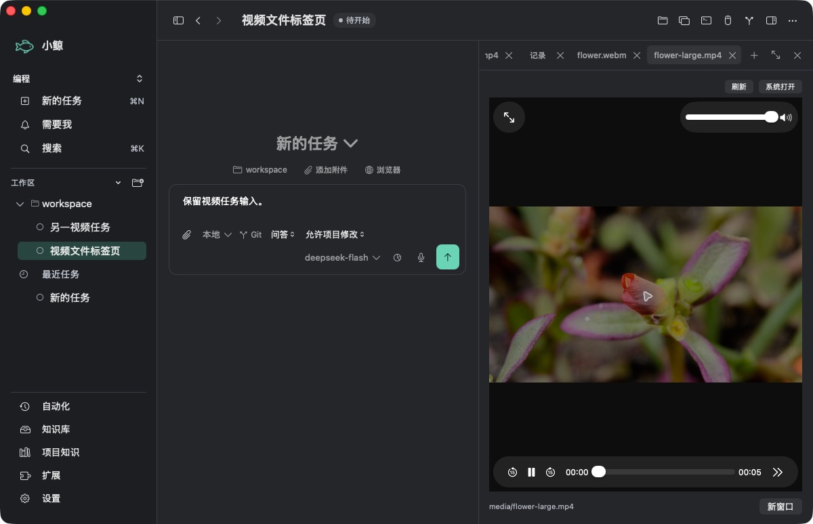

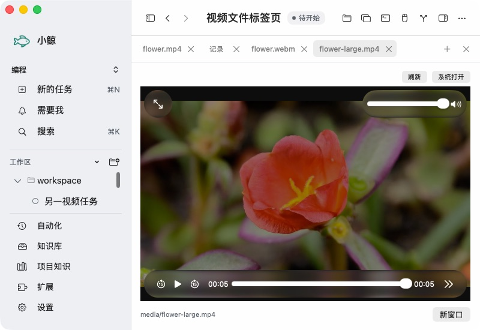

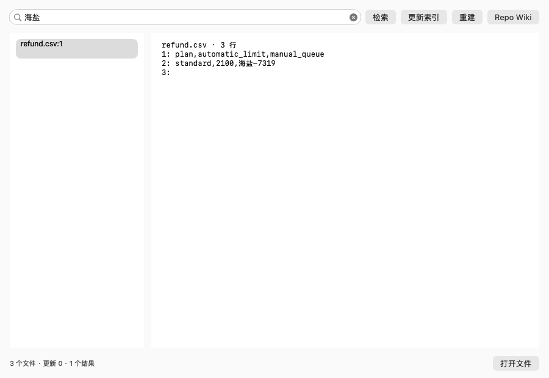

## 安静一点，也轻一点

- 唤醒使用 **sherpa-onnx 本地声学关键词检测**，命中后才启动 Apple 本机中文转写；手动聆听和短暂续聊也可启动转写。
- 开启语音唤醒需要持续使用麦克风；原始音频只在内存处理。关闭唤醒或锁屏、休眠时释放输入与模型。
- 等待唤醒时不持续做完整转写；唤醒后的文字才发送到已配置的对话服务。启用语音回复后，回复文字会发送到 MiniMax。
- 音频设备配置变化或采集断流时自动恢复麦克风；连续恢复失败会显示原因，避免停在虚假的「聆听中」。
- Token 保存在 macOS 钥匙串；设置、原有聊天和独立任务保存在 `~/Library/Application Support/BlueFatFish/`，不进入 Git。任务按需载入，历史记录不会全部常驻内存。
- 自动模式目标为待机 30 FPS、互动和说话 60 FPS；系统低电量模式为 15／30 FPS。角色收起、不可见或屏幕休眠时停止绘制。

当前原生角色使用 34 个弹簧通道、43,844 个三角面、每帧 2 次绘制。它是正面原画分区变形，尚不是完整 Cubism 模型；头发与衣服是弹性跟随。口型在内存里分析音频的开合与频谱，并按实际播放时钟采样；圆口、扁口是近似估算，尚无音素级对齐。

## 陪你看屏幕 👀

在「设置 → 屏幕陪伴」授权屏幕录制，开启「自动观察」并保存。观察间隔可选 1／3／5／10／15 分钟，默认 5 分钟；也可以点「看看屏幕」手动试一次，或免打扰 30 分钟。自动观察默认关闭。

**闲置 → 转头扫一眼 → 歪头思考 → 短评与说话口型 → 回到待机。** 发梢、衣摆和尾巴的细动持续叠加。开启 MiniMax 语音回复后会读出评论；这类主动评论结束后不会自动打开续聊转写。

只抓当前应用窗口的一帧，缩小到最长边 1280 像素，以 JPEG 发给设置中显示的视觉服务；截图不落盘。它看不到完整视频，也不采集视频声音。相似画面在本地跳过；模型可选择安静，失败后延长等待时间。

闲置针对小鲸：触摸、拖动、对话或语音聆听会让观察让位，用户继续操作其他应用不影响。角色收起、暂停动画、锁屏和休眠时不抓屏。首次使用需手动授予 macOS 屏幕录制权限，并配置支持图片理解的模型。

[功能范围与后续方向](docs/ROADMAP.md)

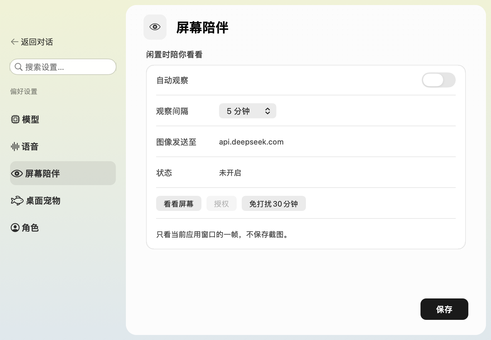

## 开发与版本管理

- 后续直接在 `main` 持续开发，按完成范围分步提交并及时同步远端。开发候选与日常安装分别核验，完整范围和证据记录在 `docs/AGENT-PLAN.md`。
- 提交源码、运行素材、必要的原画来源与许可证；构建、下载缓存、测试输出、旧生成件和私人记录留在本地。
- 无需为文档修改跑全量测试，也没有自动消耗 GitHub Actions 的工作流。按改动风险选择必要检查。

[开发说明与验证范围](docs/DEVELOPMENT.md) · [更新记录](CHANGELOG.md) · [下一步计划](docs/ROADMAP.md)

## 素材与许可

AIRI 的待机动画按其 MIT 许可复用，原件、来源与许可证位于 [`public/animations/airi/`](public/animations/airi/)。sherpa-onnx 与唤醒模型采用 Apache-2.0，ONNX Runtime 采用 MIT，固定版本来源和许可位于 [`vendor/sherpa-onnx/`](vendor/sherpa-onnx/)。

角色原画来自本项目提供的参考图，来源记录保存在 [`public/portraits/whale-maid/source.json`](public/portraits/whale-maid/source.json)。旧社区模型的原角色为上善无形，女仆版设计为 ZipZipPipe，参考适配为 Small-tailqwq，3D 重建为 AI Moe Atlas，原许可记录位于 [`public/models/whale-maid/`](public/models/whale-maid/)。本仓库尚未为全部代码与角色资源授予统一的对外分发许可，第三方许可不代表角色美术可任意商用。
