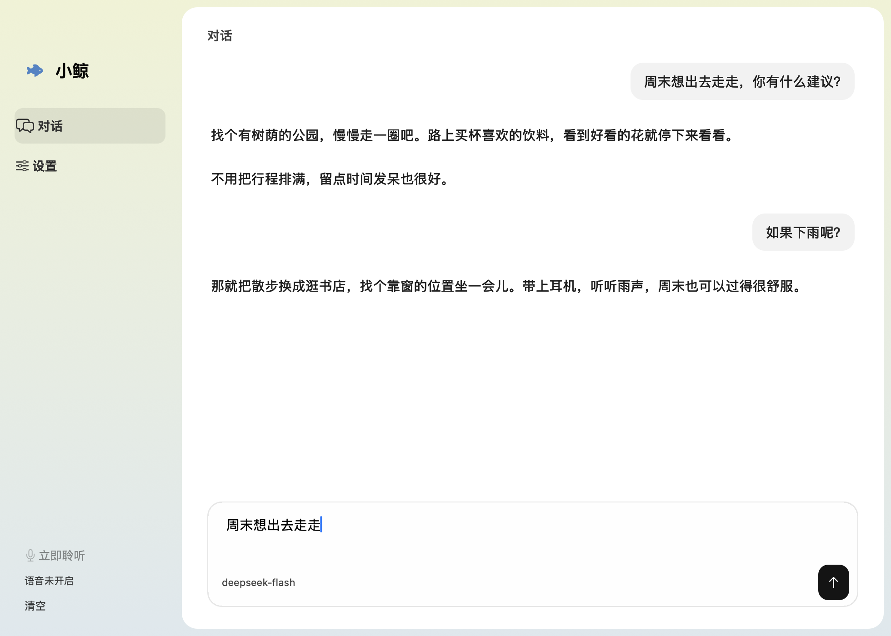

# 蓝色大肥鱼 · 小鲸 🐳

住在 Mac 桌面上的蓝发鲸鱼娘。摸摸头会开心，戳一下会吓一跳，没人聊天时也会悄悄摇尾巴。

**v0.7.1 · macOS 14+ · Apple 芯片 · AppKit + WKWebView**


## 她会怎么陪你玩？

| 你做什么 | 小鲸的反应 |
| --- | --- |
| 摸摸头 | 眯起眼睛、歪头蹭蹭，脸红，尾巴也开心地摆起来。 |
| 戳戳身子 | 吓得缩肩、收手、轻轻一跳，嘴巴变成小小的「O」，发梢和裙摆慢半拍回弹。 |
| 移动鼠标 | 眼睛先追过去，头部跟着转，长发、呆毛和蝴蝶结各自轻晃。鼠标离开角色窗口也能跟随。 |
| 拎起来挪个窝 | 身体轻微悬摆，头发和鲸尾跟着惯性晃动，放下后慢慢回稳。 |
| 什么也不做 | 呼吸、摇尾、发梢、袖口、衣摆和手指的小动作持续叠加，偶尔张望、侧耳、轻晃或打个瞌睡。 |
| 喊「小鲸小鲸」 | 轻响两声、侧耳听你说话，接入你配置的对话模型；回复后可以短暂接着聊。 |
| 和她聊天 | 可接入兼容 Chat Completions 的服务；启用 MiniMax 后能听到回复，口型跟着音频时间线变化，停顿时闭嘴。 |

原生桌面版支持透明悬浮、透明区域点击穿透、置顶、右键缩放、收起和暂停动画。运行时不需要开发服务器，也不携带 Electron、Chromium 或 Node.js。

短句气泡会随文字收缩，长句自动换行。唤醒提示音在本地播放，不消耗语音额度；回复合成失败时会显示简短原因。

## 先让她住到桌面上

已构建的 `.app` 可以直接运行。首次源码构建需要 Node.js/npm、Xcode 工具链，以及本机有效的 Apple Development 或 Developer ID Application 签名证书。

```sh
npm ci
npm run native:build
npm run native:open
```

产物位于 `build/蓝色大肥鱼.app`。有多个有效证书时，通过 `BLUEFATFISH_SIGN_IDENTITY` 指定证书名称或 SHA-1；构建不会退回临时签名，以保持更新时的钥匙串身份稳定。

首次构建会下载固定版本的 sherpa-onnx 原生库和唤醒模型，并校验 SHA-256；之后运行不再下载。当前角色素材、动画和示例音频已在仓库中，无需调用 Tripo 或重新生成。

只想看网页互动样片：

```sh
npm ci
npm run dev
```

打开 <http://127.0.0.1:4173/>。网页用于角色调试；原生聊天、钥匙串和麦克风唤醒在 macOS 应用中使用。

## 常用操作

| 操作 | 用途 |
| --- | --- |
| 单击头部／身体 | 摸摸头／戳一下 |
| 按住角色拖动 | 移动位置 |
| 双击角色 | 打开聊天 |
| 右键角色／菜单栏鱼图标 | 大小滑条、设置、置顶、暂停、收起、复位 |
| Return／Shift + Return | 发送／换行 |
| 设置中的 ⌘S | 保存设置 |
| 「小鲸小鲸」／「停止聆听」 | 唤醒／结束本轮聆听 |

打开设置后填写对话接口、模型和 Token，点击「检测」检查连接。模型列表、视觉能力、思考程度、上下文预算和回复上限均可配置；服务未声明的能力会保留为未知，手动选择不会让模型获得原本不支持的能力。

语音回复可单独启用 MiniMax，默认 `speech-02-hd`、`female-shaonv`，语速 0.98。保存后的 Token 以首尾片段显示，可点击复制、更换或移除。旧钥匙串条目无法访问时，需要在应用内重新粘贴保存一次。

语音默认等待约 3 秒停顿再接话，设置中可选 2／3／5 秒。识别器中途分段或重置结果时，会保留前半句并接着听。

## 清爽的原生聊天窗口

侧栏切换对话和设置，用户消息靠右，小鲸的回复在左。输入框固定在底部；翻看较早消息时，流式回复不会把你强行拉回末尾。



设置按「模型、语音、桌面宠物、角色」分类，搜索可跨分类查找。切换分类和返回对话时保留未保存的输入，设置卡片在小窗口中可滚动。


## 安静一点，也轻一点

- 唤醒使用 **sherpa-onnx 本地声学关键词检测**，命中后才启动 Apple 本机中文转写；手动聆听和短暂续聊也可启动转写。
- 开启语音唤醒需要持续使用麦克风；原始音频只在内存处理。关闭唤醒或锁屏、休眠时释放输入与模型。
- 等待唤醒时不持续做完整转写；唤醒后的文字才发送到已配置的对话服务。启用语音回复后，回复文字会发送到 MiniMax。
- 音频设备配置变化或采集断流时自动恢复麦克风；连续恢复失败会显示原因，避免停在虚假的「聆听中」。
- Token 保存在 macOS 钥匙串；设置和最近 80 条聊天保存在 `~/Library/Application Support/BlueFatFish/`，不进入 Git。
- 自动模式目标为待机 30 FPS、互动和说话 60 FPS；系统低电量模式为 15／30 FPS。角色收起、不可见或屏幕休眠时停止绘制。

当前原生角色使用 34 个弹簧通道、43,844 个三角面、每帧 2 次绘制。它是正面原画分区变形，尚不是完整 Cubism 模型；头发与衣服是弹性跟随。口型在内存里分析音频的开合与频谱，并按实际播放时钟采样；圆口、扁口是近似估算，尚无音素级对齐。

## 下一件想做的趣事：陪你看屏幕 👀

**待实现，当前版本不会自动截屏或评论屏幕。**

闲置一会儿 → 转头看看屏幕 → 歪头思考 → 对正在发生的事评论一两句。比如你在看视频，她偶尔接一句，而不是每隔几秒打断你。

计划支持观察间隔、暂停和免打扰；需要用户开启屏幕观察，并接入支持视觉的模型。具体动画和触发规则见 [路线图](docs/ROADMAP.md)。

## 开发与版本管理

- `main` 保存可用基线，当前标签为 `v0.7.1`；后续功能在独立分支开发。
- 提交源码、运行素材、必要的原画来源与许可证；构建、下载缓存、测试输出、旧生成件和私人记录留在本地。
- 无需为文档修改跑全量测试，也没有自动消耗 GitHub Actions 的工作流。按改动风险选择必要检查。

[开发说明与验证范围](docs/DEVELOPMENT.md) · [更新记录](CHANGELOG.md) · [下一步计划](docs/ROADMAP.md)

## 素材与许可

AIRI 的待机动画按其 MIT 许可复用，原件、来源与许可证位于 [`public/animations/airi/`](public/animations/airi/)。sherpa-onnx 与唤醒模型采用 Apache-2.0，ONNX Runtime 采用 MIT，固定版本来源和许可位于 [`vendor/sherpa-onnx/`](vendor/sherpa-onnx/)。

角色原画来自本项目提供的参考图，来源记录保存在 [`public/portraits/whale-maid/source.json`](public/portraits/whale-maid/source.json)。旧社区模型的原角色为上善无形，女仆版设计为 ZipZipPipe，参考适配为 Small-tailqwq，3D 重建为 AI Moe Atlas，原许可记录位于 [`public/models/whale-maid/`](public/models/whale-maid/)。本仓库尚未为全部代码与角色资源授予统一的对外分发许可，第三方许可不代表角色美术可任意商用。
