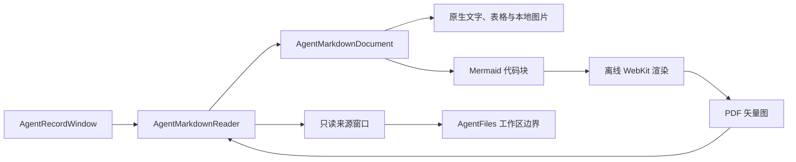
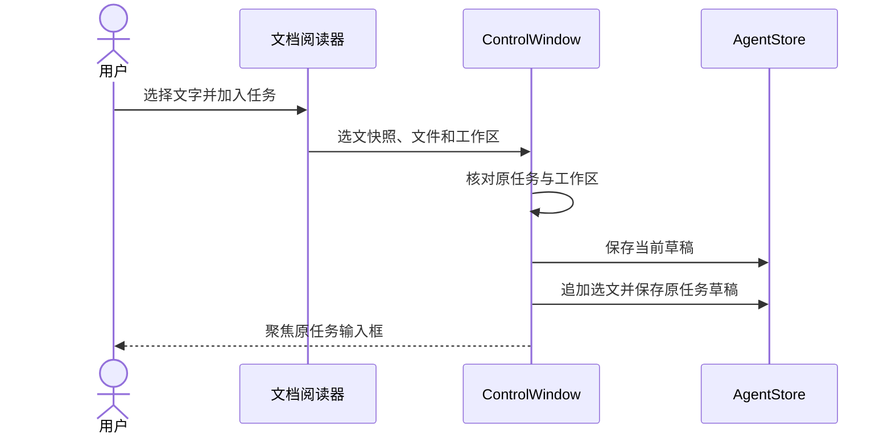

# 图表与选文

任务记录的 Markdown 产物和 Wiki 使用原生阅读器。预览中的 Mermaid 图表由随应用打包的渲染器绘制，双击可在独立窗口缩放；原文保留完整代码。

## 文档打开流程

## 选文加入草稿

选中文字后点击“加入任务”，内容以文件路径和引用形式追加到该文档所属任务的草稿。切换到其他任务后再加入，仍回到原任务；其他任务的草稿会保存。此操作不会发送消息，也不会修改文档。

## 阅读边界

图片与文档链接沿用工作区文件工具的边界。图表不访问网络或本地文件，也不能调用应用工具。每页最多预览16张图表，单张源码最多32KB、500条边；超限或语法错误可切换原文检查。选文最多16KB，合并后的任务草稿最多100KB。

## 预览编辑

在任务记录中点击“编辑”，再点击正文、标题、代码块或表格单元格，就能在原位置编辑该块的 Markdown，其余内容保持预览。Command+Return 完成当前块，Esc 取消当前块，Tab／Shift+Tab 切换相邻单元格。“完成”回到阅读；“保存”才会写入文件。

| 对象 | 修改范围 | 文件 |
| --- | --- | --- |
| 正文或代码块 | 当前块的 Markdown | 保存后写入 |
| 表格单元格 | 当前单元格 | 保存后写入 |
| 只读来源 | 不可编辑 | 保持不变 |

编辑表格时，选中单元格后使用“表格”菜单插入或删除行列，并设置当前列的左／中／右对齐。表头不能删除或在其上方插入行，最后一列不能删除。Command+Z 撤销，Shift+Command+Z 重做；这些操作先保留为草稿，点击“保存”才写入文件。

正文与单元格共用同一份原文草稿；单元格中的竖线自动转义，换行写为 ` `。未修改的源码、表格对齐与外围空白保留。原文切换、离开文档和保存前都会收取正在编辑的内容；文件在外部变化时保留草稿并阻止覆盖。只读文件、运行中的任务和超过编辑上限的文件不能进入预览编辑。

参见[开发说明](DEVELOPMENT.md)。

## 保存冲突

磁盘文件在外部变化后，正常保存会保留草稿并打开比较窗口，也可从记录窗口点击“比较”。“差异”并排显示修改与行号，“全文”显示两份完整原文及各自的编码、文件标记和换行格式。

“继续编辑”保留草稿；“采用磁盘版本”需确认放弃草稿；“覆盖文件”需确认，并将被覆盖的磁盘版本保留在任务修改检查点。比较后文件或草稿再次变化时，原选择失效，须刷新比较后重新确认。文件不可读、超限或无法按当前编码无损读取时保留草稿，不提供覆盖。

## 编码重开

阅读器的“编码重开”可选择 UTF-8、UTF-16／32 的大小端、GB18030、Big5、Shift JIS、Windows-1252 和 ISO-8859-1。自动模式只识别 Unicode 文件标记及 UTF-8，不猜测其他编码。选择编码只会重读文件，不会转换或改写磁盘内容；未保存的修改需先确认。

编辑后按打开时的编码、文件标记和原有换行写回。出现该编码无法表示的文字时，保存被阻止，草稿保留。来源窗口始终只读，编码选择不会扩大工作区或工具权限。文件工具可显式传入编码，读取返回行号，精确替换保留原格式。

## 视频预览

MP4／WebM 产物与文件来源在记录窗口内播放，Markdown 中的工作区视频链接可打开独立播放器。使用系统 WebKit 播放控件，不自动播放；支持暂停、进度拖动和系统播放控制。点击“刷新”读取最新原件，切换文件或关闭窗口时停止播放。“新窗口”暂停原来的播放器，再打开独立窗口。

预览只读取工作区内的普通文件，使用私有的只读副本，不修改或上传原视频，不开放视频编辑和原生工具。原件在打开期间变化会要求刷新；不读取工作区外链接或敏感路径。单份预览限500MB；系统不支持文件编解码或无法播放时，可选择“系统打开”。
