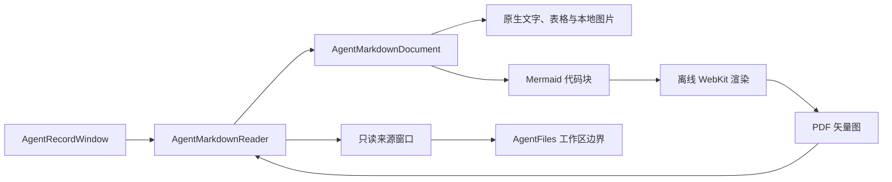
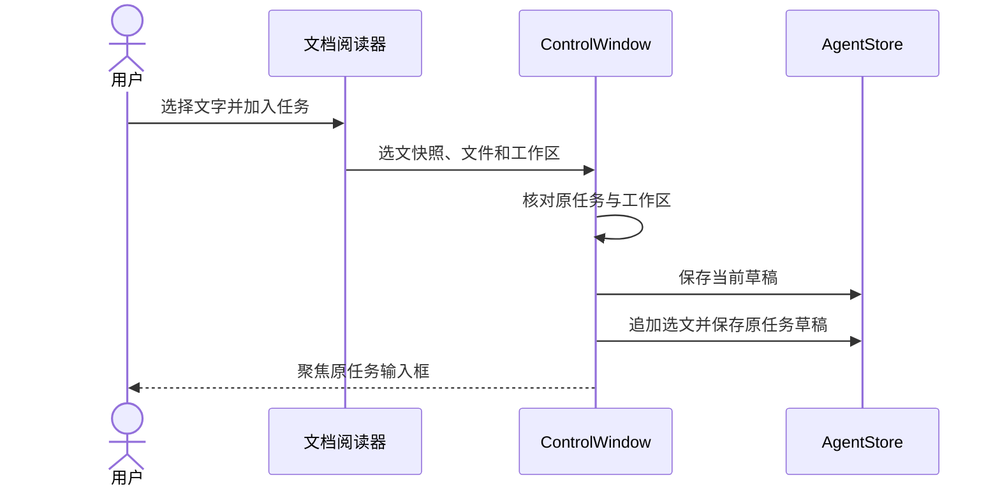
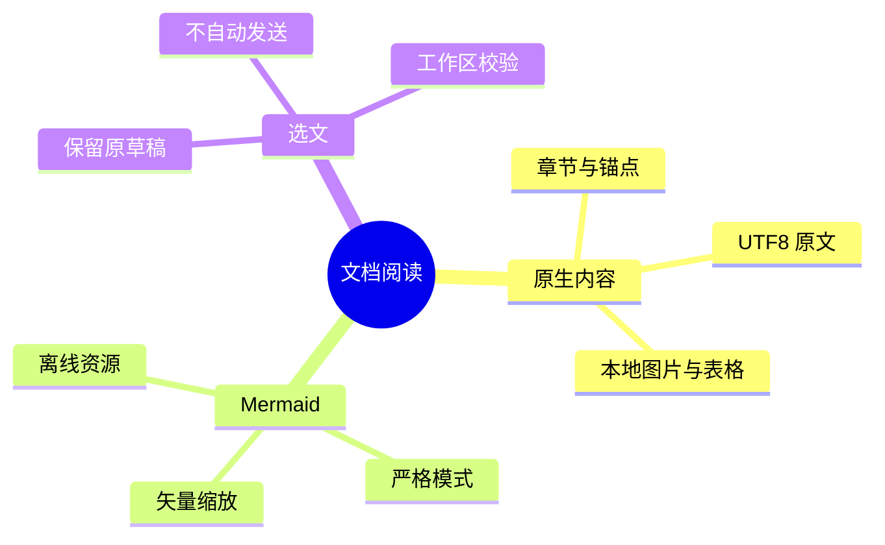

# 图表与选文

任务记录的 Markdown 产物和 Wiki 使用原生阅读器。预览中的 Mermaid 图表由随应用打包的渲染器绘制，双击可在独立窗口缩放；原文保留完整代码。

## 文档打开流程

## 选文加入草稿

选中文字后点击“加入任务”，内容以文件路径和引用形式追加到该文档所属任务的草稿。切换到其他任务后再加入，仍回到原任务；其他任务的草稿会保存。此操作不会发送消息，也不会修改文档。

## 阅读边界

图片与文档链接沿用工作区文件工具的边界。图表不访问网络或本地文件，也不能调用应用工具。每页最多预览16张图表，单张源码最多32KB、500条边；超限或语法错误可切换原文检查。选文最多16KB，合并后的任务草稿最多100KB。
