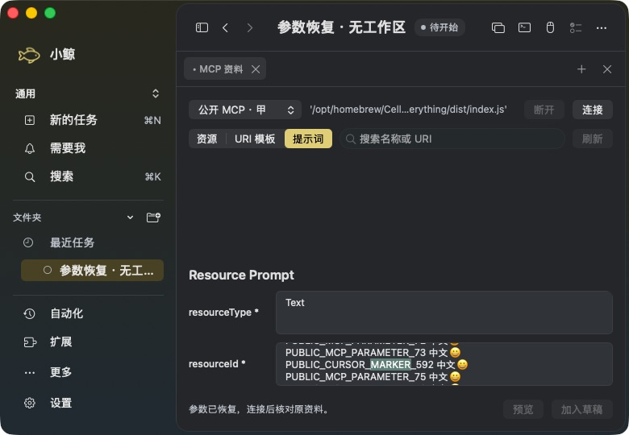
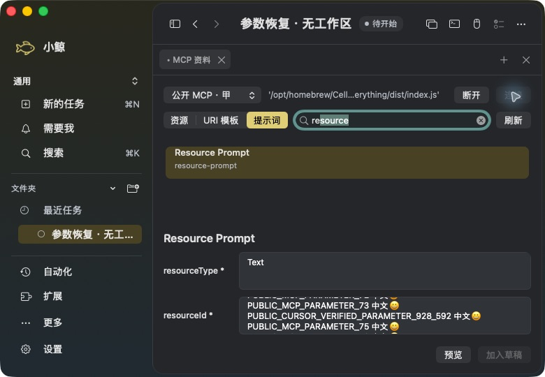
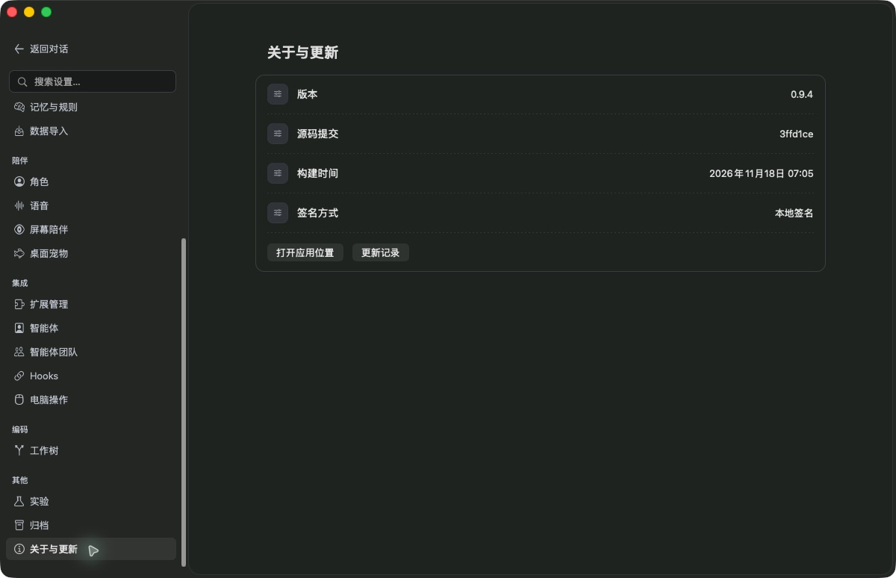

# P0 逐页界面验收台账

## 2026-11-23 任务监控阅读位置和展示恢复

- `8373998` 让任务监控按原窗口和任务保存当前分组、展开全文及折叠状态。手动选择的固定、浮动或隐藏也会读回。上方增加内容后仍从原分组续读，固定与浮动之间切换时沿用同一处阅读位置。
- 实窗在 **780×540 深色**主窗展开任务目标、折叠计划并停在「计划」，在第二扇窗的浅色浮动面板收起目标并停在「产出」。新进程恢复两个窗口各自的阅读位置，以及浮动面板的原位置和尺寸。主窗放大至 **1320×800 深色**后仍对齐「计划」，明确关闭监控的另一任务保持关闭。
- 最终同包通过 **20 项监控恢复实窗检查、5 项独立核对、113 项监控回归和 40 项工作区存储检查**。只读恢复文件的原字节、原任务草稿和 8 份公开样例已核对，模型请求 **0 次**。首轮浮动监控在父窗口显示前发起恢复的失败记录继续保留。
- 日用版 **0.9.4 `8373998`** 已本地签名安装并正常重开。实际进程 **50356**，构建时间 **2026-11-23 17:29（北京时间）**。新包和 `55e23de` 备份各核对 229 份文件，14 份正式资料内容及权限一致。实窗截图和运行核对见 `evidence/agent/task-monitor-reading-y7ql05z5/acceptance-index.json`。

## 2026-11-23 Markdown 图表页内缩放与续读

- `55e23de` 将 Mermaid 图表放大预览放入原文档的阅读区。双击图表或选中后按回车进入，页首提供缩小、放大、适合窗口和返回。返回后可接着读原段落及选区。[阅读指南](AGENT-READING.md)
- 同一份项目流程图在 **780×540 深色**实窗双击打开、放大至 **127%** 并横向平移。切到另一条任务后退出，从新进程在 **1320×800 浅色**实窗恢复原图和位置。回到原文后按回车可打开另一张图。独立核对了图形像素、Markdown 文件和任务草稿。
- 图表专项通过 **18 项实窗检查、5 项独立核对**。同包的原文、段落及表格恢复通过 **76 项原生检查、7 项独立核对**，模型请求 **0 次**。首轮图形截图空白、混合样例的旧浮窗位置失败和旧包表格选区的首轮失败均保留在验收目录。
- 日用版 **0.9.4 `55e23de`** 已本地签名安装并正常重开。实际进程 **48212**，构建时间 **2026-11-23 17:12（北京时间）**。新包和 `8377631` 备份各核对 229 份文件，14 份正式资料内容及权限一致。实窗原图、源码及运行核对见 `evidence/agent/markdown-inline-diagram-y2xlxb2n/acceptance-index.json`。

## 2026-11-23 任务画布批注续编

- `8377631` 将任务内画布的「批注」打开在原画布标签的右侧子页。框选、箭头、画笔、缩放和补充要求都在页内操作，取消或添加后回到画布预览。
- 无工作区问答任务在 **780×540 深色**实窗圈出公开样例中的按钮。切到另一张画布并正常退出，从新进程在 **1320×800 浅色**实窗打开原标签，恢复原截图、红框、备注和实际键盘选区。待添加的批注在标签载入前已显示未保存点。
- 画布源码变化后，「添加到对话」仍将批注时截取的原版本附到所属任务草稿。独立核对了任务归属、来源版本和四边像素。画布 **48 项实窗检查、36 项独立核对**，共用的网页标注 **53 项回归检查、8 项独立核对**均通过。模型请求 **0 次**。
- 日用版 **0.9.4 `8377631`** 已本地签名安装并正常重开，实际进程 **43954**，构建时间 **2026-11-23 16:40（北京时间）**。新包和 `225a88c` 备份各核对 229 份文件，14 份正式资料内容及权限一致。两张实窗原图、导出附件和运行记录见 `evidence/agent/canvas-inline-annotation-uRJ4ItDM/acceptance-index.json`。

## 2026-11-23 网页元素点选标注

- `225a88c` 在任务浏览器的标注页加入「元素」。从截图中点选可见标题、按钮或链接时，自动画框并显示名称。截图前后核对页面和元素位置，布局变化时仍可手绘；相同元素重复点选只生成一个标注。附到对话后，原截图、来源网址、框线、元素名称及类型随草稿附件保存。[Qoder 内置浏览器](https://docs.qoder.com/zh/qoder/browser)
- 同一本机库存页在 **780×540 深色**和 **1320×800 浅色**实窗核对。初版右侧窄栏压缩工具名称，最终按面板宽度分行，四种工具均可辨认。测试服务读回三种可见元素，点击测试链接的截图标注时未收到跳转请求。独立比对原图与导出图，四边均落在实际链接边界。
- 独立进程重开恢复原截图、位置、元素工具、框线和说明，并将标注一次加入原草稿。原手绘格式可在新版读回，含元素字段的恢复记录由新版续读。**53 项原生检查、8 项独立流程核对**及像素核对通过，模型请求 **0 次**。
- 日用版 **0.9.4 `225a88c`** 已本地签名安装并正常重开，实际进程 **40127**，构建时间 **2026-11-23 16:12（北京时间）**。新包和 `602e888` 备份各核对 229 份文件，14 份正式资料内容和权限一致。实窗原图、附件及运行证据位于 `evidence/agent/browser-element-annotation-Lfh42Bt1/acceptance-index.json`。

## 2026-11-23 连接器工具目录

- `602e888` 将工具搜索和数量固定在连接器设置右侧，按工具名或说明筛选。折叠时显示一行用途，展开后可选择完整说明和参数，清空筛选保留原展开项。列表采用分隔线和独立的参数区，沿用设置页的原生交互。
- 同一 Microsoft Learn 实际目录在 780×540 深色实窗完成说明筛选、参数末尾滚动和清除，搜索短语和工具数量保持可见。1320×800 浅色实窗读回 3 项工具、检查无匹配与断开状态。Qoder 0.5.2 的 1320×800 浅色目录原图用于核对行内用途和分隔关系，对照原图为 Office 工具。初版搜索框过窄，最终包已复验。[目录参考](QODER-UI-SPEC.md)
- 同包通过 **502 项设置检查**，其中连接器配置 **44 项**，覆盖长说明、筛选、展开状态和滚动边界。两次最终实窗的模型请求 **0 次**。日用 0.9.4 已安装并正常重开，实际进程 37777，源码 `602e888`，构建时间 2026-11-23 15:44（北京时间），本地签名。新包与 `c35d78b` 备份各核对 229 份文件，14 份正式资料内容及权限一致。索引位于 `evidence/agent/mcp-tool-catalog-Sd2WEppy/acceptance-index.json`。

## 2026-11-23 公开远端 HTTPS 连接器

- 隔离验收包使用 `c35d78b` 的连接器实现。1200×744 深色设置实窗点击「连接」，从 Microsoft Learn 的公开 Streamable HTTP 服务读回「已连接」及 3 个实际工具，展开搜索工具核对 `query` 参数。此服务无需登录或填写凭据。[Microsoft Learn 接入说明](https://learn.microsoft.com/en-us/training/support/mcp-developer-reference)
- 无工作区的 Agent 任务使用逐次确认模式，核对连接和调用的审批要求后，读取实际参数并执行文档搜索、正文读取。搜索返回 Azure Blob Storage 的官方页面，正文与直接访问的官方网页均确认其对象存储用于非结构化数据。搜索结果触及应用的 20,000 字符上限，仍包含目标来源。已核对其他任务无法复用连接，断开后连接失效。[Azure Blob Storage 概述](https://learn.microsoft.com/en-us/azure/storage/blobs/storage-blobs-overview)
- **17 项检查通过**，14 份正式资料的内容及权限核对一致，模型请求 **0 次**。账号授权、系统钥匙串和更多远端服务继续列在 P1-06。应用进程、原图、真实响应和首次窗口检查记录位于 `evidence/agent/mcp-public-https-uUgGe0ng/acceptance-index.json`。

## 2026-11-23 Excel 编辑区明暗外观

- 旧版在深色窗口仅更新了备注侧栏，工具栏、公式栏、标签和折叠菜单仍使用浅色。`c35d78b` 将这些控件及单元格编辑框纳入应用外观。780×540 实窗核对了菜单边界、最低项可达、输入焦点、取消编辑和锁定样式。切换过程保持 B3 原公式和备注草稿选区。[编辑器工具栏接口](https://docs.betteroffice.dev/docs/javascript#compose-the-xlsx-toolbar)
- 同一份含两色单元格和两组柱形的公开工作簿用于改前、改后对照。780×540 与 1320×800 下，分别核对明暗切换及改版前后的工作表像素，颜色和画布指纹逐项一致。样例原文件字节一致。候选通过 **14 项外观检查、31 项富文本备注回归及 10 项独立文件核对**。Qoder 同内容外观对照待补。
- 日用版 0.9.4 已安装并正常重开，关于页读回 **`c35d78b`／2026-11-23 15:09（北京时间）／本地签名**，正常进程 32696。原对话、未发送草稿和模型预算 8192／512 已读回。新包及 `063503f` 备份各核对 229 份文件，14 份正式资料内容及权限一致，模型请求 **0 次**。同一工作簿和原图索引位于 `evidence/agent/xlsx-editor-appearance-w2knxrkz/acceptance-index.json`。

## 2026-11-23 Excel 备注主题色与日用更新

- 同一份公开工作簿的「审阅」E35 使用直接 RGB 和自定义主题强调色。旧版按普通文字显示主题色段落。`063503f` 从工作簿关系定位自定义主题并计算色调，浅色预览独立读回 `175A9E` 和 `89451B`。深色续写和保存后再开仍显示两段颜色。十三个配色样例覆盖浅色／深色索引、系统颜色、正负色调、无效索引、直接 RGB 及主题文件缺失。[工作簿主题色](https://learn.microsoft.com/en-us/dotnet/api/documentformat.openxml.spreadsheet.colortype.theme?view=openxml-3.0.1) · [色调计算](https://learn.microsoft.com/en-us/dotnet/api/documentformat.openxml.spreadsheet.colortype.tint?view=openxml-3.0.1)
- 同包通过 **31 项富文本检查、22 项普通备注检查和 18 项独立核对**。续写、撤销、改格和保存后重新读回，备注的 `theme`、`tint` 和字体属性、主题文件、绘图及表格均通过核对。工作簿关系文件重新序列化，五条关系的标识和目标逐项一致。舍入断言的首轮失败及修正过程均保留。Microsoft Excel 客户端交叉验证待补。
- 日用版已安装并重开，关于页读回 **0.9.4／`063503f`／2026-11-23 14:47（北京时间）／本地签名**，正常进程 30074。实窗核对原对话、未发送草稿、两类归档空态及模型预算 8192／512。新包与 `a30ee3c` 备份各核对 229 份文件及签名，14 份正式资料的内容及权限一致，模型请求 **0 次**。工作簿、前后截图和交付索引位于 `evidence/agent/excel-note-theme-ldhgswjx/acceptance-index.json`。

## 2026-11-23 归档空态与明暗对照

- Qoder 0.5.2 与小鲸候选 `4204861` 均记录 **1320×800** 明暗两色的空任务归档。Qoder 的搜索和项目选择器在空态上方，清理按钮置灰。对照后已从外观页读回原「浅色／森林」并返回原草稿。
- 日用 `a30ee3c` 的空列表仍显示滚动条和底部三个灰置操作。候选的任务与工作区归档共用设置空态卡片，操作随结果出现。780×540 实窗核对搜索无结果、原项目范围、直接清除搜索，以及恢复最后一项后的键盘焦点。两窗口跨启动位置和旧版读回通过，批量确认在预览后取消。
- 同包通过 **29 项归档检查、372 项设置布局检查**及 **11 项独立核对**。14 份正式资料内容及权限一致，真实模型请求 **0 次**。归档空态已随 `063503f` 安装并从真实设置入口读回。整页原图、双方版本及恢复记录位于 `evidence/agent/archive-empty-iQogzn/acceptance-index.json`。[日用交付](#2026-11-23-excel-备注主题色与日用更新)

## 2026-11-23 归档筛选与日用换版

- 同一批 13 条归档样例中，旧版从主目录生成筛选，选中后显示 0 条。新版按任务实际归属显示预期的 10 条项目任务，区分同名工作区、同目录的编程与通用，以及无工作区任务。780×540 深色窗口的筛选和底部操作固定可见，1320×800 浅色窗口的单条列表随内容定高。
- 批量清理预览只列出当前范围的 10 条，预览后取消。实际恢复只作用于选定的一条通用任务，另外 14 份样例任务及源文件校验一致。两扇窗口分别恢复筛选、选中行、滚动和搜索选区，中途用旧版 `ae159dd` 打开同一份布局后仍能恢复。
- 同包通过 **23 项归档检查、372 项设置布局检查、40 项恢复存储检查**及 **11 项独立核对**。真实模型请求 **0 次**。与 Qoder 的同主题整页对照及物理触控板手势继续跟踪。
- 日用版安装并正常重开，关于页读回 **0.9.4／`a30ee3c`／2026-11-23 14:14（北京时间）／本地签名**。首次进程 23375 退出后，进程 23861 回到原对话和输入框。已查看归档空态、扩展与连接器、任务详情的上下文和模型预算 8192／512。新包与旧版 `02b91b9` 备份各核对 229 份文件及签名，安装和重启前后 14 份正式资料的内容及权限一致。过程及备份索引位于 `evidence/agent/archive-scope-0473w3yV/acceptance-index.json`。

## 2026-11-22 任务详情排版与阅读续接

- 候选 `ae159dd` 将上下文、任务回顾和请求记录统一为任务右侧的阅读页。估算与累计用量分组，保留历史缺失用量、未完成回执和长模型名。可用操作固定在页底，请求记录释放了空操作区。
- 对同一份 30 条公开回执和 8192／512 上次请求估算保留改前、改后原图。780×540 深色的请求记录滚到 760 pt，页签往返后旧逻辑回到顶部，新版保持在 760 pt。1320×800 浅色核对了分栏、估算、已报告用量和禁用提示。追加一条公开回执时，当前旧回执和它的页内位置保持。
- 两扇原窗口分别恢复请求记录、任务回顾的位置及无工作区问答的「上次请求」选择。中间用旧版 `111d134` 打开并正常退出，同一份窗口布局仍可用。明确关闭后只清除原标签，新开显示默认视图，原任务字节和公开源文件一致。
- 同包通过 **26 项详情检查、143 项工作区检查、40 项恢复存储检查**及 **12 项独立核对**。真实模型请求 **0 次**，14 份正式资料校验一致。日用候选已本地签名并核对 229 份文件，当前运行 `02b91b9`。日用换版及 Qoder 同内容整页对照待验。截图和过程索引位于 `evidence/agent/context-inspector-rsZ82FBu/acceptance-index.json`。

## 2026-11-22 工作区设置跨启动续编

- 候选 `111d134` 恢复原窗口和任务中的工作区／文件夹表单，保留名称原文、图标、颜色、源文件夹顺序、主要目录、文字选区和滚动位置。主窗口的编程任务和独立窗口的通用任务可分别续编。通用窗口取消后回到原「需要我」页面。
- 实际用两个版本依次打开同一独立资料。旧版 `bdc2dac` 正常恢复两扇任务窗口，之后新版读回原草稿。1320×800 浅色核对了含中文和表情的原选区，780×540 深色核对了长表单滚动和底部保存提示。
- 离线和同路径替换的源目录均被拦截。接回原目录后，名称校验和显式保存成功。另一窗口已保存的新配置获得保护。保存或取消后再次启动，已处理的编辑页均已清除。原任务和源文件字节通过独立核对。
- 同包通过 **26 项恢复、55 项工作区编辑、56 项命名、63 项 Git 远端原生检查**及 **11 项独立读回**。真实模型请求 **0 次**，14 份正式资料校验一致。日用候选已本地签名并核对 229 份文件，当前运行 `02b91b9`，换版待验。窗口图、按阶段结果和日用包校验见 `evidence/agent/workspace-editor-recovery-iRCpXrot/acceptance-index.json`。

## 2026-11-22 工作区设置右侧页面

- 候选 `bdc2dac` 从任务侧栏的「编辑工作区／文件夹」进入右侧页面。名称、图标和颜色与源文件夹分组。返回保留侧栏和原任务，错误及保存操作固定在底部。切换任务或关闭窗口时，可选择继续编辑当前草稿。
- 同一双目录样例保留 780×540 深色和 1320×800 浅色的改前、改后图。旧弹窗在权限错误后高 482 pt，超出预留的 476 pt。首个右侧页面宽窗缩到 1136 pt，修正内容列约束后保持目标窗口尺寸。窄窗已验收到达第 16 个源文件夹、识别同名来源、设为主文件夹及移除后再保存。
- 只读失败显示中文写入权限提示。恢复权限后从原草稿保存。原任务的源目录范围和草稿通过文件读回，新任务使用已保存配置。从列表移除的源目录仍在磁盘。
- 同包通过 **59 项原生工作区编辑、8 项独立读回及 56 项命名检查**。模型请求 **0 次**，14 份正式资料前后校验一致。日用候选已本地签名并核对 229 份文件，运行中的日用为 `02b91b9`。日用换版及 Qoder 同内容对照仍待实窗验收。索引位于 `evidence/agent/workspace-editor-page-YH3SL7bl/acceptance-index.json`。

## 2026-11-22 Codex 月度计划导入与运行

- 候选 `2c4cefa` 可从设置中的「数据导入」读取 Codex 月度规则，保留时区、隔月条件、月内序号、运行次数和到期时间。来源启用的计划以暂停状态保存。自动化页可选择「每月」并编辑规则，预设有每月 1 日、最后一天和最后一个工作日。工作日预设按周一至周五计算。[iCalendar 重复规则](https://www.rfc-editor.org/rfc/rfc5545#section-3.3.10)
- 780×540 深色与 1320×800 浅色窗口核对了月内规则、预设及下次运行。无起始限制时可按需设置开始时间。无效规则保留原定义和编辑内容，独立重开后恢复原窗口、焦点和选区。
- 本机样例在 10:44（北京时间）由计划触发。次数用尽后自动暂停，重新启动调度器仍可读回同一条完成记录。月度流程通过 **16 项原生与 5 项独立读回检查**，另通过 **32 项导入、59 项自动化页、31 项会话草稿和 25 项跨版本恢复检查**。普通草稿由旧版读取后可用新版继续。月度规则从自动化页设置。
- 最终候选使用 1 次本机样例响应，外部模型请求 **0 次**。14 份正式资料前后校验一致。日用候选已本地签名并核对 229 份文件，日用仍运行 `02b91b9`。会话绑定、工作树和云端计划、其他复杂规则与来源运行记录继续跟踪。索引位于 `evidence/agent/monthly-automation-vLx0NzUL/acceptance-index.json`。

## 2026-11-22 PowerPoint 编辑区明暗外观

- 候选 `d54eff0` 让工具栏、缩略图栏、幻灯片周边、演讲者备注和「更多」菜单跟随窗口明暗。深色使用统一分隔、选中态及焦点描边。沿用原编辑器的工具栏和菜单操作。[工具栏说明](https://docs.betteroffice.dev/docs/javascript#compose-the-pptx-toolbar)
- 以同一份两页 PPTX 留存 780×540 深色改前和改后图。780×540 与 1320×800 两种窗口均验收明暗切换，单一尺寸下读取的幻灯片像素一致。实测窄窗批注草稿、选区和焦点保留，备注可辨认焦点和只读态，「更多」菜单可滚到末项。源 PPTX 哈希在外观流程前后一致。
- 同包通过 **17 项外观检查**、**66 项 PowerPoint 批注检查**和 **51 项 Office 恢复回归**。模型请求 **0 次**，14 份正式资料前后校验一致。日用候选已本地签名并核对 229 份文件，当前日用版为 `02b91b9`。Qoder 同主题对照及日用换版待验。索引位于 `evidence/agent/pptx-editor-appearance-1PCKxBPO/acceptance-index.json`。

## 2026-11-22 旧版 PowerPoint 批注回复

- 候选 `c5cbba3` 支持在旧版格式的 PPTX 直接回复。两条作者、时间及正文均相同的批注仍可分别选择。回复按原作者编号和批注编号挂接，保留旧版批注格式。[Microsoft 批注扩展](https://learn.microsoft.com/en-us/openspecs/office_standards/ms-pptx/f1ad49e1-9f7d-404b-a295-6b02bedb7c36) · [父批注编号](https://learn.microsoft.com/en-us/openspecs/office_standards/ms-pptx/db7e8969-80af-4891-bc49-4d2111bfd82c)
- 三次独立启动完成编辑、恢复、保存和读回。780×540 深色窗口先回复第二条批注，再留下未发送的草稿。退出时原件哈希一致，恢复附件已带有第一条回复。重开恢复第二条批注、页码、草稿选区及焦点。继续提交后，另在第 1 张幻灯片新建批注，并在首次保存前回复它。
- 最终 PPTX 独立读回核对了三个新回复的父批注编号、中文多行、原回复、幻灯片正文和图片。恢复附件同样核对了第一条回复的挂接，未发送文字只在草稿中。同包通过 **66 项 PowerPoint 检查**，其中旧版回复流程 **24 项**，另通过 **51 项 Office 恢复回归**。
- 模型请求 **0 次**，14 份正式资料前后校验一致。日用候选已本地签名并核对 229 份文件，当前日用版为 `02b91b9`。Microsoft PowerPoint 客户端交叉验证、日用换版及编辑区深色样式继续跟踪。索引位于 `evidence/agent/pptx-legacy-replies-sJiEMn7n/acceptance-index.json`。

## 2026-11-22 PowerPoint 幻灯片批注

- 候选 `d8e31ee` 在任务内打开 PPTX 后，可从「批注」进入右侧面板。点击批注定位原幻灯片，也可在当前页新建批注。现代批注支持回复、解决和重新打开。旧版批注及已有回复可查看和保留，可在原格式新建批注。
- 用同一份两页样例核对 1320×800 浅色展开窗口和 780×540 深色窗口。两个尺寸的页码均单行显示。窄窗重开后恢复第 2 张、未发送回复、选区和输入焦点。提交一组批注并保存时，另一条未发送回复可在下一次启动继续编辑。深色覆盖右侧批注面板，编辑区深色样式继续跟踪。
- 同包通过 **53 项 PowerPoint 批注检查**和 **51 项 Office 恢复回归**。独立读取三份保存后的 PPTX，核对幻灯片关系、作者、回复挂接、解决状态、旧格式及原幻灯片文字、对象和图片。现代批注的幻灯片关联按照 Microsoft 的文件格式补齐。[PowerPoint 批注文件结构](https://learn.microsoft.com/en-us/office/open-xml/presentation/how-to-add-a-comment-to-a-slide-in-a-presentation)
- 模型请求 **0 次**，14 份正式资料前后校验一致。日用候选已本地签名并核对 229 份文件，正在运行的日用版为 `02b91b9`。日用换版、旧版批注新增回复及 Microsoft PowerPoint 客户端交叉验证待完成。Mac mini 的桌面连接启动失败，Qoder 深色对照待补录。索引位于 `evidence/agent/pptx-review-K9LKiJ9w/acceptance-index.json`。

## 2026-11-22 设置侧栏缩窗与续读

- 候选 `67bbb1a` 会在进入设置时定位当前分类。已完整显示的选中行因缩窗被遮住时，侧栏滚动到该行。手动滚离选中行后，刷新和缩窗保持滚动位置。
- 在 780×540 窗口逐项检查 **23 个分类**。Hooks 和扩展管理均覆盖 1320×800 缩至 780×540，Hooks 还覆盖搜索跳转及回到设置。搜索框与返回入口留在原位，右侧仍是原页面。保留同尺寸 Hooks 改前与改后图，以及 Hooks 和 Skill 审阅窄窗图。
- 同包通过 **372 项设置布局、497 项管理页、22 项设置导航跨进程检查与 45 项 Skill 创建检查**。三个独立进程核对 522 pt 的手动侧栏位置、原搜索焦点、Hooks 草稿和自动化返回路径的保存及读回。模型请求 **0 次**，14 份正式资料前后校验一致。
- 日用候选已本地签名并核对 229 份文件，当前日用为 `02b91b9`。日用换版及 Qoder 同主题对照待验。索引位于 `evidence/agent/settings-category-visibility-7JV5HRN0/acceptance-index.json`。

## 2026-11-22 Hooks 团队与 Skill 右侧审阅

- 候选 `05dc865` 统一 Hooks 启用、团队模板和 Skill 草稿的设置审阅页。右侧使用一个页头，操作随设置页头固定。多条目宽窗并排，窄窗使用选择器切换，切换回原角色或文件时恢复阅读选区。
- 同样的 420 pt 审阅内容区，团队正文宽度由 **192 pt** 增至 **388 pt**。应用窗口渲染覆盖 780×540 深色和 1320×800 浅色。用 48 行公开 Hooks 输入核对末项可达和取消回原处理器。团队模板进入编辑页后显式保存，Skill 名称无效时保留原预览及输入，修正后创建并读回两个文件。
- 同包通过 **497 项设置检查、45 项 Skill 创建检查和 68 项 Skill 自进化检查**。设置检查含 10 项实际工作台专项核对；共保留四张窗口图。模型请求 **0 次**，14 份正式资料前后校验一致。
- 日用候选已本地签名并核对 229 份文件，当前日用为 `02b91b9`。桌面连接仍无法启动，日用换版及 Qoder 同主题对照待验。本批窄窗图中的侧栏遮挡问题已在「设置侧栏缩窗与续读」复验。索引位于 `evidence/agent/settings-review-reader-xjbRK68A/acceptance-index.json`。

## 2026-11-22 需要我恢复与旧版回退

- 旧版 `02b91b9` 拒绝带有「需要我」字段的窗口布局，隔离副本无法读回原编辑器。候选 `6a4e0ef` 将阅读位置独立保存。已有嵌入记录先保存独立副本，再更新窗口布局。答复正文仍由原草稿文件保存。
- 新版迁移与旧版回退各通过 **16 项窗口检查**，读回两个窗口、原任务标签和未保存编辑。旧版运行前后独立的阅读位置文件校验一致。窗口布局有变化时，新版先显示该窗口的原任务，进入「需要我」后恢复原事项及答复选区。
- 同包通过 **36 项收件箱恢复检查、7 项独立核对、40 项存储检查及 61 项收件箱回归**。只读或未知的独立位置文件得到保留，原窗口布局仍可读取。模型请求 **0 次**，14 份正式资料前后校验一致。
- 日用候选已本地签名并核对 229 份文件。Mac mini 桌面连接启动失败，日用仍运行 `02b91b9`，Qoder 深色截图待补录。索引位于 `evidence/agent/attention-layout-rollback-bdiH4BzI/acceptance-index.json`。

## 2026-11-22 需要我双窗口草稿冲突

- 用两条独立的待答复事项复现原版的跨窗口覆盖与旧稿发送。候选 `034bd4f` 在保存和发送之前核对已保存稿。出现变化时，同页上方显示可选取的已保存稿，下方保留本窗口输入及选区。可查看原问题、载入已保存稿，或核对并合并后显式保存本窗口稿。
- 审阅期间再次写入会刷新已保存稿，等待用户重新选择。已在 **780×540 深色**和 **1320×800 浅色**窗口核对，两种尺寸的提示均在选择按钮旁。窗口内未解决的编辑保留在原事项。
- 同包通过 **14 项窗口检查、5 项独立核对和 111 项相关回归**。真实本机问题只记录一次明确提交的新版答复，并清除该条草稿。另一条问题仍待处理，合并后的原草稿可读回。模型请求 **0 次**。
- 日用候选已签名并核对 229 份文件，当前日用为 `02b91b9`。14 份正式资料内容与权限一致。验收索引位于 `evidence/agent/attention-draft-conflict-vlXcdd2p/acceptance-index.json`。

## 2026-11-22 需要我跨启动续读

- 候选 `ece78c5` 按窗口恢复「待关注」和「历史」各自的筛选及搜索，记住原事项、列表位置、正文和答复的选区、滚动与焦点。答复沿用原草稿文件，窗口存档保存位置和校验值。
- 两扇窗口正常退出重开。780×540 主窗口直接读回原事项及深处选区，续写后返回原列表位置。1320×800 的另一窗口先恢复设置页，再从「返回需要我」读回原历史记录、来源、时间、发起者和搜索选区。
- 四个连续的应用进程通过 **28 项恢复检查、6 项独立核对、61 项收件箱回归及 36 项恢复存储回归**。当答复已从另一处更新，读回新草稿并提示核对。当原事项已处理，显示原筛选列表并等待用户选择，独立核对另一条审批继续待处理。原草稿及已更新草稿的独立文件核对见验收索引。模型请求 **0 次**。
- 日用候选已签名并核对 229 份文件，当前日用为 `02b91b9`。14 份正式资料的内容与权限一致。索引位于 `evidence/agent/attention-recovery-FQdcTGct/acceptance-index.json`。

## 2026-11-22 需要我窄窗全宽阅读

- 候选 `eb30499` 在窄窗先显示「需要我」列表。点选事项或按回车后，原工作台内展开全文，保留「打开任务」、答复和处理动作。返回列表恢复筛选、选中项、滚动位置与键盘焦点。切到原任务或设置后返回，可继续读同一条事项。宽窗仍同时显示列表和详情。
- 同样的 800×550 窗口及公开问题，正文宽度由 **281 pt** 增至 **522 pt**。780×540 深色窗口正文宽 **502 pt**，可滚动区高 **136 pt**，答复及处理动作可见。1320×800 浅色窗口保持双栏。三张应用窗口渲染图已核对。
- 同包通过 **61 项原生窗口检查**。答复过长时留在原事项并显示错误，改正后可返回。分别点击允许、拒绝及答复，已独立核对原请求编号和三份处理回执、实际样例文件、父任务未发送的答复，以及已提交的子任务草稿清除。模型请求 **0 次**。
- 日用候选已签名并核对 229 份文件，当前日用为 `02b91b9`。14 份正式资料的内容与权限一致。Qoder 0.5.2 桌面连接启动失败，同内容外观对照及日用换版待验。索引位于 `evidence/agent/attention-reading-OdENNBUF/acceptance-index.json`。

## 2026-11-22 Excel 评论提及

- 候选 `9f18af4` 支持在新建评论和回复中输入 `@`，选择工作簿联系人或完整邮箱。同名联系人显示各自邮箱。草稿重开后可在原单元格和选区继续输入。提交并保存后，选中的提及连同联系人和正文位置写入工作簿，已发布的提及在正文中高亮。
- 1320×800 浅色窗口核对同名候选、键盘选择和修改提及文字后解除关联。780×540 深色窗口核对草稿重开、全角触发、回复选中完整邮箱及已保存提及。窄窗的候选列表在回复框上方打开，评论正文保持原有高度。
- 同包通过 **31 项窗口检查、11 项独立文件核对、76 项相关回归和 30 项回归文件核对**。独立读回核对表情及换行后的提及位置、纯文字 `@`、回复关系、联系人复用和再次保存。旧版兼容记录写入 `xr:uid`，原有工作簿兼容声明保留。[提及记录](https://learn.microsoft.com/en-us/openspecs/office_standards/ms-xlsx/b03ed619-e307-4d3e-9c67-b68612274128) · [兼容标识](https://learn.microsoft.com/en-us/openspecs/office_standards/ms-xlsx/6383f002-c90b-401c-a1d7-66b97b14cb3e)
- 日用候选已签名并核对 229 份文件，当前日用为 `02b91b9`。模型请求 **0 次**，14 份正式资料前后字节及权限一致。Microsoft Excel 客户端交叉验证和云端通知继续跟踪。索引位于 `evidence/agent/excel-comment-mentions-WliNrwng/acceptance-index.json`。

## 2026-11-22 Excel 新建线程评论

- 候选 `e626eb8` 支持在「评论」侧栏从当前单元格新建线程。未提交草稿保留原单元格、正文及选区，重开后可以续写。点击「添加评论」或按 ⌘↵ 后可以继续回复，再显式保存工作簿。当前单元格已有线程时打开原线程，已有备注时提示占用。
- 在尚无线程评论的工作簿中，于含表格、图表和超链接的工作表 F45 创建首条评论，再到「销售」B6 追加。已有线程的样例先在「销售」B6 新建，再到另一张表 F45 新建。均以 1320×800 浅色和 780×540 深色窗口核对草稿定位，保存并重开后读回两条新线程。
- 同包通过 **49 项新建检查、20 项独立工作簿核对及 45 项相关回归**。核对共同作者、首条评论和回复、旧版兼容记录、绘图锚点、跨表关联、原有评论及普通单元格在再次保存后的结果。首轮样例的重复图形编号触发保存保护，原件字节与恢复草稿已独立核对，编号修正后的样例通过追加。[线程评论存储](https://learn.microsoft.com/en-us/openspecs/office_standards/ms-xlsx/66e1875d-c60a-48eb-bf88-41066d45fea8) · [旧版兼容记录](https://learn.microsoft.com/en-us/openspecs/office_standards/ms-xlsx/6383f002-c90b-401c-a1d7-66b97b14cb3e)
- 日用候选已签名并核对 229 份文件，当前日用仍运行 `02b91b9`。模型请求 **0 次**，14 份正式资料前后字节及权限一致。索引位于 `evidence/agent/excel-create-comments-KxXkrA5e/acceptance-index.json`。

## 2026-11-22 Excel 线程评论

- 候选 `f788ea1` 在任务内表格工具栏加入「评论」。侧栏显示既有线程、作者、时间、回复和解决状态。点击可定位单元格，添加的回复以「小鲸」署名，随工作簿显式保存。已解决的线程可以重新打开并继续回复。[Excel 评论线程格式](https://learn.microsoft.com/en-us/openspecs/office_standards/ms-xlsx/e0fb917a-1107-409a-852f-13b47aea70dc)
- 在 1320×800 浅色窗口输入回复，780×540 深色窗口重开读回原选区和焦点。未提交回复保存在工作区，草稿副本和当时的原工作簿字节一致。样例的兼容记录将评论指向 F15。首轮快速切换后表格仍停在 B10，修复后两种窗口的名称框、高亮和侧栏均为 F15。[兼容记录定位规则](https://learn.microsoft.com/en-us/openspecs/office_standards/ms-xlsx/0d3b99e6-9bb2-448c-be6f-f7a97a4ae7e4)
- 同包通过 **27 项线程评论检查、10 项独立工作簿核对、26 项富文本备注回归及 51 项 Office 恢复检查**。独立读取核对两条新回复的作者、时间、父项、解决状态及再次保存后的编号。兼容记录继续存于工作簿，备注侧栏可编辑同表真实备注。
- 日用候选已签名并核对 229 份文件，当前日用仍运行 `02b91b9`。模型请求 **0 次**，14 份正式资料前后字节及权限一致。索引位于 `evidence/agent/excel-thread-comments-4tla9hAq/acceptance-index.json`。

## 2026-11-22 Excel 富文本备注

- 候选 `077c672` 在原备注侧栏直接编辑富文本。选区可加粗、设斜体和加下划线，支持撤销和重做。已有纯文本及新建备注也可加格式。粘贴按纯文本插入并沿用插入处的格式。
- 1320×800 浅色窗口修改「审阅」E35，780×540 深色窗口重开读回原单元格、格式、选区和焦点。续写保留换行及缩进，局部取消斜体后双下划线仍可见。显式保存并再次编辑普通单元格，最终重开读回三条备注。
- 同包通过 **26 项富文本检查、9 项独立文件核对、40 项普通备注回归和 17 项回归文件核对**。独立读回工作簿，逐段核对原作者、字号、字体、颜色、双下划线和原绘图。界面预览显式 RGB，工作簿主题色属性按原值保留。[Excel 富文本格式](https://learn.microsoft.com/en-us/dotnet/api/documentformat.openxml.spreadsheet.run?view=openxml-3.0.1)
- 日用候选已签名并核对 229 份文件，当前日用仍运行 `02b91b9`。模型请求 **0 次**，14 份正式资料前后字节和权限一致。索引位于 `evidence/agent/excel-note-rich-KMDaiqf6/acceptance-index.json`。

## 2026-11-22 Excel 新建单元格备注

- 候选 `26ac775` 在任务内表格的「备注」侧栏加入「新建备注」。按钮使用当前选中的单个单元格。该处已有备注时直接打开原备注。在「销售」B6 新增备注，在带图表、表格和超链接的「首次备注」F45 添加该表的第一条备注。
- 1320×800 浅色窗口输入后正常退出。780×540 深色窗口重开，读回 F45、正文和输入焦点，并定位到原单元格。追加 D200 后显式保存，再更新「销售」C4 并保存。最终重开读回全部修改。
- 同包通过 **18 项新建备注检查、9 项独立文件核对、22 项已有备注回归及 8 项回归文件核对**。独立读取确认备注的正文、作者、单元格、绘图编号和关联，以及原图表、超链接、表格和公式。首轮复现的重复绘图编号已修复。[单元格备注的绘图关联](https://learn.microsoft.com/en-us/dotnet/api/documentformat.openxml.spreadsheet.legacydrawing?view=openxml-3.0.1)
- 日用候选已签名并核对 229 份文件，含 140 份 Office 资源。当前日用仍运行 `02b91b9`。模型请求 **0 次**，14 份正式资料在验收前后的字节及权限一致。索引位于 `evidence/agent/excel-note-create-7gg82gm_/acceptance-index.json`。

## 2026-11-22 Excel 单元格备注

- 候选 `10e2700` 在任务内表格的工具栏提供「备注」。侧栏列出所在工作表和单元格，选中后切到原表并露出单元格。已有纯文本备注可直接编辑，改动随工作区恢复，在文件内显式保存。
- 同一样例分别在「销售」C3 和「审阅」E35 有备注。宽窗编辑后正常退出，780×540 深色窗口重开读回 E35、两行草稿及原选区，网格也能看到 E35。续写后显式保存，再编辑「销售」C4 并保存，最终正常重开读回结果。
- 同包通过 **22 项备注检查、8 项独立核对、51 项 Office 恢复回归**。对恢复附件与最终工作簿独立核对作者、单元格、另一张表的备注、公式、原绘图及自定义资源。模型请求 **0 次**，14 份正式资料的字节与权限一致。
- 日用候选已签名，140 份 Office 资源与验收包一致，当前日用仍运行 `02b91b9`。新建备注、富文本编辑和线程评论继续跟踪。索引位于 `evidence/agent/excel-notes-wu4fwrzu/acceptance-index.json`。[Excel 备注与评论格式](https://support.microsoft.com/en-us/excel/the-difference-between-threaded-comments-and-notes)

## 2026-11-22 基础设置按页保存

- 候选 `c1a8f08` 的模型、语音、角色、屏幕陪伴和桌宠设置分别保存。两扇隔离原生窗口交错保存后，模型预算、音色、角色、观察间隔和动画均按各自操作读回。两个窗口分别修改桌宠置顶和动画，两项均保留。同一角色发生冲突时保留原选区和未提交文字。
- 设置文件只读时两份文件均通过原字节核对。凭据文件只读时恢复设置原字节，页面保留未提交输入；恢复可写后直接重试，只有模型和对话凭据按该次操作更新。共通过 **14 项本批原生检查、7 项独立核对、36 项语音恢复和 72 项未保存设置检查**。模型请求 **0 次**，14 份正式资料的字节和权限一致。
- 780×540 深色窄窗的保存按钮右缘在无反馈、只读错误及成功时均为 **748 pt**。1320×800 浅色角色页的冲突提示及 780×540 深色语音的原选区、冲突提示和禁用保存均已渲染核对。日用候选已签名并核对 229 份文件，当前日用仍运行 `02b91b9`。Qoder 窗口连接失败，深色同内容对照及日用换版待验。索引位于 `evidence/agent/settings-save-scope-wbfvqwuq/acceptance-index.json`。

## 2026-11-22 语音设置草稿续写

- 候选 `f95a45b` 在原窗口恢复接口、模型、音色、唤醒词、开关、停顿和文字选区。已保存的语音设置变化时，底部提示核对，暂时禁用保存。选择「继续使用草稿」后可在原选区继续输入，显式保存只应用语音设置。语音凭据沿用显式保存流程。
- 两扇隔离原生窗口完成正常退出、重开、继续输入、保存和明确放弃。**36 项语音草稿检查、72 项未保存设置检查、6 项独立文件及进程核对**通过。已核对另一窗口的模型及用量设置、凭据文件、任务归属和草稿清除。模型请求 **0 次**。14 份正式资料的字节及权限一致。
- 1320×800 宽窗和 780×540 窄窗保留渲染图。窄窗恢复原选区和选中的「语音」分类，后台任务刷新后仍可阅读冲突提示。日用候选已签名并核对 229 份文件，当前日用仍运行 `02b91b9`。Qoder 窗口连接失败，深色实机对照及日用换版待验。索引位于 `evidence/agent/voice-settings-resume-giy6m5qb/acceptance-index.json`。

## 2026-11-22 工作树全宽审阅

- 候选 `d411a12` 在设置和任务审阅内展开回收、恢复及重新关联。审阅时收起列表和范围选择，长路径换行可复制。回收显示备份范围和受影响任务，恢复将关联任务放在备份记录之前。取消及确认固定在底部。
- 同一套样例在 **780×540** 深色任务窗中，回收正文高度从 **139 pt** 增至 **293 pt**。设置右侧同尺寸为 **311 pt**。取消后原工作树、正文选区、键盘焦点和 119 pt 滚动位置均已读回。明暗两种主题、780×540 和 1320×800 均有原生布局核对，保留四张最终渲染图。
- 最终包通过 **381 项原生检查**和 **8 项独立核对**。本机实际回收和恢复后核对忽略文件、暂存区字节和关联任务。模型请求 **0 次**，14 份正式资料的字节和权限一致。
- 日用候选已核对签名与资源，当前日用仍运行 `02b91b9`。桌面连接恢复后继续做日用换版和 Qoder 同内容对照。索引位于 `evidence/agent/worktree-review-layout-y_jelebv/acceptance-index.json`。

## 2026-11-22 语音创建与中断任务

- 候选 `8dcc6c2` 将开始聆听、停止录音和中断任务分开。识别「新建任务」后沿用当前工作区，支持无工作区，可用「内容是」将口述要求放入待发送的草稿。识别「停止当前任务」后从原任务入口中断执行或结束待确认状态。切换窗口或任务后须重新说出指令，普通转写仍可存入原任务草稿。
- 同包通过 **19 项语音任务检查**和 **72 项未保存设置检查**。使用两扇隔离窗口和一个真实本机任务进程，核对录音启停时继续运行、明确中断后退出、待确认操作、草稿落盘和设置开关读回。另核对 **22 个识别文本样例**和 **5 项独立文件及进程结果**，模型请求 **0 次**。
- 780×540 工作台渲染记录了新任务的待发送草稿。14 份正式资料的字节与权限一致，日用候选已核对签名和资源。当前日用仍运行 `02b91b9`，麦克风实机和日用换版待验。索引位于 `evidence/agent/agent-voice-commands-twlzzrby/acceptance-index.json`。

## 2026-11-22 SSH 终端远程目录

- 候选 `30af041` 从「任务终端 → 新建 SSH 终端」接受可选的绝对路径或 `~/` 路径。项目和无工作区问答均能进入指定目录。分屏继承启动目录，重开后由用户从原标签显式重连。目录缺失会在启动时提示，目录恢复后可从原标签重试。
- 同包 **41 项终端检查、14 项跨启动窗口检查**通过，共完成 **7 次应用回环 SSH 认证**。另以独立 OpenSSH 通过 **4 项**目录检查。原生组件渲染记录了深色表单、缺失提示和浅色重开状态。模型请求 **0 次**。
- 样例服务已关闭，14 份正式资料的字节和权限一致。日用候选签名及资源已核对。当前日用仍运行 `02b91b9`，外部 SSH 主机和日用换版待验。索引位于 `evidence/agent/ssh-terminal-directory-hpkj_zbg/acceptance-index.json`。

## 2026-11-22 项目检索与刷新续读

- 候选 `0f03e2f` 更新「Repo Wiki → 项目 → 检索」。左栏分行显示文件名、目录和行号，悬停可看完整路径。预览右上固定「打开原文」，原文沿当前项目页进入。「重建索引」归入更多操作。
- 780×540 深色及 1320×800 浅色隔离原生窗口检查通过，保留三张项目检索区域渲染图，覆盖长路径、完整操作与来源变化后的禁用和反馈。刷新按原提交查询更新结果，保留未提交的输入和仍存在的选中结果。内容一致时保留正文选区，文件变化后刷新读回实际新版本。检索和更新索引的工具权限均已用各自的示例智能体验证。
- 同包通过 **153 项知识中心页面检查**和 **24 项跨启动检查**，模型请求 **0 次**。核对了查询、原文件、窗口归属、选区、原文阅读位置和旧记录读取。验证范围内 14 份正式资料的字节和权限一致。
- 日用候选签名、执行文件和资源已核对。当前日用仍运行 `02b91b9`，日用换版和同内容 Qoder 对照待验。索引位于 `evidence/agent/project-search-review-tcn1tnqy/acceptance-index.json`。

## 2026-11-22 SSH 扩展配置导入

- 候选 `db41ef2` 接入 Codex 和 Qoder 的规则、指令、命令、智能体及 Hooks。780×540 原生窗口核对了来源、项目目标、跳过原因和导入确认。项目规则保留子目录，Codex 优先选择有效的 `AGENTS.override.md`，带参数提示词保留参数提示。Codex 终端审批策略提示单独配置。
- 两次应用启动共完成 **24 次回环 SSH 认证**，**15 项窗口检查**通过。1320×800 重开后从原批次续导，来源发生变更的规则被拦截。已写入项在来源离线时可恢复。Codex 扩展配置与记忆同批写入，智能体和 Hooks 初始停用。命令 Hooks 保留可执行资源并改写支持的脚本路径，MCP 工具 Hooks 单独导入并要求本机连接器。
- **7 项独立 SSH 检查**核对了指令引用摘要、读取范围、符号链接、受保护资源与凭据遮盖。应用另通过 **32 项本机扩展配置检查**和 **17 项内联 Hooks 检查**，合计 **64 项应用检查**，模型请求 **0 次**。样例 SSH 服务已关闭，14 份正式资料已比对字节和权限。
- 日用候选已做签名校验，执行文件及资源与验收包对应。日用进程仍为 `02b91b9`。外部主机、人工桌面联调和日用换版继续跟踪。索引位于 `evidence/agent/ssh-configuration-import-cvwomhk3/acceptance-index.json`。

## 2026-11-22 SSH 插件导入

- 候选 `8ac2e3a` 支持读取远端插件目录、Codex 版本缓存和指定 ZIP。深色 780×540 原生窗口核对了六类概览、实际勾选、来源、组件预览及首屏确认。Codex 缓存选中 `local` 覆盖版和正式版本，Qoder 的目录约定包和 ZIP 都要求指定本机项目。
- 两次应用启动共 **24 次认证连接**，**13 项 SSH 插件检查**通过。混合批次暂停后按原选择续导，拦截资源已改动的插件。安装的目录包保留嵌套二进制和六类组件。Qoder ZIP 的原始摘要一致，只安装到所选项目。两个包均处于停用状态，本机模板仅保留凭据占位符。
- 独立 SSH 读取验证 **6 项**，覆盖目录资源逐字节核对、隐藏文件跳过、链接和受保护资源拦截、指定 ZIP 和单份资源上限。远端使用已有 Python 3.8 或以上版本，并以系统 Python 3.9 核对 ZIP 路径。应用另通过 **21 项本机插件迁移**和 **15 项 SSH 记忆及类别导航检查**，合计 **49 项应用检查**，模型请求 **0 次**。
- 样例服务已关闭，14 份正式资料的字节和权限一致。签名候选已校验。日用版仍运行 `02b91b9`，外部主机、桌面操作及日用换版待验。索引位于 `evidence/agent/ssh-plugin-import-zF4c5fVY/acceptance-index.json`。

## 2026-11-22 SSH 连接器导入

- 候选 `275871b` 支持 SSH 导入 Codex TOML 及 Qoder JSON。深色 780×540 原生窗口核对了来源、待配置状态和首屏确认。Qoder 项目配置直接输入文件路径时仍要求本机项目，实际只写入所选项目项。验证了 STDIO 待审阅、远端回环地址待填写和普通 HTTPS 地址可直接保留。
- 两次启动共 **15 次认证连接**，**14 项 SSH 连接器检查**通过。混合批次暂停后按原选择恢复，拦截地址已改的连接器。仅轮换凭据值时，原已审阅声明仍可导入。三条已保存连接器均处于停用状态。
- 独立 SSH 原始返回复验了五种情形。测试环境变量、请求头、URL、参数和授权值未出现在返回或本机记录。验证父目录链接拦截和缺少解析组件时的状态。Codex 使用远端已有的 Python 3.11 或以上，Qoder JSON 使用 Python 3.8 或以上，另用系统 Python 3.9 核对直接读取。
- 同包通过 **19 项本机连接器检查**和 **15 项 SSH 记忆与类别导航检查**，合计 **48 项应用检查**，模型请求 **0 次**。样例服务已关闭。14 份正式资料的内容和权限已核对。签名候选已准备。日用仍运行 `02b91b9`，桌面连接启动失败，外部主机与日用换版待验。索引位于 `evidence/agent/ssh-connectors-import-Ht0EWqp6/acceptance-index.json`。

## 2026-11-22 SSH 定时任务导入

- 候选 `14576a4` 在「设置 → 数据导入 → SSH」加入定时任务。深色 780×540 原生窗口核对了四类来源概览、计划规则、提示词、来源与本机目标。远端路径与已登记本机项目重名时仍要求显式选目标。直接填写 Qoder 的 `scheduled_tasks.json` 可预览并勾选单项。
- 独立 OpenSSH 回环的 **13 项定时任务检查**全部通过，两次启动共 **13 次认证连接**。任务、记忆和 Skills 导入完成后暂停，重开按原范围继续。已变化的 Codex 提示词被拦截，原每周计划的时区和下次时间通过核对。只保存了选中的 Qoder 计划，其截止时间与来源计算相符。导入的两条计划均为停用，本机运行记录为空。
- 同包通过 **23 项本机计划迁移检查**和 **15 项 SSH 记忆与四类别导航检查**，合计 **51 项**。模型请求 **0 次**。独立校验确认远端原件内容与选中的本机计划，样例服务已关闭。
- 本地签名候选已校验。Mac mini 日用版仍运行 `02b91b9`，14 份正式资料的内容和权限一致。外部 SSH 主机、桌面操作及日用换版待验。索引位于 `evidence/agent/ssh-automation-import-penami77/acceptance-index.json`。

## 2026-11-22 SSH Skills 导入

- 候选 `c66fc3d` 在设置右侧加入 SSH Skills。深色 780×540 原生窗口检查了三类概览、资源数量、来源路径、原勾选和首屏确认。Codex 的 `skills` 与 `.agents/skills` 均读回。Qoder 样例经来源和项目选择后，完整包只出现在指定本机项目。
- 独立 OpenSSH 回环的 **15 项 Skills 检查**全部通过，两次启动共 **11 次认证连接**。任务和记忆导入后暂停。重开按原范围继续，嵌套二进制和文本资源逐文件核对。仅变更资源文件也会拦截原 Skill。脚本按普通文件保存，未执行。单份和整包超限、符号链接、受保护文件分别显示跳过原因。独立读取证明隐藏文件、缓存和受保护样例未随包传输。
- 同包复验 **15 项 SSH 记忆、13 项 SSH 任务、12 项本机混合导入、22 项本机 Skills 和 9 项双尺寸窗口续接**。合计 **86 项**，模型请求 **0 次**。首轮复验脚本补上「返回导入」后完整重跑，原错误记录已保留。样例服务已关闭。
- 已核对本地签名候选与验收包的代码一致。Mac mini 日用进程仍运行 `02b91b9`，14 份正式资料的内容和权限一致。独立外部 SSH 主机、桌面操作及日用换版待验。索引位于 `evidence/agent/ssh-skills-import-5tjqFaJ0/acceptance-index.json`。

## 2026-11-21 SSH 记忆导入

- 候选 `b7ea81b` 在「设置 → 数据导入 → SSH」按类别显示任务和记忆。同源记录可以一起预览、勾选与导入。深色 780×540 的原生窗口检查覆盖两个类别的导航、来源路径和全局目标。Qoder 项目记忆经目录别名访问时仍要求选择本机项目，确认后从指定项目读回原文。
- 使用独立 OpenSSH 回环服务的 **15 项记忆导入检查**全部通过。两次启动共 **9 次认证连接**。任务导入完成后暂停，重开继续原批次。按原字节保存长篇 Codex 记忆，拦截预览后变更的摘要，已完成的任务未重复导入。验证了两种 Codex 长期记忆目录、无效 UTF-8、4 MB 限制、规则文件和文件链接的过滤。
- 同包复验 **13 项 SSH 任务导入、12 项本机混合导入、20 项本机记忆导入、9 项双尺寸窗口续接和 6 项大目录检测与停止**。280 MiB 样例停检后可以在原位置重试，所选 56 MiB 来源副本字节相符。合计 **75 项**，模型请求 **0 次**。回环服务已关闭。
- 已校验本地签名候选的代码与验收包一致。Mac mini 日用进程仍运行 `02b91b9`。14 份正式资料的内容和权限已核对。独立外部 SSH 主机、桌面操作及日用换版待验。索引位于 `evidence/agent/ssh-memory-import-judaRTSo/acceptance-index.json`。

## 2026-11-21 SSH 大目录检测

- 旧候选 `01178ef` 在设置页检测同一批合计 280 MiB 的公开样例时触发总量上限。`9cc4272` 把检测改为逐份读取，源记录仍按单份 64 MiB 和每批 5000 份校验。两个样例的 280 MiB 和 560 MiB 记录均完整出现，SHA-256 与独立文件读取一致。最终只导入所勾选的一份，原始 56 MiB 副本字节与远端文件一致。
- 深色 780×540 原生窗口在实际 SSH 读取期间显示「停止检测」。操作后，设定的慢速远端读取进程退出，未完成预览被清空，确认导入保持禁用。原入口可重新检测，成功后恢复通常的预览和确认操作。样例进程均已退出，扫描未留下传输文件。
- 同一 280 MiB 流程中，释放每块读取的临时对象后，应用进程内存峰值从 536 MiB 降到 254 MiB。560 MiB 流程同样约 254 MiB。最终同包通过 12 项大档案与取消检查、13 项 SSH 导入、12 项本机混合导入、14 项本机终端及 9 项双尺寸窗口续接检查。共 **60 项**，模型请求 **0 次**。
- 本地签名候选已准备。桌面连接仍无法启动，Mac mini 日用版 `02b91b9` 等待正常退出后换版。应用自身渲染的窄窗图、前后内存记录和完整索引位于 `evidence/agent/ssh-import-stream-f3PC0hKG/`。

## 2026-11-21 SSH 任务记录导入

- 旧版 `02b91b9` 的 780×540 实窗仅显示本机来源。新版在「设置 → 数据导入」右侧切换本机或 SSH。填写系统已验证的 SSH 主机和远程数据目录，可预览、勾选并导入 Codex 或 Qoder 任务记录。窄窗预览曾把导入按钮挤出首屏，最终版将确认移到页首，解析错误显示具体行号。
- 同一候选 `01178ef` 的 AppKit 窗口检查覆盖深色 780×540 和浅色 1320×800。两种尺寸均验证展开预览时，页首「导入 1 项」完整可见。第二个进程从首个进程保存的原设置导航恢复，读回原主机、目录、选中记录和单项勾选。连接计数证明打开页面时未建立 SSH 会话，点击重新检测、确认导入各建立一次。实际只导入选中的 Codex 样例，来源副本的字节与独立 SSH 读取一致。
- 同包通过 **13 项 SSH 导入检查**、**12 项本机混合导入检查**、**14 项本机终端检查**及 **9 项窗口检查**。用独立 OpenSSH 回环服务实测未知和变更的主机密钥、暂停续导、远端改动拦截、归档和 Qoder 当前会话分支。任务保留来源主机、原文件和原工作目录，导入后可选本机工作区。单份记录限 64 MiB，单次目录检测限 256 MiB。样例服务已停止，模型请求 **0 次**。
- 首轮整包编译记录保留，最终以外置盘增量构建取得 465 份原生输入的完整候选。验收索引位于 `evidence/agent/ssh-data-import-E8C7Q2VF/acceptance-index.json`。桌面验收连接中断，最终窗口截图和日用换版待继续。Mac mini 日用仍运行 `02b91b9`，14 份正式资料的内容和权限通过核对。`01178ef` 的本地签名日用候选已校验，可在窗口恢复后换版。

## 2026-11-21 任务终端 SSH

- 旧版 `84298ff` 的 780×540 项目问答窗口只有本地终端。新版从任务终端工具栏进入「新建 SSH 终端」，输入 SSH 别名或 `用户@主机`。连接沿用系统 SSH 配置和已验证的主机密钥，终端标签、当前目标与监控条目均明确标为 SSH。
- 深色窄窗实测无效输入留在原表单，未知主机及密钥不符均以 255 退出，服务端没有增加已认证会话。核验密钥后，项目问答、无工作区问答及向右分屏均通过真实 OpenSSH 回环服务建立独立交互会话。实窗读回同一个公开文件的内容，与独立 SSH 读取和文件哈希一致。
- 正常退出释放五个已记录的本地终端与 SSH 进程。1320×800 浅色窗重开后显示原目标和「待连接」，服务端的认证次数保持。点击「连接」后再次读回文件。显式关闭两个 SSH 标签后，本地终端执行结果正确，终端记录恢复为原本地格式。原草稿与公开 README 通过独立核对。
- 同包通过 **37 项终端恢复检查**、**14 项本地终端检查**和 **113 项任务监控与工作台检查**。验收使用本机回环的独立 SSH 服务和测试密钥，服务已停止。模型请求 **0 次**。初次 SSH 验收夹具因外置卷目录权限拒绝认证，原失败和重新配置后的证据均在 `evidence/agent/ssh-terminal-Q8aDcjIP/acceptance-index.json` 所在目录保留。
- Mac mini 日用 **0.9.4 `02b91b9`** 构建于 **2026-11-21 21:43（北京时间）**，运行进程 **7968**。已核对关于、日用 SSH 表单、原任务、监控返回和 deepseek-flash 的 8192／512 预算。运行中的终端库与验收包一致，14 份正式资料的内容和权限一致，保留 `84298ff` 回退副本。

## 2026-11-21 本机团队归档与恢复

- Qoder 0.5.2 的浅色 1320×800 实窗核对「当前」「已归档」和空态，随后返回原外观页。小鲸旧版 `3268bd3` 在同宽度的多源样例里只有启用与停用。新版在「智能体团队」右侧显示两个分组，创建和审阅模板固定在右上，归档放在团队详情的「更多」。浅色同尺寸再次核对归档空态。
- 实窗对样例的双目录团队实际取消、归档、恢复、显式启用并新建任务。确认归档后，团队从当前组和执行者菜单移出，归档页可查看原配置。恢复回当前组时仍停用。显式启用后创建的任务绑定同一团队编号和两个原来源，重开读回原任务执行者。
- 首包深色窄窗的归档表单将成员控件置灰，名单较难阅读。最终版 `84298ff` 的 780×540 深色窗口退出重开后，归档详情直接显示原负责人、两位成员和来源。归档文件只读时，恢复失败留在原页，文字仍可读，文件哈希一致。恢复可写后在原页重试通过。旧版在独立副本中可继续读取原格式，把该团队显示为已停用。
- 最终包通过 **86 项多源角色与团队检查**及 **28 项设置恢复检查**。实测运行中的团队无法归档，实际进程保持。六次独立实窗进程正常退出，模型请求 **0 次**。原任务草稿、角色配置及五份项目文件独立核对。索引位于 `evidence/agent/team-archive-FIow0fGz/acceptance-index.json`。
- Mac mini 日用 **0.9.4 `84298ff`** 构建于 **2026-11-21 21:10（北京时间）**，运行进程 **98784**。日用窗口已核对关于、团队分组、原任务、终端和 deepseek-flash 的 8192／512 预算。14 份正式资料的内容与权限一致，上一版 `3268bd3` 的备份已保留。

## 2026-11-21 Wiki 维护审阅续读

- 日用旧版 `275fdbc` 在 1320×800 窗口打开「增量更新 Wiki」，选中「变更文件」后用 ⌘Q 正常退出。下一进程回到原任务对话，审阅页丢失。
- `3268bd3` 在同一份公开 Git 样例上正常退出、重开。1320×800 窗口回到已选中的「提交差异」，恢复正文焦点和原滚动位置，读回位置为 2412 点。780×540 窗口重开「重新生成 Wiki」，恢复已选中的「当前文档」及两页标题。
- 退出后提交一个公开源码文件，重开旧审阅显示「审阅内容已变化，请重新预览」，「更新」禁用。重新预览后显示实际新提交及三个变更文件。退出后替换生成规划，同样禁止使用旧预览开始。重新预览显示实际两页规划，取消后再次重开回到 Wiki 正文。
- 同一包通过 **100 项 Wiki 维护检查**及 **80 项知识版本审阅检查**。六次修复版窗口进程及两次旧版进程正常退出，模型请求 **0 次**。核对 67,248 字节的原补丁与独立 Git 输出、含既有版本的六份 Wiki 文件及两份样例草稿。首次无按键记录的意外返回仍待定因。索引位于 `evidence/agent/wiki-maintenance-resume-8TubXnaq/acceptance-index.json`。
- Mac mini 日用 **0.9.4 `3268bd3`** 构建于 **2026-11-21 20:24（北京时间）**，运行进程 **91696**。已核对关于、原任务、终端及 deepseek-flash 的 8192／512 预算。14 份正式资料的内容与权限一致，上一版 `275fdbc` 的备份已保留。

## 2026-11-21 通知回到原任务

- 使用 `f0c0b87` 的导航实现与独立样例复现。模型设置有未保存输入时，收到跳转后选择「继续编辑」，旧版连续弹出两次确认。`275fdbc` 同一场景仅确认一次，并保留原任务、草稿和输入选区。另验证窗口居于后台时，确认仍显示在正在编辑的那个窗口。
- 启动期间到达的通知点击等窗口恢复后处理。原生检查模拟早到的点击，验证原任务定位、已存在的任务窗口复用，以及关闭通知、缺失任务和无效目标的处理。只在实际进入原对话后记录打开结果。
- 最终同包通过 **151 项常规设置及通知检查**，模型推理 **0 次**。中间包的菜单栏焦点检查未通过，最终包运行后已通过该项。证据位于 `evidence/agent/notification-routing-Bl8zAMow/acceptance-index.json`。
- 独立验收副本实窗读回系统通知「尚未允许」。实际系统送达与从通知点击仍待授权，预检已发送 **0 条**测试通知。
- Mac mini 日用版 **0.9.4 `275fdbc`** 构建于 **2026-11-21 19:58（北京时间）**，运行进程 **86856**。已从日用入口核对关于、常规页通知入口、原任务、终端和 8192／512 预算。14 份正式资料的内容和权限已核对，上一版 `f0c0b87` 的备份已保留。

## 2026-11-21 长对话阅读续接

- `94391b2` 深色 1320×800 实窗使用同一份 18 轮公开历史。滚到第 7 轮后切走再回来，跳到第 18 轮。重新滚回中段并正常退出后，780×540 实窗重开停在第 17 轮。
- `f0c0b87` 以消息定位独立记录每个任务的阅读位置。深色 1320×800 窗口往返任务、进出设置、追加一段 45 行样例回复，均停在第 7 轮正文和原 1590 点位置。浅色 780×540 实窗重开读回同一条消息和位置。
- 任务内查找在窄窗实际命中并高亮第 3 轮问题。关闭查找后点击「回到最新」，动作收起，原草稿可直接输入。再次正常退出、重开仍停在最新回复。独立核对保留 36 条原消息和原草稿，新增一条本机样例回复。最终同包通过 **44 项对话显示检查**，模型推理 **0 次**。验收证据位于 `evidence/agent/conversation-reading-yBIgdodk/acceptance-index.json`。
- Mac mini 日用版 **0.9.4 `f0c0b87`** 构建于 **2026-11-21 19:31（北京时间）**，运行进程 **82628**。已从日用入口读回关于、原任务末尾、终端入口和 8192／512 模型预算。14 份正式资料的文件内容与权限已核对，上一版 `94391b2` 的备份已保留。

## 2026-11-21 模型设置和目录续编

- `811cff6` 输入未保存的模型 ID 后按 ⌘Q，实窗弹出放弃提示。`94391b2` 可正常退出并保留接口、模型、能力与预算草稿。设置文件仍读回原模型及 8192／512。新增原生检查覆盖未填完的预算、Token 输入和含查询参数的接口。
- 在 1320×800 深色窗口读取 31 条本机模型样例，筛选 `variant` 并键盘选中第 23 条。停止样例服务后以 780×540 浅色重开，读回相同筛选、选中行与 610 点滚动位置。目录标注「上次读取的列表」，提供「刷新列表」。
- 样例已保存的接口和模型在退出后更新。重开返回表单时「保存」禁用，原预算 `12x` 的完整选区进入视口。点击「继续使用草稿」后仍可复查，未完成的预算触发校验并保留原输入。实测从选区续写、使用离线目录里的模型、⌘S 显式保存以及退出后清除已提交草稿。
- 最终同包通过 **342 项设置布局和 70 项未保存确认检查**。早期两次独立启动的后台窗口激活检查失败，旧包 67 项通过，最终包实际运行后复验 70 项通过。最终实窗记录 1 次本机目录读取，模型推理 **0 次**。证据位于 `evidence/agent/model-settings-recovery-5EDOyFGx/acceptance-index.json`。
- Qoder 在 1320×800 记录深色森林，并恢复原「森林／浅色」。同尺寸小鲸外观页及 Qoder 恢复结果位于 `evidence/agent/qoder-dark-reference-CYI7Khyv/verification.json`。
- Mac mini 日用版 **0.9.4 `94391b2`** 构建于 **2026-11-21 18:57（北京时间）**，运行进程 **77375**。已核对关于、模型目录、原任务和终端入口，日用预算仍为 8192／512。14 份正式资料的内容和权限一致，备份 `811cff6` 已保留。

## 2026-11-21 默认终端外观

- `4442cae` 的终端配色入口在每个窗口的终端工具栏。`811cff6` 在「设置 → 外观」的主题卡片加入「终端外观」，可选跟随应用、浅色和深色。窗口菜单标出当前默认值，仍可固定浅色或深色。记录了 1320×800 深色森林的改前、改后及 Qoder 0.5.2 外观参考。
- 同一份旧窗口记录在新版读回两组无工作区问答分屏及独立项目终端。应用保持深色时，将终端默认改为浅色，两个跟随默认的分屏换色，原固定深色的窗口保持深色。独立窗口改为使用默认后，从设置切深色，两边一起更新。三组 Shell 的进程号、目录与命令输出前后一致。
- 样例配置只读时，设置页显示错误并读回原浅色，配置字节和实际配色保持。恢复可写后实测重试成功。正常退出释放三组 Shell，780×540 重开时读回默认浅色、原分屏及另一窗口的固定深色，分屏待手动启动。新建终端直接使用默认浅色并实际运行本机命令。
- 同包通过 **31 项终端存储检查和 342 项设置布局检查**，外部模型 **0 次**。实际窗口、进程及配置证据位于 `evidence/agent/terminal-default-vqxk8qwo/acceptance-index.json`。
- Mac mini 日用 **0.9.4 `811cff6`** 构建于 **2026-11-21 18:17（北京时间）**，运行进程 **70904**。已核对关于、默认终端外观、原任务和终端入口。14 份正式资料及外观配置路径前后相符，备份 `4442cae` 已留存。

## 2026-11-21 外观分组与侧栏菜单

- 旧版 `efb026e` 把配色、对话和两列侧栏排序放在同一张卡片。新版 `4442cae` 按「主题」「对话」「界面」分组，从「侧栏菜单」进入同一设置窗口右侧。返回在标题旁，「恢复默认」与保存状态在列表上方，「更多」卡片随内容定高。已保留小鲸改前、改后以及 Qoder 0.5.2 的 1320×800 深色森林外观参考。
- 780×540 深色实窗从设置搜索找到入口，使用方向键跨组并调整组内顺序。样例配置只读时保留来源、选中项与已保存顺序，恢复可写后可直接重试。清空搜索回到侧栏菜单。浅色窄窗正常重开后读回相同顺序，返回外观恢复 189 点滚动位置及按钮焦点。已实测恢复默认和空「更多」列表。
- 首包新增的五项均通过，检查总数仍沿用旧值而报告失败。最终同包通过 **342 项设置检查和 26 项侧栏检查**，实窗复验子页恢复、跨组保存和返回；外部模型 **0 次**。工具模拟拖动在改前、改后都只选中行，物理拖动仍待验。截图、配置对照和结果位于 `evidence/agent/appearance-sidebar-menu-mm0ej7p0/verification-index.json`。
- Mac mini 日用版 **0.9.4 `4442cae`** 构建于 **2026-11-21 17:56（北京时间）**，运行进程 **66680**。已核对关于、外观、侧栏菜单和原任务，并检查浏览器与终端入口。14 份正式资料及五个外观配置路径前后相符，备份 `efb026e` 已保留。

## 2026-11-21 Word 批注草稿恢复

- 旧版 `0e23c19` 在 1320×800 浅色窗口输入未提交批注，正常退出后以 780×540 重开，只剩原来的已提交批注。新版 `efb026e` 从同类旧窗口记录打开样例，保留新批注的两行文字、原文锚点、输入焦点与选区。深色窄窗重开后可直接替换选中文字，提交并显式保存。独立读取 Word 核对新批注锚在「审阅人：待填写」。
- 未提交回复随原批注线程恢复。样例原件被独立修改后，浅色宽窗仍可从原选区续写。提交后可以另存，原件写入仍禁用。已核对另存副本的正文、原文锚点和回复关系，外部修改后的原件字节一致。取消临时回复后，恢复记录中已没有该草稿。
- 同包通过 **51 项 Office 恢复检查**。对三份导出和保存结果分别运行 **17 项独立检查**。三次新版实窗使用独立样例，外部模型 **0 次**。截图、文件核对及各阶段结果在 `evidence/agent/office-review-draft-cOjNuN/acceptance-index.json`。
- Qoder 外观页的浅色、深色和恢复结果均以 1320×800 核对。已恢复原「浅色／森林」，三张窗口记录位于同一证据目录的 `qoder-reference/`。
- Mac mini 日用版 **0.9.4 `efb026e`** 构建于 **2026-11-21 17:07（北京时间）**，运行进程 **59674**。已核对关于页、原任务、浏览器及终端入口。14 份正式资料的内容和权限一致，上一日用版 `0e23c19` 已留存。

## 2026-11-21 Word 批注定位与保存

- 旧版 `3579fbd` 在 1320×800 浅色任务分栏读入了批注，但整张卡片位于视口右侧。展开工作区仍只露出部分卡片。新版 `0e23c19` 在办公工具栏固定「正文」「批注」。同尺寸分栏点击「批注」后，完整卡片和旧回复进入视口。点击「正文」后，正文选区「审阅人：待填写」和原滚动位置与改前一致。
- 右键「添加批注」会直接聚焦并显示完整输入框，回复字段采用简短中文标签。实际发布了一条锚在所选文字上的新批注，回复了原线程并标记解决。发布后编辑器重新排版时仍可用固定「批注」入口重新定位。
- 780×540 深色实窗读回了未保存的批注草稿，保存后重新从原样例文件载入。独立解析 Word 文件核对新旧锚点、两条回复的线程关系和已解决状态。正文、段落样式、表格、页眉页脚、图片及自定义 XML 均与样例原件一致。
- 同包通过 **51 项 Office 恢复检查**。恢复和保存产物三次各通过 **17 项独立检查**，覆盖 DOCX、XLSX 和 PPTX 的现有编辑与恢复。外部模型 **0 次**。11 张实窗原图、Word 恢复与保存结果及验收索引位于 `evidence/agent/office-review-O5YWSz/acceptance-index.json`。
- Mac mini 日用版 **0.9.4 `0e23c19`** 构建于 **2026-11-21 16:43（北京时间）**，运行进程 **52428**。关于页、原任务、浏览器及终端入口已核对。14 份正式资料的内容和权限一致，已留存上一日用版 `3579fbd`。

## 2026-11-21 网页标注缩放与续读

- 同一张公开库存页截图从 1320×800 宽窗保存到草稿。旧版 `2909366` 在 780×540 深色窗口恢复后，534×553 的原图显示宽度约 247 点，原 11 点文字缩到约 5 点，只能整张查看。
- 新版 `3579fbd` 可选「适应窗口」或相对适应比例的 150%、200%、300%、400%。实际在深色窄窗选 300%，横向和纵向平移，框选右下角「待核验记录」。图片显示宽度约 742 点。
- 正常退出后，以 1320×800 浅色窗口重开，恢复 300%、查看中心、标注和补充说明。横向中心与原位置的差异小于 1 个显示点。切回「适应窗口」后，整图可见，框仍在同一条记录。点击「添加到对话」，原任务草稿读回补充说明和一个附件。独立检查附件完整保留 534×553 尺寸，变动像素集中在框线，原网址与标注数一致。
- 同包通过 **46 项浏览器恢复检查**和**6 项独立核对**。外部模型 **0 次**。七张实窗原图、坐标、完整附件与验收索引位于 `evidence/agent/workbench-detail-KgCFyO/acceptance-index.json`。
- Mac mini 日用版 **0.9.4 `3579fbd`** 构建于 **2026-11-21 16:06（北京时间）**，运行进程 **44086**。已核对关于页、原任务、浏览器及终端入口。14 份正式资料的内容和权限一致，上一日用版 `2909366` 已留存。

## 2026-11-21 数据导入预览续读

- 780×540 深色实窗用三条公开 Codex 会话复现了旧版 `47cf864` 的问题。重开回到数据导入首页，原来源目录、勾选和预览位置未恢复。新版 `2909366` 能读取旧窗口记录。重新检测并勾选 A、B 后，重开读回原目录、两条勾选、A 的高亮和正文位置。前后文本指纹、锚点 782 和滚动位置 384 点一致。
- 暂时移开隔离的来源目录后重开，原勾选记录和正文位置仍在。窗口显示「项目文件夹不可用」、提供「重新检测」，导入按钮不可用。恢复目录、改动 B 并新增 D 后，在 1320×800 浅色窗口重检。A 保持勾选，B、C、D 均未勾选，页内提示一项原勾选内容变化。导入前四个检查点均无批次记录。点击「导入 1 项」后只生成一条 A 任务，来源副本与原件逐字节一致。
- 同包通过 **27 项原生检查**，覆盖原混合批次暂停与续跑、原设置搜索与返回路径的跨启动恢复。四次实窗进程均使用独立公开资料，外部模型 **0 次**。八张原图与验收记录在 `evidence/agent/import-preview-recovery-KfoiCA/acceptance-index.json`。
- Mac mini 日用版 **0.9.4 `2909366`** 构建于 **2026-11-21 15:47（北京时间）**，运行进程 **39009**。从正式入口核对了关于页、数据导入详情、原任务及终端入口。14 份正式资料的内容和权限一致，已保留上一日用版 `47cf864`。

## 2026-11-21 导入任务来源详情

- 在同一份公开 Codex 记录上对照旧版 `225ee0a` 与新版 `47cf864`。780×540 深色旧弹框的两条长路径占去大部分正文。新版从原「任务操作 → 导入来源」打开任务工作区标签页，首屏分别显示原工作目录、来源文件和导入提示。末条告警可滚到，「在访达中显示」始终留在页首。
- 深色窄窗切到普通任务，读回该任务的原草稿。切回时来源标签及末条告警的阅读位置仍在。暂时移开隔离样例副本后，页内显示「找不到来源副本，恢复文件后重试」。退出并在 1320×800 浅色窗口重开，来源标签和缺失提示恢复，原对话与输入可同时查看。恢复原副本后，访达选中确切的存档文件。
- 同一候选包通过 **143 项原生、4 项独立核对**，覆盖普通任务、原任务绑定、缺失副本和符号链接。两条任务的原文和草稿一致，公开来源及副本字节一致。外部模型 **0 次**。六张窗口原图及证据索引位于 `evidence/agent/import-source-detail-V2YGUm/acceptance-index.json`。
- Mac mini 日用版 **0.9.4 `47cf864`** 构建于 **2026-11-21 15:11（北京时间）**，运行进程 **34598**。已核对关于页、数据导入入口、原任务与终端入口，14 份正式资料的内容和权限一致，保留上一日用版 `225ee0a`。

## 2026-11-21 AppShot 同窗口重拍与草稿续读

- 旧版 `e66d0c3` 用公开 README 的同一窗口稳定复现失败。诊断采样中，窗口、焦点、标题与尺寸均一致。约 106 毫秒的采集间隔内，可访问文字只少了活动卡片的「正在读取活动…」。旧版因此拒绝保存。
- `225ee0a` 在原窗口短暂变字时最多重拍一次，图片和文字读数一致后保存。原生检查用实际窗口画面核对了第二张图片与新文字，持续变字试拍两次后停止，切换窗口后首次即停止。自截屏节选优先保留文本区内容，完整采集文字仍可通过原附件读取。
- 同一候选包通过 **24 项原生及 9 项独立核对**。原生检查使用 1200×774 实窗，核对实际 PNG、文字、草稿归属、显式提交后的请求内容与进程退出。780×540 深色实窗从「截取当前窗口」将快照加进草稿，重开读回同一草稿及附件，预览显示原画面和输入内容。两次进程退出后原 PNG 的哈希一致。外部模型 **0 次**。
- 诊断包经系统启动时等待外置盘访问，采样停在创建目录，系统日志对应可移动卷访问请求。实际验收使用同一签名程序从开发工具启动。外部应用 AppShot 与物理全局快捷键继续列在 P1-11。
- Mac mini 日用版 **0.9.4 `225ee0a`** 构建于 **2026-11-21 14:42（北京时间）**，运行进程 **30557**。核对关于页、原任务、模型和终端入口，14 份正式资料的内容和权限一致，保留上一日用版 `e66d0c3`。外置盘索引位于 `evidence/agent/appshot-stability-uXAI4M/acceptance-index.json`。

## 2026-11-21 长会话图片与上下文预算

- 用同一段公开历史复现。旧代码在压缩后恢复用户原文时，也把已送达的旧图片加回上下文，估算 9,141 tokens，续跑报超限。修正筛选顺序后，同样的历史估算 7,236 tokens，保留用户原文、附件编号和历史工具结果。预算充足时仍可带上旧图，待送达的图片在预算回退时也保留。
- `e66d0c3` 在 780×540 实窗的无工作区问答中完成续跑。以 8,192 上下文、512 回复预留发出一次本机样例请求，实际请求估算为 7,363 tokens，带有三条用户原文和原工具回执，图片占用为 0。原附件字节通过哈希核对，窗口显示样例结果 49 元。关掉样例服务后重开，原更正、历史附件、回执和答复均可读回。
- 同包通过 **24 项模型请求检查和 24 项会话 Hooks 检查**，覆盖已送达图片的预算回退和待送达图片保留。外部模型 **0 次**。旧版和首个候选包的 AppShot 自截屏均触发窗口稳定性校验，相关记录纳入 P1-11。
- Mac mini 日用版 **0.9.4 `e66d0c3`** 已在运行，构建于 **2026-11-21 14:20（北京时间）**，进程 **27617**。核对了关于页、原任务和终端入口，`deepseek-flash` 及 8192／512 已从窗口读回。14 份正式资料的内容和权限一致，已留存上一日用版 `d0fea83`。外置盘索引位于 `evidence/agent/compact-image-budget-Ynf3c0/acceptance-index.json`。

## 2026-11-21 本机连接器退出与中断恢复

- 旧版 `5976c7c` 的 780×540 实窗中，本机连接器自行退出后仍显示已连接。只强退应用后，连接器及同组子进程继续运行。用任务窗口实际批准一次公开样例写入，在服务等待响应时强退，独立样例随后写入了第二个文件。
- 新版 `d0fea83` 在同一尺寸实窗分别批准连接和写入。在第一次写入落盘、工具尚未返回时，只强退应用，监控、连接器及同组子进程约 12 毫秒后均已退出。重开显示「已停止」和原「执行结果未知」回执。点「继续」后读回完整样例答复，保留原输入、审批和执行前快照。日志保持一次启动、一次工具调用和一次写入，等超过原延迟后仍无第二个文件。
- 在独立窗口实测连接器自行退出后恢复「连接」按钮，手动重连得到新进程，再点「断开」后连接器与子进程均退出。无任务工具调用，工作目录和参数读回相符。最终同包通过 **19 项 MCP Hook、43 项 SSE 与 Streamable HTTP、35 项连接器问询检查**，另复验任务终端强退。首轮问询检查缺少服务资料，已用外置盘上的官方样例服务复跑通过。保留 16 张窗口原图。新旧任务共 7 次本机模型协议样例请求，外部模型 **0 次**。
- Mac mini 日用版 **0.9.4 `d0fea83`** 已安装并运行，构建于 **2026-11-21 13:51（北京时间）**，进程 **23515**。已核对关于页、原任务、终端入口、14 份正式资料、连接器库、命令监控程序及 `5976c7c` 回退副本。索引位于 `evidence/agent/mcp-owner-exit-0KA90P/acceptance-index.json`。P1-02 的其余执行恢复及 P1-06 的真实远端业务继续跟踪。

## 2026-11-21 应用强退后的命令清理与恢复

- 在 780×540 实窗实际点击「允许一次」，启动写入公开文件并等待的命令。旧版 `75a930d` 只强退应用后，Shell 和同组子进程在 400 毫秒后仍运行，由验收脚本结束。旧版重开的任务已停止，命令图标仍是待确认。新版 `5976c7c` 获批后立即显示执行中，只强退应用后，命令、同组子进程及监控进程在 13 毫秒后均已退出。待写入文件没有产生。
- 新版实窗重开后显示已停止，展开记录可见「执行结果未知」。原输入、审批、已落盘文件及执行前快照均已核对。重开没有新增请求，点「继续」后本机样例收到原要求和同一条中断回执，读回完整答复，旧命令未执行第二次。用旧版实际保存的记录回放，仅校正工具状态与详情，原消息编号和审批保持。
- 最终同包通过 **142 项常规设置、14 项终端和 15 项工作树移交检查**。独立原生强退确认进程全退出并读回原快照。修正测试中发现的派生时序后，96 次紧邻子进程启动的停止均通过。保留首轮未加载终端工具的样例失败及完整记录。改前、改后、旧记录回放和日用共 10 张实窗原图。实窗本机样例请求 4 次，外部模型 **0 次**。
- Mac mini 日用版 **0.9.4 `5976c7c`** 已安装并运行，构建于 **2026-11-21 13:26（北京时间）**，进程 **19411**。关于页、原任务、终端入口、14 份正式资料、命令监控程序及 `75a930d` 回退副本均已核对。索引位于 `evidence/agent/command-owner-exit-OFRdVP/acceptance-index.json`。P1-02 的其余执行与上下文场景继续跟踪。

## 2026-11-21 任务排队与跨启动继续

- 在 780×540 实窗用两项公开任务占满运行位。旧版 `aad17a3` 在运行位腾出后仍以 5/5 轮停止。新版 `75a930d` 显示「排队中」，腾出运行位后开始第 1/20 轮，本机服务读到原始目标和继续指令。
- 同一窄窗中，新问答在排队时接收一条补充。强退独立验收进程后重开，任务显示「排队已暂停」，正文读回原始要求和补充，两个消息编号一致。本机日志此时仍为 3 次请求。点「继续」后才收到第 4 次请求及完整答复。正常退出并以 1320×800 重开，同一答复与补充均读回。
- 最终同包通过 **142 项常规设置检查**（含 27 项执行偏好）和 **36 项对话显示检查**。执行检查覆盖手动继续、审批继续、补充取消旧操作及显式停止。首轮样例读取路径错误已修正，原失败报告保留。改前、改后和日用保留 10 张窗口原图，本机样例请求共 6 次，外部模型 **0 次**。
- Mac mini 日用版 **0.9.4 `75a930d`** 已安装并运行，构建于 **2026-11-21 12:53（北京时间）**，进程 **11953**。关于页、原任务、终端入口、14 份正式资料及 `aad17a3` 回退副本均已核对。索引位于 `evidence/agent/slot-queue-resume-k8Wrfu/acceptance-index.json`。P1-02 的其余执行与上下文场景继续跟踪。

## 2026-11-21 流式回复中断与跨启动恢复

- 在 780×540 深色问答窗口从本机服务接收半段回复，并实际发送两条补充。确认消息和队列已落盘后强退独立验收进程。用中断现场在旧版 `6a9124e` 回放，半段回复仍提供评价和创建分支。
- 最终版 `aad17a3` 重开同一任务，片段标为「回复中断」，可以复制，两条补充按原顺序显示。重开前后本机服务仍只有首次发送的一次请求。点击「继续」才收到第二次请求，读到按顺序排列的三条原始输入，消息编号一致，工具调用记录为 0 条。完整答复显示独立操作。
- 正常退出并以 1320×800 浅色重开，原片段、两条补充和完整答复均读回。最终同包通过 **22 项本机模型协议检查**和 **36 项对话显示检查**，含流提前结束、主动停止、旧失败回执识别、重试和任务回顾。协议检查使用 12 次本机请求，实窗使用 2 次，外部模型请求 **0 次**。
- Mac mini 日用版 **0.9.4 `aad17a3`** 已安装并运行，构建于 **2026-11-21 12:23（北京时间）**，进程 **7725**。关于页、原任务、终端入口、14 份正式资料和 `6a9124e` 回退副本均已核对。索引位于 `evidence/agent/execution-restart-dlmsYR/acceptance-index.json`。P1-02 的其余执行与上下文场景继续跟踪。

## 2026-11-21 Wiki 与 Markdown 图片原位重试

- 用同一份公开 Wiki 在 1320×800 浅色窗口比较 `755a367` 与 `6a9124e`。旧版显示系统英文。新版显示「图片未找到」及「重试图片」，沿旧记录重开仍选中图片下方的「README 原文」。放回图片后原位读取，滚动到原文时原高亮仍在，文章字节一致。
- 780×540 深色窗口分别验证缺失和损坏的两张图片。未恢复时重试保留原状态，放回第一张时仅恢复该图，修复第二张后重试入口自动隐藏。全程保留原单元格草稿和选区，直接输入仅替换选中文字。显式保存后独立核对 Markdown、两份图片及发布记录。
- 同包通过 **76 项文本位置检查**、**7 项独立核对**和 **97 项 Wiki 维护检查**。重试沿用原工作区、文件类型与大小检查。新增检查覆盖目标变成外部符号链接和远程图片保持离线。两次最终版实窗正常退出，模型请求 **0 次**。
- Mac mini 日用版 **0.9.4 `6a9124e`** 已安装并运行，构建于 **2026-11-21 11:46（北京时间）**，进程 **2920**。关于页、原任务、终端入口、14 份正式资料及 `755a367` 回退副本均已核对。索引位于 `evidence/agent/markdown-image-retry-8ctyIc/acceptance-index.json`。P0-09 与 P1-08 的其余场景继续跟踪。

## 2026-11-21 Wiki 单元格窄窗行高

- 用同一份公开 Wiki 草稿对照 780×540 浅色实窗。旧版 `947baa5` 恢复了原选区，但编辑框只露出前两行。`755a367` 随文字换行撑开整行，完整显示选区、竖线和第二行中文。短输入会收回行高，长输入达到高度上限后可在格内滚动。
- 在原选区直接粘贴，Tab 跨列进入下一行，Shift+Tab 回到原格。实际保存的 Markdown 与独立预期逐字节一致，其余 11 份样例文件和发布记录保持一致。以 1320×800 深色重开读回原筛选和已保存内容，点击可重新选中，Esc 返回预览。
- 同包通过 **71 项文本位置检查**、**7 项独立核对**和 **97 项 Wiki 维护检查**。另一次表格结构套件在启动应用创建外置盘目录时停住，其现场已保留。两次最终版实窗正常退出，模型请求 **0 次**。
- Mac mini 日用版 **0.9.4 `755a367`** 已安装并运行，构建于 **2026-11-21 11:19（北京时间）**，进程 **99161**。关于页、原任务、终端入口及 14 份正式资料都已核对，`947baa5` 回退副本保持可用。验收索引位于 `evidence/agent/markdown-inline-sizing-yzdWfH/acceptance-index.json`。P0-09 的七项整体视觉标准继续开放。

## 2026-11-21 Wiki 预览段落与单元格续写

- 用导入的公开 Wiki 和实际表格样例。在 1320×800 深色窗口输入两行段落草稿并留住选区。旧版 `d8f8dd3` 在样例项目失联时可读回只读草稿。原 Markdown 回来、引用图片仍缺失时，从比较页返回退到原文，活动编辑框和选区消失，草稿字节保持。
- `947baa5` 使用同一恢复记录，在 780×540 深色窗口按原段落定位。文件回连后连续刷新两次，返回读回原选区，直接输入只替换选中文字。分支切到同一提交的分离 HEAD 后，保存被拦截，编辑框和新输入保留。回原分支保存，独立核对原文件、续写字节和检查点。
- 同一 Wiki 的浅色宽窗编辑表格，输入含换行、竖线和表情的草稿并选择原片段。以 780×540 窄窗重开时，原件暂移、图片已恢复。放回原件并刷新，原行列、字段与选区恢复，可直接续写保存。原文的竖线转义、` `、其余单元格和段落均逐字节核对。任务按文件合并修改记录，原始磁盘版本仍在检查点中。
- 保存后再启动，已读回两处最终修改及「项目文档」筛选。长单元格的编辑框在窄窗仍需内部滚动，版式继续在 P0-09 跟踪。
- 同包通过 **68 项文本位置检查**、**97 项 Wiki 维护检查**和 **138 项工作区检查**。保留 **13 张**原图，模型请求 **0 次**。四次最终版实窗过程均正常退出。
- Mac mini 日用版 **0.9.4 `947baa5`** 已安装并运行，构建于 **2026-11-21 10:43（北京时间）**，进程 **94091**。关于页、本地签名、原任务和终端入口已读回。14 份正式资料、217 份资源、4 份运行依赖及 `d8f8dd3` 回退副本已核对。索引位于 `evidence/agent/wiki-inline-reconnect-znBD8e/acceptance-index.json`。

## 2026-11-21 Wiki 原件失联后的续编

- 在应用里导入公开样例 Wiki。进入项目知识筛选「项目文档」，写入未保存段落并在全文比较选中样例标记。旧版 `cd5fee7` 退出后暂移样例原件，重开退到对话。从项目知识重试，提示原文档或目录不可用，原恢复记录仍在。
- 中间版 `02751f1` 可读回只读正文和筛选，启动时仍停在原文。最终 `d8f8dd3` 把比较纳入当前 Wiki 页面，在知识区显示后再恢复比较。780×540 深色实窗冷启动直接回到比较，原件缺失时两项决定禁用。刷新后正常退出，保留两份版本、选区和筛选。
- 1320×800 浅色实窗在整个样例项目目录暂移后冷启动。放回项目与同一原件后，先切到相同提交的分离 HEAD，再回主分支并暂移发布记录。两种情况都阻止比较决定，草稿及选区保持。原分支和发布恢复后，刷新显示两份原内容和原选区，返回选中原文档和筛选。
- 在恢复后的原文续写。再次切换分支，直接保存被拦截。回原分支后实际保存，仅新增一条文件修改，检查点的旧字节、续写后的字节、其余 10 份样例文件和原发布记录均独立核对。以 780×540 重开后直接读回已保存的原文与原筛选，比较页已关闭。原文工具栏收紧后从此前实际 791×540 回到 780×540。
- 同包通过 **97 项 Wiki 维护检查**和 **138 项工作区检查**。保留 **13 张**原图，模型请求 **0 次**。本轮实窗覆盖中文发布 Wiki 的原文和比较，离线预览内的段落与单元格编辑续编仍待专题验收。
- Mac mini 日用版 **0.9.4 `d8f8dd3`** 已安装并运行，构建于 **2026-11-21 10:20（北京时间）**，进程 **87567**。已核对关于页、本地签名、原任务和终端入口。14 份正式资料的字节与权限一致，217 份资源、4 份运行依赖及 `cd5fee7` 回退副本已核对。索引位于 `evidence/agent/wiki-file-reconnect-YtyeSU/acceptance-index.json`。

## 2026-11-21 原文件失联后的比较与续写

- 以公开工作区 Markdown 和已保存的比较位置从原任务重开。旧版 `f514ddc` 在原件缺失时显示系统英文，第一次刷新丢掉两份比较版号和全文选区。还原相同磁盘文件再刷新，正文从首行开始。点「继续编辑」后，原草稿仍只读且保存禁用。
- `cd5fee7` 在 780×540 深色实窗显示中文状态，隐藏空的对照栏，将四个操作收为一行。原件缺失时，两项决定均禁用。连续两次刷新并正常退出再重开，原版本和选区记录仍在。放回相同原件并刷新，全文高亮原选区，切回差异首个完整可见磁盘行仍为 112。
- 在原 Markdown 续写后点击保存，外部版本变化仍需审阅。确认期间再次移走样例原件，应用保留草稿并阻止写入。放回文件并重新审阅，实际保存字节与独立预期一致，任务只新增一个修改记录，检查点中的旧磁盘字节与原版本一致。
- 1320×800 浅色分屏从「返回草稿」读回原未保存正文，可重新点「比较」。接入已有变化的只读版本后可以对照全文，覆盖保持禁用。恢复该样例的写权限并刷新后，从原任务编辑器读回保存操作。明确返回时只清除比较页，草稿字节保持。
- 最终同包通过 **138 项工作区检查**和 **11 项确认样式及默认动作检查**。保留 **16 张**原图，模型请求 **0 次**。已验证工作区文本编辑器，Wiki 目录下同类恢复仍归 P1-03。
- Mac mini 日用版 **0.9.4 `cd5fee7`** 已安装并运行，构建于 **2026-11-21 09:43（北京时间）**，进程 **82935**。已读回源码提交、本地签名、原任务和终端入口。14 份正式资料的字节和权限一致，217 份资源、4 份运行依赖及 `f514ddc` 回退副本已核对。索引位于 `evidence/agent/file-conflict-reconnect-DxFzNx/acceptance-index.json`。

## 2026-11-21 文件冲突比较跨启动恢复

- `078e723` 在 1200×774 深色窗口用补充了实际磁盘变更的公开 Markdown 打开文件比较。正常退出并以 780×540 重开后进入原文编辑器，草稿仍可编辑。旧恢复文件独立核对只有文档草稿状态。
- `f514ddc` 使用同一原任务与样例验证宽窗退出、窄窗恢复。全文两列按原阅读位置重排，焦点选区在窄窗仍可见。切回差异时，首个完整可见的磁盘行仍为 112。比较标题去掉重复文件名。中间包恢复了选区，窄窗截图中选区落在视口外，最终实窗已修复。
- 退出后更新样例文件，重开原比较时「采用磁盘版本」「覆盖文件」均禁用。原件暂缺时显示系统英文提示，放回后刷新可审阅新内容。点「继续编辑」返回原草稿，继续退出和重开后回到原文。独立比对同名文件、另一任务与原草稿，最新磁盘文件的字节与外部更新结果一致。
- 最终同包通过 **135 项工作区检查**与 **67 项文本位置恢复检查**，含同名文件误绑定保护。并行回归首次有一项单元格位置检查失败，同二进制独立重跑五个阶段通过，原失败保留。共保留 **16 张**原图，模型请求 **0 次**。更多编辑器与页面类型继续在 P1-03 跟踪。
- Mac mini 日用版 **0.9.4 `f514ddc`** 已安装并运行，构建于 **2026-11-21 09:12（北京时间）**，进程 **78702**。原任务、终端入口、关于页与本地签名已读回。14 份正式资料、217 份资源、4 份运行依赖和 `078e723` 回退副本均已核对。索引位于 `evidence/agent/file-conflict-recovery-RGbOal/acceptance-index.json`。

## 2026-11-21 MCP 预注册客户端密钥

- `39f9d85` 从 1200×774 实窗授权时，浏览器收到含未转义 `+` 的客户端 ID，样例服务返回 `invalid_request`。最终 `078e723` 的浏览器请求使用正确编码，同一 ID 已走通授权、回调与工具目录读取。
- 1200×774 深色实窗在设置右侧编辑旧连接器，验证缺密钥提示、安全输入、阻止带新密钥切换 JSON 及保存后只显示占位。780×540 深色实窗重开到原配置，改址保存被拦截。独立核对原配置与授权文件一致，恢复原地址并使令牌失效后，Basic 实际续期并读回库存工具。另一连接器在窄窗滚动填写表单认证，保存按钮固定可见，已通过 Chrome 授权并读回工具。
- 最终同包通过 **35 项授权检查**、**16 项独立协议核对**及 **20 项设置恢复检查**。两种密钥方式都实际交换授权码和续期，**14 次**只读库存查询与样例源数据核对。还覆盖签发者不一致、认证方式变化、密钥错误、令牌地址重定向和移除授权后重新认证。实窗与日用共 **10 张**原图，模型请求 **0 次**。真实组织授权服务及系统钥匙串联调继续跟踪。[OAuth 客户端认证](https://www.rfc-editor.org/rfc/rfc6749.html#section-2.3.1)
- Mac mini 日用版 **0.9.4 `078e723`** 已安装并运行，构建于 **2026-11-21 08:29（北京时间）**，进程 **73127**。已核对连接器入口、关于页的本地签名、原任务及终端入口。14 份正式资料、217 份资源、4 份运行依赖、与验收包一致的代码及 `39f9d85` 回退副本均已核对。索引位于 `evidence/agent/mcp-registered-secret-IakOo8/acceptance-index.json`。

## 2026-11-21 SSH Git 插件市场

- 780×540 深色实窗中，`19ce85b` 拒绝相同的 SSH 地址。`de31623` 从设置右侧加载本机受保护的 SSH Git 仓库，可查看提交、子目录和文件差异。实际审阅并安装库存插件 1.0.0。主动换用不同的主机密钥后，市场提示校验失败，原目录和安装记录的字节保持一致。
- 在远端发布 2.0.0 后，实窗审阅显示样例库存由 61 变为 97。停止样例 SSH 服务和代理后，最终签名包 `39f9d85` 重开恢复同一份审阅及所选库存文件。确认更新后，2.0.0 保持停用，1.0.0 的文件及原安装记录仍保留。两版文件分别与各自的 Git 提交核对，26 次样例 Git 会话均为只读。
- 最终包通过 **13 项 SSH 检查**与 **68 项市场回归**，另有 **22 项独立市场校验**。改前、改后、离线重开及日用共保留 **13 张**主窗口原图。模型请求 **0 次**。实际组织私有仓库、组织策略和团队发布继续在 P1-07 跟踪。
- Mac mini 日用版 **0.9.4 `39f9d85`** 已安装并运行，构建于 **2026-11-21 07:47（北京时间）**，进程 **65902**。从访达启动后，核对市场入口、关于页的本地签名、原任务及终端入口。14 份正式资料、217 份资源、4 份运行依赖和 `19ce85b` 回退副本均已核对。索引位于 `evidence/agent/plugin-market-ssh-r4v6m2p8/acceptance-index.json`。

## 2026-11-21 设置模型目录独立右侧页

- 同一组 16 个公开样例在 `4111935` 的 780×540 深色服务表单首屏完整显示 3 行。`19ce85b` 将目录移入模型分类的独立右侧页，首屏完整显示 8 行。搜索、读取和使用按钮独立于结果滚动区，页首返回保留原表单草稿与位置。
- 780×540 深色实窗验证空结果禁用、按名称搜索、方向键与回车选择 134 字符的模型 ID。回填后配置文件在保存前逐字节核对。读取慢速接口时返回可取消，保留接口和模型草稿，随后读取第二个接口只显示该接口结果。780×540 浅色实窗验证鉴权失败、修正接口后重读，以及清除全局设置搜索后恢复原模型筛选。
- 1320×800 深色实窗使用同一目录对照，滚到最后一项时操作保持可用。确认回填后显式保存并关闭本机样例服务，重新启动读回完整模型 ID 和 8192／512 预算。
- 最终同包通过 **337 项设置布局检查**，其中新增 7 项。改前、改后、离线重开和日用共保留 **20 张**主窗口原图。本机目录读取 **7 次**，模型请求 **0 次**。同内容 Qoder 对照及 P0-09 整体验收继续开放。
- Mac mini 日用版 **0.9.4 `19ce85b`** 已安装并运行，构建于 **2026-11-21 06:59（北京时间）**，进程 **58245**。已核对模型目录入口、关于页、原 `deepseek-flash` 及原任务终端入口。14 份正式资料、217 份资源、4 份运行依赖和 `4111935` 回退副本均已验证。索引位于 `evidence/agent/model-directory-page-a9r4m6t2/acceptance-index.json`。

## 2026-11-21 Wiki 窄窗与审阅布局

- 用同一组公开文档复测 `3c1a980`。对话和 Repo Wiki 项目列表保持 780×540，打开正文即扩到 800×540，进入审阅或取消后仍是 800×540。
- `4111935` 让章节菜单随可用宽度收缩。知识页将返回箭头与当前标题放在一起，为审阅列表和正文设置独立区域，并统一取消、重新预览和确认按钮。返回目的地可通过悬停或辅助功能读取。
- 780×540 深色实窗从列表进正文、打开增量审阅、关闭并从访达重开、重新预览及取消，全程保持原尺寸。重开为相同进程和窗口，仍选中「变更文件」。独立逐字节核对两个实际 Git 提交之间的 66,206 字节补丁及变更文件路径。1320×800 浅色实窗验证默认规划、当前文档标题、重新预览与返回。两个已发布样例页面和两份草稿均已核对。
- 最终包通过 **94 项 Wiki 维护检查**与 **80 项知识版本审阅检查**。维护检查覆盖 780×540 和 1320×800 的明暗主题。改前、改后及日用保留 **18 张**主窗口原图，模型请求 **0 次**。P0-09 整页对照及 P1-04 真实模型验收继续开放。
- Mac mini 日用 **0.9.4 `4111935`** 已安装并运行，构建于 **2026-11-21 06:27（北京时间）**，进程 **53114**。从访达启动并重开，已核对关于页、原任务及终端入口。14 份正式资料、217 份资源、4 份运行依赖和 `3c1a980` 回退副本均已验证。索引位于 `evidence/agent/wiki-review-layout-n3w6r8m2/acceptance-index.json`。

## 2026-11-21 重开主窗口保留 Wiki 审阅

- `8e08a83` 的增量审阅在当前窗口停留 57 秒后保持可见。用关闭按钮收起主窗口，再从访达打开同一个应用，实测原进程把主窗口切回对话，后台仍保留同一份提交差异。
- `3c1a980` 让系统重开显示原页面。800×540 深色实窗读回相同窗口、所选「变更文件」及完整差异。1320×800 浅色实窗读回重新生成的「当前文档」，并成功重新预览、取消。外观设置同样从访达重开到原分类，再返回原 Wiki。主动点击原任务可回到对话并继续输入原草稿。
- 深色样例以 780×540 启动，进入 Wiki 后窗口变为 800×540，随后完成 [780 pt 适配](#2026-11-21-wiki-窄窗与审阅布局)。当时的重开包通过 **82 项维护检查**。独立核对两个实际 Git 提交的完整补丁、已发布页面哈希及两份任务草稿。窗口重开、历史回放和日用共保留 **17 张**主窗口原图，外部模型请求 **0 次**。
- 历史首次意外返回的原生读回发生在菜单点击后约 20 秒，约 53 秒后的截图显示已回到对话。使用当时签名的程序和公开源码内容独立重放，在约 20 秒和 54 秒仍读到审阅页。系统重开逻辑由后续提交 `73038b9` 引入，历史首次异常仍待定因。
- Mac mini 日用 **0.9.4 `3c1a980`** 已安装并运行，构建于 **2026-11-21 05:56（北京时间）**，进程 **48535**。已用访达重开正常安装包，核对原「关于与更新」和返回原任务。14 份正式资料、217 份资源、4 份运行依赖及 `8e08a83` 回退副本已核对。索引位于 `evidence/agent/wiki-review-reopen-r8m4q6v2/acceptance-index.json`。

## 2026-11-21 自动化分组与固定保存

- 780×540 深色实窗中，`bfdd82e` 的名称校验提示与四个操作按钮同排，只能看到前半句。`8e08a83` 将长表单分为基本字段、运行计划、任务指令及执行设置，统一输入框和开关。返回和保存固定在页首，错误独占一行，滚动到下方也能完整读到原提示。
- 深色窄窗实际触发空名称与无效间隔，独立核对计划文件未写入。切换到固定间隔，在 30 行任务指令中留下选区，正常退出后从原选区直接续写。只读保存失败时保留正文、选区位置和原文件。恢复写入后按 ⌘S，读回原计划 ID、75 分钟间隔、完整指令及暂停状态。
- 1320×800 浅色实窗实际加入周三并保存，文件读回周一、周三、周五。到期开关和日期联动，恢复原关闭值后再保存。已核对归档计划的禁用控件、原手动失败记录和原任务输入草稿。手工编辑只写入选定计划，其他计划、已有记录和样例项目文件均通过核对。
- 最终同包通过 **59 项页面检查**、**20 项旧草稿恢复与读回检查**及 **5 项新草稿检查**。改前、改后及日用共保留 **25 张**原图，外部模型请求 **0 次**。本批验收覆盖小鲸的自动化页面，Qoder 同内容整页对照继续归 P0-09。
- Mac mini 日用 **0.9.4 `8e08a83`** 已安装并运行，构建于 **2026-11-21 05:25（北京时间）**，进程 **43549**。已核对关于、正常自动化入口和原任务。14 份正式资料、217 份资源、4 份运行依赖及 `bfdd82e` 回退副本已核对。索引位于 `evidence/agent/automation-editor-layout-w8q2m6v4/acceptance-index.json`。

## 2026-11-21 输入区任务模型选择器

- `8f7e844` 在 780×540 深色窗口打开独立的「任务模型」窗。输入确切的 `fixture/series-12` 后，列表仍选中「跟随默认」，点「使用模型」使任务回到默认模型。已独立核对任务记录中的模型和原草稿。
- `bfdd82e` 将选择器放在输入区模型按钮上方，沿用小鲸主题。780×540 深色窗口已验证精确搜索、回车应用、取消后恢复消息焦点、切换任务及无工作区问答入口。首包在窄窗重新打开时裁切底部内容，随后修正展开方向并留出窗边距。最终版的错误、操作按钮及卡片边界均完整可见。
- 本机模型目录先返回 503，随后恢复。两次刷新保留原查询和选项，重试后可应用目录中的准确条目。任务记录改为只读时，原模型和文件保持，选择器保留新选项并提示恢复写入。恢复后原位保存，重开仍读到所选模型和原草稿。1320×800 浅色窗口验证上下键、长自定义 ID 及显式恢复「跟随默认」。
- 同一最终包完成三次独立窗口检查并正常退出。改前、最终包及日用共保留 23 张原图，前两包另有 18 张过程原图。最终包读取本机目录 2 次，外部模型请求 0 次。Qoder 同内容整页对照仍在 P0-09。
- Mac mini 日用 **0.9.4 `bfdd82e`** 已安装并运行，构建于 **2026-11-21 05:02（北京时间）**，进程 **39463**。已从正常入口核对关于、模型选择器和原任务。14 份正式资料、217 份资源、4 份运行依赖及 `8f7e844` 回退副本已核对。索引位于 `evidence/agent/task-model-picker-q5m8v2n6/acceptance-index.json`。

## 2026-11-21 工作树上游认证联调

- 日用旧版 `ca5b527` 在本机受保护的 Git 服务返回 HTTP 401 时显示「预览失败」和 Git 凭据助手的原始诊断。`8f7e844` 在同一创建页按原因显示「上游认证失败」或「上游访问被拒绝」，并提供项目、远端分支和重试步骤。1320×800 深色实窗对照了旧版和新版，实际触发 401 与 403。两次均保留原分支输入、起点、项目 HEAD、暂存区和工作文件，创建按钮保持禁用。临时凭据只用于校验本机服务接受正确认证。[Git 凭据配置](https://git-scm.com/docs/git-config)
- 780×540 深色实窗沿用本机已有 SSH 身份。从只含 `39c334c` 历史的隔离项目实际读取 GitHub `origin/main` 的 `16c12eb`，预览显示确切起点。手动创建后独立核对新工作树的 HEAD、带入的 README 修改及原任务草稿。原项目 HEAD 和完整暂存区通过前后核对，测试期间 GitHub 主分支引用读回与预览一致。
- 最终同包通过 40 项创建检查。改前、改后共四次独立实窗正常退出，连同日用读回保留 8 张原图。外部模型请求 0 次。本次真实凭据成功链路覆盖 GitHub SSH，HTTP 服务覆盖 401 与 403 两种拒绝。P0-09 整页视觉验收继续跟踪。
- Mac mini 日用 **0.9.4 `8f7e844`** 已安装并运行，构建于 **2026-11-21 04:13（北京时间）**，进程 **32389**。已核对关于、上游设置入口及原任务。14 份正式资料、217 份资源、4 份运行依赖和 `ca5b527` 回退副本通过核对。索引位于 `evidence/agent/worktree-authenticated-upstream-k4r8m2v6/acceptance-index.json`。

## 2026-11-21 带保护的强制推送

- `ca5b527` 在「设置 → Git」右侧新增「允许强制推送」，默认关闭，切换即保存。1320×800 深色实窗从设置搜索进入并开启，780×540 深色重开读回。两种尺寸均可从任务内推送页读取实际目标、整体差异、待发送提交和将从远端分支移出的提交。同尺寸设计对照沿用已存的 Qoder 0.5.2 深色 Git 页。
- 审阅后显示一次明确确认，回车默认取消。实窗取消后独立核对样例远端引用。再次手动确认后，`sample-force` 从 `238dc9e084d0` 更新到 `a4b7fbc5277b`，原提交仍由验收标签保留。原项目 HEAD、工作文件、暂存区与样例 `main` 引用通过前后核对。
- 窄窗确认期间将 `sample-race` 前移到 `28c7b36e22f4`。确认后提示远端分支已变化，推送按钮禁用，Git 读回新提交。50 项原生检查及 8 项独立结果核对通过，覆盖纯回退、接收端拒绝、实际发送阶段的并发更新，以及关闭开关后拦截旧审阅。强制发送只接受手动审阅页的确认。[Git 精确租约](https://git-scm.com/docs/git-push)
- Mac mini 日用 **0.9.4 `ca5b527`** 已安装并运行，构建于 **2026-11-21 03:40（北京时间）**，进程 **25387**。已核对关于、新开关的关闭状态及原任务。14 份正式资料、217 份资源、4 份运行依赖和 `21bb69c` 回退副本均通过核对。同包双窗口与日用共保留 12 张原图。外部模型请求 0 次。索引位于 `evidence/agent/git-force-push-review-m4v8r2k6/acceptance-index.json`。

## 2026-11-21 创建工作树前获取上游更新

- `21bb69c` 在「设置 → 工作树」加入「创建前获取上游更新」，默认关闭，选项当场保存。保留条件与数值合在同一行。1320×800 深色实窗打开开关，独立核对本地跟踪分支和暂存区仍是原值。780×540 深色重开读回开关，从任务输入区进入工作树创建，在「预览」时获取上游。
- 选择本地起点时，可快进则在预览使用新的上游提交。上游落后或分叉时保留本地提交，显示「使用本地提交」。选择远程分支时按实际跟踪映射获取。已独立验证改名映射、多源各自获取、无权联网、远端不可用、跟踪分支或设置变化后的过期预览。该开关由手动创建流程读取，模型工具沿既有本地预览与审批执行。[Git 上游映射](https://git-scm.com/docs/git-for-each-ref)
- 用本机 HTTP 只读 Git 服务，实际预览获取 `923f6e13d994`。预览后把样例远端前移到 `f4d25e027cf9`，点「创建任务」实际检出的仍是 `923f6e13d994`。HTTP 的 8 条读取均属于预览。独立核对新工作树文件、原任务草稿、原目录 HEAD、工作文件和完整暂存区。
- 最终同包通过 **35 项创建检查**和 **308 项工作树页面检查**，外部模型请求 **0 次**。两次独立实窗正常退出，连同日用读回保留 **6 张**原图。实测传输覆盖本机文件及 HTTP 样例。P0-09 整页视觉和带凭据的远端联调仍单独跟踪。
- Mac mini 日用 **0.9.4 `21bb69c`** 已安装并运行，构建于 **2026-11-21 03:10（北京时间）**，进程 **18773**。已核对关于、新开关的关闭状态及原任务。14 份正式资料、217 份资源、4 份运行依赖和 `cb4324d` 回退副本通过核对。首轮在观察退出时重新唤起旧版，安装保护拦截了替换，正常退出且确认文件释放后完成安装。索引位于 `evidence/agent/worktree-upstream-preview-m8r3k6v2/acceptance-index.json`。

## 2026-11-21 工作树按数量回收与草稿

- `0dbbefd` 的设置页只能按闲置时间回收。`cb4324d` 在「设置 → 工作树」右侧加入「回收条件」，在「按数量」下默认提供每项目 15 个。启用前在原窗口显示回收范围、上限和备份影响，回车默认取消。1320×800 深色实窗已经验证取消保留草稿，策略文件仍未创建。同尺寸对照沿用本机 Qoder 0.5.2 的工作树参考。整页视觉仍归 P0-09。[Qoder 保留数量说明](https://docs.qoder.com/zh/user-guide/quest/execution-environments)
- 两个独立 Git 仓库使用每项目 4 个的上限。第一项目达到上限时，加上第二项目的工作树仍不会触发回收。第一项目新增一份后，只备份并回收最早符合条件的一份。锁定、固定、较新及另一项目的工作树均保留。停用回收后，从备份独立核对恢复的分支、未暂存文件、忽略文件和原始暂存索引。
- 780×540 浅色实窗读取旧版七天策略，留下每项目 5 个的草稿并正常退出。重开读回原项目、滚动位置及草稿，显式应用后落盘。再次重开时，外部已保存 20 个而原草稿是 10 个，保存被拦下，重新载入读取 20 个。已核对策略文件字节和 0600 权限，以及原项目索引、工作文件和外部工作树。
- 同包通过 **54 项回收与恢复检查**和 **308 项工作树页面检查**，外部模型请求 **0 次**。切回按闲置时间后，配置与原格式字节一致。780×540 旧版实窗读到新数量策略时暂停回收，策略文件字节与权限保持。首次回退样例的配置路径误放，记录保留并以正确目录复验。有效验收共六次实窗正常退出，含日用读回 **15 张**原图。
- Mac mini 日用 **0.9.4 `cb4324d`** 已安装并运行，构建于 **2026-11-21 02:38（北京时间）**，进程 **11612**。已读回关于、日用工作树设置和原任务。14 份正式资料、217 份资源、4 份运行依赖和 `0dbbefd` 回退副本通过核对。索引位于 `evidence/agent/worktree-count-retention-k6r3m8v2/acceptance-index.json`。

## 2026-11-21 终端外观跟随与恢复

- `e74c01b` 的 780×540 深色工作台初次打开终端时仍显示浅色。`0dbbefd` 在无工作区的问答任务中默认使用深色终端，同一条公开命令的正常输出和 ANSI 颜色可读。「终端外观」菜单提供「跟随应用」「浅色」「深色」。手动切换深浅时，输出、工作目录和 Shell 进程保持。
- 1320×800 浅色实窗打开两个分屏，从设置切换应用至深色后，两边同时换色，Shell 进程和命令输出均保留。正常退出后恢复相同两个分屏，点击启动其中一个，另一个保持待启动。同尺寸记录了本机 Qoder 0.5.2 的深色终端和「跟随主题」选项，随后恢复原浅色及原页面。双应用同内容整页对照仍待验收。
- 同一份 `e74c01b` 的真实窗口记录升级后沿用原浅色，选择「跟随应用」时原 Shell 直接切深色。用旧版重开后仍可读取并启动原分屏，核对任务、分屏标识和目录一致。布局文件保留旧结构，新偏好单独保存，回退后偏好文件的字节和权限已核对。
- 最终同包通过 **23 项终端存储检查**与 **32 项外观检查**。保存按钮按实际绘制颜色核对，对比度为浅色 5.50:1、深色 6.99:1，浅色数值与实窗截图取样一致。旧断言读取已由自绘替代的原生按钮属性，改前与首包的两条失败和中间离屏取色记录均已保留。改前、改后和回退共六次实窗正常退出，连同日用读回保留 **14 张**原图。外部模型请求 **0 次**。
- Mac mini 日用版 **0.9.4 `0dbbefd`** 已安装并运行，构建于 **2026-11-21 02:01（北京时间）**，进程 **4956**。已核对关于、原任务「已完成」及终端入口。14 份正式资料与原字节和权限一致，日用包与验收包的代码、217 份资源、4 份运行依赖和 `e74c01b` 回退副本均已核对。索引位于 `evidence/agent/terminal-appearance-p9m4v7k2/acceptance-index.json`。

## 2026-11-21 终端同屏的审批与查找

- 使用同一段 14 行公开 README 命令对照。日用旧版 `e0e6e87` 在 780×540 深色窗口打开底部终端后，审批标题消失，正文只剩一截。最终版 `e74c01b` 在同尺寸保留标题、可滚动预览、网络和超时信息。滚到第 14 行和格式字符转义后，「拒绝」与「允许一次」仍在原位。
- 780×540 实际加入三个公开附件，查找「完整展示」，命中的原句高亮可读。终端同屏执行本机验收命令并读回输出。收起终端恢复三个附件、原草稿和输入焦点。另实测无工作区的问答终端可以执行本机命令，失败任务也能在终端同屏时读到文件错误与「继续」。
- 1320×800 浅色对照保留右侧固定监控，长审批预览上限由 116 pt 增至 156 pt，首屏多显示三行完整命令。原生验收还覆盖开着终端从宽窗缩到 780×540。首包在查找与附件同时出现时仍裁切标题，第二包在实窗只见「1/1」计数。最终包将该场景的对话阅读区从 3 pt 恢复到 30 pt。
- 最终同包通过 **113 项工作台与监控检查**、**27 项模式检查**。改前、改后四次实窗正常退出，连同日用读回保留 **15 张**原图。第二包的两张现场原图另行保留。两次实际终端回执、样例文件和审批数据已核对，外部模型请求 **0 次**。Qoder 同内容整页对照仍待完成。
- Mac mini 日用版 **0.9.4 `e74c01b`** 已安装并运行，构建于 **2026-11-21 01:19（北京时间）**，进程 **96841**。已核对关于、原任务「已完成」和终端入口。14 份正式资料的字节与权限、日用版与验收版的代码和资源，以及 `e0e6e87` 回退副本均完成核对。索引位于 `evidence/agent/workbench-decision-room-v4n7m2k9/acceptance-index.json`。

## 2026-11-21 失败后的排队补充与续跑

- 改前 `2e1df2e` 的本机传输失败样例中，两条已接受的补充仍留在队列，780×540 深色窗口只显示初次提问。失败处理尚在运行时插话，旧轮次还会覆盖新轮次的状态。改前包复现四条新增检查的失败。
- `e0e6e87` 在失败或停止时按原顺序把已接受的补充显示在对话里。「继续」沿用最后一条尚未得到答复的补充及附件。通过本机响应检查发送顺序、附件引用、重试后的状态，以及失败收尾期间插话启动的新一轮。
- 同一个最终包的 780×540 深色窗显示两条补充，并可打开附件。1320×800 浅色窗读取改前包留下的原失败记录后显示同样三条消息及附件，按原消息编号、附件字节和权限完成独立核对。
- 同包通过 **16 项模型传输与诊断检查**及 **135 项常规设置与执行检查**，后者含 **20 项直接执行检查**。用了 **10 次本机协议请求**，外部模型请求 **0 次**。三次独立验收窗口和日用读回保留 **7 张**原图。两次新版验收的补充快照标记含换行，窗口结果由原图、进程与请求阻断记录核对。
- Mac mini 日用版 **0.9.4 `e0e6e87`** 已安装并运行，构建于 **2026-11-21 00:35（北京时间）**，进程 **85453**。在「关于与更新」读到该源码，在「常规」读到现有的「排队」设置，返回原任务仍显示「已完成」。14 份正式资料的字节和权限通过核对，保留 `2e1df2e` 回退副本。索引位于 `evidence/agent/execution-failure-queue-n6r4m8k2/acceptance-index.json`。

## 2026-11-21 MCP 工具权限续编

- `77200be` 的 780×540 深色窗口中，从智能体打开工具权限并填写后，⌘Q 弹出放弃确认。页首只显示「智能体」。`2e1df2e` 在页首显示「MCP 工具权限」和当前智能体，正常退出后恢复原页、连接器、权限、校验提示、工具名和选区。
- 1320×800 浅色窗口留下过长的工具名并选中后缀。780×540 深色重开后直接替换原选区，⌘S 应用到同一智能体的草稿。实际点父级保存后，只改写目标智能体配置。再重开读回 `echo` 规则及原职责，已应用的子页没有重现。
- 从「智能体团队 → 管理 Agent」打开成员的工具规则，在退出后修改公开样例连接器版本。780×540 深色重开后仍显示 `public_details`、原选区和「禁止」，同时禁用「应用」。用 ⌘S 尝试时原配置保持。明确重选现有连接器后，先保存原成员，再回到原团队继续保存原职责草稿。两套样例均独立核对任务文件、写入范围、权限和恢复记录。
- 同一生产包通过 **487 项设置检查**，含新增 **9 项**。旧版一次、最终版五次独立实窗正常退出，连同日用读回保留 **13 张**原图。独立预检发现复制样例时残留原样例路径，已用重新核对过的独立项目复验。验收沿用模型请求阻断，实际流程均在设置内完成。
- Mac mini 日用版 **0.9.4 `2e1df2e`** 已安装并运行，构建于 **2026-11-20 23:55（北京时间）**，进程 **80612**。已核对关于、智能体入口及返回原任务。14 份正式资料、日用与验收的代码和资源、`77200be` 回退副本均通过核对。索引位于 `evidence/agent/agent-mcp-rule-recovery-k7m4v2p8/acceptance-index.json`。

## 2026-11-20 JSON 错误定位

- 改前 `90edab2` 的 780×540 深色窗口，连接器与 Hooks 草稿在第 71／72 行出错时仅显示通用格式提示，光标仍在首行。`77200be` 在原状态旁显示行列和「定位错误」。点击后编辑区滚到解析位置并恢复输入焦点，编辑后清除旧位置。空文档保留通用提示，字段及写入错误继续显示实际原因。
- 780×540 深色验证连接器保存失败后从工具页定位回配置、逐字修正并按 ⌘S 保存，以及 Hooks 定位和保存后返回原目录。首个连接器样例缺少 `env`，因此语法修正后仍显示字段错误。补齐字段后，用完整样例复验单字符修正和保存，读回 45 秒。
- 1320×800 浅色用含中文、组合表情与 CRLF 的样例检查「载入 JSON」及切回表单的错误反馈。实窗报第 87 行第 39 列，修正一个字符后切回表单读到 12000 毫秒并保存。Hooks 定位修正后在事件分组读回新名称，处理器仍为停用。两组失败过程均核对了原文件内容及权限，修正后分别读回实际落盘配置。
- 同一生产包通过 **478 项设置检查**，包含新增 **7 项**。三次独立实窗进程正常退出，连同日用读回保留 **19 张**原图。验收模型请求 **0 次**。本批覆盖小鲸自身的错误流程，同内容 Qoder 对照仍纳入 P0-09。
- Mac mini 日用版 **0.9.4 `77200be`** 已安装并运行，构建于 **2026-11-20 23:25（北京时间）**，进程 **76422**。已从日用窗口核对关于、Hooks 入口及返回原任务。日用和验收的代码、217 份资源、4 份运行依赖一致。14 份正式资料和 `90edab2` 回退副本通过内容与权限核对。验收索引位于 `evidence/agent/settings-json-diagnostics-n8v2k6m4/acceptance-index.json`。

## 2026-11-20 工作台窄窗标题与侧栏

- 在 780×540 深色实窗中，改前 `2e13fd8` 的审批标题截断，左栏样例只显示三条任务。`29dbc6d` 将电脑操作和 Git 在顶栏空间不足时移入「任务操作」，项目、浏览器、终端和监控保留直达入口。「更多」与「设置」在矮窗并排，样例第四条任务可见。
- 同内容原生测量中，审批标题从 133 pt 增至 163 pt，完整显示。长失败标题从 133 pt 增至 193 pt，完整标题保留在提示中。实窗从任务菜单打开 Git 和电脑操作设置。无工作区的 Git 仍禁用。折叠左栏后空间足够时，两个入口回到顶栏。实测固定监控关闭后读回原草稿、输入焦点和原选区。
- 1320×800 浅色实窗保留七个直达操作和分行侧栏，281 pt 固定监控与对话同屏。新启动的公开后台样例显示「停止任务」，实窗点击后状态变为「已停止」，独立核对后台进程已退出。首轮窄窗样例在检查前超时，窄窗停止入口用最终包的新样例复验。
- 模式设置的旧断言要求开关至少 20 pt 高，改前包与首包均剩两项同样的失败。实窗核对了六个原生开关及滚动，实际和原生尺寸均为 36×16 pt。`90edab2` 将断言改为核对控件的实际内在尺寸和边界。最终同包通过 **106 项监控与工作台、26 项侧栏、27 项模式检查**，模型请求 **0 次**。共记录改前、首包和最终包的六次实窗启动、31 张原图，含日用读回。
- Mac mini 日用版 **0.9.4 `90edab2`** 已安装并运行，构建于 **2026-11-20 22:33（北京时间）**，进程 **70392**。已核对关于、工作台入口及返回原任务。日用版和最终验收版的代码、217 份资源及 4 份依赖一致，14 份正式资料通过内容及权限核对，保留 `2e13fd8` 回退副本。验收索引位于 `evidence/agent/workbench-density-p6m4s9q2/acceptance-index.json`。Qoder 0.5.2 沿用上次空任务参考，跨应用五状态同内容对照待补。

## 2026-11-20 记忆主题命名与清理预览恢复

- 改前 `2a74ce3` 的新建记忆主题弹窗会挡住 ⌘Q。清理页的勾选和阅读位置在正常退出后消失。`26b9b4b` 将命名移到设置右侧，页首显示范围、取消和创建，原名称、UTF-16 选区及校验提示都可跨启动读回。首包重开的校验提示是灰色，`2e13fd8` 恢复错误色。
- 在 1200×774 浅色窗口输入同名主题并选中文字，正常退出后从 780×540 深色窗口直接替换原选区。项目与无工作区全局两条路径均实际创建新 Markdown 主题，回到新主题编辑器。独立核对同名原件、新文件和权限。原主题目录被同名副本替换时会阻止创建，归还原目录后可继续。
- 清理页重开读回原筛选中的范围、勾选和文件列表的滚动位置。实窗中副本项目的 56 个文件与原滚动位置读回一致。新增文件后禁用移至废纸篓，重新检查后须再次勾选，新登记的项目未进入原预览。同名目录替换和完成回执已通过本机独立样例，移动操作使用样例目录。实窗验证到复查和返回，样例原件均经字节和权限核对。
- 最终生产包通过 **19 项清理、471 项设置页、40 项记忆编辑续编和 51 项设置表单恢复检查**，共 **581 项**。改前、首包与最终包共 7 次独立实窗启动，另核对日用版。保留 **13 张**原图，模型请求 **0 次**。
- Mac mini 日用版 **0.9.4 `2e13fd8`** 已安装并运行，构建于 **2026-11-20 21:12（北京时间）**，进程 **48088**。已核对关于、新建主题入口及返回原任务。日用与验收的代码、217 份资源和 4 份运行依赖一致，14 份正式资料的内容与权限通过核对，保留 `2a74ce3` 回退副本。验收索引位于 `evidence/agent/memory-review-recovery-s4k8p2m7/acceptance-index.json`。

## 2026-11-20 记忆与指令跨启动续编

- 在 `66e726d` 的 780×540 窗口中，正常退出时出现「放弃未保存的更改？」。退出记录仅保留「记忆与规则」分类。新版正常退出会记录原编辑页、未保存正文与选区，返回目录后读回搜索、滚动和焦点。
- 独立资料覆盖无工作区的全局记忆、独立登记项目的记忆主题，以及多来源任务第二个目录的指令。项目暂时不可用时仍可打开全局记忆。以相同内容的同名目录替换原目录时会挡住保存，恢复原目录后可以继续写入。磁盘身份与目录身份校验通过独立文件操作核对。
- 在 1200×774 浅色窗口编辑主题后正常退出。首包重开时选区在可见区下方，修正后在 780×540 深色窗口重开即可看到。直接输入只替换原选区，按 ⌘S 保存后回到原目录。原目标、同目录另一份主题与原文备份的内容及权限均已独立核对。明确返回目录后，再次退出重开仍停留在目录。
- 首次编译遇到系统盘空间压力后暂停，系统盘空间回升后改为串行分批构建，并修正两处批量编译的字段声明。最终生产包通过 **40 项续编检查、466 项设置回归和 17 项实窗结果核对**，保留 **9 张**原图。模型请求 **0 次**。
- Mac mini 日用版 **0.9.4 `2a74ce3`** 已安装并运行，构建于 **2026-11-20 20:34（北京时间）**，进程 **42523**。已从日用入口核对关于、记忆设置及返回原任务。日用包与验收包的代码、217 份资源和 4 份运行依赖一致。14 份正式资料通过内容及权限核对，保留 `66e726d` 回退副本。索引位于 `evidence/agent/memory-editor-recovery-h6v2m8r4/acceptance-index.json`。

## 2026-11-20 设置详情返回

- 返回箭头、对象标题和范围共用设置页首。省下原来 36 pt 的返回行，连接器的首个表单卡片相应上移。回到父页时恢复本次会话的外层滚动位置。搜索暂时隐藏详情操作，清空后回到原详情。
- **780×540 深色**滚到连接器的最后一个字段后，返回和保存仍在页首。实际改为 14 秒，尝试返回后选择继续编辑，输入和键盘焦点都在。按 ⌘S 保存后返回同一目录。**1200×774 浅色**重开读到 14 秒，实测插件历史逐级返回插件和目录，以及查看规则正文后返回原规则列表。
- **1320×800 深色**记录了小鲸同一份新建连接器表单的改前、改后原图，以及 Qoder 0.5.2 的目录与新建表单。小鲸的设置侧栏和范围可见，表单预填名称和 STDIO。Qoder 将新建表单放在居中弹窗内，名称和传输类型初始为空。Qoder 已恢复原浅色／森林并返回原任务草稿。
- 首包 `ab885dd` 的实窗显示了截断的「返…」。`66e726d` 修正 AppKit 的图标模式，悬停和辅助功能仍可读出父页名称。搜索检查补齐实际命中的「数据导入」。最终日用包通过 **67 项未保存检查、15 项设置导航恢复检查及 28 项管理页恢复检查**。布局检查的三处测量偏差来自 AppKit 对齐边距，`cbf0a27` 将测量改为视图对齐范围，单独构建通过 **330 项**。该提交只改布局检查，两个包的产品代码一致。
- Mac mini 已安装并运行日用版 **0.9.4 `66e726d`**，构建于 **2026-11-20 19:21（北京时间）**，进程 **33457**。从日用入口核对了版本、连接器目录及返回原任务。实窗共 **26 项**操作结果通过，保留 **21 张**原图，包含参考、改前及初包失败现场。日用包和前一版 `0a5b2b0` 回退副本的 228 份文件及权限均通过核对，14 份正式资料通过字节与权限核对。模型请求 0 次。索引位于 `evidence/agent/settings-detail-header-r6m2v8q4/acceptance-index.json`。

## 2026-11-20 设置卡片按内容定高

- `0a5b2b0` 让共用滚动表单根据可见内容定高，覆盖市场凭据、连接器、智能体、团队和记忆设置。短卡片下方保留自然空白，错误提示只占所需高度，长表单可滚到最后一个控件。
- 使用相同地址、浅色主题和 **1200×774** 窗口提交空凭据表单。错误出现时，卡片内侧高度由约 **548 像素降至 178 像素**，上沿和字段位置从原图逐项核对。**780×540 深色**也可读到完整错误和输入焦点。两次空表单验证后，隔离配置仍为空。
- 深色窄窗实际滚到智能体的工具权限和连接器的超时字段。连接器在末行通过 ⌘S 保存为 12 秒，浅色宽窗重开读回，配置文件校验值一致。固定页首操作与原任务返回均已核对。
- 同一优化包通过 **327 项布局检查**和 **465 项设置回归**，其中六项新增检查覆盖扩窗、显示错误、长表单末行和缩短后回到首行。三个验收进程正常退出，七项实际窗口结果通过，共保留 12 张样例原图和两张日用原图。模型请求 0 次。
- Mac mini 日用版 **0.9.4 `0a5b2b0`** 已安装并运行，构建于 **2026-11-20 18:35（北京时间）**，进程 **26801**。已核对关于、记忆设置及返回原任务。日用与验收采用同一代码、217 份资源和四份运行依赖，14 份正式资料经字节与权限核对，保留 `a814906` 回退副本。完整索引位于 `evidence/agent/settings-form-height-v6m2r8q4/acceptance-index.json`。

## 2026-11-20 插件市场目录布局

- `a814906` 将审阅安装和更新放到设置页首。目录地址、已保存目录和目录错误共用一块区域，移除归入「更多」并沿用确认。列表改为 64 pt 行高，名称和版本信息左对齐，安装状态独立显示。尚未加载目录时只显示可用的来源操作。
- **780×540 深色**用相同两份本机目录对照改前和改后，实际切换目录、搜索无结果、按分类筛选及从页首打开所选插件。无效 HTTPS 地址在输入框下方显示，直接粘贴即可修正。移除确认已取消，空凭据表单按 ⌘S 后提示错误并回到安全输入框。
- **1200×774 浅色**在样例服务关闭后重开，读回待安装插件的同一文件全文。取消后回到原目录、搜索和分类，再次加载失败时仍可查看缓存条目。五项独立资料核对确认改前和改后目录字节一致，取消后的安装与审阅状态符合预期。明暗切换只用于隔离样例。凭据卡片留白已在后续批次修正，与 Qoder 的同内容整页对照继续跟踪。[设置卡片验收](#2026-11-20-设置卡片按内容定高)
- 同一优化包通过 **68 项市场检查**和 **64 项插件审阅检查**，包含六项新增布局核对。另有 **22 项市场独立核对**和 **11 项实窗操作结果**。三个验收进程正常退出，保留 14 张样例原图和两张日用原图，模型请求 0 次。
- Mac mini 日用版 **0.9.4 `a814906`** 已安装并运行，构建于 **2026-11-20 18:09（北京时间）**，进程 **23593**。已核对关于、新版市场空页及返回原任务。日用与验收使用同一代码、217 份资源和 4 份依赖，14 份正式资料的字节与权限均通过核对，保留 `acd48e9` 回退副本。验收索引位于 `evidence/agent/plugin-market-layout-p4m8r2v6/acceptance-index.json`。

## 2026-11-20 插件市场审阅离线恢复

- `acd48e9` 将市场目录的筛选、选中项和阅读位置纳入原窗口恢复。下载后的待安装或待更新插件保留已审阅的文件和来源信息，重开时校验副本及原安装目标。确认后写入插件并返回原目录，更新保留旧版。应用的访问凭据仍由原配置管理。
- 1200×774 宽窗下载 1.0.0 后正常退出。默认目录改为另一份缓存目录，样例服务暂停时，780×540 深色窗仍直接打开原插件的 `count.json` 全文，恢复筛选和 `count` 选区。确认安装后回到原目录，保留「库存」搜索和「工作流」分类。
- 下载 2.0.0 后再次正常退出，并关闭样例服务。780×540 窗口重开仍显示原文件的 1.0.0 → 2.0.0 差异，库存从 42 变为 88。明确更新后保持停用，原安装记录和旧版库存文件通过校验。服务日志共两次下载，确认安装与更新后各自的审阅副本已清理。
- 同一优化包通过 **62 项市场检查**、**64 项插件审阅检查**、**22 项市场独立核对**及 **26 项实窗文件核对**。三个独立验收进程正常退出，保留七张实窗原图和两张日用原图，模型请求 0 次。带凭据的市场传输沿用本机样例回归，离线续读实窗使用公开样例。
- Mac mini 日用版 **0.9.4 `acd48e9`** 已安装并运行，构建于 **2026-11-20 17:37（北京时间）**，进程 **19211**。已核对关于、市场入口及返回原任务。同验收包的代码、217 份资源和 4 份运行依赖一致，14 份正式资料的内容及权限一致，保留 `fbd99d8` 回退副本。验收索引位于 `evidence/agent/plugin-market-review-recovery-j8m2r5v7/acceptance-index.json`。

## 2026-11-20 插件 ZIP 中文路径兼容

- 基线 `6382b26` 通过普通插件入口打开原样本，实窗复现「扩展包中的路径不是 UTF-8」。macOS 的 ZIP 列表输出替换了部分路径字节。`fbd99d8` 在列表有损时读取 ZIP 目录中的原始文件名，再交给原有隔离流程读取文件。沿用路径、重名、受保护文件、条目和大小校验。独立探针核对五份实际归档的原始路径及内容，覆盖未标记／已标记 UTF-8、普通路径、不同 Unicode 拼写和 ZIP64。[ZIP 格式规范](https://pkware.cachefly.net/webdocs/casestudies/APPNOTE.TXT)
- 同一失败样本在 1200×774 浅色窗打开审阅，在 780×540 深色窗重开原选区。明确安装后为 2.0.0 停用状态，安装后的 **30 个文件**与原包逐一核对，原包指纹一致。带 UTF-8 标记的原样本也通过窄窗审阅与取消。四个验收进程正常退出，实窗原图五张，日用另有两张。
- 最终同包 **64 项插件检查**含五项归档核对，另通过 **54 项市场回归**和 **22 项独立核对**。中文子目录资源及带空格、重音和 emoji 的名称读回正确，控制字符仍被拒绝。模型请求 0 次。
- Mac mini 日用版 **0.9.4 `fbd99d8`** 已安装并运行，构建于 **2026-11-20 17:06（北京时间）**，进程 **14286**。关于、插件导入和原任务均已读回。代码、217 份资源、4 份运行依赖同验收包，14 份正式资料的内容和权限一致，保留 `6382b26` 回退副本。完整索引位于 `evidence/agent/zip-path-utf8-k9m4r2v6/acceptance-index.json`。

## 2026-11-20 本地插件安装更新与启用审阅续读

- 日用基线 `e2e9e07` 的本地安装审阅正常退出后回到插件目录。新版保存原范围、来源校验值、更新或启用目标、文件筛选、阅读方式及选区。审阅记录仅保存定位所需资料。源缺失时页首提供「重新检查」和「取消」，确认保持禁用。还原原件后可续读，源内容或目标变化时显示原因和可做的操作。
- 1200×774 浅色退出后，780×540 深色重开显示原名称及缺失提示。修改测试包时重新检查会拦截安装，恢复原字节后可看到同一长文选区，确认才写入用户插件。ZIP 更新重开仍在 `commands/review.md` 的两版全文中，恢复筛选和原选区。确认更新后，用户插件为 2.0.0 且停用，1.0.0 的 30 个文件和原安装记录可完整读回。项目启用重开恢复同一范围和选区，明确确认后在原项目启用 1.0.0，用户同名插件的记录逐字节一致。
- 最终同包 **59 项插件审阅检查**含 12 项新增恢复检查，另通过 **54 项市场回归**及 **22 项独立核对**。改前与最终版六个实窗过程正常退出，最终版有 14 项操作结果及 11 张原图。改前与日用各另有两张。首个候选缺失状态仍显示阅读方式切换，可能在同一窗口重试时丢选区，已修复并复验。首个候选和预检记录保留。模型请求 0 次。
- ZIP 实窗验收使用中文外部文件名和可读取的内部路径。中文内部路径复现了现有解包器的 UTF-8 路径清单错误，已留 `zip-member-encoding-proof.json` 与复现包。市场下载审阅跨启动、其余设置子页和 P0-09 整体视觉标准继续跟踪。
- Mac mini 日用版 **0.9.4 `6382b26`** 已安装并运行，构建于 **2026-11-20 16:37（北京时间）**，进程 **10281**。已读回关于、插件导入入口及原任务。同验收包的代码、217 份资源、4 份运行依赖一致，14 份正式资料的内容及权限一致，保留 `e2e9e07` 回退副本。验收索引位于 `evidence/agent/plugin-package-review-recovery-k4m9v2q6/acceptance-index.json`。

## 2026-11-20 MCP 连接器导入审阅续读

- `f6273d9` 从审阅页正常退出后只回到连接器目录。`e2e9e07` 在右侧详情保留所选连接器、滚动和预览选区，页首固定「取消」「载入草稿」和需要时的「重新读取」。文件恢复记录只保存路径、内容校验值和阅读位置。可识别且凭据为空或已遮蔽的粘贴清单支持续读，其他粘贴内容沿用原退出确认。
- 1200×774 浅色实窗从目录导入同一份公开清单，选中第 19 项及长配置中的 `PUBLIC_REVIEW_075`。780×540 深色实窗正常重开自动恢复原对象和选区。来源缺失时保留原记录，恢复文件并重新读取可回原位置。修改文件后点击「载入草稿」触发拦截，重新读取后先审阅新内容，再载入草稿。仅明确点击「保存」后，隔离配置写入一个新连接器。
- 同包 **465 项设置检查**含 11 项新增审阅恢复检查，另通过 **20 项连接器续编检查**及 **35 项独立文件核对**。六个实窗进程正常退出，保留 **12 张**原图。首个窄窗的桌面读取超时保留原记录，后续独立重开已读回原选区。模型请求 0 次。P0-09 七项整体验收与其他设置子页恢复继续跟踪。
- Mac mini 日用版 **0.9.4 `e2e9e07`** 已安装并运行，构建于 **2026-11-20 15:35（北京时间）**，进程 **1990**。已读回关于、连接器导入入口及原任务。日用版与验收包的代码、217 份资源及 4 份运行依赖一致，14 份正式资料的字节与权限保持，保留 `f6273d9` 本地回退副本。验收索引位于 `evidence/agent/mcp-import-recovery-n6q4v8t2/acceptance-index.json`。

## 2026-11-20 MCP 连接器设置续编

- 旧版 `4ea816d` 在修改样例超时后，正常退出需处理放弃确认。保存同一连接器后，重开仅回到目录。新版 `f6273d9` 保存目录筛选和滚动、原连接器页面、配置／工具页签，以及表单与可识别 JSON 草稿的输入、选区和阅读位置。工具页重开后的连接仍由用户发起。
- **1200×774** 浅色实窗输入无效超时并选中一个片段后正常退出。**780×540** 深色重开直接恢复原表单、错误和原选区。输入仅替换选中的文字，修正后将同一连接器的超时保存为 72 秒。返回目录后原筛选和选中项可见。与旧版同尺寸深色表单的对照保留了回调地址，移除了隐藏字段留下的分隔线。
- 同一包三次独立启动通过 **20 项原生检查**、**35 项文件核对（12／12／11）**及 **51 项共用设置回归检查**。连接器被其他进程修改时保留原草稿，恢复原版本后才继续保存。带明文凭据或无法辨识凭据的 JSON 继续走原退出确认。四个实窗进程正常退出，共保留 **10 张**原图，模型请求 0 次。
- Mac mini 日用版 **0.9.4 `f6273d9`** 已安装并运行，构建于 **2026-11-20 15:00（北京时间）**，进程 **94732**。已读回关于、连接器入口和原任务，14 份正式资料的内容与权限一致，保留 `4ea816d` 回退副本。验收索引位于 `evidence/agent/mcp-settings-recovery-f8r4n2k6/acceptance-index.json`。

## 2026-11-20 MCP 预注册与客户端元数据

- 旧版 `e849fe4` 填入预注册公开客户端 ID 后，在同时提供动态注册的授权服务上生成了另一个 ID。新版 `4ea816d` 的浏览器请求、授权码交换及续期都使用原 ID。填写 HTTPS 元数据地址时，本机 HTTPS 服务实际拉取文档，核对文档 ID 和本机回调，再签发授权。客户端 ID 留空时仍可动态注册。服务未声明支持元数据地址时，设置页给出修正提示。
- **1200×774** 浅色实窗保存预注册 ID，并从 Chrome 完成授权和工具目录读取。正常退出后以 **780×540** 深色重开，复用原授权并保持记录字节和权限。窄窗保存非 HTTPS 元数据地址时保留输入。修正后实际完成浏览器授权，滚到回调地址时页首操作仍然可见。
- 同一签名包通过 **20 项原生检查**和 **12 项独立核对**，八次读取均与公开样例库存一致。覆盖三种客户端身份、授权续期、旧记录兼容、更换身份后重新授权和错误提示。保留 **12 张**原图，真实模型请求 0 次。真实远端账号和需要客户端密钥的注册方式仍待联调。
- Mac mini 日用版 **0.9.4 `4ea816d`** 已安装并运行，构建于 **2026-11-20 14:17（北京时间）**，进程 **85024**。已读回关于、连接器入口和原任务，14 份正式资料的字节与权限一致，保留 `e849fe4` 回退副本。验收索引位于 `evidence/agent/mcp-configured-oauth-r6k2p8m4/acceptance-index.json`。

## 2026-11-20 插件历史与审阅位置恢复

- 「设置 → 扩展管理 → 插件 → 更多 → 历史版本」在正常重开后保留项目范围、所选备份、列表位置及审阅页。审阅页恢复文件筛选、差异或全文、文字选区和阅读位置。取消回到同一历史条目，窗口变窄时仍可见。重新打开和确认时均校验实际备份，确认后才切换插件，并保留刚替换的版本。
- 旧版 `583471d` 的首次隔离测试未开启设置恢复。按正式恢复路径复测，780×540 深色窗口重开时只回到插件目录，恢复记录只有分类和子页。预览包能恢复 README 选区，但取消后选中行在窄窗视野外。最终包补齐行可见性，旧截图和中止的构建记录均保留。
- 最终同包 **47 项原生检查**，覆盖全文和异步差异位置、备份改动、当前版本变化和确认前校验。另有 **34 项实窗及文件核对**和 **7 张**原图。1200×774 深色窗口正常退出，780×540 浅色重开到 README，原筛选及第 121 行选区完整读回。取消后再次退出，重开仍在可见的 1.0.0 条目。实际确认后，项目插件恢复为 1.0.0 并停用，原 9.0.0 与已有八份备份的文件字节和权限通过独立核对。三个最终验收窗口正常退出，真实模型请求 0 次。
- Mac mini 日用版 **0.9.4 `e849fe4`** 已安装并运行，构建于 **2026-11-20 13:41（北京时间）**，进程 **79469**。关于、插件目录及原任务已读回，14 份正式资料的字节和权限一致，保留 `583471d` 回退副本。验收索引位于 `evidence/agent/plugin-history-recovery-m7r4h9k2/acceptance-index.json`。

## 2026-11-20 智能体与团队配置详情

- 在「设置 → 智能体／智能体团队」从目录进入右侧详情。页首显示对象名称和实际范围，右上固定「新建任务」和「保存」。名称与职责横排，智能体的工作指令紧接基本信息。团队的负责人、已选成员及来源放在前部，启用和管理入口归入成员区。源文件夹选择留在目录，返回时保留选中的来源。
- **80 项原生检查**在最终优化包通过，覆盖页首操作、键盘顺序、窄窗滚动、保存反馈、项目插件与跨项目成员。旧版检查仍在目录中查找详情控件，首次复跑的失败记录已保留。首个预览裁切成员姓名，首个优化包仍裁切双目录名单的第二行，最终包在同尺寸复验完整可读。
- **26 项实窗及文件核对**保留 **13 张**原图。`74d9e85` 与 `583471d` 在 **780×540** 深色窗口使用相同配置对照。清空名称后按 ⌘S 显示具体错误，原文件和页首名称一致，修正后保存成功。滚到团队协作指令后仍能保存，48 行内容全部写入，原任务及成员配置经文件核对。**780×540** 浅色窗口实际切换来源，查看 Alpha 项目插件的只读名称，返回保留来源。双目录团队完整显示两个同名成员，从页首新建任务保留两个目录、原主要目录 Beta 及成员身份。两个最终验收窗口正常退出，真实模型请求 0 次。
- Mac mini 日用版 **0.9.4 `583471d`** 已安装并运行，构建于 **2026-11-20 12:53（北京时间）**，进程 **72315**。已读回关于、两个目录入口及原任务。14 份正式资料的字节和权限一致，已保留 `74d9e85` 回退副本。验收索引位于 `evidence/agent/agent-team-detail-u7m2r6k4/acceptance-index.json`。

## 2026-11-20 插件审阅与文件差异

- 安装、更新、恢复和项目启用共用设置右侧的审阅页。页首显示动作、插件名称、范围和版本，确认与取消固定在右上。文件变更可按路径筛选，右侧显示所选路径，可切换带行号和增删高亮的差异，以及两版全文。二进制文件显示大小。
- **35 项原生检查**覆盖六类组件、差异原文和行号、文件筛选、空结果、切换期间取消比较、过期审阅拦截、项目启用及历史恢复。预览包发现窄窗首行裁切，正式包将读取方式移到阅读列并从差异首行开始显示。
- **42 项实窗及文件核对**，保留 **13 张**截图。`c436a3f` 与 `74d9e85` 在 **780×540** 深色窗口使用同一插件和文件对照。正式包滚至第 113 个变更，仍可使用页首操作。筛选、差异／全文、取消、更新和恢复通过。独立核对 113 份安装资源、取消前后的记录、两版历史及项目启用授权。**1200×774** 浅色窗口实际安装并启用项目插件。三个验收窗口正常退出，模型请求 0 次。
- Mac mini 日用版 **0.9.4 `74d9e85`** 已安装并运行，构建于 **2026-11-20 11:55（北京时间）**，进程 **65298**。已读回关于、实际安装审阅入口及原任务。日用审阅在确认前取消，14 份正式资料的字节和权限一致，保留 `c436a3f` 回退副本。验收索引位于 `evidence/agent/plugin-review-layout-n6q8m4v2/acceptance-index.json`。

## 2026-11-20 私有 HTTPS 插件市场

- 「设置 → 扩展管理 → 插件 → 插件市场 → 访问凭据」在设置右侧编辑，保存与清除固定在页首。HTTPS 目录支持 Bearer 或 Basic，HTTPS Git 仓库使用用户名与具备读取权限的令牌。凭据存入本机应用配置，按目录地址隔离，重开时令牌输入框为空。[GitHub HTTPS 凭据](https://docs.github.com/en/authentication/keeping-your-account-and-data-secure/managing-your-personal-access-tokens#using-a-personal-access-token-on-the-command-line) · [GitLab HTTPS 凭据](https://docs.gitlab.com/user/profile/personal_access_tokens/#use-git-over-https)
- 同一优化包通过 **54 项原生检查**和 **22 项独立核对**。本机 HTTPS 服务要求两种不同的样例令牌。原始 ZIP 与真实 Git 提交核对了安装、更新、历史、目录间凭据隔离和拒绝访问。错误令牌时保留上次目录，同站相邻目录收不到凭据，授权请求的跳转被拦截。初测捕获了 macOS Git 的匿名拒绝输出，修正中文提示后通过复验。
- **32 项实窗及文件核对**覆盖 **1200×774** 浅色窗口的缺凭据提示、令牌遮挡、审阅及 ZIP 安装，以及 **780×540** 深色窗口的 Git 子目录安装、库存 **61 → 97** 的更新、旧版本保留和清除凭据。清除后实际刷新被拒，目录及已安装的 **2.0.0** 仍可浏览。两个窗口正常退出，保留 9 张原图，模型请求 0 次。
- Mac mini 日用版 **0.9.4 `c436a3f`** 已安装并运行，构建于 **2026-11-20 11:11（北京时间）**，进程 **60338**。已读回关于、访问凭据入口与原任务，14 份正式资料的字节和权限一致，保留 `5d3a9b6` 回退副本。验收索引位于 `evidence/agent/plugin-market-private-https-y4k8m2v6/acceptance-index.json`。

## 2026-11-20 公开 HTTPS Git 插件市场

- 「设置 → 扩展管理 → 插件 → 插件市场」可输入公开 HTTPS Git 的 `.git` 克隆地址。读取默认分支的市场清单并记录具体提交。HTTPS 目录也可声明仓库根目录或子目录，以及分支、标签和提交。审阅显示来源和组件，明确安装或更新后仍停用。[Qoder 市场清单参考](https://docs.qoder.com/zh/cli/plugins-reference)
- Git 在独立临时目录使用只读 HTTPS 拉取，校验目标公开地址与证书，按所选提交归档。下载进程的单文件上限为 64 MiB，插件归档沿用 20 MB 上限。真实 GitLab 公开仓库的传输探针读回提交 `ddd0f15ae839` 和 1,398,923 字节归档。[Git 拉取参考](https://git-scm.com/docs/git-fetch.html) · [GitLab 公开样例](https://gitlab.com/gitlab-org/gitlab-test)
- 同一优化包通过 **39 项原生检查**与 **16 项独立核对**。本机真实 HTTPS Git 服务提供两个提交，独立核对请求中的提交及安装文件。测试覆盖默认分支推进、标签保持、固定提交、同来源更新、恢复旧版本、禁止重定向和拒绝私有地址。
- **30 项实窗与文件核对**覆盖 **1200×774** 浅色窗口的子目录安装、显式分支包审阅与取消，以及库存 **61 → 97** 的实际更新。**780×540** 深色窗口在服务关闭后重开，可切换两个市场。刷新失败仍可读回已装版本，中文反馈可见。两个窗口进程正常退出，保留 9 张原图，模型请求 0 次。
- Mac mini 日用版 **0.9.4 `5d3a9b6`** 已安装并运行，构建于 **2026-11-20 10:28（北京时间）**，进程 **54288**。已核对关于、市场入口与原任务。14 份正式资料的字节和权限一致，保留 `2cd91c1` 回退副本。验收索引位于 `evidence/agent/plugin-market-https-git-r8n6w4c2/acceptance-index.json`。

## 2026-11-20 多市场目录与 GitHub 插件

- 「设置 → 扩展管理 → 插件 → 插件市场」可保存最多 12 个 HTTPS 或公开 GitHub 目录，恢复上次选择并离线切换。新索引另存，旧单目录文件原样保留。设置页内可返回和取消移除。断网、超时及证书错误使用中文提示。[Qoder CLI 插件参考](https://docs.qoder.com/zh/cli/plugins-reference)
- 支持公开 GitHub 仓库根目录、指定子目录，以及同仓库市场清单中的相对路径。审阅显示仓库、提交和目录。拉取指定提交的 ZIP 归档，安装和更新依旧由用户确认，完成后停用。归档下载上限 20 MB。[市场来源字段](https://code.claude.com/docs/en/plugins/marketplace-reference#plugin-sources) · [GitHub 归档接口](https://docs.github.com/en/rest/repos/contents#download-a-repository-archive-zip)
- 同一优化包通过 **26 项原生检查**与 **12 项独立核对**。两个实际 Git 提交分别从根目录及子目录安装和更新，库存工具读回的正文与 `git show` 的原文件一致。原生检查同时覆盖目录并发保留、仓库越界路径、固定提交、同名保护及移除目录后继续读取安装记录。
- **44 项实窗及文件核对**覆盖旧版读回和三次最终版窗口验证。**1200×774** 浅色窗口把三个目录保存，实际将仓库库存从 **61** 更新为 **97**，并核对原文件、提交和旧版历史。关闭样例服务后，**780×540** 深色重开仍可切换，刷新失败时保留目录并显示中文。另在独立窗口从公开 GitHub 读取 12 个条目，实际按名称搜索出 1 个条目。保留 13 张原图，模型请求 0 次。[公开市场清单](https://github.com/anthropics/claude-code/blob/main/.claude-plugin/marketplace.json)
- Mac mini 日用版 **0.9.4 `2cd91c1`** 已安装并运行，构建于 **2026-11-20 09:48（北京时间）**，进程 **49396**。关于、市场入口及原任务已读回。14 份正式资料的字节与权限一致，保留 `0465e5a` 回退副本。验收索引位于 `evidence/agent/plugin-market-repositories-u5n2c8k4/acceptance-index.json`。

## 2026-11-20 插件市场浏览与更新

- 「设置 → 扩展管理 → 插件 → 插件市场」可加载公开 HTTPS 目录，按名称、作者、说明等搜索，并按分类筛选。目录中的 HTTPS ZIP 条目可审阅，提供 SHA-256 时核对压缩包，其他来源显示所需条件。[归档目录格式](https://code.claude.com/docs/en/plugins/marketplace-reference#archive-plugin-source)
- 设置右侧复用插件审阅，显示组件、版本和文件变更。安装、更新后均停用。更新按目录地址、名称及条目识别原安装，版本历史与原文件一同保留。重开可浏览最近成功加载的目录。
- 同一优化包通过 **12 项原生检查**、**7 项独立 HTTPS 与源文件核对**及 **30 项实窗和文件核对**。**1200×774** 浅色窗口完成筛选、组件审阅、安装和版本更新，库存从 **42** 更新为 **88**，与 ZIP 正文一致。进程退出并关闭样例服务后，以 **780×540** 深色重开仍读到新版。重新加载失败后保留目录和原安装记录，提示沿用系统英文。保留 8 张窗口原图。
- 实窗从旧入口导入两版独立本地 ZIP，已核对来源摘要、更新后停用及旧版内容，另存 2 张原图。带系统测试凭据的旧组合回归在凭据写入处中止，记录已保留。三次最终窗口进程正常退出，真实模型请求为 0。
- Mac mini 日用版 **0.9.4 `0465e5a`** 已安装并运行，构建于 **2026-11-20 09:06（北京时间）**，进程 **43998**。关于、插件市场入口及原任务已读回，14 份正式资料的字节和权限一致，保留 `c99268a` 回退副本。验收索引位于 `evidence/agent/plugin-market-k7v2n5r8/acceptance-index.json`。

## 2026-11-20 MCP 浏览器授权

- 「设置 → 扩展管理 → 连接器」的 HTTP 表单提供「浏览器授权（OAuth）」和「授权并连接」。首次授权由用户在设置发起，任务可复用已保存授权。取消后可重试，修改地址须重新授权，连接器更多菜单可移除本机授权。[MCP 授权规范](https://modelcontextprotocol.io/specification/2025-11-25/basic/authorization)
- 同一优化包通过 **55 项原生检查**（OAuth 12 项，HTTP／SSE 回归 43 项）和 **20 项独立协议与数据核对**。支持动态注册的本机服务通过受保护资源发现、HTTPS 令牌交换、回调状态检查及令牌续期。首次授权、重开、续期与移除后重新授权均实际查到公开库存 **47 件**，与源文件一致。连接失败时的测试凭据在状态栏和返回错误中均已遮蔽。
- 1200×774 浅色窗口从空目录新建 HTTP 连接器。实际打开 Chrome 后，从小鲸取消，监听端口已关闭。再次授权在 Chrome 实际批准公开库存访问，浏览器显示回调，小鲸打开工具目录。780×540 深色重开后沿用原授权建立连接，服务端读回无新增浏览器授权。实际打开移除确认框后取消。保留 **8 张**原图和两份浏览器状态摘录，**20 项**实窗及文件核对通过。
- Mac mini 日用版 **0.9.4 `c99268a`** 已安装并运行，构建于 **2026-11-20 08:13（北京时间）**，进程 **36984**。已核对关于、连接器页和原任务。14 份正式资料的字节与权限一致，保留 `f23df34` 回退副本。验收使用隔离凭据文件和专用本机授权服务，模型请求为 0。真实账户、系统钥匙串和其他 OAuth 服务继续归 P1-06。验收索引位于 `evidence/agent/mcp-browser-oauth-y5q8n3p6/acceptance-index.json`。

## 2026-11-20 MCP 认证与凭据复用

- 设置页保存名称或超时时可沿用原地址的凭据记录。修改地址或传输方式时，要求明确补填或清除已保存的凭据，保存失败后可继续编辑。HTTP 401 提示检查 Token 或认证请求头，403 提示核对权限范围。
- 同一优化包通过 **62 项相关原生检查**（协议及认证 43 项，连接器导入与续跑 19 项）和 **11 项独立核对**。本机服务同时校验 Bearer Token 和请求头，Streamable HTTP 与旧版 SSE 均实际查到两条库存记录并与源文件数量一致。验收使用独立的测试凭据文件，真实模型请求为 0。
- 1200×774 浅色窗口读回 401、403 及改名后的 HTTP 工具目录。正常退出后以 780×540 深色重开，已改名的连接器仍可认证。SSE 改址保存被拦截，输入保留，原配置与凭据字节通过核对，替代地址收到 0 次请求。改回原地址后保存并实连。留存 **8 张**窗口原图，**19 项**窗口及文件核对通过。
- Mac mini 日用版 **0.9.4 `f23df34`** 已安装并运行，构建于 **2026-11-20 07:26（北京时间）**，进程 **30684**。已核对关于、连接器页及原任务。14 份正式资料的字节与权限一致，保留 `aecca58` 回退副本。真实账户、远端 HTTPS 和 OAuth 继续归 P1-06。验收索引位于 `evidence/agent/mcp-authenticated-connection-t6n4r8k2/acceptance-index.json`。

## 2026-11-20 任务内附件阅读

- 草稿附件、历史附件及记录中的附件来源复用原任务的阅读标签。「设置 → 常规 → 产物文件默认打开位置」可选择右侧栏或独立窗口。单段文字直接显示正文。PDF 预览和文字共用页码，从来源可以定位页和行。工作区恢复记录保存 PDF 当前页及文字的滚动位置和选区。[Qoder 文件浏览文档](https://docs.qoder.com/zh/qoder/file-viewer)
- 同一个网页附件在 `12d614c` 从深色 780×540 任务另开阅读窗口，在 `aecca58` 的同尺寸任务内显示相同网址和正文。首个候选发现 PDF 切回预览时页码和画面不一致，原图已保留。最终改用原生 PDF 页面渲染，实窗第二页和页码读数由原图与正文分别核对。
- 最终同包在 1200×774 深色实窗从草稿进入 175 行文本、从历史翻到双页 PDF 的第二页，并从来源选中第二页第 2 行。780×540 浅色重开后实际显示第二页，长文恢复滚动位置与原选区。关闭阅读标签再重开仍可从原草稿与历史进入，原附件字节一致。独立窗口选项也已实际打开并恢复。共 **10 项原生检查、6 项独立数据核对和 16 项实窗及文件核对**，真实模型请求为 0。
- Mac mini 日用版 **0.9.4 `aecca58`** 已安装并运行，构建于 **2026-11-20 06:49（北京时间）**，进程 **24530**。已读回关于页、实际打开位置和原任务。14 份正式资料的字节与权限一致，保留 `12d614c` 回退副本。验收索引位于 `evidence/agent/attachment-workspace-h8p3m6r4/acceptance-index.json`。

## 2026-11-20 对话引用任务网页

- 打开任务浏览器后，在输入框键入 `@` 按标题或网址选择标签。Enter 或 Tab 把所选页面的标题、网址和可见文字加入草稿附件。原输入保留，另一个活动标签保持原位。正文最多保存 24,000 个 UTF-16 代码单元，超出时标记截取。加载新页面、关闭所选标签或输入变化时，保留草稿并提示重新选择。[Qoder 网页引用文档](https://docs.qoder.com/qoder/browser#add-a-browser-tab-to-a-task)
- `0b92669` 的同尺寸旧版实窗只留下输入的 `@` 和网址。`12d614c` 在 1200×774 深色实窗从两个同名标签中选中后台标签，仍显示原活动页。附件阅读器读回所选的网址和正文。正常退出后以 780×540 浅色重开，原草稿和附件均恢复。另一条无工作区问答任务只能引用自己打开的网页，两条任务的附件字节和网址分别核对。最终包留存 8 张实窗原图，12 项实窗与文件核对通过。
- 最终同包通过 **85 项相关原生检查**，其中浏览器工作区 66 项，文件附件 19 项。覆盖选区变化、编辑并发、失效标签、隐藏文字、长度上限和未发送附件隔离。首轮把另一个任务的候选列表与主动切任务造成的引用失效混入断言，记录保留。最终按实际操作边界复验。真实模型请求为 0。
- Mac mini 日用版 **0.9.4 `12d614c`** 已安装并运行，构建于 **2026-11-20 05:59（北京时间）**，进程 **17329**。已读回关于页、浏览器入口和原任务。14 份正式资料的字节与权限保持。保留 `0b92669` 回退副本。验收索引位于 `evidence/agent/browser-tab-reference-p6m8r2k4/acceptance-index.json`。

## 2026-11-20 Codex 参数提示词迁移

- 「设置 → 数据导入 → Codex → 扩展配置」现在能导入带参数的旧提示词。支持位置参数 `$1` 至 `$9`、`$ARGUMENTS`、`KEY=值` 形式的命名参数、带空格的引号值及 `$$` 字面美元符。含命名占位的模板沿用命名参数解析。导入预览和斜杠菜单显示参数提示，格式标记写入应用内的导入副本。[Codex 参数说明](https://learn.chatgpt.com/docs/custom-prompts#add-metadata-and-arguments)
- 780×540 深色实窗使用同一外置样例目录。`426bdaa` 跳过两条提示词，`0b92669` 实际导入 2/2。无工作区任务从斜杠菜单选择命令，漏填 `TITLE` 时显示具体提示，完整草稿保留。1320×800 浅色重开时来源离线，补填后从正常发送入口生成完整指令。任务记录中的展开结果、原始输入、导入副本和来源均已独立核对。验收拦截模型传输，真实请求为 0。
- 最终同包通过 **52 项原生检查**，包括扩展配置 32 项和记忆导入暂停／恢复 20 项。实际窗口与文件核对 12 项，保留 7 张最终包窗口原图。
- Mac mini 日用版 **0.9.4 `0b92669`** 已安装并运行，构建于 **2026-11-20 05:18（北京时间）**，进程 **11941**。已读回关于页、数据导入入口和原任务。14 份正式资料的字节与权限一致，保留 `426bdaa` 回退副本。验收索引位于 `evidence/agent/codex-legacy-prompts-v9k4m6r2/acceptance-index.json`。

## 2026-11-20 Markdown 表格与代码排版

- 对话、知识库、知识卡片与文档阅读器共用原生表格。长路径在原列内换行，保留数字右对齐、状态居中、转义竖线和单元格内换行。代码块依照围栏的字符和长度闭合，段内的短围栏作为代码保留。
- 比较 `ae3f683` 和 `426bdaa` 的 780×540 深色知识库。改前表头与正文分离，部分数据退回带竖线的文字，短围栏提前结束代码块。最终版逐字读回 708 字节的 Markdown 原文，并核对原文件和导入文件。浅色 780×540 对话实际查找单元格内的第二行，显示 1/1 并高亮，退出查找后保留草稿。留存最终包 6 张实窗原图及 12 项窗口和文件核对。
- 同一优化包通过知识中心 136 项、正文及单元格恢复 67 项和独立全文核对 7 项。内容外观共 51 项，43 项通过，包含全部 5 项新增 Markdown 检查。余下 8 项断言在 `ae3f683` 同样失败，两个版本的正文和输入区宽度读数一致。真实模型请求为 0。
- Mac mini 日用版 **0.9.4 `426bdaa`** 已安装并运行，构建于 **2026-11-20 04:40（北京时间）**，进程 **6862**。已核对关于页、知识库入口和原任务。14 份正式资料的字节与权限一致，保留 `ae3f683` 回退副本。验收索引位于 `evidence/agent/markdown-block-layout-r4k7m2p6/acceptance-index.json`。

## 2026-11-20 知识库直接打开本地视频

- 知识中心「知识库」首屏新增「打开视频」。系统选择器允许一个 MP4 或 WebM，双格式都进入原窗口的只读播放器。取消保留原列表。无工作区也可打开显式选择的本地文件。
- `edcff81` 的深色 780×540 作为基线。预览包在同尺寸从系统选择器打开 MP4，实际播放后停在约 1.94 秒并正常退出。浅色 1320×800 重开到原视频并保持暂停，点击播放从相同位置继续。返回保留「公开样例」筛选及按钮焦点。随后用原选择器打开 WebM 并验证真实播放，明确返回后清除视频恢复记录和临时副本。
- 两个实际预览进程均正常退出。17 项实窗与文件核对、10 张应用原图均保留。两个外置样例的原字节与只读权限保持，知识库目录保持原状态。
- 窄窗截图发现原搜索提示被新按钮挤窄。可见提示改为「搜索」，保留「搜索知识库」辅助功能名称。最终包 `ae3f683` 通过 780×540 深色实窗的实际选择、离线后重开、放回原文件并刷新、明确返回，共 9 项窗口和文件核对及 5 张原图。移走样例期间，原视频页显示失联提示和刷新按钮。
- 首轮调试的命名草稿恢复断言遇到 JSON 字段顺序差异，前后字段值和草稿状态相同。固定字段顺序后，最终同包通过 **295 项相关原生检查**，包括视频 124、知识中心 136、命名及 Wiki 规划三阶段恢复 35。真实模型请求为 0。
- Mac mini 已安装并打开日用版 **0.9.4 `ae3f683`**，构建于 **2026-11-20 04:01（北京时间）**，运行进程 **1830**。关于页、知识库视频入口和原任务已读回。14 份正式资料字节与权限保持，验收包和日用包的代码、217 份资源及 4 项运行依赖一致。保留 `edcff81` 回退副本。完整索引为 `evidence/agent/knowledge-local-video-v6m2r8p4/acceptance-index.json`。

## 2026-11-20 Git 设置与工作树空态

- 「设置 › Git」在右侧正文编辑分支前缀和提交说明指令。默认前缀为 `agent/`，支持留空。无效前缀保留输入和已保存配置。用「Git」或「提交说明指令」搜索可直达页面。
- Git 审阅的「生成说明」使用任务模型、当前所选差异与已保存指令，填入可编辑的提交草稿。样例核对所发差异来自暂存区，提交、工作文件、暂存区与原会话保持原样。已有说明时生成按钮停用，提交与推送沿用各自的操作。
- 预览包实测 780×540 深色和 1320×800 浅色。正常退出并重开后继续编辑两项设置，原任务提交草稿同时保留。用新前缀实际创建两个样例工作树，分别核对起点、Git 登记及来源仓库。20 项实窗与文件核对、15 张原图均保留。
- 优化包 `ca20471` 在 1320×800 深色及 780×540 浅色实窗复验搜索、保存和创建入口，通过 8 项实窗核对。相同深色宽窗下，「工作树与记录」空态卡片由 `85c4bc8` 的 161 px 收至 44 px，保留「打开备份」。有工作树时可选择项目、打开管理和查看回收记录。
- 第一轮 Git 审阅的四项布局断言沿用六个按钮。读回新增按钮高度为 28 pt，位置在窗口内。按七个按钮复验后，最终同包 `edcff81` 通过 **812 项相关原生检查**，其中 Git 设置 15、设置布局 321、Git 审阅 168、工作树 308。生成说明使用一次本机协议样例，真实模型请求为 0。明暗对照包与最终包的界面源码相同，后一包只修改 Git 审阅的独立检查。
- Mac mini 已安装并打开日用版 **0.9.4 `edcff81`**，构建于 **2026-11-20 03:14（北京时间）**，正常进程 **95165**。关于页与 Git 设置入口已读回，返回原任务后可见 Git 和终端入口。14 份正式资料的哈希和权限保持。验收包和日用包的代码、217 份资源及 4 项运行依赖一致，保留 `b1aa46c` 回退副本。完整记录为 `evidence/agent/git-preferences-h9s4m2v7/acceptance-index.json`。

## 2026-11-20 四来源工作树窄窗

- 日用基线 `d7ed605` 在 780×540 打开同一组四来源创建表单后增高到 780×591。来源列表的首选高度优先于窗口尺寸，随后进入预览仍为 591。
- `5750a08` 让来源列表在窄窗内先缩小可视区。最终包 `b1aa46c` 的明暗窄窗都保持 **780×540**。列表可视区为 97 pt，最后一个来源能滚动到并打开选择器。差异区保留 120 pt，两个底部按钮位置一致。1320×800 深色窗口的列表可视区为 148 pt。
- 深色窄窗实测无效分支提示及创建禁用，修正后生成与改前样例相同的补丁。浅色窄窗明确预览并创建四个工作树，逐个核对起点、带入的未暂存文件和 Git 登记。来源仓库的分支、工作文件及暂存区通过文件核对。
- 新增自动回归覆盖打开及预览后的窗口尺寸。首个检查缺少工作台启动模式，最终补齐后通过 47 项多源工作树检查、308 项工作树页面检查、14 项相关独立核对及 20 项实窗与文件核对。真实模型请求 0 次。
- Mac mini 已安装并打开日用版 **0.9.4 `b1aa46c`**，构建于 **2026-11-20 02:05（北京时间）**，正常进程 **82180**。已核对原任务、Git／终端入口和 14 份正式资料。验收包与日用包的代码、217 份资源及 4 项运行依赖一致。保留 `d7ed605` 回退副本。完整记录为 `evidence/agent/worktree-compact-v8q4m2s7/acceptance-index.json`。

## 2026-11-20 新建工作树草稿跨启动恢复

- `d7ed605` 将「新建工作树」的原始分支输入、选区、焦点、各来源的 Git 引用、滚动位置及「带入当前修改」保存在原任务的「审阅」标签。Git 更多操作和输入区的执行位置共用该表单。恢复后需重新预览才可创建。
- 四来源实窗样例中的同名本地与远程起点指向不同提交。移除所选远程引用后，原选择保留为不可用，预览和创建被禁用。将次要来源的 Git 元数据替换到同一路径时，恢复在重试页停下。放回原仓库后读回四项起点、原选区和滚动位置。
- 正式包从原选区续写，预览后退出再打开，创建按钮恢复为等待预览。重新预览并确认后，在原任务下创建一个含四个工作树的任务。分别核对了四个提交、新分支、Git 登记、带入的未暂存文件和原会话草稿。来源仓库的分支、暂存区和工作文件保留，已创建的表单清空，输入区可再次打开默认表单。
- 续建检查验证原任务和已保留的检出目录可以继续使用。最终同包通过 308 项工作树页面检查、45 项多源检查、168 项 Git 工作区检查及 22 项相关独立核对。另有 23 项实窗和文件核对，5 个应用进程正常退出，真实模型请求 0 次。验收脚本按实际留存状态核对试验回收登记及暂存区。
- 该版四来源表单从 780×540 打开后增高至 **780×591**，宽窗实测 **1320×800**。540 高度的修复见 [四来源窄窗验收](#2026-11-20-四来源工作树窄窗)。
- Mac mini 已安装并打开日用版 **0.9.4 `d7ed605`**，构建于 **2026-11-20 01:27（北京时间）**，正常进程 **68254**。已核对版本、Git／终端入口、原任务和 14 份正式资料。安装包与验收包使用相同代码、217 份资源和 4 项运行依赖，保留 `adc155e` 回退副本。完整台账为 `evidence/agent/worktree-creation-draft-v4e7k2m9/acceptance-index.json`。

## 2026-11-20 添加 Git 远端草稿跨启动恢复

- 旧日用版 `5a99518` 从任务「Git → 推送 → 添加远端」填写名称和地址后，正常退出会要求放弃远端编辑。新版将表单输入和选区保存在原任务的 Git 标签，恢复时核对原仓库及分支。
- 独立样例同一仓库的两条任务分别编辑名称和地址。普通名称校验失败后原字段保留。带登录信息的合成地址在退出时提示处理，选「继续编辑」仍可修改。独立核对确认此前的安全草稿和仓库配置保持。
- 首个预览在后打开任务时读回了正确地址，系统输入框却全选了正文。恢复文件里仍是原选区。修订预览在 **780×540** 窗口分别读回两条任务的名称选区与地址选区，切回第一条可直接继续编辑。
- 后续在旧预览复现带括号的合成登录地址进入恢复记录。补齐带括号、格式残缺和经过编码的登录链接判定。保留旧样例和 22 个独立地址判断结果。最终包重开旧样例时显示格式提示，新输入的合成登录链接在窗口可继续编辑，退出检查确认其余恢复记录和仓库配置保持。
- 最终签名包 `adc155e` 实测 **780×540** 与 **1320×800**。指向同一提交的不同分支保留原草稿并提供重试。切回原分支后，在恢复的原选区直接改正无效名称。表单开启时同路径替换 Git 元数据会阻止保存。放回原仓库后，明确点击「添加远端」只增加本次样例所选的名称和地址，原工作文件、暂存区和远端引用通过核对。
- 保存后回到原来的推送草稿，再开表单显示干净默认值。另一任务原地址和选区仍可续写，主动返回时可选「继续编辑」。同包通过 **168 项 Git 工作区检查**、**63 项远端页面检查**、**8 项独立 Git 核对**、**15 项实窗与文件核对**及 **5 项登录地址实窗核对**。三个最终界面进程正常退出，真实模型请求 **0 次**。完整台账为 `evidence/agent/git-remote-draft-h4s8q2m6/acceptance-index.json`。
- Mac mini 日用版 **0.9.4 `adc155e`** 已安装并打开，构建于 **2026-11-20 00:44（北京时间）**，正常进程 **54337**。已读回关于页、Git／终端入口及原任务，核对 217 份资源、4 项运行依赖和 14 份正式资料。保留 `5a99518` 完整回退副本。
- 独立样例已复现「新建工作树」在填写新分支、勾选带入修改后，正常退出会要求放弃创建配置。选「继续编辑」保留两项输入，原分支、工作树和任务均通过核对。创建前配置草稿继续归 P1-03。

## 2026-11-19 Git 推送草稿跨启动恢复

- 旧日用版 `d3a45cf` 的「推送」在正常退出重开后把填写的目标恢复为默认 `main`。新版在原任务 Git 标签保存目标分支、远端、地址摘要、「设为上游」、输入选区及推送页位置。返回审阅时保留推送草稿，主动关闭标签时可选择继续编辑。
- 预览实窗中，同仓库两个任务各自保留推送目标。第二个任务的提交说明、所选文件和推送草稿同时存在。第一任务原选第二个推送地址，将其移除后界面保留输入并停用检查。把该地址恢复到列表首位，再刷新仍选中原地址。三份本机样例远端、工作文件和暂存区均通过独立核对。
- 在 **780×540** 窗口打开指向同一提交的另一分支，原草稿保持，标签显示「重试」。回到原分支后可直接在原中文及表情选区续写。推送审阅要求显式检查当前远端，推送要求再次确认。
- 最终签名包 `5a99518` 实测 **780×540** 与 **1320×800**。旧审阅跨进程失效，目标和地址继续保留。重新检查并明确确认后，只有选定的本机样例远端收到 `release/候选✅`，另外两处远端引用、本地提交、暂存、工作文件和上游设置均通过核对。再次重开后已成功推送的草稿保持清空，另一条任务的提交说明和推送选区仍可使用。
- 同包通过 **168 项 Git 工作区检查**、**56 项远端页面检查**、**8 项独立 Git 核对**及 **15 项实窗与文件核对**，三个最终界面进程正常退出。首个预览的自动检查输出与草稿退出提示均保留，测试收尾已在隔离样例中清理输入。真实模型请求 **0 次**。完整台账为 `evidence/agent/git-push-draft-w6m4q8s2/acceptance-index.json`。
- Mac mini 日用版 **0.9.4 `5a99518`** 已安装并打开，构建于 **2026-11-19 23:50（北京时间）**，正常进程 **42167**。关于页、Git／终端入口、原任务、217 份资源、4 项运行依赖和 14 份正式资料已核对。保留 `d3a45cf` 完整回退副本。
- 当时的入口和后续草稿恢复见[添加远端草稿台账](#2026-11-20-添加-git-远端草稿跨启动恢复)。

## 2026-11-19 Git 提交说明跨启动恢复

- 旧日用版 `7443708` 有未提交说明时，正常退出会出现「放弃提交说明？」。新版把说明、选区、焦点、改动来源和所选文件保存在原任务的 Git 审阅标签。明确关闭该标签时仍可选择「继续编辑」。
- 最终包在 **1320×800** 窗口恢复同仓库两条任务各自的中文与表情选区，并分别显示 `review.txt` 和 `other.txt`。正常退出后，以 **780×540** 打开指向同一提交的另一分支，或同路径的另一份 Git 元数据，均保留两个原草稿，标签正文显示原因和「重试」。
- 放回原仓库后，在同一窗口点「重试」并直接在原选区续写。样例提交 `b4f8004b` 仅包含原先审阅的暂存文件，另一个文件的暂存、工作文件和本地样例远端通过核对。再次重开后，已提交的说明保持空白，另一任务仍保留自己的选区、文件和说明。独立预览也核对了原暂存文件变化后说明保留、提交停用和重新选择文件的提示。
- 旧版和中间包的两项错误状态检查曾失败。定位到更新提示文字时覆盖了错误颜色后，修正提交说明为空和无效分支的状态显示。最终同一签名包通过 **165 项原生检查**、**8 项独立 Git 核对**，四个实窗进程正常退出，另有 **28 项实窗与文件核对**。旧版无草稿标签的兼容记录保留在中间包证据中。真实模型请求 **0 次**。证据见 `evidence/agent/git-draft-resume-s8k4r2m6/acceptance-index.json`。
- Mac mini 日用版 **0.9.4 `d3a45cf`** 已安装并打开，构建于 **2026-11-19 23:07（北京时间）**，正常进程 **33096**。关于页、Git／终端入口和原任务已读回，核对 217 份资源、4 项运行依赖及 14 份正式资料。保留 `7443708` 完整回退副本。
- 当时的「推送…」目标分支重置及后续验收见[推送草稿台账](#2026-11-19-git-推送草稿跨启动恢复)。

## 2026-11-19 Git 与工作树深色对照

- 本机 Qoder **0.5.2** 的 Git 与 Worktrees 页面均在 **1320×800** 深色窗口记录。从外观页读回原浅色、切换后的深色和恢复后的浅色，随后返回原应用页面。小鲸使用 `85c4bc8` 的独立窗口在同尺寸深色下记录工作树设置，独立进程正常退出。
- 两边均以设置侧栏导航、右侧正文承载策略及状态。Qoder 的托管工作树空态集中在一张卡片，小鲸同区还显示空项目选择器、停用的管理按钮、回收状态和空记录，空态占用较多纵向空间。P0-09 继续核对空态与有内容态的层级，并保留实际可用的「打开备份」入口。
- Qoder 有独立 Git 设置页，展示分支前缀和提交说明指令。小鲸的 Git 审阅和推送从任务页进入，侧栏尚缺对应偏好配置入口。原图与恢复读回见 `evidence/agent/git-draft-resume-s8k4r2m6/qoder-git-dark/comparison.json`。P0-09 的七项仍开放。

## 2026-11-19 Repo Wiki 项目总览续读

- 旧版 `ab7ccd7` 在正常退出后会重置项目搜索词、生成状态、语言、视图和滚动。新版 `7443708` 将这些信息及搜索选区保存到原窗口。列表位置以实际工作区路径和卡片内偏移为准。
- 在 **1320×800** 窗口滚到第 21 个样例。加入两个排序更靠前的项目，再以 **780×540** 重开，恢复到同一工作区、卡片内同一位置和原搜索选区。刷新、打开项目详情、从详情退出重开及返回总览都保留了该位置。首次预览包曾在详情返回时偏移，修订后的正式包通过精确位置核对。
- 无匹配项目的筛选可以原样重开。总览留在后台退出时，重开先显示原任务，从「项目知识」返回后仍保留原筛选和选区。
- 同一签名包通过 **216 项原生检查**和 **23 项独立核对**，7 个实际窗口进程均正常退出。核对了 40 份原样例文件，真实模型请求 **0 次**。原图和状态记录见 `evidence/agent/repo-wiki-catalog-resume-u6m4r8q2/acceptance-index.json`。Git 未提交说明的退出提示已在独立样例复现，跨启动恢复继续归 P1-03。
- Mac mini 日用版 **0.9.4 `7443708`** 已安装并打开，构建于 **2026-11-19 22:05（北京时间）**，正常进程 **19654**。已读回关于、项目总览正常入口和原任务，核对 217 份资源、4 项运行依赖及 14 份正式资料。保留 `ab7ccd7` 完整回退副本。

## 2026-11-19 知识目录与历史预览续读

- 旧版 `7fe2100` 正常退出后可打开原文档，但 Wiki 筛选和打开的历史预览丢失。新版 `ab7ccd7` 能读取同一份旧恢复资料并打开原 Wiki 文档。
- 在 **1320×800** 窗口打开包含 46 篇公开样例的 Wiki，输入筛选词并选中第 32 篇，再预览另一历史文档。正常退出后在 **780×540** 窗口恢复搜索词、当前文档、历史版本、正文选区和两处滚动位置。项目知识组合包恢复到同一历史卡片。知识卡片分别验收了版本列表中的第三项及已打开的正文预览。
- 退出期间修改当前 Wiki，连续两次重开均显示「当前版本已变化」并禁用「恢复」。用户重新预览后才可继续。明确取消后再次重开会回到原筛选和文档。独立核对样例文件的内容摘要。
- 同一签名包通过 **216 项原生检查**和 **44 项独立核对**，真实模型请求 **0 次**。知识页面检查的首次样例缺少检索关键词，改用仓库 README 后同一二进制通过。原图、进程和状态记录详见 `evidence/agent/wiki-version-reader-resume-k4r7m2q8/acceptance-index.json`。项目总览的后续验收见[总览续读](#2026-11-19-repo-wiki-项目总览续读)。其他编辑类型继续归 P1-03。
- Mac mini 日用版 **0.9.4 `ab7ccd7`** 已安装并打开，构建于 **2026-11-19 21:16（北京时间）**，正常进程 **13164**。已读回关于、工作树设置和原任务，核对 217 份资源、4 项运行依赖及 14 份正式资料。保留 `7fe2100` 完整回退副本。

## 2026-11-19 工作树回收中断续跑

- 「回收记录 → 继续回收」可核对备份后补完工作树回收及任务归档。回收先保留完整文件和暂存区，再分步移出原目录与 Git 登记。原路径被占用或回收目录有新改动时暂停，可在访达找到保留的文件。
- 旧版 `4e2f4e4` 在 Git 已移除样例目录及登记、任务尚未归档时实际强退。用新版打开同一份资料，确认继续回收后，只归档一次。随后从窗口实际恢复旧备份，分支、工作文件、暂存区及原任务均读回。
- 新版 `7fe2100` 在 **780×540** 深色窗口实际回收独立外部工作树。在备份完成、原目录移出、Git 登记移出且清理进行中三个阶段分别强退。第三次强退时临时目录剩 **1,796／11,050** 项。重开均接续同一份备份。实测原路径被占用或已移出目录出现新增文件时暂停，保留两处改动。另存改动后完成回收，随后恢复原分支、暂存与未暂存内容、文件权限、符号链接及关联任务草稿。
- 从 **1320×800** 深色设置页实际确认清理独立样例的缺失登记，并从同一页面还原。独立核对登记、分支、原暂存区、Git 链接和暂存于其他路径的工作文件。这补齐了此前设置页仅验证审阅及取消留下的最终确认。
- 同一签名包通过 **368 项原生检查**（工作树 306、移交 15、回收策略与核心 47）及 **30 项独立核对**。真实模型请求 **0 次**。完整原图、三次进程中断与旧版兼容记录位于 `evidence/agent/worktree-recycle-resume-v7q2m5d9/acceptance-index.json`。结合此前工作树创建、多源续建、移动重新关联、移交与恢复记录，完成 P1-05 验收。
- Mac mini 日用版 **0.9.4 `7fe2100`** 已安装并打开，构建于 **2026-11-19 20:32（北京时间）**，正常进程 **6871**。读回关于、工作树设置与原任务，核对 217 份资源、4 项运行依赖和 14 份正式资料。保留 `4e2f4e4` 完整回退副本。

## 2026-11-19 工作树备份恢复中断续跑

- 从「Git → 工作树 → 回收记录」选择「继续恢复」。应用核对原路径、Git 登记、已到位的文件和暂存区，再补齐缺失内容。旧版未记录归属且原路径已占用时，页面提示核对，保留现有目录和备份。
- 旧版 `f610048` 以保存的中间状态复现「恢复待核对」但按钮禁用。新版 `4e2f4e4` 在 780×540 深色窗口实际开始恢复，在 Git 登记和临时文件都已落盘后强制退出。重开后分别验证工作文件编辑和新增暂存条目会拦截续跑，并点出文件名或暂存区。另存两份改动后成功续跑，实际打开恢复后的关联任务与原草稿。
- 同一签名包通过 **321 项原生检查**（工作树 306、移交 15）及 **15 项独立核对**。恢复后 Git 提交、分支、原始暂存区、未暂存文件、权限和符号链接与备份相符。已到位文件保留原位置及文件标识，恢复事件只出现一次，临时文件和本次恢复锁均已释放。真实模型请求 **0 次**。
- Mac mini 已安装并打开日用版 **0.9.4 `4e2f4e4`**，构建于 **2026-11-19 19:59（北京时间）**，正常进程 **98217**。读回关于、工作树设置和原任务，核对 217 份资源、4 项运行依赖及 14 份正式资料。保留 `f610048` 完整回退副本。
- 原图和读回共 7 组，详见 `evidence/agent/worktree-restore-resume-p3m8r6t2/acceptance-index.json`。回收阶段中断及指定记录的实窗清理仍待核对，P1-05 继续跟踪。

## 2026-11-19 工作台审批与失败反馈

- 原日用 `88a45ab` 的 780×540 同内容截图显示，短命令原样铺在固定 92 pt 参数区，主次操作同色。缺失文件已返回中文，错误和「继续」分处输入区两侧。
- 新版短命令正文按内容收缩。联网和超时与审批按钮同行，联网开启采用警示色。长命令滚动时，两项参数、审批按钮和草稿保持可见。控制和格式字符显示可见转义。浏览器和连接器审批正文保留完整说明及参数。问询使用正文文字和「不回答」，失败状态在同一行显示错误与「继续」。
- 同一最终包的 780×540 浅色、780×540 深色和 1320×800 深色实窗均通过。实际允许本地只读命令后，README 的返回字节数与独立读取相同。明确拒绝的长命令留有拒绝结果及未发送草稿。两次后续模型请求均在发送前拦截，真实模型请求 **0 次**。普通窗核对浏览器详情完整、任务监控和输入区可同屏。
- 最终包 `f610048` 通过 **101 项原生**和 **23 项独立窗口结果**核对。首轮检查对错误与按钮的中线使用精确相等，差 0.5 pt，最终按 1 pt 容差核对。改前、首轮、最终原图和报告均保留。
- Mac mini 日用版 **0.9.4 `f610048`** 已安装并打开，构建于 **2026-11-19 19:24（北京时间）**，进程 **90753**。已读回关于、工作台入口和原任务，核对 **217 份资源**、**4 项运行依赖**及 **14 份正式资料**。保留 `88a45ab` 可回退副本。
- 证据在 `evidence/agent/workbench-approvals-n6m2q7v4/`，包括 `baseline-light-approval.jpg`、`baseline-dark-approval.jpg`、`final-light-long-end.jpg`、`final-dark-long-end.jpg`、`final-wide-browser.jpg`、`accepted-windows.json` 和 `daily-01/delivery-proof.json`。同内容 Qoder 对照及 P0-09 其余视觉验收继续跟踪。

## 2026-11-19 工作树移交中断恢复

- 重新从工作树任务的「Git → 更多 → 移交到本地…」打开中断记录。可确认恢复移交前的状态。若本地任务已经保存，可直接打开同一个任务。移交未处理时，任务删除预览与关联工作树回收会先提示处理移交。
- 旧版在独立双仓库强制退出后，第一个仓库的分支已经前移，两个仓库留下空的暂存锁。新版在 **1100×760** 窗口实际移交，在第二个 Git 进程更新分支时强制退出，从 **780×540** 浅色窗口重新打开。Git 仍在写入、另一 Git 操作拥有暂存锁、第二个项目有后续编辑三种情况都拦截恢复。独立核对确认两个项目的状态、其他锁与后续编辑均保留。
- 确认恢复后，两仓库的分支、原始暂存区字节、工作文件和源工作树均核对一致。重开 Git 页刷新了原任务的审阅记录和更新时间，对话、草稿与附件一致。重新确认移交后，独立读取验证合并父提交、快进、暂存与未暂存两版、二进制文件和符号链接，并打开带原草稿、附件的本地任务。
- 已保存任务的尾部中断使用独立记录回放。另一次实际窗口重开后，从原任务看到「上次移交已保存」，并打开同一任务。已保存记录、Git 分支与文件均核对一致，只释放本次拥有的锁。原任务的删除预览显示保护提示。旧版本无法核对归属的锁、不同于移交前后两种状态的文件，留给用户在 Git 中核对。
- 最终优化包 `88a45ab` 通过 **15 项移交**和 **306 项工作树**检查。实窗包 `0fd0def` 与最终包的差异仅在专项验收代码。首轮原生检查没有复现重开后的删除保护提示。专项改为重新载入任务后，原生与实窗均读到同一提示。模型请求 **0 次**。
- Mac mini 已安装并打开日用版 **0.9.4 `88a45ab`**，构建时间 **2026-11-19 18:43（北京时间）**，进程 **79209**。读回关于、工作树设置及原任务，核对 **217 份资源**、**4 项运行依赖**和 **14 份正式资料**。保留 `2e1805e` 完整回退副本。
- 证据位于 `evidence/agent/worktree-handoff-recovery-h4n8p3v6/`，包括 `runs/baseline/forced-exit.json`、`runs/crash-second/`、`narrow-second-current.jpg`、`narrow-second-edit-check.jpg`、`published-second-reopened-task.jpg`、`window-acceptance.json`、`verified-native-summary.json` 和 `daily-02/delivery-proof.json`。

## 2026-11-19 工作树移交到本地

- 从工作树任务的「Git → 更多 → 移交到本地…」进入页内审阅。按项目切换提交、已暂存与未暂存，核对本地分支和路径。可快进时保留本地分支名，两边各有提交时创建保留双方历史的合并提交。原工作树与对话保留，新的本地任务继承草稿、附件和模型。
- 最终包通过 **12 项移交**和 **306 项工作树页面**检查。覆盖跨仓库重新审阅、第二个仓库分支更新失败后的回滚、真实 Git 原索引和原任务保留，以及回滚后重试。首轮实际回滚后 Git 缓存指向旧文件时间，导致干净目录仍被 `git apply` 拒绝。独立回放确认仅刷新临时索引就能重试，实际暂存区字节保持。
- **1320×800 深色**实窗逐个审阅两个源、取消并核对资料一致，再实际移交。Git 读回第一个项目的两个合并父提交、第二个项目的快进提交。**780×540 浅色**实窗在预览后新增本地编辑，确认动作被拦截。保留该文件并重新审阅后成功移交。两窗独立核对提交、暂存和未暂存内容、二进制及符号链接、源工作树原件和附件。模型请求 **0 次**，两个最终验收进程正常退出。
- Mac mini 日用已安装并打开 **0.9.4 `2e1805e`**，构建于 **2026-11-19 17:47（北京时间）**，进程 **65676**。已读回关于页、工作树设置和原任务。核对 **217 份资源**、**4 项运行依赖**与 **14 份正式资料**，保留 `3af242c` 完整回退副本。
- 证据位于 `evidence/agent/worktree-handoff-v7m4k2r8/`，包括 `retry-probe.json`、`final-native-summary.json`、`multi-alpha-commit.jpg`、`narrow-blocked.jpg`、两组 `window-after.json` 和 `daily-01/delivery-proof.json`。强制退出后的恢复另有[实窗验收](#2026-11-19-工作树移交中断恢复)。

## 2026-11-19 工作树创建起点与带入修改

- 旧版实窗复现了同名本地和远程分支在同一提交时少一个菜单项，选择后面的本地分支却在另一个提交创建。现按每个菜单项绑定的 Git 引用预览及创建。菜单区分本地和远程分支，保留真实 `…/HEAD` 分支。未带入修改时显示起点提交，有差异或错误时显示详情。
- **1320×800 深色**从任务 Git 按指定本地分支创建干净工作树。**780×540 浅色**从输入区选择远程跟踪分支并带入修改。让样例的远程跟踪引用前移后，旧预览被拒绝，分支及任务数保持。重做预览后实际创建，Git 回读新的起点及两个未暂存文件。两条路径都打开了新任务并读回草稿，原项目分支、暂存区、工作文件和原草稿均核对一致。
- 首包的多源验收因控件查找依赖旧菜单文字而停下。改用实际 Git 引用定位后，最终同一包通过 **22 项创建、306 项工作树页面、44 项多源工作树及 6 项独立多源核对**。两个最终验收窗口正常退出，模型请求 **0 次**。
- Mac mini 日用已安装并打开 **0.9.4 `3af242c`**，构建于 **2026-11-19 16:57（北京时间）**，进程 **55172**。已读回关于页、工作树设置和原任务。日用与最终验收包代码相同，核对 **217 份资源**、**4 项运行依赖**及 **14 份正式资料**，保留 `426ae44` 完整回退副本。
- 证据位于 `evidence/agent/worktree-create-r7m4p6k2/`，包括 `baseline/wrong-base.json`、`shipped-native-summary.json`、`multi-source-shipped.jsonl`、`shipped-local-review.jpg`、`remote-stale-review.jpg`、`shipped-remote-review.jpg`、`remote-window/creation-after.json` 和 `daily-02/delivery-proof.json`。

## 2026-11-19 移动工作树重新关联

- 从任务 Git 或「设置 → 工作树 → 管理工作树」选择原登记。通过系统目录选择器选中新目录，页内审阅新旧路径、分支及关联任务，再确认。支持原上级目录已移走及使用相对链接的工作树。确认后可从管理页打开原任务，读取新工作区和已有草稿。
- 首轮 `3bd3fb7` 的两项专项失败发现未保存草稿会被缓存回收。`0d4ef7b` 修复后，审阅期间编辑草稿会要求重新审阅，确认后新草稿与多源任务的新目录一同保存。该包通过 **306 项工作树、47 项保留策略及 46 项工作区编辑**检查。最终 `426ae44` 修正误导性的 Git 修复提示，复验 **306 项工作树**检查通过。
- **1320×800** 从任务 Git 入口重连。两轮 **780×540 浅色**从设置实际选择目录、确认并打开关联任务。最终包读回「原目录缺失 · 可重新关联」、新工作区及原草稿。三个实窗各通过 **8 组**独立文件和 Git 核对，确认相对链接、原分支、暂存与未暂存内容、相邻登记及其他任务。三个验收窗口正常退出，模型请求 **0 次**。
- Mac mini 日用已安装并打开 **0.9.4 `426ae44`**，构建于 **2026-11-19 16:18（北京时间）**，进程 **42504**。已读回关于页、工作树设置和原任务。日用与最终验收包代码相同，核对 **217 份资源**、**4 项运行依赖**和 **14 份正式资料**，保留 `8c7576c` 完整回退副本。本机签名，编译目标为 macOS 14。
- 证据位于 `evidence/agent/moved-worktree-u6c8q2p5/`，包括 `final-native-summary.json`、`shipped-native-summary.json`、`shipped-narrow-review.jpg`、`shipped-narrow-relinked.jpg`、`status-window/window-after.json` 及 `daily-03/delivery-proof.json`。

## 2026-11-19 缺失工作树登记清理

- 工作树管理页显示「原目录缺失」和「清理登记…」。页内审阅列出原路径、分支和备份范围。确认后将选中的 Git 登记移入同一仓库的备份区，并保留 HEAD、历史对象和暂存对象。锁定、上级目录不可用或清理前原目录重新出现会拦截清理。从回收记录还原时核对原路径和分支。
- 最终同包通过 **295 项工作树**和 **47 项保留策略**检查，模型请求 **0 次**。独立仓库确认同一条登记及完整索引恢复、相邻登记与原工作区数据保持。额外 Git 探针通过相对路径登记、分离 HEAD、拆分索引、已重新接回的上级目录和无索引工作树。真实 Git 垃圾回收后仍可读取已暂存内容和该工作树的历史提交。
- **780×540 浅色**从设置进入缺失登记审阅，滚动读到清理范围，取消并返回原项目，**9 组**资料核对通过。**1320×800 深色**从 Git 回收记录实际点「恢复登记」，读取原分支并核对 **8 组**确认前后的资料。首轮发现窗口重开会刷新 Git 审阅的创建时间及任务更新时间。复验在确认前后记录数据，工作目录、原登记及暂存区、两份任务文件均核对一致。清理确认由原生专项在独立仓库执行，实窗覆盖清理审阅及取消。三个窗口进程正常结束，共保留 **5 张**原图。
- Mac mini 日用已更新并打开 **0.9.4 `8c7576c`**，构建于 **2026-11-19 15:06（北京时间）**，进程 **26855**。关于页、工作树设置和原任务均已读回。日用与验收包代码相同，核对 **217 份资源**、**4 项运行依赖**和 **14 份正式资料**，保留 `ad97ef2` 完整回退副本。编译目标为 macOS 14，实机验收使用 Mac mini 当前系统。
- 证据位于 `evidence/agent/stale-worktrees-r9m4k7w2/`，包括 `verified-native-summary.json`、`narrow-missing-scope.jpg`、`wide-restored.jpg`、`window-native-workspace/restore-after.json` 及 `daily-01/delivery-proof.json`。

## 2026-11-19 外部工作树备份回收

- 从任务 Git 或「设置 → 工作树 → 管理工作树」可以审阅当前仓库登记的外部工作树。页内显示原目录、分支、备份项数和关联任务。回收后保留备份与分支，恢复时核对原上级目录、路径冲突、文件和完整暂存区。原分支已前进或被占用时，恢复到新分支。
- 同一优化包通过 **282 项工作树**和 **47 项保留策略**检查，模型请求 **0 次**。使用独立真实仓库核对原位恢复、已暂存与未暂存两版内容、忽略文件权限、关联任务草稿和原工作区。锁定、关联任务在运行、审阅后内容变化、目标被占用及上级目录被替换的保护均通过。独立 Git 探针也通过分离 HEAD、相对登记路径、拆分索引，以及原分支前进并运行垃圾回收后的暂存内容恢复。
- **1320×800 深色**工作台从 Git 打开管理和审阅，再取消并保留选中工作树及原任务草稿。**780×540 浅色**从设置侧栏进入同页审阅，长路径与备份说明可在详情区滚动，底部按钮固定。取消后返回原项目和保留设置。两个实窗进程正常结束，各核对 **8 份**公开样例文件，保留 **5 张**新版原图及上一版外部工作树按钮禁用的对照。原生专项执行了独立仓库的实际回收和恢复，实窗操作覆盖审阅、滚动和取消。
- Mac mini 日用版 **0.9.4 `ad97ef2`** 已安装并打开，构建时间 **2026-11-19 14:30（北京时间）**，进程 **16851**。从日用入口读回关于页、工作树设置及原任务，核对安装和重开前后的 **14 份**正式资料一致。日用和验收包代码一致，**217 份资源**与 **4 项运行依赖**核对通过，保留 `5626a4f` 的完整回退副本。最终包使用项目的 macOS 14 编译目标，实际运行结果来自 Mac mini 当前系统。
- 重启后使用外置盘缓存重建。构建、实窗、专项结果及安装记录分别保存在 `evidence/agent/external-worktrees-p7m4q8v2/` 下的 `release-04`、`wide-review.jpg` 与 `narrow-review-scrolled.jpg`、`verified-native-summary.json` 和 `daily-02/delivery-proof.json`。路径已缺失的 Git 登记、更多起点和修改带入场景继续跟踪。

## 2026-11-19 Hooks 处理器详情

- 事件行 **64 pt**、处理器 **48 pt**。详情在选中行下方使用主题表面，按实际内容显示操作、错误、完整匹配式与只读命令预览。独立预览测得三行命令只占 **53 pt**，长内容限制在 **144 pt** 并可滚到末尾。
- Qoder 0.5.2 的 1320×800 深色「森林」参考用于目录层级比较。小鲸改前 `3654989` 与最终 `5626a4f` 保留同尺寸的八处理器样例对照，窄窗使用同一条 264 字符匹配式及 2043 字符参数。首包 `d9385e0` 实窗发现空态重复显示零条、长匹配式展开后首屏仍缺命令开头，原截图及修正后的实图分别保留。
- 最终包在 **1320×800 深色**核对计数、匹配和取消审核后恢复原处理器焦点，在 **780×540 深色**核对名称、操作和命令开头同屏及参数最后一行，在 **780×540 浅色**核对无效配置提示和禁用。独立无工作区窗口显示单一空态，项目范围禁用，全局配置页可进。最终四个进程正常退出，保留 **9 张**原图。三组有配置的窗口各核对七份公开样例和原任务文件。
- 最终同包通过 **308 项设置布局**与 **446 项设置页面**检查，实际模型请求 **0 次**。初始调试构建被中止，首个优化包和改前二进制的检查分别留档。最终索引为 `evidence/agent/hooks-detail-ui-x7m4q8v2/acceptance/verified.json`。
- Mac mini 日用已安装并打开 **0.9.4 `5626a4f`**，构建时间 **2026-11-19 12:29（北京时间）**，进程 **64939**。从关于与设置的 Hooks 入口读回新版。日用程序和验收包代码一致，核对 217 份资源及 4 项运行依赖，保留 `3654989` 完整回退副本。安装后复核 14 份正式资料，重开仅重新保存 1 份窗口布局。安装证明在 `evidence/agent/hooks-detail-ui-x7m4q8v2/daily-02/delivery-proof.json`。

## 2026-11-19 清空与新建会话

空闲任务可以从输入栏或斜杠菜单执行 `/clear` 和 `/new`，命令后可填写名称。空白会话沿用工作区、模式、审批方式和显式模型选择。原任务可从侧栏打开，原消息、草稿和附件留在那里。首次发送分别通过 `SessionStart` 的 `clear` 或 `new` 匹配处理器，后续继续使用 `resume`。[Codex Hooks](https://learn.chatgpt.com/docs/hooks#sessionstart) [Qoder Hooks](https://docs.qoder.com/cli/hooks) [Qoder 会话命令](https://docs.qoder.com/cli/slash-reference)

- 最终源码 `3654989` 的同一优化包通过 **45 项**原生检查，其中会话专项 24 项。该专项发送 **14 次本机协议请求**，核对 Codex `clear`、Qoder `new`、首次发送的空白上下文、后续 `resume`、待审批拦截、原文件字节和附件、无工作区新建及名称校验。真实模型请求 **0 次**。
- **1320×800 深色**窗口检查斜杠候选，以回车执行 `/clear`，以发送按钮执行 `/new`。首轮 `9e734a3` 发现原任务输入框留下半截 `/cle`。最终包复验了已提交命令片段的清理，也从原任务读回普通草稿与两条历史消息。首轮记录在 `evidence/agent/fresh-session-hooks-k8m2v6q4/first-window-finding.json`。
- **780×540 浅色**重开后，两条空白会话分别触发样例处理器，原任务的草稿与消息仍可读取。上一版用独立资料副本打开原任务与两条新增会话。三个窗口进程正常退出，最终保留 **9 张**原图。索引见 `evidence/agent/fresh-session-hooks-m6t4q8p2/accepted.json`。
- Mac mini 日用已安装并重开 **0.9.4 `3654989`**，构建于 **2026-11-19 11:31（北京时间）**，进程 **55572**。实际读回关于页和 Codex 扩展配置入口，并回到原任务的 deepseek-flash 8192／512 模型设置。日用程序与验收包一致，新旧应用各 **228 份**文件已核对。上一版 `e6d5c58` 已备份，正式 **14 份**资料的内容和权限一致。安装记录见 `evidence/agent/fresh-session-hooks-m6t4q8p2/daily-01/delivery-proof.json`。

## 2026-11-19 主任务中断 Hooks

用户主动停止运行中的主任务时，`Interrupt` 使用停止前的会话、轮次、模型及审批方式。支持从 Codex `config.toml` 和 `hooks.json` 迁移命令及 MCP 工具处理器，导入后停用。处理器忽略匹配条件，默认 1 秒，配置超时限制为 1 至 3 秒。空输出有效，`systemMessage` 在原任务的「记录 → 日志」显示。MCP 处理器沿用原任务已经批准且仍有效的连接，处理完成后释放该次运行的连接。[Codex Hooks](https://learn.chatgpt.com/docs/hooks#interrupt)

- 源码 `e6d5c58` 的同一优化包通过 **88 项**原生检查。中断专项 9 项覆盖实际终端进程、重复停止、超时清理、文字停止、后台取消、空闲任务和侧任务。MCP 专项实际收到一次带原会话和轮次的停止事件，随后释放连接。模型请求专项的 **6 次本机协议请求**复验 `PostModelRequest` 的取消记录和独立 `Interrupt` 记录。真实模型请求 **0 次**。
- **1320×800 深色**窗口完成配置预览、导入和审核。审核显示「匹配：全部」和最高 3 秒，取消后保持停用。**780×540 浅色**窗口实际点击「停止任务」，核对进行中的 `/bin/sleep` 进程退出，原任务状态为「已停止」，并在「记录 → 日志」读回提示。来源离线时可以从原批次打开全局导入项，验收后还原样例来源。两个进程正常退出，保留 **8 张**原图。索引见 `evidence/agent/interrupt-hooks-r8m6y4q2/accepted.json`。
- Mac mini 日用已安装并重开 **0.9.4 `e6d5c58`**，构建于 **2026-11-19 10:41（北京时间）**，进程 **46448**。实际读回关于页和 Codex 扩展配置入口，返回原任务的 deepseek-flash 8192／512 模型设置。日用程序与验收包一致，新旧应用各 **228 份**文件已核对。上一版 `40b64e1` 已备份，正式 **14 份**资料的内容和权限一致。安装记录见 `evidence/agent/interrupt-hooks-r8m6y4q2/daily-01/delivery-proof.json`。

## 2026-11-19 模型请求诊断 Hooks

「设置 → 数据导入 → 扩展配置」可导入 Codex `config.toml` 与 `hooks.json` 中的 `PreModelRequest` 和 `PostModelRequest`。它们观察任务对话、上下文压缩与手动任务回顾。每次请求各自触发一对事件，同一轮重试沿用 `turn_id`。事件提供模型、会话和轮次标识，`transcript_path` 为 `null`。后置事件记录完成、失败或取消，附带脱敏错误与服务实际报告的用量。处理器输出保存在任务记录中。[Codex Hooks](https://learn.chatgpt.com/docs/hooks#premodelrequest-and-postmodelrequest)

- 源码 `40b64e1` 的同一优化包通过 **78 项**原生检查，其中请求诊断专项 12 项，另有会话压缩、扩展导入、内联命令与 MCP Hooks 四组回归。专项使用 **6 次本机协议请求**，覆盖流式成功、HTTP 失败、取消、两次同轮压缩尝试和手动回顾。另核对传输前被拒时没有请求记录，以及处理器的停止指令和补充文本留在任务记录。真实模型请求 **0 次**。
- **1320×800 深色**窗口实际完成两种事件的预览与导入，并打开请求前处理器的审核。**780×540 浅色**窗口在样例来源离线时从原批次打开请求后处理器，核对完整命令、范围与取消后的停用状态。两个进程正常退出，保留 **7 张**原图。验收脚本首次混用了 TOML 原件校验值和导入指纹，修正后分别读回两个值并用同一包的窗口记录复验。来源原件与权限一致。索引见 `evidence/agent/model-request-hooks-q6m4t1v8/accepted.json`。
- Mac mini 日用已安装并重开 **0.9.4 `40b64e1`**，构建于 **2026-11-19 10:07（北京时间）**，进程 **39652**。实际核对关于页和 Codex 扩展配置入口，再恢复原任务的模型设置，读回 deepseek-flash 及 8192／512。日用程序与验收包一致，新旧应用各 **228 份**文件已核对。上一版 `398459b` 已备份，正式 **14 份**资料的内容和权限一致。安装记录见 `evidence/agent/model-request-hooks-q6m4t1v8/daily-01/delivery-proof.json`。

## 2026-11-19 会话启动与上下文压缩 Hooks

首次执行、继续已有任务、任务分支首次执行和压缩完成分别匹配 `startup`、`resume`、`fork`、`compact`。审批返回继续使用原会话。手动和自动压缩分别匹配 `manual` 和 `auto`，前后事件提供当轮标识，`PostCompact` 还收到已保存的摘要。压缩前可拦截，压缩后可保留摘要并暂停续跑。主任务的压缩后 Hook 补充资料进入紧接的对话请求。[Codex Hooks](https://learn.chatgpt.com/docs/hooks#sessionstart) [Qoder Hooks](https://docs.qoder.com/cli/hooks)

- 源码 `398459b` 的同一优化包通过 **49 项**检查，包含 15 项会话及压缩专项、17 项内联命令迁移和 17 项 MCP Hooks。使用 **11 次本机协议样例请求**核对真实任务执行顺序、重开后的会话来源、分支原件、审批恢复、拦截后重试、摘要落盘及后续请求的数据。真实模型请求 **0**。
- 1320×800 深色窗口实际点击任务详情的压缩按钮，780×540 浅色窗口重开后再次操作。两次均在正文显示前置 Hook 的拦截原因，分别生成新记录，原 5 条样例消息和源配置的校验值一致。两个进程正常退出，保留 **4 张**原图。验收索引见 `evidence/agent/hook-lifecycle-y4p8t2m6/accepted.json`。
- Mac mini 日用已安装并重开 **0.9.4 `398459b`**，构建于 **2026-11-19 09:36（北京时间）**，进程 **34494**。读回版本和原任务的压缩入口后返回模型设置，复核 deepseek-flash 及 8192／512。日用程序和验收包一致，新旧应用各 **228 份**文件已核对。上一版 `bfad5ff` 保留回退副本，正式 **14 份**资料校验一致。安装记录见 `evidence/agent/hook-lifecycle-y4p8t2m6/daily-01/delivery-proof.json`。

## 2026-11-19 Codex MCP 工具型 Hooks

「设置 → 数据导入 → 扩展配置」可预览并导入 Codex `config.toml` 或 `hooks.json` 中的 `mcp_tool`。同一文件的命令与 MCP 处理器分别勾选。导入后停用，审核在设置右侧显示目标连接器、工具、来源和分行的参数模板。完整占位符保留事件字段的 JSON 类型。已审核的 Hook 同步使用当前 Agent 或目标任务已有的连接，沿用任务的联网、只读和逐次确认范围。更改连接配置后需要复核。`SessionEnd` 的 MCP 处理器在预览中显示跳过原因。[Codex Hooks](https://learn.chatgpt.com/docs/hooks)

- `bfad5ff` 的同一优化包通过 **73 项**检查，其中 MCP Hooks 专项 17 项，回归覆盖命令 Hooks、已有扩展配置及独立迁移。实际 Agent 任务读到公开 README，读取前后向本机 STDIO 工具传入指定字段。连接器日志核对了拒绝回传、同次触发不重复调用、字段缺失、逐次确认和禁止联网的拦截。旧命令审核保持原记录。原有 SSE 实连测试也通过。
- **1320×800 深色**实窗核对了来源预览、选中项导入、默认停用和审核。**780×540 浅色**重开后从来源离线的导入结果打开原处理器，核对参数、滚动至完整来源和状态，取消后返回停用行。两次进程正常退出，保留 **8 张**原图，样例配置与正式 **14 份**资料的校验一致。真实模型请求 **0**。
- 首轮实连已经拦住禁止联网的调用，测试断言使用了另一条提示文字。保留原失败与连接器回放，更新断言后在最终包重新通过。实窗发现的重复标签已改为显示目标范围，审核参数也已改为分行。并行的非优化试编被系统终止，验收索引指向最终优化包。索引见 `evidence/agent/mcp-hook-import-x7m4q9p2/accepted.json`。
- Mac mini 日用已本地安装并重开 **0.9.4 `bfad5ff`**，构建于 **2026-11-19 09:06（北京时间）**，进程 **29866**。正常入口核对关于、Codex 扩展配置、原任务及 deepseek-flash 8192／512。日用程序与验收包一致，上一版 `1b33f0d` 已保留回退副本。新旧应用各 **228** 份文件已核对。安装证据见 `evidence/agent/mcp-hook-import-x7m4q9p2/daily-01/delivery-proof.json`。

## 2026-11-19 Codex 内联命令 Hooks

「设置 → 数据导入 → 扩展配置」可检测 Codex 用户或项目目录中 `config.toml` 的内联命令 Hooks，与同目录的 `hooks.json` 分别预览和勾选。项目来源必须选择目标项目。导入保留匹配条件、超时、状态消息和补充上下文限额，继续使用小鲸的上下文上限。可识别的项目或用户脚本引用会改用复制后的资源路径，其他脚本路径可在审核时核对。转换后的处理器默认停用，沿用 Hooks 管理中的启用审核。预览列出跳过的处理器类型和事件。[Codex Hooks](https://learn.chatgpt.com/docs/hooks)

- `d614a60` 的优化包在 1320×800 深色实窗完成两份配置的目标选择、预览和导入。780×540 浅色窗口在来源离线时重开，读回批次与原项目，打开转换后仍停用的处理器和完整配置。两个窗口通过 **12 项**操作核对，保留 **10 张**原图。导入后、离线重开后及恢复来源后各核对 **5 份**原件的字节与权限，并独立确认项目归属、脚本副本和停用状态。14 份日用资料在窗口验收前后保持原字节和权限。
- 最终优化包 `1b33f0d` 只调整验收样例，通过 **17 项**内联迁移、**17 项**已有智能体与 Hooks 迁移和 **22 项**独立配置回归。首轮实际脚本已执行，另有三项样例断言因共享脚本目录的预期及上级指令继承失败。调整为独立验证配置与脚本的版本变化，并为验收项目建立实际 Git 边界。最终通过普通问答入口核对 `startup` 匹配、原项目正文、上下文限额和重审保护，另验证无工作区的用户脚本。模型请求为 **0**。原失败报告和最终包索引位于 `evidence/agent/inline-hook-import-v7m3q8k4/accepted.json` 所在目录。
- Mac mini 日用已本地安装并正常重开 **0.9.4 `1b33f0d`**，构建于 **2026-11-19 08:13（北京时间）**，运行进程 **18035**。从正常入口核对版本与 Codex 扩展配置，再回到原任务的模型页读取 deepseek-flash 和 8192／512。日用与最终验收包的程序代码、217 份资源及 4 个运行依赖一致。已核对新旧应用各 **228 份**文件，上一版 `5173700` 保留在同盘回退目录。正常重开后 **14 份**日用资料的字节和权限均一致。安装证据位于 `evidence/agent/inline-hook-import-v7m3q8k4/daily-01/delivery-proof.json`。

尚未对应的事件继续留在 P1-09。[MCP 工具处理器](#2026-11-19-codex-mcp-工具型-hooks) [压缩后启动](#2026-11-19-会话启动与上下文压缩-hooks)

## 2026-11-19 记忆按范围清理

在「设置 → 记忆与规则 → 记忆与指令」打开全局或项目清理，右侧列出实际文件。项目可按搜索结果复核一个或多个来源目录，底部操作区显示本次范围及文件数。正式应用通过 macOS 废纸篓移动主记忆和 Markdown 主题。清理前复核清单及文件版本，变化后的文件需重新检查。只读范围显示原因并禁用选择。[Qoder 记忆参考](https://docs.qoder.com/zh/qoder/memory)

- 源码 `5173700` 的同一优化包通过 **13 项**清理专项、**20 项**记忆导入回归和 **446 项**设置检查。专项通过实际设置控件将公开样例移到独立验收目录，核对项目及全局范围隔离、第二来源、过期预览、批处理中变化的文件，以及原内容和权限的恢复。测试中的项目指令、任务草稿、备份、导入源和链接保持原样。
- 1320×800 深色和 780×540 浅色实窗通过 **14 项**操作。预览后按单个项目和当前搜索结果核对文件数，全选跳过只读项目，按返回保留原筛选，两个窗口正常退出。两个窗口各有 **10 份**样例原件的字节与权限核对，保留 **10 张**原图。实际移动与恢复使用样例验收目录。
- 设置回归首轮因验收目录缺少独立用户根而停止，补齐后在同一二进制上通过。验收前后的 **14 份**日用资料字节与权限一致，模型请求为 **0**。验收索引位于 `evidence/agent/memory-cleanup-p6v8m2k4/accepted.json`。
- Mac mini 日用已安装并重开 **0.9.4 `5173700`**，构建于 **2026-11-19 07:24（北京时间）**，正常进程 **7520**。从正常入口核对版本、两个清理入口和空范围禁用状态，再恢复原任务的模型页，核对 deepseek-flash 与 8192／512。日用与验收包的程序代码、217 份资源和 4 个运行依赖一致。已核对新旧应用各 **228 份**文件，上一版 `fdabedf` 保留在同盘回退目录。正常重开后的 **14 份**日用资料字节和权限均一致。安装记录位于 `evidence/agent/memory-cleanup-p6v8m2k4/daily-01/delivery-proof.json`。

## 2026-11-19 本机数据分类与混合导入

「设置 → 数据导入」沿右侧内容先选择 Codex 或 Qoder，再检测任务记录、记忆、Skills、连接器、定时任务、插件和扩展配置。各类别独立显示数量与错误。整类勾选与逐条选择共用状态，切换来源或从设置其他页返回可继续原选择。记录的目录和项目目标随同一批次保存。[界面规范](QODER-UI-SPEC.md#数据导入) [Qoder 本机导入参考](https://docs.qoder.com/zh/qoder/data-import)

- `2e568db` 的优化包通过 **12 项**混合导入、**23 项**定时任务迁移、**17 项**智能体和 Hooks 迁移、**304 项**设置检查。两个独立进程验证一条任务导入后暂停、按原目录和范围恢复，来源变化的记忆单独报告失败，其余选中项继续处理，随后重新检测可见新增记录。
- 在 1320×800 深色窗口用同一组公开会话对照前一版，实际切换 Codex 和 Qoder，核对部分选中、目标修改后重新检测、特定来源不可用及从其他设置页返回。一次导入五类选中项，分别为会话、项目记忆、Skill、停用计划和停用智能体。
- 780×540 浅色窗口在记忆来源离线时恢复 **5/5** 的批次和原范围，保留已写入正文的定位入口，实际打开导入的会话与只读智能体。导入前、导入后与重开退出后分别通过 **14／24／25 项**独立文件核对，留存 **16 张**样例原图，包含两张旧版本对照。验收期间模型请求为 0，14 份日用资料的字节与权限一致。索引为 `evidence/agent/import-workspace-v4m2q7k8/accepted.json`。
- 首轮 Skill 检查引用了目录路径，定时任务窗口也曾缺少独立验收所需的调度启动参数，原记录保留。第二包的窄窗首屏完成状态贴近下缘。`fdabedf` 将类别行从 36 pt 调整为 32 pt，同时收紧行间距。此包的 **304 项**设置检查通过，780×540 实窗复验完成状态和导入按钮均完整可见，切回 Codex 仍可读原 **5/5** 批次。复验索引与两张原图位于 `evidence/agent/import-workspace-v4m2q7k8/compact-accepted.json` 所在目录。
- 日用已安装并正常重开 **0.9.4 `fdabedf`**，构建于 **2026-11-19 06:53（北京时间）**，正常进程 **745**。关于页和新导入入口已实际查看，核对原任务标题后恢复模型页及 8192／512。日用与最终验收包的程序代码、217 份资源和 4 个运行依赖一致。安装的 **228** 份文件按清单核对，上一版 `742a95e` 的 **228** 份文件及权限保留在同盘回退备份。安装与重开前后的 **14** 份日用资料字节和权限一致。证据位于 `evidence/agent/import-workspace-v4m2q7k8/daily-03/delivery-proof.json`。

## 2026-11-19 独立智能体与 Hooks 迁移

「设置 → 数据导入 → 扩展配置」可预览并导入 Qoder 的独立 Agent Markdown、`settings.json`／`settings.local.json` 中的 Hooks，以及 Codex 的独立 Agent TOML 和 `hooks.json`。用户来源可选择全局或登记项目，项目来源要求选择一个登记项目。智能体保留兼容的职责、指令、工具范围及只读设置。同名智能体保留现有版本。Hooks 保留可映射的事件、匹配条件和包内脚本，凭据字段改由本机补填。两类配置导入后均停用，并各自接入原设置页的详情与审核操作。[Qoder 智能体](https://docs.qoder.com/cli/subagent) [Qoder Hooks](https://docs.qoder.com/cli/hooks) [Codex 智能体](https://learn.chatgpt.com/docs/agent-configuration/subagents?surface=app) [Codex Hooks](https://learn.chatgpt.com/docs/hooks)

- 同一优化包 `0b1819e` 通过 **17 项**迁移专项、**22 项**独立规则／指令／命令及 **22 项** Skills 回归。验收实际使用项目角色读取公开 README，确认其他登记项目无法使用该角色。另一项测试在本机审核启用后执行迁移的 SessionStart 脚本，检查退出码与返回内容。Codex 多行角色指令、只读配置和停用终端由原生解析器读取。
- 1320×800 深色实窗核对未选项目拦截、同名跳过、角色和 Hook 预览、凭据待补填，并实际迁移两项。780×540 浅色实窗在来源离线时重开原批次，从导入记录进入原项目，保存停用智能体的职责，并查看 Hooks 的页内编辑器、两个事件及凭据占位。两次进程正常退出，保留 **11 张**原图。导入前、导入后、离线重开和保存后分别通过 **12／16／17／19 项**独立文件核对。
- 实窗发现从项目导入记录打开 Hook 时，页头编辑范围仍显示全局。`61397c2` 将页头范围与跳转对象对齐，优化验收包通过 **304 项**设置检查。780×540 深色实窗确认页头显示「当前项目」，可打开项目配置并返回，单条 Hook 的编辑入口仍打开对应导入文件。保留 **3 张**复验原图，17 个相关路径的存储核对一致。非优化构建曾被系统中止，最终复验使用重新构建的优化包。复验索引为 `evidence/agent/role-hook-import-p7w3k8m4/hook-scope-accepted.json`。
- 首包中止后修正了 SessionStart 验收样例的返回对象结构，正式候选通过本机签名校验。模型请求 **0**，14 份日用资料的字节与权限一致，日用源码为 `742a95e`。索引位于 `evidence/agent/role-hook-import-p7w3k8m4/accepted.json`。

仍待补齐 Codex 在 `config.toml` 内声明的 Hooks、MCP 工具处理器、未对应的事件和独立智能体高级选项。本轮实际 Hook 执行覆盖本机命令。HTTP、提示和模型处理器的真实执行另行验收。

## 2026-11-19 独立扩展配置迁移

「设置 → 数据导入 → 扩展配置」支持 Qoder 用户目录或项目中的规则、持久指令和命令，以及 Codex 生效的 `AGENTS.md`／`AGENTS.override.md` 和旧版静态提示词。选定目标后可逐项预览、勾选、暂停和续导。已共享的 Qoder 配置维持原位置。项目规则和指令保留目录层级，命令保留分组；指令的相对引用要求目标已有相同内容。预览逐项说明同名冲突、引用缺失和不兼容项。Codex 终端审批策略和带参数的旧提示词仍待处理。[Qoder 规则与指令](https://docs.qoder.com/cli/memory) [Qoder 命令](https://docs.qoder.com/cli/commands) [Codex 指令](https://learn.chatgpt.com/docs/agent-configuration/agents-md) [Codex 旧提示词](https://learn.chatgpt.com/docs/custom-prompts) [独立智能体与 Hooks 迁移](#2026-11-19-独立智能体与-hooks-迁移)

- 最终同一优化包 `7d4a8b3` 通过 **22 项**专用检查和 **20 项**记忆导入回归。覆盖四种规则触发、子目录匹配、真实指令与相对引用载入、斜杠命令展开、范围保护、原件与同名保留、已写入条目的离线续导，以及导入后无关联任务的登记项目指令读取和保存。
- 1320×800 深色窗口核对文件夹名称、项目限制、引用不匹配、同名跳过、规则路径和分项勾选，并实际导入所选的命令与项目指令。780×540 浅色重开恢复原批次；来源离线时打开两个导入项并通过 ⌘S 保存项目指令。两窗正常退出，保留 **9 张**原图。导入前、导入后、离线重开和保存后各通过 **15／18／19／20 项**独立文件核对，包含指令原版本备份。
- 首轮的两项失败、长路径截断、无关联任务时指令入口错误及中止的中间构建均保留。冲突提示、来源名称与登记项目入口已复验。真实模型请求 **0**，日用 **14 份**资料保持原字节和权限。最终验收包通过本机签名校验，日用版源码为 `742a95e`。索引位于 `evidence/agent/extension-import-m6t4k9v2/accepted.json`。

## 2026-11-19 Qoder 数据导入明暗对照

- 本机 Qoder 0.5.2，在 1320×800 窗口下记录「森林」主题的数据导入和展开分类。页面将本机来源与 SSH 实例分组，Codex 卡片在正文中展开任务记录、定时任务、记忆和扩展类别。操作限于浏览界面和切换外观。[Qoder 数据导入说明](https://docs.qoder.com/zh/qoder/data-import)
- 外观已恢复为原「浅色／森林」，并回到原外观页。六张原图、窗口尺寸与校验和位于外置盘 `evidence/agent/qoder-import-reference-s8r5j3w2/`。

## 2026-11-19 本机插件迁移

「设置 → 数据导入 → 插件」支持 Qoder 本机插件目录、Codex 本机缓存，以及手选插件目录或 ZIP。可按全局或登记项目预览、勾选、暂停和续导。插件的 Skills、命令、Agent、规则、Hooks 和 MCP 配置保留在同一个安装包里。导入后停用，可直接进入扩展管理中的插件详情。[Qoder 插件结构](https://docs.qoder.com/cli/plugins-reference) [Codex 插件结构](https://developers.openai.com/plugins/build/plugins) [Codex 缓存版本选择](https://github.com/openai/codex/blob/main/codex-rs/core-plugin-common/src/installed.rs)

兼容的 Codex 主清单及嵌套 Skills 转换为小鲸安装格式。MCP 和 Hooks 凭据字段保留名称与占位，使用前在本机设置中补填并按原入口启用。项目来源要求选择项目，原件及同范围同名插件保留。依赖来源应用注册的连接器、专属 SDK 和无法保留的授权配置会显示跳过原因。

- `bd00019` 的同一优化包通过 21 项迁移专项。两个进程验收暂停、重开续导和来源离线时复用已落盘版本。检查覆盖项目原件、同名保留、来源变化、Codex 缓存版本、便携主清单、实际 ZIP、整包组件和普通插件安装入口。
- 导入时未启动插件或写入来源凭据。使用独立验收凭据补填并显式启用 Codex 插件连接器后，实际握手、读取工具目录以及读取包内公开文件均通过。停用插件后连接器随之停用。带凭据的 Hooks 保留事件和配置结构，沿用本机配置入口。
- 1200×774 浅色实窗核对项目范围、六类组件预览、跳过提示和只导入勾选项。780×540 深色重开恢复原批次，来源离线时打开原项目的停用插件。从详情进入 MCP 配置，缺少凭据时在页内提示。两窗正常退出，保留 8 张原图，导入前、导入后和重开退出后分别通过 6／12／13 项文件核对。
- 真实模型请求 0 次，14 份日用资料的字节与权限一致。验收包通过本机签名校验，日用版源码为 `742a95e`。索引在 `evidence/agent/plugin-import-r6m4k8q2/accepted.json`。

## 2026-11-19 本机定时任务迁移

「设置 → 数据导入 → 定时任务」支持 Qoder CLI 的 `.qoder/scheduled_tasks.json`，以及 Codex `automation.toml` 中可转换的本机独立计划。预览可保留原项目或指定一个已登记项目，支持逐项勾选、暂停和续导。导入计划默认为停用，可直接打开自动化详情核对项目、指令与时间。[Qoder 定时任务参考](https://docs.qoder.com/cli/scheduled-reference) [Codex 定时任务](https://learn.chatgpt.com/docs/automations?surface=app)

Qoder 重复计划保留五段 Cron 和创建后七天的到期时间。一次性计划取创建后的第一个匹配时间。来源最近运行仅在预览中展示。导入后使用小鲸的本机时钟和错过时段处理方式，Qoder CLI 的触发抖动未迁移。Codex 支持有明确时间的日历规则、显式 UTC 起点的固定间隔，以及可确认的一次性规则。绑定会话、工作树、云端和无法准确转换的时间规则仍待覆盖。跨项目的 Codex 计划默认按登记项目生成独立计划。

- `2a5f499` 的优化包通过 23 项定时任务迁移检查。两个独立进程验证暂停、重开续导及来源离线时复用已保存条目。另核对源文件变化、项目范围、一次性计划、到期、时区、夏令时和跨频率写入恢复。首轮断言将启动时的空白任务计入新增，复验改为比对导入前后任务编号。该提交只修改验收代码，首轮记录保留。
- 源码 `c8dee5d` 的优化包通过 30 项自动化草稿回归。三份移除 Cron 字段的旧版草稿样例，覆盖已有计划、手动新建和会话提案，通过 25 项恢复检查和 36 项独立文件核对。Cron 使用独立配置文件，普通计划仍使用原文件。跨频率写入有恢复记录，重新启动时可完成中断的转换。
- 1200×774 浅色实窗识别未登记的来源项目、无效月份和逐项勾选，只导入了选中的工作日计划。780×540 深色重开恢复原批次，在来源临时离线时打开自动化详情，核对了原 Cron、时区、到期、指令和停用状态。两个窗口正常退出，保留 6 张原图。导入前、导入后和重开退出后分别有 6／11／12 项独立文件核对。
- 14 份日用资料的字节与权限一致。真实模型请求 0 次。日用版源码为 `742a95e`，两份独立优化验收包通过本机签名校验。索引在 `evidence/agent/automation-import-n4k7v2q8/accepted.json`。

## 2026-11-19 本机连接器配置迁移

「设置 → 数据导入 → 连接器」可选 Codex 的 `config.toml`、Qoder 的 `settings.json` 或 `.mcp.json`，支持 STDIO、Streamable HTTP 和 SSE 的连接声明。预览、勾选和暂停续导沿用数据导入页。可指定全局或登记项目，项目来源要求选择目标项目。既有同名配置保留，导入项目单独存放，以便回退旧版时仍保持范围。旧授权和工具审批留给本机重新核对，连接器导入后为停用状态。凭据只保留字段名，需在连接器详情填写。[Codex MCP 配置](https://learn.chatgpt.com/docs/extend/mcp?surface=cli) [Qoder MCP 配置](https://docs.qoder.com/cli/mcp-reference) [Qoder 数据导入](https://docs.qoder.com/zh/qoder/data-import)

- `51976ba` 的同一优化验收包通过 19 项连接器迁移专项和 22 项 Skills 迁移回归。两个独立进程核对真实暂停、续导和来源暂时离线时复用已落盘条目。其他检查覆盖 Codex 引号表名、变量名引用、字段遮盖、同名保留、来源变化、并发写入保护和项目范围。
- 使用独立测试凭据保存补填、启用项目 STDIO 连接器。任务仍走现有审批路径。实际完成握手、读取工具目录，并通过工具读取公开样例文件。检查确认导入阶段没有启动程序及写入来源凭据，其他项目无法使用该连接器。HTTP／SSE 在本批核对配置迁移和待填状态。
- 1200×774 浅色实窗核对项目来源的全局限制、两项预览与逐项勾选，只导入所选一项。780×540 深色重开恢复范围和记录，从数据导入直接进入无关联任务的项目详情。实际保存时提示缺少凭据，连接保持禁用。两窗正常退出，保留 6 张原图。导入前、导入后和重开退出分别通过 7／13／14 项独立文件核对。
- 14 份正式资料的字节与权限一致，模型请求 0，日用运行 `742a95e`。同包的二进制、连接器组件和窗口索引位于 `evidence/agent/mcp-data-import-v2k6m8q4/accepted.json`。

## 2026-11-19 本机 Skills 迁移

「设置 → 数据导入 → Skills」识别 Codex 的 `.agents/skills`、旧版 `.codex/skills`、Qoder 的 `.qoder/skills` 及手选的兼容文件夹。选择全局或项目后，可预览说明和文件数、逐项勾选并暂停续导。说明与资源保留相对路径，复制后核对字节。同名现有版本保留，已由共享目录提供的 Skill 保持原有引用和启停状态。[Codex Skills](https://learn.chatgpt.com/docs/build-skills) [Qoder Skills](https://docs.qoder.com/extensions/skills) [Qoder 数据导入](https://docs.qoder.com/zh/qoder/data-import)

- `13eaa50` 的同一优化验收包通过 22 项 Skills 专项和 20 项记忆导入回归。两个独立进程核对暂停、原选择续导和已落盘条目的复用。另核对来源资源变化、同名不覆盖、项目隔离、单个 Skill 的原导入方式和通过任务工具读取导入说明与资源。
- 1200×774 浅色实窗选择 Qoder 样例来源及项目目标，核对格式错误、同名和部分勾选。实际导入一项。780×540 深色重开恢复批次和项目范围，在扩展管理打开已启用的导入项。同名原项仍可查看，未选中项没有复制。两个进程正常退出，保留 6 张原图，导入前、导入后和重开退出后分别通过 13／18／19 项文件核对。
- 首包发现目录扫描跳过隐藏文件时漏读后续脚本。已复现并修正，最终包复制后按字节核对。旧包实窗的「全选」状态错误也已修正，实际切换通过。初次专项的项目样例未建目录、调试构建被系统终止，以及为纳入界面修正而中止的候选均留存记录。
- 14 份正式资料的字节与权限一致，真实模型请求 0，日用运行 `742a95e`。完整索引在 `evidence/agent/skill-import-k7m4v2q8/accepted.json`，其中关联两张 1320×800 深色 Hooks 实图和 Qoder 的外观恢复原图。

## 2026-11-19 本机记忆迁移

「设置 → 数据导入 → 记忆」可选来源及全局或项目目标。支持 Codex 的 v1／v2 汇总 Markdown、Qoder CLI 的记忆目录，以及手选记忆文件夹中的 UTF-8 Markdown。Qoder 项目目录需要明确选择项目。预览显示来源、正文片段和实际目标文件名，随后逐项勾选。同名不同内容另存，相同内容跳过。较长文档按 UTF-8 边界拆为有序主题，拼接后的字节与原件一致。[Codex 记忆组织](https://github.com/openai/codex/blob/main/codex-rs/memories/README.md) [Qoder 记忆目录](https://docs.qoder.com/zh/cli/memory)

- `c272a68` 的同一优化验收包通过 20 项记忆导入专项检查。两个独立进程核对真实暂停、重开后续导原选择、复用已写入的目标、源版本变化、目标范围、同名保留、链接拒绝和 UTF-8 原文还原。
- 1200×774 浅色实窗选择 Qoder 测试目录和目标项目，预览同名另存，取消勾选一项后只导入另一项。780×540 深色重开恢复所选范围与批次，在记忆页分别打开新旧两个文件。另用公开样例回归 Codex JSONL 任务导入与打开，来源副本字节一致。
- 共通过 8 项窗口结果和导入前、导入后、重开退出后的 8／13／13 项文件核对，保留 9 张实窗原图。原任务记录、原件、其他项目和全局记忆保持，14 份日常资料字节和权限一致。模型请求 0，日用版仍为 `742a95e`。完整索引位于 `evidence/agent/memory-import-f4m7k2q6/accepted.json`。

## 2026-11-19 多文件记忆

「设置 → 记忆与规则」的全局和项目记忆显示实际文件数与最近更新时间。右侧可选择主记忆或主题，新建 Markdown 文件、编辑保存并在访达中定位。全局主题存于应用 Agent 数据的 `memory/`，项目主题存于 `.bluefatfish/memory/`。已有 `memory.md` 继续提供主记忆，任务只列出可访问的主题，并通过 `read_memory` 按需读正文。保存仍核对版本，保留同名文件、范围、模式限制和原有审批逻辑。

- `4304b21` 的首轮检查因临时目录从上层继承指令而失败，原报告已保留。补齐实际 Git 边界后，同包 446 项通过。`e4c483c` 仅修正验收样例初始化，最终优化包通过常规命令的同一组 446 项检查。覆盖第二源目录读写、审批中的目标、路径链接拒绝、开关和过期文件版本。
- 1200×774 浅色实窗核对主题下拉、同名拒绝、创建后正文焦点、⌘S、计数刷新、全局记忆及跨项目同名隔离。正常退出后在 780×540 深色实窗重开，核对已保存的主题正文，在访达选中目标文件，再正常退出。两次窗口使用相同产品源码，验收样例代码有上述差异。
- 12 项窗口结果和 12 张原图留存，创建前、创建后、保存后、重开退出后分别通过 9／11／11／11 项文件核对。原问答任务和其他样例文件保持原样。14 份日常资料字节和权限一致，模型请求 0，日用应用仍为 `742a95e`。完整索引为 `evidence/agent/memory-topics-h7m4v2q8/accepted.json`。

## 2026-11-18 全部项目记忆

在「设置 → 记忆与规则 → 记忆与指令」汇总工作区登记和任务来源，覆盖编程／通用模式、无关联任务目录和多源文件夹。可按项目名或目录路径筛选。失联目录保留位置并禁用管理入口。右侧编辑器显示目标项目，保存前核对原版本和位置，并备份已有内容。

- 旧版 `742a95e` 的实窗复现了登记目录已在工作区侧栏显示、记忆页却没有管理入口。新版 `a154c98` 的同一优化验收包通过 421 项设置页检查，包含无任务目录、跨模式去重、未登记路径拒绝、旧版本拒绝及目录重定向。
- 1200×774 浅色实窗按名称和路径筛选，进入独立源目录及主目录的编辑器，返回恢复筛选和原按钮焦点。实际输入后用 ⌘S 保存，检查原任务字节、目标文件、同组其他源文件、独立项目和 0600 备份。再次启动 780×540 深色实窗，搜索后滚动到结果并打开，读取已保存正文。两个窗口进程均正常退出。
- 原生和窗口检查的模型请求均为 0。保存前、保存后、重开退出后分别通过 11／13／13 项文件核对，14 份日常资料的字节和权限一致。日常应用仍为 `742a95e`。验收索引及 11 张原图位于 `evidence/agent/memory-overview-t4q8v2m6/accepted.json` 所在目录。

## 2026-11-18 界面与终端合并交付

日常已安装并从访达重开 **0.9.4 `742a95e`**，构建时间 **23:00（北京时间）**，正常进程 **1906**。关于页核对版本、源码、构建时间及本地签名；实际打开原任务、扩展管理的连接器入口及模型列表入口，最后恢复更新前的模型设置页，8192／512 保持。

- 此包包含 `70c05a9` 的详情标题和固定操作、`c85ed7c` 的窄窗监控布局、`8920d42` 的插件历史与错误状态，以及 `a64d856` 的模型列表。各批实窗结果继续归各自候选。这个已安装的正式包另通过 **304 项**设置布局及 **411 项**管理页面检查，真实模型请求 **0**。
- 按已验收的本地签名候选安装。旧版 `565da6c` 已备份并核对二进制和构建信息。替换前后 14 份正式文件的字节和权限一致；正常启动后 13 份完全一致，只有一份工作区窗口布局记录被重写，权限保持。证据在 `evidence/agent/terminal-recovery-k8m3v6r2/daily-ui-integration/delivery-proof.json`。
- P0-09 的完整视觉标准继续开放，保留不同任务状态与复杂详情的同内容对照缺口。

## 2026-11-18 终端会话恢复与释放

候选源码 `742a95e`，版本 0.9.4，23:00（北京时间）。验收索引在 `evidence/agent/terminal-recovery-k8m3v6r2/accepted.json`。

- 任务顶栏与监控使用同一个终端面板。任务和窗口各自保存标签、分屏比例、选中项、主题、原工作目录和退出状态。正常退出后，点原会话的启动按钮从该目录开启新 Shell。记录采用独立的私有文件，原工作区布局格式保持兼容。[Qoder 终端文档](https://docs.qoder.com/qoder/terminal-and-sandbox)
- 1200×774 和 780×540 实窗核对项目、Git 工作树、无工作区问答及两个窗口。真实交互读回输入，Ctrl+C 返回 130，退出码 7 随窗口恢复。拖动过的横向分隔由约 61% 恢复到窄窗同一比例。收起的无工作区面板保持收起，再打开后读取原任务临时目录中的文件。
- 暂移独立样例的子目录，原会话维持待启动，窄窗顶部完整显示重试提示。恢复目录后，同一会话的实际 Shell 工作目录由系统读回确认。首包的提示被长路径挤出可视区，原图已留下，最终包复验通过。
- 正常退出释放 6 个 Shell 和 1 个后台作业。关闭单个分屏或独立窗口时，系统各自确认相应 Shell 和后台作业结束，主窗口原会话继续运行。关主窗口结束其余 Shell，从桌宠重开恢复布局。再次启动后，主动关闭的分屏与独立窗口均未出现。
- 最终同包通过 14 项原生存储检查、32 项独立核对和 12 项实窗操作核验。三个实窗进程正常退出，保留 17 张原图。正式 14 份资料哈希及权限一致，真实模型请求 0。日用候选本地签名，217 份资源及 4 份运行依赖已核对。当时日用仍运行 `565da6c`，现已按上节完成安装。

## 2026-11-18 模型列表与独立检测

候选源码 `a64d856`，版本 0.9.4，22:01（北京时间）。验收索引在 `evidence/agent/model-directory-r5m2k8v4/accepted.json`。

- 模型列表在设置右侧展开。未填模型 ID 时可直接读取目录，按模型名称或 ID 搜索，选择后回填原输入。明确保存前，配置文件保留原值。手填模型和连通性检测仍可用。
- 780×540 深色实窗核对 16 个有效模型、重复和无效 ID 过滤、最后一项滚动、空搜索、方向键与回车选择、模型能力更新和原预算保留。取消读取与编辑接口均终止当前请求，随后返回的旧结果未替换新目录。查实空目录、格式错误、鉴权失败及重试。原模型输入和未保存保护仍有效。
- 1200×774 浅色实窗选择并保存长 ID，正常重开后从对话和设置读回完整值。编辑 Token 会清除已显示的目录。独立本机服务的目录返回 404 时，手填模型仍通过显式连通性检测。请求日志确认原 Token 只用于原服务，切换服务后的检测未携带原 Token。
- 最终同包有 39 项实窗核对及 16 张原图，三个进程正常退出。新版向本机样例发出 10 次目录请求和 1 次模拟对话检测，真实模型请求 0。首轮已有回归的后台窗口激活断言失败，同一二进制复跑 67 项全部通过，原失败记录保留。旧版的重复模型与切换接口后仍显示旧列表另留三张改前原图。
- 正式 14 份资料的哈希及权限一致。日用候选采用本地签名，217 份资源及 4 份运行依赖已核对。当前日用运行 `565da6c`。

## 2026-11-18 设置搜索与窄窗定位

候选源码 `d023f81`，版本 0.9.4，21:19（北京时间）。验收索引在 `evidence/agent/settings-search-recovery-v8m3q6t2/accepted.json`。

- 设置搜索随原窗口恢复查询、文字选区、结果焦点及滚动位置。实际窗口从 1200×774 正常退出，经独立样例的窗口记录安排 780×540 重开。从原选区把「模型」直接改为「模式」，点击结果进入「模式配置 · 编程」，再返回原对话。
- 另一窗口重开时，原先聚焦的「签名方式」在窄窗内可见。空格打开结果时弹出未保存保护，选择「继续编辑」回到原项目 Hooks 草稿与原选区。第三个窗口从设置返回原自动化页。主动返回后再次重开留在原页面，清除搜索后再次重开直接显示 Hooks 草稿。项目目录暂时不可用及重新接回通过原生检查，原搜索和草稿记录完整保留。
- 已有自动化的长指令在同样尺寸重开，原选区实际显示在外层表单可视区。从原选区直接续写，相邻正文保持，计划原文件字节一致，无新增执行记录。旧版丢失搜索、首包裁切结果和长指令选区的现场均已保留。
- 最终同一优化包通过 168 项相关原生检查和 83 项独立文件核对。五个实际窗口进程正常退出，保留 12 张原图，另通过 11 项窗口退出后的文件核对。正式 14 份资料的哈希及权限一致，模型请求 0。日用候选已完成本地签名和代码、资源核对，当前日用仍运行 `565da6c`。

## 2026-11-18 自动化草稿与窄窗编辑

候选源码 `88751d6`，版本 0.9.4，20:22（北京时间）。验收索引在 `evidence/agent/automation-recovery-m8q2v6k4/accepted.json`。

- 已有计划、手动新建和会话提案各自在原任务窗口恢复。保留空名称、无效时间和间隔、计划字段、最后编辑的文本字段、选区与滚动。会话提案保存后回写原任务。已有计划或提案版本变化时，保存会被拦下并保留草稿。
- 从 1200×774 正常退出，按独立测试窗口记录设置为 780×540 重开。实际续写长指令和原时间字段选区，勾选启用的手动草稿在重开后仍待保存，调度器未添加计划或运行记录。显式保存手动新建与会话提案，恢复基线版本后显式保存同一已有计划，返回目录后核对计划编号和最终文件。
- 插件启用页在窄窗显示插件名，刷新与保存固定在右上。重开时焦点回到原启用选择，实窗用空格展开选项、Esc 关闭，再用 ⌘S 保存本机范围，另两个范围仍是草稿。Hooks 缩窗重开可直接看到原正文选区。
- 同一优化包通过 160 项相关原生检查、62 项独立文件核对。五个实窗验收进程正常退出，保留 15 张原图，另通过 19 项实窗文件核对。正式 14 份资料哈希及权限一致，模型请求 0。日用候选已本地签名，当前日用运行 `565da6c`。
- 当时自动化长指令在窄窗重开后可以从原选区续写，外层表单有时仍需滚动才看到选区。该定位及全局搜索恢复已在下一批复验。 [设置搜索与窄窗定位](#2026-11-18-设置搜索与窄窗定位)

## 2026-11-18 Hooks 导入与插件启用草稿恢复

候选源码 `5cba9c4`，版本 0.9.4，19:44（北京时间）。验收索引位于 `evidence/agent/settings-import-recovery-p7m4r2x9/accepted.json`。

- Hooks 导入预览显示原件名称。跨启动保留编辑内容、所选原任务和源文件夹、原件与目标版本、选区和滚动。保存时重读原件并核对目标版本。原件变化、无法读取，或目标已由外部修改时会保留草稿。
- 插件启用设置分别保存用户、项目和本机的待编辑选择及其原配置版本。正常退出后回到原插件和最后范围。外部新增本机设置文件时保留输入并提示刷新。刷新后保存只落实当前范围，保留文件里的其他字段。返回时可选「继续编辑」保留草稿。
- 两次实窗均用 ⌘Q 正常退出。用独立样例的恢复记录安排从 1200×774 到 780×540，在原选区直接续写、触发两种冲突，再显式保存 Hooks 和本机插件设置。结果读回确认 Hooks 仅写入第二来源，另两个插件范围仍保留各自草稿。保留 10 张实际窗口原图，实窗后的 8 项文件检查和两项冲突原件检查通过。
- 同包通过 464 项相关原生检查与 65 项独立文件检查，正式 14 份资料哈希及权限一致，模型请求 0。旧版两处复现和首包验收代码编译错误保留在同一目录。日用候选采用本地签名，当前日用运行 `565da6c`。
- 缩小窗口后 Hooks 的原选区可能落在滚动区下方，实窗键盘输入仍替换了原选区。插件启用页重开时焦点落到设置搜索，底部操作在 780×540 有部分裁切。焦点和操作栏布局继续验收。

## 2026-11-18 设置错误与插件历史

最终候选源码 `8920d42`，版本 0.9.4，构建于 18:59（北京时间）。完整索引在 `evidence/agent/settings-states-v3t9k4m2/accepted.json`。

- 插件历史从「更多」进入设置详情，显示插件名和当前版本，旧版本可纵向滚动。实窗看到了八份本机备份的首尾、审阅和取消后返回原行，也核对了无备份提示。原生检查在独立样例中实际恢复 `1.0.0` 并停用插件，原 `1.0.8` 进入备份，历史增加到九份。[窄窗历史](media/settings-states-plugin-history.jpg)
- 深浅色 780×540 实窗核对连接器焦点、禁用描边和无效 JSON。超时填 0 后仍显示实际输入和有效范围；无效 JSON 不能切换到表单，修正提示与编辑焦点保留。长规则空名称明确提示，修正后保存并看到第 73 行。Hooks 的中文格式提示、实际配置范围和固定保存入口在窄窗可见，正文可滚到最后一行。失败后的连接器、规则和 Hooks 原文件字节及权限通过独立比对。[窄窗报错](media/settings-states-mcp-json-error.jpg)
- 1320×800 深色同主题对照沿用 Qoder 0.5.2 原图。小鲸以同为八个处理器的五组折叠事件核对 Hooks 布局，保留范围、编辑与导入。智能体、团队空态省去零计数，顶部新建仍可见；有内容的智能体目录仍显示数量。两应用的智能体目录数据不同。同一浅色审批样例的实图文字采样相对白底约从 2.01 提高到 4.07，缺失文件显示中文和实际名称。
- 最终同包通过 **505 项**原生检查，包括设置页 **411** 项和工作台 **94** 项。五个实际窗口正常退出，最终 **21 张**原图，另保留 10 张改前原图。公开样例以外的正式 **14 份**资料字节和权限一致，模型请求 **0**。日用候选已签名备妥，Mac mini 仍运行 `565da6c`。
- 首包 406 项旧检查通过，新增检查使用了错误的恢复按钮名称。修正为「恢复并停用」后，实窗又发现历史标题缺少插件名，接替了正在编译的中间候选。最终包已重跑。超时字段探针、菜单切换时机和长正文点击位置的首次观察失败保留，复核后的文件与截图采用最终窗口。

第 3 批代表性状态已验收。P0-09 七项整体视觉标准、其他页面状态、物理触控板和正式日用核对继续开放。

## 2026-11-18 任务工作台与窄窗监控

最终候选源码 `c85ed7c`，版本 0.9.4，构建于 18:09（北京时间）。完整索引在 `evidence/agent/task-workbench-states-n7r4p2m8/accepted.json`。

- 780×540 同一公开任务的固定监控从约 110 pt 扩展到 558 pt，铺满右侧内容区。顶栏可读到「核对项目说明」和当前状态，监控开关和其余操作留在顶栏。缩窗和任务切换时，当前选择滚入左栏视野。
- 深色窄窗实查空任务、执行中、等待审批、失败和完成。列表与顶栏使用相同状态图标，长标题保留完整悬停提示，较长分支名占宽时输入底栏分两行。实际关闭监控后直接续写草稿，切换任务再返回核对文字、选中项及监控状态。保存 8 张原图。[等待审批](media/workbench-narrow-approval.jpg)
- 同包浅色 1320×800 实查 281 pt 固定监控与对话、输入并排。等待审批时显示「拒绝」「允许一次」，任务模式与模型按状态禁用。保存 2 张原图。浅色审批强调色和缺失文件的英文系统提示列入后续错误与对比度检查。
- 同包 94 项原生检查全部通过，其中 23 项覆盖工作台的状态、几何、焦点和返回。样例使用公开 README、本机实际后台进程与文件读取。等待审批为独立样例，模型用量为 0。两个最终窗口正常退出，正式 14 份资料的字节和权限一致。
- 保留 `70c05a9` 两张改前原图。首包原生验收因仍监听旧链接弹窗而中止，实窗还发现缩小后选中行出视野、六字标题提前截断。最终包修正并复验。一次普通窗因外观样例放错位置而仍为深色，原图保留，最后重新以浅色运行。通过数量仅计最终包。

工作台本批代表性布局已验收。P0-09 七项整体视觉标准继续开放。日用候选使用本地签名，当前日用仍运行 `565da6c`。

## 2026-11-18 详情标题与固定操作栏

最终同包源码 `70c05a9`，版本 0.9.4，构建于 17:06（北京时间）。索引 `evidence/agent/settings-detail-headers-v4m8r2p7/accepted.json`。

- 连接器、插件、规则使用实际对象名与范围。返回留在详情头部，保存、连接和在任务中使用固定在窗口顶栏。连接器合并启用与连接状态，插件合并启用与版本信息，规则把打开来源和移除放在「更多」。选择其他页面或返回时恢复对应页面的操作。
- 同包浅色 780×540 核对三个详情首屏、插件配置返回、连接器两项实际本机工具及断开、规则移除取消和 60 行正文的 ⌘S 保存。15 份公开资料只有显式保存的规则内容变化，原权限保持。连接器子进程已退出。
- 同包森林深色 1320×800 核对 JSON 长路径、规则正文、插件 README 和 16 项组件末行，36 份公开资料的字节和权限保持。两次实窗均正常退出，最终同包 11 张原图，另保留三张同内容浅色 780×540 改前图。此处 Qoder 参考沿用 0.5.2 原图，跨应用的同内容样例仍待扩大。
- 最终包通过 304 项布局、11 项操作确认和 51 项编辑恢复检查。正式资料 14 份保持，模型用量为 0。本地签名日用候选已准备，当前日用运行 `565da6c`。
- 首包的布局汇总仍要求 292 项，304 项断言全部通过时汇总仍失败。最终包修正计数后重跑。首包深色窄窗另有 4 张原图，其中一张标注为末行时实际仍在中途。最终包的 1320×800 实图和滚动位置均确认末行。七项整体视觉标准继续开放。

同一公开连接器的 780×540 浅色原图见[改前](media/detail-headers-connector-before.jpg)与[改后](media/detail-headers-connector-after.jpg)。

## 2026-11-18 设置操作与规则目录

最终候选 **0.9.4**，源码 `565da6ce7ba7bfa733a533f6312d68df584b37aa`，构建于 **2026-11-18 14:52（北京时间）**。验收二进制 SHA-256 为 `6ab68b26df41125d46d2ce4dbf33a030eac8720ef78fad1d98022ab7f2d1813c`。索引 `evidence/agent/settings-action-layout-v5r2m8q4/accepted.json`。

- MCP 连接与断开共用按钮，配置／工具和表单／JSON 同排。资料与提示词、移除进入更多菜单。工具页隐藏配置按钮。公开本机连接器实际连通，显示两项工具，断开后本机子进程退出。MCP 配置字节保持。
- 插件更多菜单包含启用设置、来源、更新、历史及移除。最小窗口内完整显示，原禁用历史和任务动作可辨认。进入启用设置后返回原插件，README 及组件仍可读。详情移除目录总数，保留实际反馈。
- 规则列表按来源分组，正文在设置右侧全宽打开。浅色窄窗实际取消离开、保留草稿与焦点、退出编辑后保持原筛选、回车打开原条目。普通深色验证项目空态与用户条目。既有恢复检查覆盖旧记录缺少新导航字段、原范围及选区。双目录实窗取消切换时保留主目录草稿，显式保存只写次目录 Alpha 规则，Beta 规则、两份指令和任务原文件的字节及权限保持。
- 「需要我」分常规、来源和内容，九项采用共用开关行。窄窗实际切换「结果」，核对 0600 文件仅该项变化并恢复。普通深色在独立测试资料目录临时只读时，通知保存失败回读原开关，显示原因且文件原样。恢复目录权限后重试成功，随后恢复原通知值。
- 最终同一二进制通过 **827 项**相关原生检查，包括设置页 **406**、布局 **292**、未保存保护 **67**、编辑恢复 **51**、操作确认 **11**。同包实窗 **30 次调用／60 条原记录／17 张公开原图**，验收结果 **51 项**。窄窗 **780×540** 为 26 项和 10 张，普通深色 **1320×800** 为 11 项和 6 张，双目录 **1320×800** 为 14 项和 1 张。三个进程正常退出。普通与窄窗共用的 63 份原文件及两条完整任务保持，正式资料 14 份保持，模型请求 **0**。
- 初版目录检查的预期数多一项，修正后最终设置页通过。初版实窗发现插件菜单贴右及底部总数误用，最终包已复验。另有一项多来源旧自动检查在进入指令详情前停止，已在 `9bc7579` 修正测试入口并类型检查。该补充调试构建被信号 9 终止，保持未通过，实际双目录结果据同一最终发布候选的窗口和文件核对。首次输入法未送达中文正文、随后用粘贴完成，以及规则匹配模式转义导致的一次文件探针误判均留档。
- 首次任务资料写入在两版检查中均约 22 秒，随后三个测试窗口的准备均不足 2 秒。当前仍未定位首次启动等待的原因，见 P1-02。沿用已恢复外观的 Qoder 0.5.2 本机参考。
- 本地签名正式包已安装。日常正常进程 99675 从访达启动，关于页读回 `565da6c`／14:52／本地签名，核对「需要我」三组开关后恢复模型设置页。安装前、安装后及重开后 14 份正式资料字节和权限一致；旧 `3eb105a` 应用完整保留，二进制与构建元数据已核对。证据见 `evidence/agent/settings-action-layout-v5r2m8q4/side-daily/delivery-proof.json`。真实模型和物理触控板、P0-09 七项完整视觉标准及其他编辑器恢复继续开放。整体为 **25 类中 7 类已有功能性验收、18 类开放**。

公开原图见 [需要我设置](media/settings-action-attention.jpg)、[规则列表](media/settings-action-rule-catalog.jpg)、[规则正文](media/settings-action-rule-detail.jpg)、[连接器工具](media/settings-action-mcp-tools.jpg)及[插件菜单](media/settings-action-plugin-menu.jpg)。

## 2026-11-18 详情层次与最小窗口精修

最终候选源码 `2acdb66b4b08c0514d62f719718e6d85db820d9b`，0.9.4，构建于 **2026-11-18 13:22（北京时间）**。索引 `evidence/agent/settings-detail-density-t6p2m8r4/accepted-final05.json`，验收二进制 SHA-256 为 `a53960f25efcf973b16db6e62a63890f731cb92b750a42e8da34a6c667496888`。**本地签名更新包已准备；当时日常仍是 `3eb105a`／08:44；后续由上方 `565da6c` 交付。**

- MCP 表单去掉标签页外的重复卡片，JSON 单独保留一个主题编辑卡片；MCP 与 Hooks JSON 去掉旧横向边距，连接、断开、移除和资料读取使用公共 28 pt 按钮。原字段、来源、滚动、快捷键与启用条件保持。
- 插件组件表按实际末行收紧，首选高度上限 120 pt，README 阅读区最低 80 pt；在实际 **780×540** 窗口中，单组件列表为 **50 pt**、README 视口 **156 pt**，16 组件列表为 **120 pt**、README 视口 **86 pt**。最后一项可通过内层滚动到达，窗口未被约束增高。
- 最终**同一源码与二进制**通过 **694 项**相关原生检查：布局 **292**、设置页 **402**。本批实际窗口也使用该二进制，不借用旧候选的检查成绩；模型请求 **0**。
- 实窗 **37 次调用／74 条原记录／24 张公开原图**，**33 项窗口操作／状态结果**通过：窄窗 19 项、普通窗口 14 项。14 张窄窗原图均为 **780×540**，10 张普通原图均为 **1320×800**。分别实际选择浅色与深色，检查单／多组件列表、MCP 表单与 JSON、Hooks JSON；窄窗另检查长表单／JSON 底部、未连接工具空态、返回原对象及关于页版本。未将主题切换、返回等结果扩展为 33 项不同业务闭环。
- Hooks 全局 JSON 在本批公开来源临时只读时实际保存失败，错误可读、全文保留、来源字节不变；恢复原权限后实际重试成功并返回原 8 组处理器。MCP 保持断开，原名称、命令、两条参数和超时在表单／JSON 中一致，未启动连接器。插件保持原禁用状态。两个窗口进程均正常退出，原外观恢复跟随系统／森林。
- 两轮实窗分别核对相同 **67 份**原文件字节／权限及 **2 条完整原任务**保持，不将重复核对累加为不同资料。正式原 **14 份**资料、原公开 **248 份**源文件／**39 份**资料／**8 条**任务均保持；既有 **152 个历史目录、22,022 项**保持，本轮另封存 **9 个已结束目录、2,679 项**。原七项视觉标准定义及未勾选状态保持，摘要为 `7babebd6dba40b7b25a9a425a966526ebb5b04be8eb6106d71c8dbe2def5da34`。
- 日常候选与验收包的代码段、**217 份**资源和 **4 份**运行依赖核对一致，严格本地签名通过；准备证明为 `package-proof.json`。只调整应用名称、标识及本地签名，未要求解锁个人钥匙串；尚未替换在用应用，不把准备成功写成已安装。
- **保留失败：**首次无组件插件样例违反原安装校验，改为合法的 16 组件样例，未放宽校验。第二候选的两项 Hooks 几何失败来自透明文字外框，改查文字对齐矩形后仍检查严格边界。实窗又发现插件固定列表挤压 README；第四候选虽通过 694 项，真实最小窗口却增高到 **780×594**，仍判不通过。最终限制列表首选高度，并把实际 780×540 详情及视口加入原生检查，再完成同包实窗复验。两次明确接替的编译、准备错误和所有原候选／失败现场保留，不累计成绩。
- **启动等待仍待定位：**第四候选首次原生运行到 **58.78 秒**才写入首份资料，60 秒原包装器超时，尚未开始布局检查；不改变二进制、超时或校验，同包独立资料重跑首写 **2.77 秒**并通过。最终包本轮人工窗口准备为 **24.19 秒**；10.83 秒的进程采样仅见 `_dyld_start`，当时尚未进入应用布局。准确原因未定，归 P1-02；没有修改系统权限、锁屏或安全策略，后续成功不视为修复该等待。
- 页面导航后的 AX 观察失败均保留，依据同进程的新完整状态核对实际结果，没有重复点击已送达的动作；正常退出后的 AX 超时均由原启动句柄退出码 0 核实。沿用已记录并恢复原外观的本机 **Qoder 0.5.2** 参考，本批不增加参考截图成绩，不发布带私有项目标签的参考图。
- **继续开放：**MCP 拥挤的多行操作区，插件底部／启用设置等次级操作，规则分栏、需要我复选框网格及更多编辑／错误／禁用／物理悬停组合；其他编辑器的完整恢复、Skill 真实模型闭环和物理触控板亦未完成。整体仍为 **25 类中 7 类已有功能性验收、18 类开放**，P0-09 原七项未勾选。

同尺寸浅色 MCP：[此前](media/page-parity-mcp-remaining.jpg)／[本批](media/detail-density-mcp.jpg)；[Hooks JSON](media/detail-density-hooks.jpg)、[单组件插件](media/detail-density-plugin-one.jpg)和[多组件插件](media/detail-density-plugin-many.jpg)。本批四张均直接复制公开原图字节，未编辑。

## 2026-11-18 设置整页对齐与公共操作精修

最终候选源码 `17cf1aa3698a3a0055c3d01d8434d44142c26e6d`，0.9.4，构建于 **2026-11-18 11:24（北京时间）**。索引 `evidence/agent/ui-page-parity-a7m2r6p9/accepted-final05.json`；逐页差异见同目录 `whole-page-review.json`。**更新包已准备，日常应用仍为 `3eb105a`／08:44；等待正常退出后安装，尚不计本批日常交付完成。**

- 移除列表详情及表单重复的左右边距，范围移入标题行，单目录隐藏空导航行；基础页标题至内容统一 30 pt，管理页 16 pt，分组名至内容 16 pt。保留原范围来源及返回对象，不复制状态标签。
- 保存、模型检测、屏幕陪伴、语音停止、桌宠重置、Agent／团队、MCP、插件、扩展、Hooks 及工作树的主要操作复用 28 pt 公共按钮；Hooks 统一主题卡片、图标底色、分隔和来源下拉。规则名称、触发选择及正文边框使用公共样式，描述／匹配模式仍保留多行；导入来源复用单箭头描边，原目标与启用逻辑保持。
- 最终同一二进制通过 **952 项**相关原生检查：布局 **282**、设置页 **402**、主题 **115**、未保存 **67**、设置恢复 **50**、恢复存储 **36**。旧未保存专项已改为选择实际创建菜单中的“手动创建”，本包 67 项通过；不将旧失败补记为当时通过。模型请求 **0**。
- 实窗正常 **1320×800** 逐页检查 **22 类深色＋22 类浅色**，窄窗 **780×540** 检查 **22 类浅色**，并查看 Agent 错误／修正保存、团队正文／内层滚动、规则正文／底部操作、插件／Skill 详情、MCP 长表单、Hooks JSON、导入来源及手动创建取消。正常操作结果 **6 项**、窄窗 **18 项**分别通过，原任务／草稿、来源和范围保持；未连接 MCP、未扫描导入或创建新记录。
- 正常审阅包为 `9f95f10`、窄窗为 `ba700b5`，与最终 `17cf1aa` 的产品界面／操作源码一致，仅原生检查文件不同，**不是相同二进制**。最终包又实际查看常规、团队详情、Hooks 和关于页并读回源码／时间。三段共 **110 次调用／220 条原记录／91 张公开原图**；其中一张额外浅色外观原图曾被旧闭包标作深色，明确保留更正说明。首次提示文字匹配、文字输入及增量 AX 缺少未变状态三处探针失败不计通过。
- 首包用原始文字外框判断对齐，实际透明外延产生 2 pt 差异；后续又发现旧 189 项总数门槛未更新，以及保存反馈把文字透明外框和 1 pt 编辑边框内侧当作可见内容范围。最终改为文字对齐矩形及外层可见编辑卡片，仍严格检查边界、换行及操作区位置。各候选和失败现场独立保留；第二次编译因补齐实窗发现的旧操作样式被明确接替，不记为超时失败。
- 固定参考继续使用本机 **Qoder 0.5.2** 的既有 1320×800 明暗原图，原浅色已按授权恢复并正常退出；本批不新增参考截图成绩。含私有项目标签的 Qoder 原图只供本机审阅，不发布。正式原 **14 份**资料、公开 **248 份**源文件／**39 份**资料／**8 条**任务及原 **135 个历史目录、19,970 项**均保持。本批 **17 个已结束目录、2,052 项**已封存；本批公开 UI 原 29 份文件仅 Agent 文件因显式恢复原名称并保存而变化，两条原任务的 20 项字段保持，MCP 未启动。
- **仍未完成：**MCP 详情双层框、旧 14 pt 外边距与拥挤操作区；Hooks JSON 旧外边距；插件单行组件表的固定空高；规则分栏与需要我复选框网格模板、其余次级操作及更多编辑／错误／禁用状态。P0-09 原七项全部保留未勾选，整体仍为 **25 类中 7 类已有功能性验收、18 类开放**。物理触控板、其他编辑器完整恢复及 Skill 真实模型闭环继续开放。

团队页同尺寸同主题：[调整前](media/page-parity-team-before.jpg)／[调整后](media/page-parity-team-after.jpg)；[Hooks 根页](media/page-parity-hooks-after.jpg)、[窄窗规则](media/page-parity-rule-narrow.jpg)及[仍待精修的 MCP 详情](media/page-parity-mcp-remaining.jpg)。全部为未编辑的公开样例原图。

## 2026-11-18 智能体团队与 Hooks 草稿恢复

- 源码 `5bbd8c3`，16:04（北京时间）。智能体草稿保留原任务与角色，团队恢复包含待保存的模板成员及从团队打开的智能体。Hooks 保留用户／项目配置目标、原文、选区和滚动。含明文 Headers 或 env 的输入沿用离开时的确认保护。
- 同一优化验收包通过 28 项恢复专项和 51 项规则／技能／指令回归，另有三次各 13 项独立文件检查。已覆盖事务前的配置版本变化、保存原任务的角色草稿、团队模板冲突时保留正文与待创建成员，以及明确返回后的再次重开。独立凭据样例另通过 9 项。
- 实际窗口从 1200×774 正常退出，在 780×540 恢复到 Alpha 项目及原选区。直接输入替换原选区，格式错误后保留原输入，修正并保存后回到原项目目录。独立读回确认只写入 Alpha，Beta 原文和两个任务的输入保持，未创建用户 Hooks 配置。窄窗口尺寸由公开测试恢复记录安排。四张原图及结果见 `evidence/agent/settings-manager-recovery-r6p9t3m2/accepted.json`。
- 本地签名日用候选已准备，已核对相同代码段和 217 份资源。日用当前运行 `565da6c`。正式资料 14 份保持，模型 0。Hooks 格式错误目前显示系统英文，导入和插件配置的扩展场景、自动化及其他编辑器继续验收。
- 保留首轮验收入口的类型检查失败、恢复入口修正前中止的构建，以及实窗首次按中文错误文案判断时的未命中。最终证据来自修正验收入口后的同一签名包。

## 2026-11-18 Qoder 深色设置参考

- 本机 Qoder 0.5.2，1320×800 深色「森林」。外观、钩子、智能体目录和团队空态各一张原图，切换前、恢复后各一张浅色外观原图。全部六张 JPEG 及校验和位于外置盘项目下的 `evidence/agent/qoder-dark-settings-v7c4m2p9/`。
- 钩子按事件折叠，处理器数量与事件名同排。团队页面在顶栏提供创建操作，在内容区提供当前与归档切换及空态。继续用相同主题、尺寸和数据状态核对小鲸的背景、目录密度和空态占用高度。
- 恢复后从 Qoder 外观页确认「浅色」和「森林」均为原选项，保留外观页打开。系统外观及其他 Qoder 设置保持；P0-09 七项整体视觉标准仍开放。

## 2026-11-18 设置编辑草稿恢复交付

本批日用源码 `3eb105a16781ce8f2a0b93fe74a54f39285022f3`，0.9.4，构建于 **2026-11-18 08:44（北京时间）**，正常进程 **7909** 无验收参数。索引 `evidence/agent/settings-editor-recovery-r9m4p7v2/acceptance-index.json`；代码段、**217** 份资源及 **4** 份依赖与最终验收包一致，严格本地签名。旧 `3ffd1ce` 的 **228** 份应用文件／权限完整备份于 `delivery-01/previous-1WDz2g/蓝色大肥鱼.app`，安装后的 228 份文件与准备记录一致。

- 规则保留完整正文、空名称、触发方式、无效匹配模式、原规则版本、用户／项目范围、搜索与 UTF-16 选区；Skill／指令保留完整无效正文、原文件版本、详情／目录状态和最后输入位置。手动新建保留原任务、无工作区的全局范围、名称及选区，不因其他窗口选中任务而转到别的项目。
- 恢复记录为原窗口的 0600 私有文件，沿用原子写入及版本保护，不把草稿自动写回来源。范围变化、只读记录、只读来源和外部修改均保留输入；修正后显式保存仍通过原业务服务。退出时，未被完整记录的 Agent 等已承载设置编辑器也必须经过未保存检查。
- 最终同一优化包 **275 项**相关原生检查：本批三阶段恢复 **50**（12／9／29）、旧恢复存储兼容／保护 **36**、设置布局 **189**。安装后的日常二进制另用独立资料通过 **50 项**；两类二进制成绩分开，不合并旧候选或开发定位结果，模型 **0**。
- 最终实窗 **33 次调用／66 条原记录／6 张公开原图**：1200×774 正常退出，将已停止的本批五个临时窗口恢复尺寸安排为 **780×540** 再启动；新建名称、次来源规则、项目 Skill、无工作区指令和新规则均在原选区直接续写。无效 Skill 保存失败保留全文和原件，修正后保存原 Beta 项目；手动创建只写原全局范围。返回目录、再次正常退出重开，已结束的两处编辑不复活；未保存规则保留外层滚动 182 和最后插入点，并再次直接续写。**14 项**实际操作结果通过；五次独立文件／状态核对分别为 **36／36／41／41／41 项**，重复保留项不当作不同对象。三个窗口进程正常退出；尺寸安排不计物理缩放或触控板通过。
- 日常正常入口另保留 **1 张原图**：读回版本、源码、08:44 及本地签名，恢复原模型页与 8192／512；仅输出固定导航的结果和布尔值，没有模型页截图或密钥按钮标签枚举。正式 **14 份**资料原字节／权限保持，未改凭据或创建正式任务。原公开 **248 份**源文件、**39 份**资料和 **8 条**任务保持；原 **126 个**历史目录 **19,657 项**保持，本轮另封存 **9 个**已结束目录 **313 项**。
- 首候选误把应用的初始任务当成“无任务”，且漏登记专用共享目录，父目录混入已有本机来源；该候选不记为隔离验收，没有编辑或在窗口输出其正文，原现场与更正记录保留。修正后实际使用有任务、无工作区的原归属，并核对最终所选来源均属于公开样例。恢复实测又发现名称原选区被再次聚焦改成全选；修复后，原生及实窗的原选区续写通过。两次明确接替的编译、旧包定位结果及原始失败均保留。
- 旧未保存专项脚本仍假设点“新建”立即出现表单，实际已是创建菜单，等待后尝试选择仍缺少其预期返回入口；脚本及菜单实现与前一日常源码 `3ffd1ce` 相同，**这次检查未通过，未计入 275 项**，适配工作保留在 TODO。规则来源的一次假阴性来自增量 AX 输出未重复包含未变的来源行，完整读回及独立文件核对确认仍为 Alpha，未把该探针记作首次通过。
- 本轮真实模型 **0**，未解锁钥匙串或改系统权限。沿用已记录并恢复外观的 Qoder 0.5.2 参考，本批不增加 Qoder 截图成绩。整体仍为 **25 类中 7 类已有功能性验收、18 类开放**；P1-03 其他编辑器／导航、P0-09 原七项及物理触控板仍开放，Skill 最多20次真实请求仍待本轮确认。

名称重开见 [原图](media/settings-editor-recovery-name.jpg)，规则滚动及插入位置重开见 [原图](media/settings-editor-recovery-rule.jpg)，日常版本见 [原图](media/settings-editor-recovery-daily-about.jpg)。

## 2026-11-18 知识编辑草稿恢复交付

本批日用源码 `244d1eb2f115df989dfb5f280fff5da7d15926cf`，0.9.4，构建于 **2026-11-18 05:04（北京时间）**，正常进程 **59285** 无验收参数。证据索引 `evidence/agent/knowledge-editor-recovery-h4m7p2r6/acceptance-index.json`；与最终验收包的代码段、**217** 份资源和 **4** 份依赖一致，严格本地签名。原 `e7437e4` 的 **228** 份应用文件／权限完整保留于 `delivery-01/previous-o4D21G/蓝色大肥鱼.app`，安装后的 228 份文件亦与签名前后的准备记录一致。

- Wiki 规划沿用所属记录页恢复，不另建任务；无效 YAML、完整草稿、原来源版本／路径、编码与 BOM、选区、滚动、焦点和所属窗口一起保留。仅在恢复记录成功写入后允许带草稿退出；失败继续保留未保存保护。原项目失联、改到其他目录、只读及来源变化都不自动改写原件。
- 知识库新建／重命名保留用户或原项目范围、实际任务归属（允许无任务）、名称、筛选、选区和最后焦点；重命名仍核对开始编辑时的目录版本。旧记录不要求新字段，不补造任务。明确取消清除命名恢复，保存后返回并正常重开不复活旧编辑页。
- 最终同一优化包 **207 项**相关检查：本批跨进程恢复 **35**、原知识中心流程 **136**、恢复存储兼容／保护 **36**。无效输入、旧范围、只读、来源与目录冲突、原始 UTF-16／BOM、实际保存、原任务草稿和明确关闭均覆盖，模型 **0**；首包和定位用参数的结果不累加。
- 实窗 **25 次调用／50 条原记录／8 张原图**：1200×774 写入实际名称和规划，在两处保留选区后正常退出；将已停止的本轮临时恢复资料中的两个窗口尺寸安排为 **780×540**，再启动观察。两处均在原选区直接续写，规划无效保存保留全文／原件，改正后实际保存；返回目录、再次正常退出重开、正常入口所见两个真实知识库均通过。**18 项**独立文件／状态核对和 **8 项**窗口结果核对保留；尺寸安排不计物理缩放或触控板通过。
- 正常日常入口另有 **2 张原图**：关于页读回版本、源码、05:04 和本地签名；查看空白知识库命名页后取消，目录仍为 0 项，恢复模型页及 8192／512。正式 **14 份**文件字节／权限保持，没有新增正式知识库或编辑凭据。原公开 **248 份**源文件、**39 份**资料、**8 条**任务保持；原 **110 个**历史目录 **19,107 项**保持，本轮另封存 **7 个**已结束目录 **202 项**。
- 首轮遗漏专项恢复入口注册，导致缺少窗口编号，原报告与 120 秒超时保留；初始伴随任务的断言错误亦保留。登记后使用独立新资料重新验收。定位用旧恢复参数的 8/9、18/20 不算最终通过；实窗巨型文字框点击越界和窗口快捷切换未成功，改用已有选区及窗口菜单，未声称原操作通过。原图读取器误按 `text` 读取实际 `input_text` 的断言失败已单独记录，原图／原始输出不改写。
- 日常核对有一次误输出界面已遮蔽的密钥缩略文字，**完整密钥没有输出，凭据未改动**。随后限定固定导航标签和布尔检查。日常导出明确标注为安全子集，排除该条缩略文字输出，原现场保留，未将凭据隐藏核对记为全程通过。
- 本轮无真实模型请求，未解锁钥匙串或改系统权限。整体仍为 **25 类中 7 类已有功能性验收、18 类开放**；P1-03 的 MCP 专项日常入口及其他类型、P0-09 原七项视觉标准和物理触控板继续开放，Skill 的 20 次真实请求仍未获本轮确认。

实际名称恢复见 [原图](media/knowledge-editor-recovery-name.jpg)，规划显式保存见 [原图](media/knowledge-editor-recovery-plan.jpg)。

## 2026-11-18 Skill 任务式创建交付

本批日用源码 `e7437e4d6283508e30ac8bc9eeea70420b5107da`，0.9.4，构建于 **2026-11-18 03:24（北京时间）**，正常进程 **40398** 无验收参数。索引 `evidence/agent/skill-authoring-g8m4n2p6/acceptance-index.json`。代码段、**217** 份资源及 **4** 份依赖与最终验收包一致，严格本地签名；旧 `434940e` 的 **228** 份应用文件及权限完整保留于 `delivery-01/previous-GG0jUE/蓝色大肥鱼.app`。

- 新建菜单提供「通过小鲸创建／手动创建」。任务式创建开启独立计划会话，使用原项目范围或无工作区通用模式，保留来源任务及未发送草稿；确认方案后生成待审阅文件，再显式保存到用户或原项目。手动创建、导入和原建议改进保留，无工作区的项目保存范围禁用。
- 最终同一优化包 **147 项**相关原生检查通过：独立创建 **43**、旧 Skill 改进 **68**、多来源改进 **36**，全部禁止模型传输。覆盖旧格式兼容、来源／草稿过期保护、只读失败、重复名称、跨任务／项目范围、保存、重开及普通分支；新增独立额度入口的缺失／错范围／链接授权拒绝。首包检查不累加。
- 最终实窗 **59 次调用／118 条原记录／8 张原图**：1320×800 浅色菜单及独立计划会话；780×540 深色菜单、手动表单、要求重开和多文件审核，实际保存项目与用户两套 Skill，并重开项目详情。两套共 **4 个文件**的原文、权限及保存记录独立核对；来源任务和 README 保持。全部草稿明确为原生样例，**不是模型输出**。
- 同一入口资料原 **17 份**文件及 **2 条**原索引记录保持，只新增预期的两个独立创建任务；两份未发送要求及原来源草稿在窄窗重开后保持。系统／森林／14 pt 已恢复。原始 248 份公开源文件、39 份资料、8 条任务与七项视觉标准保持；97 份历史快照的 97 个目录、17,037 项，另封存本轮 13 个已结束目录、2,070 项。
- 日常正常入口另保留 **2 张原图**，读回版本、源码、03:24 和本地签名；检查两种创建方式、空白手动表单并取消，恢复原模型页与 8192／512。正式 **14 份**文件原字节／权限保持，未创建正式任务或 Skill，未编辑凭据。本轮真实请求 **0**。
- 首包实窗发现菜单越过右缘，调整原生菜单锚点后由最终包复验。两个旧专项入口缺少工作台／独立目录注册，首次 38 项创建检查不记为隔离验收；改正注册后最终专用入口重新通过。旧多来源检查的列表页面类型断言在改动前后同样失败，实际详情读回确认后更新为严格详情类型，原来源、主要目录和文件断言保留。首包设置 402、布局 189 等成绩独立保留；最终包与首包 399 份输入、八份创建／保存／运行核心源码相同，不将旧成绩累计。
- 安装工具已成功原子移动候选，收尾脚本先误判缺少返回字段，随后误查已移动的旧候选位置；原返回、错误和诊断保留。未重复安装，按实际安装位置核对全部不变文件、签名前记录和完整旧版备份后再启动日常版。页面切换的首次 AX 失败与后续新快照分别保留；首包离开确认后撤销未改变名称，不记作撤销通过。公开输入行号及名称字节核对脚本的初始假设失败也保留。
- 沿用已授权并恢复外观的固定 Qoder **0.5.2** 实图，不增加新 Qoder 截图成绩。真实模型「需求→方案→生成→审阅保存→调用」尚待本轮独立授权，已提出最多 **20 次**，此前各功能额度不转用。整体保持 **7 类已有功能性验收、18 类开放**，P0-09 原七项及物理触控板继续未完成。

实际菜单见 [原图](media/skill-creation-menu.jpg)；窄窗口审核页为 [原生样例原图](media/skill-creation-review.jpg)。

## 2026-11-18 安全输入与模型下拉交付

本批日用源码 `434940ef4514f719742cfc8a931bc2ce3c0ed843`，0.9.4，构建于 **2026-11-18 01:51（北京时间）**，正常进程 **20234** 无验收参数。完整索引 `evidence/agent/settings-secure-combos-r4n8v2m6/acceptance-index.json`。代码段、**217** 份资源及 **4** 份依赖与最终验收包一致，严格本地签名；旧 `8bfd492` 的 **228** 份应用文件及权限完整备份于 `delivery-01/previous-cZ0khr/蓝色大肥鱼.app`。

- 模型／语音普通字段、安全值和可编辑模型／预算框共用主题底色、6 pt 圆角、中性边框与焦点。MCP Bearer、环境变量与请求头安全值复用原生安全字段，保留遮盖和原编辑器；存储、权限、保存及检测逻辑没有改动。
- 最终同一优化包通过 **797 项**相关原生检查：设置 **402**、布局 **189**、主题 **115**、名称编辑 **56**、官方 MCP 输入 **35**。原检查键全部保留，主题新增 40 项，覆盖八种明暗／配色组合的安全遮盖文字、实际填充、原生文字位置和箭头。旧候选成绩与开发探针不累加。
- 实窗 **55 次调用／110 条原记录／15 张原图**，覆盖 1200×774 深色模型／语音／MCP 动态安全行及浅色模型，780×540 明暗模型滚动、预算框和未保存确认。上下文列表完整显示 `1048576`，方向键／回车确认；窄窗回复预算实际选择 `32768` 后恢复 `512`。模型自由编辑与撤销通过；未检测服务，模型目录为空，**不计有数据模型目录的选择验收**。
- 公开测试值保持安全遮盖，继续编辑保留原值，放弃后配置恢复；MCP 环境变量在表单／JSON 间原样保留，Bearer／请求头均未保存或连接。宽、窄及正常退出后同一 **18 份**配置／源文件／任务与索引字节和权限保持，原草稿不变；外观恢复跟随系统／14 pt。
- 修改前 **4 张**同资料、1200×774、相同明暗与代表性焦点原图和 **1 张**旧版预算列表原图独立保留。四组模型／语音／MCP 对照见 `image-provenance.json`；`docs/media/settings-model-inputs.jpg` 直接复制最终公开原图字节。此前普通字段日常原图继续保留，不改写成新模型表单的日常成绩。
- 日常正常入口另有 **3 张原图**：关于、空白 HTTP 表单及空安全字段焦点；取消后恢复原模型页、8192／512。正式 **14 份**文件字节与权限保持；未修改凭据、保存连接器或请求模型。本轮真实模型 **0**。
- 首候选虽通过 797 项，实际列表变窄并截断长预算，因此未安装。旧版实图确认差异后，修复为保留原生完整绘制；仅修改一个原生文件的两行，其余 402 份输入与该候选相同。失败候选、无效的坐标平移探针及最终修正证据分别保留。页面重建后的首次 AX 读取失败由下一份新快照确认实际切换成功，原记录保留；不能作为首次读取通过。安装曾因提前触发、核对文件尚未准备好而停止，旧版和候选均未改变；原失败保留，待原核对进程完成后才重新安装。
- 固定 Qoder **0.5.2** 参考沿用已授权并恢复外观的既有实图。本批完成上述输入家族的代表性样式和行为，已检测模型目录、更多状态、其他整页／工作台、Skill 任务式创建、物理悬停／触控板仍开放。整体保持 **7 类已有功能性验收、18 类开放**，P0-09 原七项未勾选。

## 2026-11-18 共享输入框与撤销入口交付

本批日用源码 `8bfd4928bc9b32c49f2399a385cbb11939d35d32`，0.9.4，构建于 **2026-11-17 23:55（北京时间）**，11 月 18 日完成安装；正常进程 **99344** 无验收参数。完整索引 `evidence/agent/settings-field-surfaces-c7n4r2p8/acceptance-index.json`。代码段、**217** 份资源与 **4** 份依赖和最终验收包一致，严格本地签名，不需解锁钥匙串；`965d452` 旧包 **228** 份文件及权限完整备份，已交付侧栏原实现包含在当前包中。

- 普通输入框采用主题卡片底色、6 pt 圆角、中性边框及清晰焦点，保留 AppKit 原生文字布局；智能体、团队与 MCP 普通字段复用。修复名称卡片的撤销／重做菜单未接入独立编辑器，原任务草稿保持。原安全值字段类型、存储、权限与模型设置不变，没有新增依赖。
- 最终同一优化包通过 **757 项**相关原生检查：设置 **402**、布局 **189**、主题 **75**、名称编辑 **56**、官方 MCP 输入 **35**。主题检查包含八种配色／明暗组合的实际填充像素与原生文字位置；名称检查通过应用菜单派发撤销／重做，保持独立草稿。旧候选 753 项和开发绘制探针单独保留，不累计。
- 实窗 **113 次调用／226 条原记录／16 张原图**：1320×800 深色名称卡片的粘贴、撤销／重做、空名错误和取消；深色 Skill 重名、继续编辑／放弃、Agent 空名及团队焦点；浅色 MCP 参数、动态环境变量名称、原安全值控件与取消。780×540 重开同一资料，检查深色 Agent 长表单、浅色团队焦点、MCP 长路径和底部超时字段；独立无工作区深色 Skill 范围保持禁用。代表性组合不扩大为全部主题与状态通过。
- 同一设置资料 **18 份**配置／源文件／任务及索引在宽、窄、退出后均字节与权限保持；无工作区 **2 份**任务及索引也保持。Git 窄窗验证提交说明粘贴／撤销、修订 HEAD 比较与恢复原来源，仓库 HEAD、暂存区、状态及工作文件保持，原任务标题／正文／草稿保持。切换审阅来源会保存新的审阅快照，任务及索引发生写入；严格字节断言失败保留在 `git-fields-after.json`，不称所有任务文件字节不变。
- 日常正常入口另保留 **3 张原图**，读回版本、源码、时间及本地签名；同一正式资料的改前图 **1 张**。最终对照同为 1200×774、森林深色、空白 Skill 表单、搜索焦点及侧栏顶部，原字节直接复制到 `docs/media/settings-form-controls.jpg`。取消后原 **28 项**技能目录保持，已恢复模型页及 8192／512；正式 **14 份**文件字节与权限不变，模型请求 **0**。
- 首候选的直接撤销检查通过，但实际改名窗口的菜单／快捷键未接入独立编辑器；原失败、10 张过程图与验收误操作记录完整保留。误操作只涉及本批独立样例，标题和草稿已由实际界面恢复，未把其任务及索引字节变化改写为通过。最终修复复验另用独立资料。首次日常启动观察超时后，以访达打开事件显示同一 PID 99344，没有重启。
- 参考沿用上一批已记录、按授权恢复外观并退出的固定 Qoder **0.5.2** 实机规范，本批不增加 Qoder 截图成绩。安全值输入、模型组合框、其他页面动作位置和层次、Skill 任务式创建、物理悬停／触控板及全部七项 P0-09 标准继续开放；整体仍为 **7 类有功能性验收、18 类开放**。

## 2026-11-17 设置侧栏精修交付

当前本批日用源码 `965d4522b70b1418f53d43e843813165ec6fa23d`，0.9.4，22:47（北京时间），正常进程 **82774** 无验收参数。完整索引 `evidence/agent/settings-sidebar-7ltpvx_z/acceptance-index.json`；正式包与最终验收包代码段及 **217** 份资源一致，严格本地签名通过，无需解锁钥匙串。主分支随后新增的 `b2b918e`／`5b03685` 输入框调整不包含在本批日用和成绩中，继续独立跟踪。

- 以本机 Qoder 0.5.2 的 1320×800 浅色外观页为实际参考（1 张原图），将 22 类设置整理为个人／陪伴／集成／编码／其他；保留原路由、持久 ID 和类别索引。陪伴是小鲸功能的明确分组差异，不宣称与 Qoder 分类逐项相同。
- 统一 30 pt 分类行、2 pt 行间距、22 pt 分组标题、14 pt 组间距；16 pt 图标槽、13 pt 文字及中性选中底色。搜索和返回固定，分类独立滚动；鼠标选中不再叠加键盘描边，Space 操作显示焦点。普通窗口侧栏 252 pt，窄窗沿既有响应布局为 180 pt。
- 修复筛选后点击侧栏分类、显式入口跳转及清空查询后的选中定位；取消未保存跳转恢复原编辑、草稿、单一选中项及可见位置。实际公开角色原名称保持，临时草稿没有写入。
- 最终同一优化包通过 **658 项**相关原生检查：设置 **402**、布局 **189**、未保存保护 **67**。模型请求 **0**。实际验收 **28 次调用／56 条原记录／14 张原图**，覆盖 1320×800 浅／深色、800×550 浅／深色、底部分类、搜索无结果和清空、未保存取消及键盘 Space 焦点；默认系统 Tab 未遍历全部导航按钮，物理悬停和连续触控板不作通过。
- 日常正常入口另有 **2 张**原图，关于页读回 `965d452`／22:47／本地签名，已恢复原模型设置页；未编辑或保存凭据。安装前、安装后及运行后 **14 份正式文件字节与权限完全一致**。旧 `3e4c9c1` 二进制与构建元数据核对一致，备份于 `evidence/agent/settings-sidebar-7ltpvx_z/delivery-01/previous-opwTap/蓝色大肥鱼.app`。
- 调试包行高失败、旧布局汇总门槛失败、重编译前各候选及筛选定位失败保留在 `pre-release-observations.json` 和原报告，不累计为最终成绩。日常首次读取超时后核对同一进程，再经访达显示，未重复启动；正式模型页的私有观察未进入公开图文。

本批完成设置侧栏范围；整体仍为 25 类中 7 类已有功能性验收、18 类开放，P0-09 原七项、其余页面状态及物理触控板继续开放。

## 2026-11-17 设置短表单与顶栏操作交付

当时日用源码 `3e4c9c17f2b15c72aed17d481f58be5b24fb2d27`，0.9.4，22:07（北京时间），正常进程 **71864** 无验收参数。索引 `evidence/agent/settings-form-controls-m8q2v6r4/acceptance-index.json`；代码段、217 份资源及 4 份依赖一致，本地签名，无需钥匙串解锁。

收尾时主分支同期加入 `18cc3e2`～`84876ca` 四笔设置侧栏提交，涉及 `AgentSettingsSidebar.swift` 和 `ControlWindow.swift`。这些源码均保留并同步，本批日用与验收仍明确对应 `3e4c9c1`；未采用同期候选或将其结果并入本批。最新主分支与当前已验收日用之间的侧栏差异继续独立跟踪。

- 新建 Skill／指令与 MCP 工具规则复用分组卡片、描边字段、单箭头选择器和主题主次按钮；原取消及创建／应用操作移至设置页右上，返回恢复原目录操作，独立承载仍保留就近按钮。
- 最终同一优化包通过 **573 项**相关原生检查（设置 402、布局 171），实际窗口 **8 张**公开原图；正常日用另有 **2 张**。模型 0，正式 14 份资料字节与权限保持。三项新增检查实际移动原按钮、调用原提交并核对无效输入不写入及返回原位置；原布局断言按本次明确的顶栏行为更新，旧包成绩不相加。
- 1320×800 浅色 Skill 重名失败、原输入保留、继续编辑及取消返回；MCP 空名快捷键校验、禁止规则应用至原未保存角色草稿，随后放弃临时改动。780×540 深色指令范围菜单、空名错误和取消，MCP 子页确认切换后快捷键校验、取消返回；无工作区浅色 Skill 的实际项目菜单禁用，取消仍为零项。18／2 份原配置、任务和源文件保持，草稿跨重开保持，公开样例均恢复跟随系统／14pt。
- 深色输入框仍保留原生填充，与 Qoder 的背景有差异；继续归 P0-09，不能把按钮位置和布局检查通过扩展为整页视觉一致。
- Qoder 0.5.2 新记录 5 张原图，包含同尺寸浅／深色空白 Agent 配置。已恢复原浅色／森林并正常退出；未保存新对象，也未请求生成。Skill 添加菜单进入新任务，与本地创建表单不同，不宣称同流程或同内容完成。
- 首个优化编译在发现旧布局检查仍要求隐藏子页操作后明确停止；原源码、44.51 秒日志和终止原因保留。最终同包重新编译并运行相关检查，不沿用首包结果。
- 首次窄窗规则菜单切换后立即发送快捷键命中原父页校验；确认子页后重试，工具名错误正确显示，原观察保留。日常首次窗口读取超时后经访达显示同一进程，未重启。初始系统填充浮层和私有配置观察只留系统原记录，未进入公开图文。
- 原日用 `bbb4965` 的 228 份文件与权限完整备份于 `/Volumes/江波龙/Allprojects/ai-girlfriend-desktop/evidence/agent/settings-form-controls-m8q2v6r4/delivery-01/previous-vtpMKR/蓝色大肥鱼.app`；正常入口核对版本、源码、时间和本地签名后恢复模型设置页，未编辑或保存凭据。原公开资料、任务、七项标准与历史失败完整保持。

整体仍为 25 类中 7 类已有功能性验收、18 类开放，P0-09 原七项及物理触控板仍未完成。Qoder 的 Skill 创建进入新任务，本应用本批仍为本地创建表单；流程差异继续开放。

## 2026-11-17 目录顶栏与主题交付

当时日用源码 `bbb4965c93d76f20c2e77f52233c019a03d50b1c`，0.9.4，20:58（北京时间），正常进程 **53045** 无验收参数。完整索引 `evidence/agent/settings-window-chrome-v6r2m4n8/acceptance-index.json`，最终候选 `final-03`；代码段、217 份资源与 4 份依赖匹配，全程本地签名。

- 目录创建／导入移至窗口右上，详情、搜索及其他页面隐藏，返回恢复原按钮与目标；空态采用 64 pt 原生线框插图、16 pt 必要文字及 154 pt 卡片。森林主题分开侧栏、页面与卡片，新建表单统一底色，无工作区的项目范围保持禁用。
- 最终同一优化包通过 **629 项**相关原生检查（设置 399、布局 171、主题 59），实际窗口 **17 张**公开原图；正常日用另有 **2 张**。模型 0，正式 14 份资料字节与权限保持。 所有成绩只计当前二进制；原 395／625 项候选成绩及 10 项机械探针不累计。49 项顶栏检查保留原 122 项条件，四项新增设置检查覆盖菜单更新后的禁用和取消返回。
- 1320×800 深色智能体、键盘打开第二项及返回；浅色插件、新建 Skill 统一底色、取消保留查询与搜索无结果。780×540 浅色插件／Skills／指令、原正文详情及深色团队。无工作区的同尺寸浅色团队空态对照、窄窗五类空态及实际打开后的项目菜单禁用；取消、范围／权限和跨启动草稿保持，两份资料均恢复跟随系统／14pt。
- 前候选 `37498ef` 挂接扩展页时触发 NSStackView 缺席占位移除断言，未生成布局报告；原系统异常、独立资料、诊断图及停止记录保留。`b11dea9` 的 625 项虽通过，实际窗口又发现无工作区项目菜单和浅色表单底色差异；该包未安装，原成绩、前台／后台图和全部资料保留。当前包保留断言并补齐菜单检查，不沿用旧成绩。
- 原日用 `3a79a5e` 的 228 份文件／权限完整备份于 `delivery-01/previous-wuw1Qf/蓝色大肥鱼.app`。正常入口读回版本、源码、时间和本地签名，查看新版空目录后恢复原模型页，未编辑或保存凭据；私有聊天及凭据页不进入公开导出。
- Qoder 固定参考 0.5.2，本轮复用之前已授权并恢复外观的原图，不再次更改 Qoder。三层背景取自实际窗口；强调色保留既有可读对比度。本批只覆盖目录顶栏、空态比例及森林层次的代表性流程；其余页面更多状态、物理悬停／连续触控板及同内容差异页继续开放。整体仍为 25 类中 7 类已有功能性验收、18 类开放，P0-09 原七项未勾选。

## 2026-11-17 目录分组与空态交付

当时日用源码 `3a79a5ee3813f4a750d31243aab2c55a2510a712`，0.9.4，构建时间 18:45（北京时间），正常进程 **27218** 无验收参数。完整索引 `evidence/agent/catalog-groups-p7m4n2v6/acceptance-index.json`，最终候选 `final-03`；代码段、217 份资源及 4 份依赖与日用一致，全程本地签名。

- 智能体／团队逐项卡片；插件按实际用户／项目范围，Skills／指令按实际来源连续分组。正文 64 pt、组间 12 pt、来源标题 30 pt，保留原对象数量和 ID。分组顺序采用原目录中来源首次出现的次序，组内保留原顺序；不重排持久配置。创建／导入位于页内右上，搜索与范围独立一行；初始空态和搜索无结果共用 144 pt 内容区及语义图标，仍由页面层承载。
- 最终同一优化包通过 **395 项**相关原生检查，含 **12 项**新增分组／空态检查；原正文读取和首次选中项均通过。402 份冻结原生输入与已通过类型检查的内容完全一致；旧包成绩、复用脚本检查与图像数量不累加进 395。
- `final03-window-review.json` 保存 **21 张公开实窗原图、5 份同进程／同二进制读回**。1320×800 深色五类目录及浅色智能体；780×540 浅色插件／Skills／指令及深色智能体／团队。两条项目、两条全局和一条插件技能验证实际来源、同组多行与真实数量，内层滚动后内容和操作仍可用。
- 实际 Down／Return 打开第二个智能体和跨来源的原用户技能，返回保留选择；搜索无结果后清空恢复五项／三组。新建 Skill 取消后仍为原 `catalog-user` 查询与原结果，没有创建文件。宽窄重开保留未发送草稿；本批公开配置、源文件、任务及索引 **21 份**保持，空目录资料的 **2 份**任务／索引保持；两份独立资料均恢复原跟随系统外观。
- 无工作区使用全新未播种资料检查五类初始空目录，插件项目范围正确禁用。额外记录 1320×800 浅色团队空态，与上轮本机 Qoder **0.5.2** 同尺寸、同浅色、均无团队的原图对照：`catalog-settings-q6m2r8v4/cua-qoder-catalogue-reference/original-2.jpg` 和本批 `cua-final03-empty-wide/original-1.jpg`。本轮未再次更改 Qoder；原浅色／森林外观保持。全局顶栏创建位置、空态图标／插图比例及森林深色层次仍有差异，不扩大为全部页面同内容通过。
- 首次类型检查发现共用行高声明需要兼容 MCP 的原覆盖及无分组行，原错误保留；其原绘制路径保持。首个编译任务因发现重复水平内边距被明确接替，原日志／源码及终止原因保留，原全宽断言恢复。`bc4c507` 的 395 项中“读取实际存储内容”失败；实窗证明按来源名称排序把首次选择从用户技能换成插件，两个原正文均可读。`3a79a5e` 改为来源首次出现次序，保留原正文断言并补强初始选择检查；旧 **395 项失败包和 3 张诊断原图**均保留，不计最终成绩。
- 已备份旧 `1fa065d` 的 **228 份应用文件及权限**，路径 `delivery-01/previous-IgIfhT/蓝色大肥鱼.app`。正常入口实际读回 `3a79a5e`／18:45／本地签名，并查看新版智能体空态，另保留 **2 张 1200×774 日用原图**；恢复到原模型设置页，未编辑或保存凭据。启动时既有聊天与旧凭据页的原始观察只留系统原处，公开导出从关于页开始。
- 本轮起点、旧版正常退出后、更新并运行后的正式 **14 份资料字节与权限完全一致**，8192／512 保持。更早主窗口／桌宠坐标变化继续按各自原始基线保留，未重写旧失败。原 248 份公开文件、39 份原配置／任务文件、8 条任务及全部历史失败保持。模型与语音密钥实现及其检查和 `1fa065d` 字节相同；此前 23 项独立检查保留为其历史成绩，本轮真实模型请求 **0**。

整体仍为 **25 类中 7 类已有功能性验收、18 类开放**；P0-09 原七项、其他 22 类设置／工作台状态、物理悬停与触控板、真实模型业务和其余 P1／P2 范围继续跟踪。

## 2026-11-17 需要我页面精修交付

- 日常源码 `906a3f11c367fdd716b8316f371fc5552fc5ce3f`，0.9.4，构建时间 17:21（北京时间）。证据根目录 `evidence/agent/attention-polish-i107n5wj/`，索引 `acceptance-index.json`；最终优化包 `final01`，安装与运行见 `daily-delivery-proof.json`。
- 顶部标题／页签同排，筛选／搜索同栏，历史窄窗分两行；76 pt 列表行约束长摘要，复用主题选中态及 13／12／11 pt 文字层级。列表与详情用竖线区分，正文对齐标题，打开任务置于右上，答复和处理动作位于详情底部。完整错误及原处理逻辑保持，不绕过凭据失败或权限。
- 最终同一优化二进制 **48 项**相关原生检查通过，模型传输 **0**：普通／窄窗待关注与历史筛选、任务返回、答复存储、第二窗口、实际允许／拒绝写入。原报告由 `native-results.json` 引用。调试包 46 项分开保留，不累加。
- `cua-final` 为 **19 次调用、38 条原记录、10 张原图**：1200×774 深色长错误／审批／中文草稿，800×550 深色历史，800×550 浅色历史／草稿／搜索无结果，清空后恢复普通浅色列表。公开草稿独立从存储核对；`manual-ui-result-2041.json` 确认同包及模型 0。未扩大为计划执行全流程或全部主题与状态组合通过。
- 正常日常进程 **3183** 无验收参数，关于页读回 `906a3f1`／17:21／本地签名，已返回需要我主页面；原 **6 条**事项保持，无验收样例混入。`cua-before` 保留同一正式资料的改前图，`cua-daily` 为 **9 次调用、18 条原记录、3 张原图**。安装前、安装后和运行后 **14 份正式文件字节与权限完全一致**，本轮坐标也保持；此前坐标变化原因仍待核实。
- 日常与验收包代码段及 **217** 份资源一致，严格签名通过，不需解锁钥匙串。实际替换的 `740a2fa`／16:42 包完整备份于 `delivery-01/previous-7fZraZ/蓝色大肥鱼.app`，原二进制与元数据核对一致；与此前 16:25 候选分开记录。
- 首次 CUA 定位和正式启动／重显曾超时，核对原 PID 后重试，保留 `daily-startup.sample.txt`，没有重复启动。`typeText` 注入中文仅得到句号，改用完整粘贴后核对持久正文；保留失败原记录，不将失败注入记为成功。
- 按固定 Qoder 0.5.2 规范收敛，本轮未增加 Qoder 同内容实图。P0-09 七项整体视觉、其他列表／详情及物理触控板继续开放。
- 独立复核见 `evidence/agent/catalog-settings-q6m2r8v4/latest-attention-delivery-reuse-review.json`：原始 48 项报告、验收二进制、当前日用代码段、217 份资源及 4 份依赖匹配；旧目录 383／505 项不累计。此前 `740a2fa`／16:42 包完整保存在 `attention-polish-i107n5wj/delivery-01/previous-7fZraZ/蓝色大肥鱼.app`，本批明确退出操作与旧进程 99858 正常退出时间一致。正式资料的 14 份保持对应本批起点；下方更早的 12 份字节保持、两份仅坐标变化采用各自原始基线。

## 2026-11-17 目录独立复验与同包更新

本轮独立资料为 `evidence/agent/catalog-settings-q6m2r8v4/`，索引 `acceptance-index.json`。当时源码 `740a2fa451fc552e105f1727c7609dd1febbe9ef`，0.9.4，构建时间 16:42（北京时间）。最终同包设置检查 **383 项**通过，包含 8 项搜索／空态检查及 58 项既有保存反馈检查；不累加下方 16:25 另一编译包的 505 项成绩。

- 宽窗深色核对智能体／团队计数、键盘选择／Return 打开／返回原选择及插件完整空提示；宽窗浅色核对技能／指令搜索。780×540 浅色核对三类搜索、取消新建技能后返回原查询，深色核对插件空提示和智能体内容。无工作区另用未播种资料核对五类初始空目录及禁用项目范围。
- 有效流程原图 **15 张**、同进程读回 **5 份**；另有 2 张指针尝试原图，因系统实际指针仍在窗口外，不作物理悬停通过。原宽／窄样例 18 份配置／源文件／任务及索引、空目录 2 份任务及索引均保持。原 8 条公开任务、39 份原配置、248 份公开文件和旧失败现场保持，模型请求 0。
- 新取本机 **Qoder 0.5.2** 的 5 张原图：浅色智能体、团队空态、插件分组及深色智能体／插件分组；已恢复原浅色／森林及原外观页并退出，没有创建对象或提交更新。数据不同，不能写成同内容对照。分组卡片、团队空态层次、创建动作位置和森林深色内容区仍有实际差异，继续归 P0-09。
- 首包四条新检查只改文字而未触发实际搜索通知，失败及 1 张实窗诊断图保留。`740a2fa` 使用实际文字变化委托通知，原全文及几何断言保持；首包不计入最终 383 项。
- 编译期间原日用曾独立更新到同源码的 16:25 包。因其代码段与本轮验收包不同，现已完整备份 **228 份应用文件**于 `delivery-01/previous-ovYMYR/蓝色大肥鱼.app`，再安装本轮同包。日用与验收包代码段及 **217** 份资源相同，4 份依赖保持，全程本地签名。
- 正常入口进程 **99858** 实际读回 `740a2fa`／16:42／本地签名并恢复原深色智能体页，2 张原图保留。首次旧控制引用读取超时并重置 CUA 后，经访达重显同一进程。读回后系统记录 `termination reported by launchd (0, 0, 0)`；无对应崩溃报告。随后核对到下一批交付在同一时刻明确退出旧版，并完整备份后换为 `906a3f1`；本段 99858 仅为历史验收进程。既有需要我／对话内容的启动原始记录留在系统原处，公开导出只含关于／智能体页。
- 正式 14 份资料中 **12 份字节完全不变**，另两份仅主窗口及桌宠的 X／Y 位置变化。对原始和本轮起点分别仅替换这些坐标后，恢复整个原文件摘要，证明其余设置、聊天、草稿及 8192／512 不变，14 份权限保持。变化发生于编译期间，发起方未确定；严格失败记录保留，不重设基线、不恢复当前位置。

完整视觉、物理悬停／触控板及其余业务范围保持开放。“需要我”页的新包已在上节独立记录，未纳入本包和本轮成绩；整体仍为 7 类有功能性验收、18 类开放。

## 2026-11-17 目录列表精修交付

- 当时日常 `740a2fa451fc552e105f1727c7609dd1febbe9ef`，0.9.4，构建时间 16:25（北京时间）。本批证据根目录为 `evidence/agent/catalog-polish-ybzs4qzf/`；最终源码与验收包在 `final-05`，完整交付索引见 `acceptance-index.json`，安装与运行见 `daily-delivery-proof.json`。
- 覆盖智能体、团队、插件、Skills 和指令目录：64 pt 行、名称／摘要／状态层级、轻分隔、主题选中／悬停、同栏计数与操作；智能体／团队复用主次按钮。保留原范围、权限、完整列表、页内配置与存储逻辑。参照固定的 Qoder 0.5.2 规范及既有实图，保留小鲸原生目录语义，不宣称逐像素一致。
- 最终同一优化二进制通过设置页面 **383**、22 类设置布局 **122**，共 **505** 项相关原生检查，模型请求 0；原始报告及 PID／二进制摘要在 `native05-results.json` 和 `check05-settings-*`。旧候选检查数、组件探针和 CUA 调用数不累加。
- `cua-final05` 保留 14 次调用、28 条原记录及 14 张原图：1320×800 深色目录、有内容行及主次操作；780×540 深／浅色筛选、完整空态、清空后恢复、选中与焦点；普通浅色智能体。实际空名保存失败保留输入，修正后 ⌘S 保存、返回所选行及 Return 重开均通过。另有同产品实现 `831df23` 的 `cua-final04` 13 张过程原图；最终 `740a2fa` 仅修正搜索检查的通知方式，两包成绩分开记录，不扩大为五页所有状态组合通过。
- 正文持久结果独立核对：`ui-final05/profile/extensions/agents.json` 中仅公开角色更名为“公开审阅员 · 目录精修验收”，原指令、停用、只读及禁用网络保持；`ui-review.json`、`manual-ui-result-87461.json` 核对实际保存、同一二进制及 0 模型请求。验收应用均已正常结束，资料及原失败现场保留。
- 已实际安装到 `build/蓝色大肥鱼.app`，正常进程 **89558** 无验收参数。首次窗口读取超时后，通过访达正常打开事件显示同一进程，未重复启动；关于页读回 `740a2fa`／16:25／本地签名。正式五个目录只读进入，原有 28 项 Skills 与空目录状态真实显示；`cua-daily` 记录 15 次调用、30 条原记录及 7 张原图。保持原深色外观，最后返回智能体页，没有写入验收角色或发送消息。
- 日常与最终验收包代码段、**217** 份资源一致，严格签名校验通过；原 `8c878c0` 完整备份于 `delivery-01/previous-0T7jNA/蓝色大肥鱼.app`，原二进制和元数据已核对。更早各批备份保留，不解锁钥匙串、不更改系统权限。
- 正式 14 份文件中 **12 份字节完全一致**；`settings.json` 仅桌宠坐标从 1547／71 变为 1496／104，恢复布局仅主窗口坐标从 362／239 变为 389／186。分别按原坐标在内存重建后精确匹配旧版正常退出后、安装前的 SHA256，证明其他全部字节及 14 份权限未变，见 `layout-preservation-proof.json`。最初严格字节相等检查失败保存在 `verify-daily-strict-failed.log`，没有静默重设基线或恢复用户当前位置；不称全部文件字节不变，也不据此宣称日常位置恢复通过，坐标变化的触发原因仍待核实。
- 保留的失败包括：第二候选指令搜索框被旧空白占位挤窄；第三候选空态文字裁切；第四候选四条新增检查没有触发实际文字通知；独立组件探针的主线程入口和原始 frame／对齐边界假设错误。最终用实际委托通知及实窗输入核对修复，旧候选、截图、检查结果全部保留。物理触控板与 P0-09 七项整体视觉标准继续开放。

## 历史基线与范围

更新：2026-11-17。历史基线：起点为 main 的 `04a56bd`、旧日常 `3f14dfe`；早期 P0 最终源码 `34e369d07959e10d4be756b002c5132309682720` 当时已安装并重开。当前交付见上方目录分组与空态记录，其后保留历次过程。规范见 [QODER-UI-SPEC.md](QODER-UI-SPEC.md)，唯一待办见 [TODO](QODER-PARITY-TODO.md)。

对标本机 Qoder 0.5.2 的任务工作台和设置组织，保留小鲸品牌与 AppKit；本台账记录此前结构、行为和安装验收，不能解释为视觉质感或整体复刻完成。2026-11-16 用户反馈 UI 质感仍不协调，TODO 新增未完成的 P0-09 视觉精修（含密度、宽度、字体、层次、控件比例及重点页面的实机对照）；P0-01～07 的历史检查不替代这项视觉验收。P0-08 安装已完成，物理触控板连续手势／惯性仍待人工实机验收。当前日常版本以后续 TODO 的交付状态为准，以下保留 34e369d 阶段的原始证据归属。

## 2026-11-17 保存反馈与只读规则保护交付

日用源码 `8c878c0c918be690b27439dba0560086baa9bdc4`，0.9.4，15:40（北京时间），正常进程 78986 无验收参数。正常入口实际核对关于页源码／版本／时间／本地签名，再恢复更新前的深色智能体页，保留 2 张原图。首次读取超时后，经访达重显同一进程，未重启；启动自动显示的既有对话及掩码配置不复制到公开验收导出，原系统记录保留在原处，起止范围摘要见 `daily-startup-observation.json`。旧 `16e0cb6` 完整保留于 `save-feedback-r7m2p9v4/delivery-01/previous-uVyHMN/蓝色大肥鱼.app`。

保存失败使用明确原因、下一步操作和语义错误色，不在主提示中显示完整内部路径；原始诊断留在工具提示。恢复可写后沿原保存按钮或 ⌘S 重试，失败不清空草稿。实际规则只读文件曾被原子保存替换；新增显式写入位保护，只在上次明确只读失败、同一归属／来源／内容仍保持时允许重新读取元信息，现有外部修改／版本保护保留。规则与插件错误独占完整内容宽度的一行并可换行，底部动作单独排列。

| 场景 | 最终候选实际窗口覆盖 |
| --- | --- |
| 1320×800 深色规则 | 打开前即为 0400；编辑中文／表情双行正文，⌘S 拒绝且原件保持；恢复 0600 后同一 ⌘S 保存完整正文，最终通过编辑器恢复原件 |
| 1320×800 深色智能体 | 只读配置失败、职责草稿保留、离开确认选择继续编辑，恢复权限后可见保存按钮成功；恢复样例后保留原字节 |
| 780×540 浅色记忆 | 目录 0500 的实际权限错误完整可见；原正文保持，恢复目录后 ⌘S 保存完整草稿；返回重开正文一致，最终按钮保存恢复原文 |
| 780×540 浅色插件 | 保留所选停用声明，错误行不被路径或按钮挤压；恢复权限后同一 ⌘S 只写预期声明，离开编辑后恢复原配置 |
| 跨窗口／外观收尾 | 同一测试资料正常退出后以窄窗重开，不重新播种；任务草稿保持，最后恢复跟随系统并退出 |

最终同一候选设置 **375**（含新增保存反馈 **58**）、知识共用 **80**、原规则 **38**，共 **493 项相关原生检查**；三组最终进程均退出 0。原生四种外观／尺寸组合检查规则、插件完整错误及标签真实对齐矩形，实际窗口范围按上表记录，不把四种原生组合都写成手工窗口流程。原规则还核对旧编辑器不能覆盖外部修改、有效新版本保存、实际父子进程随规则停用退出；模型请求 0。实际公开窗口 **11 张原图、5 份读回**；原生布局探针、独立文件核对和旧候选不累加。

公开样例五份配置原字节／权限及父目录权限恢复，三份任务和索引、两份项目源文件保持；原八条公开任务、248 份原公开文件、39 份原配置及旧失败现场保持。正式资料 **13 份字节完全不变，1 份布局文件仅 X／Y 变化**，14 份权限不变；以替换 X／Y 后恢复整个原文件摘要证明变化范围，没有复制文件正文或输出坐标，严格核对失败 `formal-after-rule-fix.json` 保留，暂时保留当前位置。日用与验收包代码段、217 份资源一致，4 份运行依赖不变；本地签名，无需解锁钥匙串。

首个新增检查编译错误、第二包实际只读覆盖、第三包四个标签几何断言误差及误启动旧源码的第四次编译均保留。原生标签 frame 包含 AppKit 对齐留白，最终使用真实 alignment rect 校验左右边界、文字高度、换行和动作间隔；独立布局探针保留新旧值，不计为实窗通过。原规则检查第一次缺公开资料、第二次正确阻止继承开发仓库外部指令，均不计成绩；最终使用独立公开 Git 边界及相同测试资料，未放宽权限或断言。

完整索引：`evidence/agent/save-feedback-r7m2p9v4/acceptance-index.json`，范围见 `final05-window-review.json`。目录行密度、计数及动作层次仅作代表性观察，**插件空列表提示仍可见裁切**，不宣称目录整体视觉通过；主分支后续 `5320e9f`／`741bcf9`／`dc230d5`／`831df23` 未纳入本次包和 493 项成绩。Qoder 实际差异页显示无法比较，原浅色／原工作区已恢复，仍缺有效同内容对照。P0-09 原七项保持未完成，整体仍为 7 类有功能性验收、18 类开放。

## 2026-11-17 推送补丁阅读历史交付

日常源码 `16e0cb639e869381caed6a07459b88ec66fc4832`，0.9.4，12:50（北京时间），正常进程 29574 无验收参数。正常入口实际读回源码、版本、时间和本地签名，恢复原深色常规页，另有 2 张原图；首次观察超时后保留同一进程，经访达重显，未重启。旧 `f6a8f4e` 完整保留于 `push-diff-reader-t8m4p6q2/delivery-01/previous-xDjlS9/蓝色大肥鱼.app`。

推送页继续位于所属任务审阅内。提交选择器与 28 pt 阅读控件共用一行，选择器填满余宽，统一／并排／换行固定右侧，切换标题不跳动；正文使用共享固定行号、主题增删背景及真实可见宽度换行。整体与单提交保留原始 Git 信息；截取提示在切回整体后仍存在。无效目标清除旧补丁和行号、保留输入并禁用推送；结果为无行号的普通输出，保留换行、结果核对和返回。

| 场景 | 本轮实际窗口覆盖 |
| --- | --- |
| 1320×800 深色 | 整体／单提交、完整提交信息、精确中文／表情选区、长行换行、横向滚动 0.6 后固定行号；并排右滚后两侧位置为 1 |
| 1320×800 浅色 | 并排末尾、整体返回和固定工具条；无效目标清空／错误／输入保留、修正重试、确认取消不发送 |
| 780×540 浅色 | 整体与单提交信息、中文长行首尾、选区；并排右滚后两侧位置为 1 |
| 780×540 深色 | 并排末尾、统一末尾标记；明确确认后仅向本机接收库推送一次，普通结果及独立核对，返回原审阅 |

最终同一候选推送／远端 **56**、Git 主审阅 **164**，共 **220 项相关原生检查**，两组退出 0；包括四种尺寸／外观中的实际边界、右侧位置、切换稳定、UTF-16 选区、真实 Git 提交信息，以及实际超过截取上限的整体／单提交与返回提示。实际窗口保留 22 张 CUA 原图、18 份同进程读回；后者含 2 份空／错误状态、2 份精确 Unicode 选区及 2 份普通结果。原生绘图探针、独立文件核对及旧包成绩均不累加。模型请求 0。

整体补丁与基线为相同的 1936 字节真实 Git 输出，摘要 `a7742ed918d3f6a397b91746dab165f39c9e65a62a64af6c3383e47690f0e8ab`；单提交按各自实际 Git 原文核对，不把不同提交哈希混作同一元数据。取消后的接收记录为 0；最终接收记录恰好 1 条、包含所审阅两项提交，结果核对未再推送。六份源文件／权限、完整索引、HEAD、状态、其他暂存版本和原任务草稿保持；仅按确认设置了本机示例的上游。

首包的 220 项旧检查虽通过，实窗仍发现默认横向分配让工具条随提交标题伸缩；保存的四种旧布局在新对齐条件下均失败。改为填满行宽后，最终包新增右边界和标题切换稳定性约束通过，实窗确认控件固定。首包、原图、资料和一次新增检查的坐标类型歧义均保留，不计入最终成绩；导航操作返回的 AX 错误均先读实际状态，未重复触发发送。此前基线、失败现场、原八条公开任务、39 份原配置／任务文件、原目录 248 份文件及正式资料 14 份内容／字节／权限保持。日常与验收包代码段、217 份资源相同，4 份运行依赖不变，全部本地签名，无钥匙串解锁。

完整索引：`evidence/agent/push-diff-reader-t8m4p6q2/acceptance-index.json`。本轮沿用固定 Qoder 0.5.2 参考，没有取得其同内容差异页新实图。**P0-09 原七项继续未完成**；其余复杂详情、保存失败文案、更多差异状态、主工作台和整页观感继续处理；整体仍为 7 类有功能性验收、18 类开放，物理触控板与 P1／P2 边界保持。

## 2026-11-17 共享差异阅读器历史交付

当时日常源码 `f6a8f4e01ca665e8ed438c519c35428ef7068236`，0.9.4，11:36（北京时间），正常进程 11743 无验收参数。正常入口实际读回源码、版本、构建时间与本地签名后恢复原深色常规页，另有 2 张原图。首次观察超时及一次标识歧义保留，访达重显后仍为同一进程，未重启。旧 `fc46a0d` 完整保留于 `diff-reader-ui-n6r4p8s2/delivery-01/previous-iiPKiU/蓝色大肥鱼.app`。

统一视图保留原始补丁全文与 UTF-16 选区，增加固定旧／新行号、主题增删背景及区块层次；并排沿用真实行配对与同步滚动，统一主题标题和动态行号列。行号使用独立兄弟视图实际占宽，正文换行按扣除行号后的真实可见区域计算，横向滚动时行号固定；续行不重复编号，状态文本没有空行号栏。绘制裁剪在自身四边内。

| 场景 | 当前实际窗口覆盖 |
| --- | --- |
| 1320×800 明暗 | 统一／并排及中文／表情换行；深色另核对横向滚动 0.6 后行号固定、选区和末尾标记 |
| 780×540 明暗 | 统一长行首尾连续滚动、并排行号及末尾，右侧滚动后两侧真实滚动条同为 1 |
| 空来源与返回 | 本轮无修改时清除行号、禁用文件与提交；返回实际未提交来源 |
| 工作树预览 | 原五文件实际补丁共用阅读器；取消自建配置，不创建分支或任务；任务与 Git 草稿保持 |

最终同一候选通过 Git **164**、知识卡片共用流程 **80**，共 **244 项相关原生检查**，两组正常退出为 0。检查包括四种尺寸／外观组合、全绘制入口的四边外像素保护、真实 TextKit 字形边界、UTF-16／CRLF／六位行号／续行、未换行横移及并排行高对齐。21 张 CUA 原图按原字节保留，17 份同进程读回包含 16 份 Git 阅读状态；其中两份精确选择“新的公开示例 🐋”。绘图探针图、独立文件核对与旧包成绩不计入 244 或 CUA 原图。模型请求 0。

基线与最终使用相同的 1587 字节真实 Git 补丁，摘要 `15694f911023fa9e651598f6246f205dcc66835ed273e779dc06da5a404f0a6d`；五份源文件／权限、Git 暂存区完整字节、HEAD、状态和原任务草稿保持。原八条公开任务、39 份原配置／任务文件、原目录 248 份文件、此前基线和失败现场，以及正式资料 14 份内容／字节／权限保持。日常与验收包代码段及 217 份资源相同，4 份运行依赖不变；仅使用本地签名，无钥匙串解锁或个人证书操作。

失败现场保留：第一包自定义标尺绘制越界，第二包原生标尺细边框越界，第三包原生标尺负原点导致正文宽度多算 64 pt。相应原生检查曾通过，不能替代实窗发现；最终新增完整绘制／四边像素与真实字形边界检查，并改为独立占宽的行号视图。一轮调试编译以信号 9 退出，原因未确立，未产生可运行包。宽窗退出先被自建 Git 草稿确认拦住，保留原进程，确认仅放弃该临时说明后正常退出；原始观察超时、横移手势无变化和辅助读取错误均保留。原图保留宽窗退出的独立记录，不将失败计为通过。

完整索引：`evidence/agent/diff-reader-ui-n6r4p8s2/acceptance-index.json`。本机 Qoder 0.5.2 已恢复原浅色，本轮只查看工作区菜单，没有取得其差异页新实图，**不宣称同内容对照完成**。当时尚未接入推送页，现已由上方的新交付补齐当前覆盖。**P0-09 原七项继续未完成**；差异更多业务状态、其他复杂详情、主工作台及整页观感继续处理。整体仍为 7 类已有功能性验收、18 类开放，P0-08 物理手势和 P1／P2 边界保持。

## 2026-11-17 Git 推送与工作树操作历史交付

当时日常源码 `fc46a0d2f09e1e6c5253f3fd290fc5bb13124e2f`，0.9.4，09:18（北京时间），正常进程 70922 无验收参数。关于页实际读回源码、版本、构建时间与本地签名后恢复原深色常规页，另有 2 张原图。通过访达正常打开和再次显示同一进程，未重启。旧 `0635cf4` 完整保留于 `git-operations-ui-v8k2p6m4/delivery-01/previous-JDYBS0/蓝色大肥鱼.app`。

四处操作继续承载于所属任务内，长配置不改为独立弹窗。推送／远端及新建工作树复用 28 pt 选择器／动作、32 pt 单行字段和语义错误，忙碌时文字与箭头同步禁用；管理行高 56 pt，宽窗左右分栏、窄窗上下排列。真实编辑器内容在保存和预览前确认。长地址不折行，支持单行横向滚动并保留全文。

| 最终包实窗 | 实际操作与独立核对 |
| --- | --- |
| 1320×800 深色推送与远端 | 无效分支错误／重试、实际 2 项提交及 81 行正文滚动；确认取消时接收库无分支，确认后仅推送一次，原暂存／工作修改未发送；核对收据不重发；309 字节地址错误后保留全文，改名后 ⌘S 保存实际完整地址 |
| 1320×800 浅色工作树 | 从所选 release 创建，2 个文件修改保持未暂存，忽略文件排除且原草稿复制；外部工作树不可回收；备份回收与恢复分别先取消再实际执行，原文件、权限、索引完整字节和关联任务归档／恢复通过；返回原 Git 草稿保持 |
| 780×540 浅色 | 同一资料正常重开，实际收据核对及 0 项待推送，发送保持禁用；309 字节远端地址单行编辑／错误后取消，未新增配置写入 |
| 780×540 深色 | 长分支单行输入、实际带入预览并滚动至末尾后取消；管理上下布局、外部保护、回收审阅与完整详情滚动后取消；已恢复记录禁用重复恢复；自动回收空记录可读；最后恢复原跟随系统外观 |

最终同一候选通过远端 **38**、工作树 **265**、Git 审阅 **128**、名称输入 **52**，共 **483 项相关原生检查**，各组正常退出为 0。包括四种尺寸／外观组合、真实字段编辑器的长地址／长分支单行字形检查，以及真实自动回收收据、150 pt 有内容记录、实际恢复原索引和关闭自动回收。实窗两段正常退出，21 份同进程读回与 23 张原图按原字节保存；独立 Git／配置／文件核对不加入 483。模型请求 0。

首包工作树的 4 项失败来自旧“空记录至少 100 pt”断言；旧版同样复现，空记录原产品高度 56 pt 未修改。按真实收据区分空态与有内容／错误高度，并新增真实自动回收／恢复验证。第二包虽有 300 项通过，实窗暴露长地址折为两行并裁切，未验收交付；单行修复后的第三包重新验证。实际创建后的辅助脚本曾遗漏启动即有的第五条空白任务，按创建前同进程记录校准原 ID 集合，旧脚本和失败仍保留。原型、旧包、工具观察及辅助核对错误均不计入最终成绩。

原八条公开任务、39 份原配置／任务文件、原目录 248 份及正式资料 14 份内容／字节／权限保持。依赖基线 46 份／样例 33 份、上轮 Git 基线 73 份／失败 87 份、本轮旧包基线 116 份、首包失败与旧版复现各 136 份、预览 125 份、第二包实窗失败 135 份及第二包原生资料 80／157 份均保持。独立实窗样例的 9 份原文件／权限和源索引在恢复后完全一致；新工作树与本机接收提交另行核对。日常与验收包代码段、217 份资源一致，4 份运行依赖不变，全程本地签名，无钥匙串解锁或个人证书查询。

完整索引：`evidence/agent/git-operations-ui-v8k2p6m4/acceptance-index.json`。**P0-09 原七项继续未完成**；复杂详情、差异阅读器、主工作台与用户观感继续处理。P0-08 物理手势、P1 十二类及 P2 四类边界保持，整体仍为 7 类已有功能性验收、18 类开放。

## 2026-11-17 Git 主审阅历史交付

日常源码 `0635cf4d1cb1608fc8b5b3721afeb38a2491a7d2`，0.9.4，07:39（北京时间），正常进程 43697 无验收参数。关于页实际读回源码、版本、时间与本地签名后恢复原深色常规页；首次观察超时后经访达显示同一 PID，未重启。旧 `d250e96` 完整保留于 `git-review-ui-p4h8m2v6/delivery-01/previous-i3K8eg/蓝色大肥鱼.app`。

审阅继续承载于所属任务工作区。来源／文件使用 28 pt 共享单箭头选择器，文件行填满可用宽度；按钮共享 28 pt 主次及危险语义，提交说明使用 32 pt 描边字段，修订字段宽 132 pt。状态可换行，错误为语义色；空来源清除旧文件并禁用选择。窄窗列表按可用高度收紧，长状态与四个动作同时出现时仍保留 80 pt 可滚动差异。

| 最终包实窗 | 实际操作与核对 |
| --- | --- |
| 1320×800 深色 | 空来源及禁用、81 行正文滚动、多选禁用单文件动作；真实编辑框输入、所选暂存版本提交及忙碌状态；空说明错误与焦点 |
| 1320×800 浅色 | review.txt 恢复取消、实际恢复及撤销；已提交 HEAD 只含暂存版本，无效分支错误及 HEAD 重试；切换任务后原输入与提交草稿保持 |
| 780×540 浅色 | 同一资料重开、文件列表、并排／换行切换及正文滚动；实际恢复后私有权限保持；296 字节中文路径暂存、完整三行状态和四个操作 |
| 780×540 深色 | 长路径取消暂存、状态换行、四个按钮及差异最小高度；撤销恢复后原五份工作文件、权限及原暂存版本保持；最后恢复跟随系统 |

最终同一优化包通过 **128 项相关原生检查**，包括四种尺寸／外观组合、忙碌／错误与真实编辑器草稿，以及原权限 0600／0700、索引执行位和撤销。两段实际窗口均正常退出，13 份同进程窗口读回、16 张公开原图保持原字节；日常关于／常规页另有 2 张。独立 Git 对象核对所选文件提交、原索引完整字节、其他暂存内容及私有权限；提交只发生于独立本机样例，没有发布到接收库或外部远端。模型请求 0。

实际第二包发现恢复把 0600 文件变成 0644，保留恢复现场后通过原撤销入口找回原文；修复后的第三包分别从宽／窄实际恢复和撤销证明原权限保持。首包四项文件选择器宽度失败、第二包虽有 121 项原生通过但实窗失败、废弃原型与辅助核对阶段误用均保留，不计入最终 128。首次安装被占用保护拦截：退出后观察重新打开了旧版；再次正常退出并通过只读占用检查后才替换，安装保护未放宽。

原八条公开任务、39 份原配置／任务文件、原目录 248 份、正式资料 14 份，以及依赖报告基线 46 份／样例 33 份、本轮旧包基线 73 份、失败包 87 份内容／字节／权限保持。日常与验收包代码段、217 份资源一致，4 份运行依赖与旧版一致，全程本地签名，不解锁或查询个人钥匙串。

完整索引：`evidence/agent/git-review-ui-p4h8m2v6/acceptance-index.json`。**P0-09 原七项继续未完成**；Git 推送／工作树及其他复杂详情、差异阅读器、主工作台细节与用户观感继续处理。P0-08 物理手势、P1 十二类、P2 四类保持原边界，整体仍为 7 类已有功能性验收、18 类开放。

## 2026-11-17 依赖漏洞报告历史交付

日常源码 `d250e96aeda28d95e8cf721efff3abba0c5ebcc3`，0.9.4，05:59（北京时间），正常进程 20206 无验收参数。关于页实际读回源码、版本、时间与本地签名后恢复原深色常规页；首次观察超时后经访达显示同一 PID，未重启。旧 `6e6c5fa` 完整保留于 `dependency-report-h7m3q8v2/delivery-01/previous-BoeKya/蓝色大肥鱼.app`。

入口保持为任务内 Git 审阅的依赖漏洞子页面。固定五列改为自适应三列，依赖名称／版本与 CVE 或公告编号分两行；完整路径、公告别名、实际修复版本、检查时间和公告库日期保留在可选取、换行的滚动详情。来源／范围使用 28 pt 共享单箭头选择器，动作统一；空提示置于页面层，避开原生表头，错误保留上次报告及选择。

| 入口与状态 | 最终包实际窗口覆盖 |
| --- | --- |
| 普通深色 | 初始空结果、整个工作区真实扫描、289 字节中文路径、长详情滚动、跳过原因与禁用公告；所选工作区干净版本、暂存区旧版本 |
| 普通浅色 | 暂存区公告及修复版本、实际更新公告库后停止、报告保留与控件恢复；返回原 Git 审阅后任务及提交草稿保持 |
| 来源失联与公告 | 暂移本批独立样例全部原件，实际错误保留上次报告；恢复原路径后真实重试。公告按钮打开对应 OSV 公开页，核对后关闭本次标签 |
| 780×540 明暗 | 正常退出重开后上次报告的来源／范围／日期仍在；完整项目扫描、三列内容、长详情与末尾日期可滚动，深色干净结果提示位于表头下方 |

同一最终优化包通过报告界面 **37**、原扫描器 **10**，共 **47 项相关原生检查**，两组均自动退出为 0。检查包含四种尺寸／外观组合、实际忙碌禁用和停止、普通文件夹不可用范围、失联重试及原件保护；普通文件夹未计入本轮手工窗口流程。两段实际窗口流程正常退出，19 张原图保持原始字节；日常关于／常规页另有 2 张。停止前首次更新已在观察时完成，随后即时停止另有实际“已停止检查”记录，不把首次观察记为忙碌截图。模型请求 0。

本批 33 份样例文件内容／字节／权限、暂存区、HEAD 与 Git 状态保持。此前依赖报告基线 46 份、原八条公开任务、39 份原配置／任务文件、原目录 248 份及正式资料 14 份保持。日常与验收包代码段、217 份资源一致，4 份运行依赖与旧版一致。编译缓存路径、原生只读标签光学边界、原图格式校验及实际工具观察失败记录保留，不计入 47；原图未修改，原型不替代真实扫描和窗口验收。全程本地签名，不解锁或查询个人钥匙串。

完整索引：`evidence/agent/dependency-report-h7m3q8v2/acceptance-index.json`。**P0-09 原七项继续未完成**；Git 主审阅、其余列表／详情和复杂页面、工作台细节及用户观感继续逐项处理。P0-08 物理手势、P1 十二类、P2 四类保持原边界。

## 2026-11-17 代码安全报告历史交付

日常源码 `6e6c5fa11c399349e401fc95444ca3ca9c71f1e5`，0.9.4，04:37（北京时间），正常进程 6698 无验收参数。关于页已读回源码、时间和本地签名，最后恢复原深色常规页；首次观察超时后通过访达打开同一 PID，未重启。旧 `17d4de1` 完整保留于 `git-security-report-v6m2p8n4/delivery-01/previous-Oc73aa/蓝色大肥鱼.app`。

正常代码安全和轻量语义报告入口原本已位于任务审阅工作区，本轮修整其内容与操作：自适应三列无需横向滚动，完整路径／建议／规则及跳过原因可选择和滚动；空状态移到页面层，避开滚动容器的原生表头。数据流使用共享单箭头选择器，切换后详情、复制和定位一致；底部动作和所属窗口内的修复确认统一样式，错误保留报告。Git 刷新前确认仍在编辑的提交文字，补齐真实输入丢失的修复。

| 入口与状态 | 最终包实际窗口覆盖 |
| --- | --- |
| 静态报告 | 普通浅色空结果、444 字节长路径完整详情、跳过原因和禁用定位；普通深色 TLS、居中确认、来源变化错误、重试修复与撤销 |
| 轻量语义报告 | 普通深色来源选择后实际定位到 `api.ts:3`；最小深色读取上次报告、数据流菜单和来源切换 |
| 最小静态报告 | 深色三列及四个动作、居中确认与 Escape 取消；浅色长详情从 0 滚动到 18、末尾规则可读且底部操作固定，空提示避开表头 |
| 草稿与返回 | 实际输入提交说明后切换文件、扫描、返回、设置往返及任务切换保持；两个任务的原消息草稿保持，结束前只清空本轮临时提交说明 |

最终同一优化包通过报告 **34**、原扫描 **13**，共 **47 项相关原生检查**。报告检查使用真实输入框编辑器刷新回归，四种窗口尺寸／外观组合的布局与详情、真实扫描的跳过和数据流均有核对；报告产生通过记录后以 ⌘Q 退出，不据此声称自动退出通过。两个实际窗口流程均正常退出，公开原图 18 张；日常只读关于／常规页另有 2 张。10 项独立状态／文件核对不累加进 47。模型请求 0。

来源变化时未覆盖文件，恢复公开原件后实际重试只改已核实的布尔值；撤销及窄窗取消后，原文件、权限、Git 暂存区与 HEAD 完整恢复。原八条公开任务、39 份原配置／任务文件、原目录 248 份文件及正式资料 14 份内容／字节／权限保持。日常与验收包代码段和 217 份资源一致，4 份运行依赖与旧版一致；全部本地签名，无需解锁钥匙串。早期空状态重叠、真实提交输入丢失、构建及工具观察失败记录保留，仅最终包结果计入本轮成绩。

完整索引：`evidence/agent/git-security-report-v6m2p8n4/acceptance-index.json`。**P0-09 原七项继续未完成**；依赖漏洞报告的表格／选择器／长详情与空错误状态、其他复杂页面、主工作台细节及用户观感审阅继续处理。P0-08 物理手势、P1 十二类、P2 四类保持原边界。

## 2026-11-17 居中弹窗交付

日常源码 `17d4de1f839baa9d110e93dc399e377dcff42d6a`，0.9.4，01:59（北京时间），正常进程 74599 无验收参数。关于页已读回源码、时间及本地签名，日常实际录入卡片打开／取消后回到原深色常规页；首次观察超时后通过访达正常打开同一 PID，未重启进程。旧 `fce3196` 完整保留于 `centered-dialogs-j8v2m6q4/delivery-01/previous-ZvJp6J/蓝色大肥鱼.app`。

六类短交互改为真正处于所属窗口内的居中卡片与原生背景模糊；可访问性暴露模态表单语义，系统目录选择器仍使用原生表单。键盘操作隔离在当前卡片，关闭后恢复任务输入焦点／选区／滚动，任务输入区撤销记录独立保留；危险确认默认取消。名称／工作区的 ⌘S 与按钮保存一致。长配置继续在设置右侧逐级进入。

| 入口 | 最终包实际窗口覆盖 |
| --- | --- |
| 名称 | 普通浅色正常／空名错误／⌘S 保存、深色正常；窄窗浅色正常、深色错误；后台新任务快捷键与遮罩点击被隔离 |
| 工作区 | 普通浅色编辑／错误／系统目录选择取消、深色编辑；窄窗深色正常／错误；取消未改原工作区 |
| 确认与未保存 | 普通浅色删除预览回车取消、深色继续编辑；窄窗深色删除预览取消、浅色继续编辑／保留输入；没有删除任务 |
| 快捷键 | 普通浅色无效键／保存原默认键、深色录入；窄窗深色错误与取消；原默认配置保持 |
| 任务切换 | 普通浅色搜索／无匹配禁用、深色列表；窄窗深色筛选后回车打开原选中任务；取消保留草稿 |
| MCP 问询 | 普通深色 STDIO 长表单错误／修正提交、网址拒绝；窄窗浅色 HTTP 长表单必填错误／滚动／取消及网址取消 |

最终同一优化包通过名称 52、工作区 46、操作确认 11、未保存保护 64、快捷键 45、MCP 35、外观 51，共 **304 项相关原生检查**。上述四个实窗过程保留 35 张公开原图，正常日常 3 张单独记录，不把代表性状态扩大为全部组合通过。官方 MCP 测试服务 server-everything 2.2.1 的实际回复与输入文字、整数 37、布尔值 false 及默认枚举完全一致；取消／拒绝没有表单内容，网址未导航，模型请求 0。

原八条公开任务、39 份原配置／任务文件与原目录 248 份文件完整保持；本批新增第九条任务只改名称及更新时间，草稿和其他字段保持。正式资料 14 份内容／字节／权限不变。日常与验收包代码段和 217 份资源一致，4 份依赖与旧版一致。安装工具 `d9b51b8` 修复系统共享盘只读缓存的高编号显示误判，相关 10 项保护检查独立记录；真正占用仍被阻止。首轮安装拦截、原生文本初始化、可访问性、所属窗口测试前提和旧包 ⌘S 失败记录均保留，不计入最终通过。全程本地签名，无需解锁钥匙串。

完整索引：`evidence/agent/centered-dialogs-j8v2m6q4/acceptance-index.json`。对标沿用本机 Qoder 0.5.2 的深浅色原图；此前临时深色已恢复原浅色，未再次改变。**P0-09 原七项仍未完成**；其余列表／详情、Git 安全扫描长报告、复杂内容及更多业务状态仍需逐页审阅。P0-08 物理手势、P1 十二类、P2 四类保持原边界。

## 2026-11-16 临时窗口精修交付

日常源码 `fce31966687bd26e2be9cb6fd4c0dcc278385a75`，0.9.4，22:41（北京时间），正常进程 33237 无验收参数。关于页已读回源码、时间和本地签名，快捷键页及录入窗口从正常入口只读打开并取消，最后回到原深色常规页。旧 `c638978` 完整备份于 `transient-panels-q4s8n2t6/delivery-01/previous-Pa1PMi/蓝色大肥鱼.app`；旧二进制、元数据与严格签名核对通过。

- 快捷键使用 106×28 pt 键帽、384 pt 录入窗口和共用动作；错误按内容扩展，取消不写配置，只读失败可恢复重试。任务切换宽 560 pt，标题、搜索、语义选中行和动作统一；无结果禁用打开，搜索与回车选择保留。
- 连接器问询宽 560 pt；长地址省略显示但完整值可选取／查看，表单在最多 320 pt 的正文区滚动；短网址问询按内容收紧。普通输入框未聚焦时为 1 pt 中性边框，焦点为 1.5 pt 强调色；错误滚入可见区，填写值保留，底部动作可达。
- 最终同一优化包通过快捷键 45、连接器 35、名称输入回归 32，共 **112 项相关原生检查**。最终包普通／780×540 窗口的三类窗口均核对明暗，公开原图 25 张；正常日常 4 张单独保留。官方 MCP 2.2.1 的本机真实服务返回了实窗提交的文本、整数 17 和布尔值 false；取消／拒绝无表单内容，网址拒绝／取消无导航。模型请求 0。
- 八条原公开任务及草稿、38 份原配置／任务文件与原验收目录 222 份文件保持；测试快捷键及外观恢复，正式资料 14 份内容／字节／权限保持。日常和验收包代码段与 217 份资源一致，4 份运行依赖与旧日常一致。

首次使用系统启动的独立验收包等待外置盘访问确认；原进程采样后正常结束，改用已有开发工具直接启动，系统授权未变。路径链接触发原归档保护的失败、首个优化包未聚焦字段边界不足，以及首轮类型检查的断言代码错误均有原始记录；首个包的 80 项和截图不计入最终 112。日常首次 AX 读取超时，通过访达正常打开同一 PID 33237 后显示窗口，未重启。未解锁钥匙串、查询个人证书或更改系统设置。

完整索引：`evidence/agent/transient-panels-q4s8n2t6/acceptance-index.json`。**P0-09 原七项仍未完成**；所属窗口表单与 Qoder 居中遮罩、其余详情／复杂内容、更多状态组合和用户观感审阅仍开放；P0-08 物理手势、P1 十二类、P2 四类保持原边界。

## 2026-11-16 短表单与确认精修交付

日常源码 `c638978e86be6569fa3f4a8a2499ed68bfb4cf80`，0.9.4，2026-11-16 20:50（北京时间），正常进程 34054，从关于页读回源码、时间和本地签名。旧 `b999480` 完整备份于 `short-form-polish-dymhw9gu/delivery-01/previous-iTUgbE/蓝色大肥鱼.app`；当前包与验收包代码段及 217 份资源相同，4 份运行依赖与旧日常一致。

- 名称宽 384 pt、按错误内容扩展，输入的原生边框和初始焦点可见；工作区源目录、图标／颜色行和底部动作统一比例与层级，错误及目录变更提示按内容扩展，超出上限保留滚动。
- 普通动作使用低对比底色；主操作使用强调色；危险动作有独立颜色。按钮文字与输入焦点按所属窗口的实际明暗解析，明暗按钮对比度有独立读值检查。
- 最终同一优化包通过名称、工作区、操作确认和未保存保护共 **152 项相关原生检查**。普通窗口实际保存并重开字段，普通／780×540 窗口的明暗查看、错误与取消均有最终包记录，公开清晰原图 12 张（另保留两张动画过渡，不计通过）。
- 原七条公开任务、草稿与权限、原验收目录 170 份文件及正式资料 14 份保持。本批新增第八条公开任务只改名称与更新时间，新工作区只改名称／图标／颜色；模型请求 0。实际永久删除均停在预览后取消。
- 输入无边框、固定高度挤压颜色行、深色取消文字及原生标签边界判断及焦点检查的失败记录与中止构建保留，不计入最终成绩。只读失败与恢复写入后的重试另保留原包来源，不与最终包成绩相加。物理 Tab 遍历未在本批确认。

完整索引：`evidence/agent/short-form-polish-dymhw9gu/acceptance-index.json`。Qoder 临时深色已恢复浅色；未解锁钥匙串、查询个人证书或改变系统权限。**P0-09 七项继续未完成**；快捷键录制、任务切换、MCP 问询、遮罩形态、复杂内容与更多状态仍开放，P0-08 物理手势、P1 十二类及 P2 四类保持原边界。

## 2026-11-16 工作台选择器补齐交付

日常源码 `b9994800d8d4bb658db02df1fdc4ca918f5dd377`，0.9.4，18:40（北京时间），正常进程 2331，无验收参数。关于页读回源码／时间／本地签名，应用保留在原深色的常规设置页。完整索引 `evidence/agent/workbench-options-os63eh7g/acceptance-index.json`，安装证明同目录 `daily-delivery-proof.json`。

| 范围 | 变化及实际核对 | 边界 |
| --- | --- | --- |
| 模式与审批 | 共享选择器增加无外框样式；28 pt 高、13 pt 字、单下箭头，保留原生菜单和目标动作 | 原生四种模式、三种审批保存及草稿／用量检查；实窗在一条新公开测试任务中选择问答、计划和逐次确认，点击箭头及键盘操作通过 |
| 禁用与焦点 | 等待、归档、受管任务的箭头随原控件一起变淡 | 原生三类禁用及恢复可用通过；实窗等待状态是明确准备的公开样例，明暗点击箭头不展开。菜单选择后回到原输入框，不冒充真实模型审批流程 |
| 布局与外观 | 文字、间距、单箭头、原生菜单及工具栏换行核对 | 原生 1200×774、780×540、1320×540；实际 1320×800 明暗及 780×540 明暗，最长原审批文字与发送按钮无重叠。宽窗 10 张、窄窗 6 张原图保留 |
| 数据与日常 | 原六条任务／草稿、设置、角色／团队／MCP 和原验收目录 158 份文件保持 | 两个进程各 12 项保留核对，不相加计数；新测试任务及其等待样例留在独立目录。正式资料 14 份内容／字节／权限不变，测试模型 0 |

最终同一优化包通过首页 68、布局 122、常规 135，共 **325 项相关原生检查**。常规菜单图标切换的焦点断言前两次失败；旧版比较通过，实际候选窗口开关往返保持激活并恢复原配置，随后同二进制 135 项通过。产品、断言、等待时长均未因此修改；保留原始失败并继续观察激活时序，不把旧版结果计入最终成绩。首次类型检查接口兼容错误、公开等待样例索引格式错误、参考指纹和截图分段导出错误也原样保留，不伪装为业务检查通过。

日常与验收包代码段及 217 份资源一致，4 份运行依赖与旧日常字节一致。旧 `d60cc4a` 完整备份于 `delivery-01/previous-fMjPdw/蓝色大肥鱼.app`，原二进制和元数据、严格签名核对通过。正常启动首次 AX 超时，标准重开事件显示窗口后仍为 PID 2331，未重启。正常入口只读打开模式菜单、常规和关于，3 张原图保留；未改变正式任务模式、审批或设置。用户上下文只留在本地受限原始记录中。全部本地签名，无钥匙串解锁、个人证书查询或系统权限变更。

**P0-09 七项继续未完成。** 更多详情／短表单、复杂内容、状态组合和用户观感反馈仍待收尾；P0-08 物理触控板、P1 十二类及 P2 四类保持开放。

## 2026-11-16 第三批控件与首页交付

日常源码为 `d60cc4a535dfa6e043c308d6158b0ec32b735815`，0.9.4，17:32（北京时间），正常进程 90910 无验收参数。关于页实际读回源码、构建时间和本地签名，应用留在常规设置页。证据根目录 `evidence/agent/settings-control-fidelity-nqa_4rdp/`，完整索引 `acceptance-index.json`、安装证明 `daily-delivery-proof.json`。

| 范围 | 变化 | 实际证据与边界 |
| --- | --- | --- |
| 共用设置行 | 标签 14 pt、控件 13 pt、28 pt 图标容器、轻虚线、28 pt 高描边选择器与紧凑开关 | 相同 1320×800 明暗重点设置原图；实际点击箭头、键盘选择和开关保存，独立文件核对只改预期值，随后完整恢复原常规配置 |
| AppShot、工作树、MCP 与实验 | 补齐旧选择器和列表开关；实验行复用共用模板，应用按钮使用主题主色 | 普通明暗及最小窗口实际查看；工作树未启用回收，AppShot 快捷键保持停用，未连接服务器或授予系统权限 |
| 首页与输入区 | 输入靠底；正文普通 60 pt、矮窗口 44 pt；活动区按宽度收紧；隐藏矮窗口空白占位，标题至少 28 pt、快捷操作至少 24 pt | 原生检查覆盖 1200×774、780×540、1320×540；实际 1320×800 深色与 780×540 浅色首页，五项完整可见／无重叠核对分别通过。1320×540 仅有原生检查，不宣称有该尺寸实窗截图 |
| 长表单与保存值 | 保留原任务和草稿，检查新字体及选择器在窄窗口的可达性 | 实际常规滚动、模型表单、Agent 名称焦点与禁用保存、配置内层滚动；六条公开任务完整字节／权限、模型和常规配置、角色／团队／MCP 及原验收目录的 130 份文件保留，两个进程分别通过 11 项核对，不相加计数 |
| 日常正常入口 | 查看当前控件、权限状态与实际构建信息 | 常规、电脑操作、实验、关于的 5 张原图；模型页仅只读打开。应用默认后台启动，通过正常重开事件显示主窗口，仍为同一 PID 90910；无验收参数、无重启，无模型操作 |

最终同一优化包通过首页 50、布局 122、页面 317、常规 135、外观 32，共 **656 项相关原生检查**，模型请求 0。宽窗 21 张、最小窗口 14 张原始截图与完整调用记录保留。未将早期预览或其他源码包的结果加入 656；原生检查、实际窗口和用户视觉反馈继续分开记录。

日常与验收包代码段及 217 份资源一致，4 份运行依赖与已验收基线字节一致；不宣称历史链接库实现字节相同。旧 `898a00a` 完整保留于 `delivery-01/previous-KkKPsk/蓝色大肥鱼.app`，原二进制、元数据与严格签名核对通过。正式资料 14 份在正常退出旧版、打开新版后内容／字节／权限均不变，原深色外观保持。全部本地签名，未解锁或更改钥匙串、查询个人证书或授予系统权限。

预览的首页标题截断、快捷操作仅 15 pt、首个完成优化包标题被压为 20 pt 均有真实失败记录；主动中止的旧编译也保留。最终通过收起零高度占位解决间距挤压，未降低可见性要求。导航的 AX 返回失败以新状态和截图核对，关于元数据与首页读取器的解析错误仅修正证据读取方式，未因此修改产品。日常 UI 原始记录含用户上下文，只在本地受限目录保留。

**P0-09 七项保持未完成。** 当前覆盖是本批记录的页面和状态，仍需其余详情／短表单、更多有内容／编辑／错误／禁用／焦点组合及用户观感审阅；P0-08 物理触控板、P1 的 12 类及 P2 的 4 类继续开放。

## 2026-11-16 第二批视觉精修交付

日常已更新为 `898a00afadaf44d932544767cf3125c2fb417a61`，0.9.4，15:52（北京时间），正常进程 65979 无验收参数启动。关于页读回源码、时间和本地签名；22 个设置分类从正常入口只读打开。常规、电脑操作、工作树及关于页保留安装后的原图。证据根目录为 `evidence/agent/settings-consistency-fqdyb_yz/`，完整索引 `acceptance-index.json`，安装证明 `daily-delivery-proof.json`。

| 范围 | 本批变化 | 实际证据与边界 |
| --- | --- | --- |
| 常规、模式、监控、快捷键及基础设置 | 共用分组、行密度、内容边距、主题主按钮；权限状态与动作靠右，嵌入工作树去除额外 16 pt 边距 | `34af58a` 的 22 类浅／深色 1320×800 原图；最终 `898a00a` 的 780×540 常规、权限、工作树、角色及长表单内层滚动 |
| 保存、错误和关联名称 | 人设未保存离开／继续编辑／⌘S；空名错误明确，原配置保留，修正后保存并读回团队负责人名称 | 实际执行在 `34af58a`；16 项独立文件核对通过，工具权限仅规范排序，集合及其他角色不变。首次按数组顺序比较的失败证明保留 |
| 导入与归档 | 空列表按内容收紧；预览按选择显示；两类表格复用语义选中行 | 两条只读公开来源在 `34af58a` 实际预览导入、筛选空态、归档恢复。该包暴露选中行低对比问题；`898a00a` 仅新增两处行样式绑定，实际普通／窄窗及明暗复验同一批记录，16 项资料核对在两个最终进程分别通过 |
| 主工作台 | 常规侧栏 252 pt、圆角主面板与 4 pt 外沿、真实月份轴 | 公开任务明暗工作台及首页原图；原任务完整文件、消息和未发送草稿保持。未据此宣称首页细节已完全对齐 Qoder |
| Qoder 固定参照 | 0.5.2，1320×800 的基础页及深色管理／工作台原图 | 临时深色按本轮明确授权执行，实窗读回原浅色后正常退出。含偶然项目标签的参考仅保留本地，不发布 |

最终 `898a00a` 优化包通过页面 317、布局 122、外观 32，共 471 项相关原生检查，包含实际保存按钮在明暗下的文字对比度。此前 `34af58a` 七组 791 项及其完整保存／导入业务保持原归属；不与最终包成绩相加。两者仅有上述两个表格行视图回调差异，其余 392 份原生输入一致，保存、解析、权限和归档动作未改。最终包正常／780×540 两个进程均正常退出，原有六条公开任务全部保留，模型请求 0。

日常包与最终验收包代码段及 217 份资源一致，正式资料 14 份的内容、字节数和权限完全一致。旧日常 `c04023b` 完整保留于 `delivery-01/previous-9tWLpO/蓝色大肥鱼.app`，原二进制和版本元数据核对通过；此前只读失败现场 85 份、初始公开资料 63 份和业务后快照 38 份保持。全部使用本地签名，没有解锁或更改钥匙串、查询个人证书或授予系统权限。

**P0-09 七项仍未完成。** 字号／字重、行内图标、分隔和控件轮廓、主工作台细节、更多真实状态对照及用户观感反馈继续跟踪；P0-08 物理触控板、P1 的 12 类与 P2 的 4 类仍开放。

## 2026-11-16 首批视觉精修交付

首批交付时日常源码为 `c04023b`，0.9.4，13:53（北京时间），正常进程 30921；关于页读回版本／源码／时间／本地签名。扩展、Skills／指令、智能体和团队进入全宽详情，MCP 复用列表行，侧栏宽度／字号与空工作树记录区已调整。实际只读 Skill 保存缺陷修复并复验通过；业务分支及原件核对在独立公开资料中完成，不写正式数据。

- 同一最终优化包：设置页面 317、布局 122，共 439 项，包含六项 Skill／命令保存保护；其他候选成绩不累加。
- 实际浅色 1320×800：六个重点页的固定 Qoder 0.5.2 原始对照；只读失败、取消返回直接续写、保存重试、Agent 无效输入保护与团队名称同步。深色 780×540：代表性详情、长表单滚动及操作可达；原任务草稿和消息保持。
- 日常正常入口：插件、Skills、MCP、智能体、团队、工作树，以及真实只读外部 Skill 详情／返回已打开。相同代码段与全部 217 份资源、正式资料 14 份内容／字节／权限、旧版 `023cbb7` 备份核对通过。
- 证据根目录 `evidence/agent/visual-polish-z34o00c8/`，索引 `acceptance-index.json`、日常证明 `daily-delivery-proof.json`。前序宽度／选择／文字／状态失败和只读覆盖的完整 85 份现场保留。实际调用中导航 AX 错误不计业务通过。

这是重点设置页的首批交付。P0-09 七个视觉子项、其余页面间距／控件／空态、主工作台、全套明暗／窄窗口与用户观感反馈仍开放。下文继续保留 `34e369d` 阶段的原始成绩，不能与本次 439 项合并。物理触控板仍待人工实机；本轮模型请求 0，使用本地签名，不解锁或更改钥匙串。

## 证据口径

- 下文证据根目录为 `evidence/agent/p0-interface-PiJm2h/`。`ui-pages-03` 在源码 `fdd4e16` 对 22 类设置逐页查看正常深色 1200×774 和窄窗口浅色 780×540，共保留 59 张原图；不是假称每张均来自最终二进制。
- 此后发现并修复的工作树旧表单、确认框危险默认按钮、重复空提示／空白草稿名称分别在 `ui-worktree-cards-05`、`ui-safe-confirm-06`、`ui-empty-final-07` 留有实际窗口证据。最终包包含这些修复及所属窗口激活保护。
- 最终同一日常二进制通过 7 组共 666 项检查：未保存 64、22 类布局 122、页面承载 282、外观 30、短名称表单 26、操作确认 10、任务工作区 132。汇总 `release08-native-checks.json`，每组完整结果路径保存在其中。
- `daily-installed-08` 是实际安装后的正常入口、22 分类导航、关于读回及正常退出重开记录，共 9 次调用、18 条原记录、5 张原图。只读打开不等于重跑每页所有业务；未改正式设置、未发送消息或模型请求。

## 22 类设置

各页历史基线保存在原始清单和开发记录。下表的“明暗／窄窗”指 `ui-pages-03` 的实际逐页观察；“最终”指上述同一二进制相关检查；“日常”指 `daily-installed-08` 从正式应用分类打开。针对已有内容所需的只读、禁用、错误和保护分支验收，不为凑数调用模型或触发系统操作。

| 页面 | 本轮核对／收尾 | 窗口与最终证据 | 日常入口 |
| --- | --- | --- | --- |
| 模型 | 公共表单、选择器、配置分组；不触发检测或模型请求 | 明暗／窄窗；最终布局与页面检查 | 已打开 |
| 常规 | 公共设置行；基础设置离开、写入失败及重试保护 | 明暗／窄窗；实际失败保留／重试，最终未保存 64 项 | 已打开 |
| 模式配置 | 公共卡片、权限及范围表单 | 明暗／窄窗；最终页面检查 | 已打开 |
| 任务监控 | 行高、选项、分组与禁用状态 | 明暗／窄窗；最终布局检查 | 已打开 |
| 外观 | 配色／布局；打包补齐 AccentColor 声明 | 明暗／窄窗；最终外观 30 项 | 已打开，正式绿色强调色已见 |
| 快捷键 | 分类、按键显示及键盘路径 | 明暗／窄窗；最终页面检查；物理全局按键归 P1-11 | 已打开 |
| 语音 | 标签、选项与权限状态 | 明暗／窄窗；最终布局检查；真实语音归 P1-12 | 已打开 |
| 屏幕陪伴 | 公共设置行、范围与禁用态 | 明暗／窄窗；最终页面检查 | 已打开 |
| 桌面宠物 | 控件、分组与布局 | 明暗／窄窗；最终页面检查；小游戏归 P1-12 | 已打开 |
| 角色 | 选择与编辑区承载 | 明暗／窄窗；最终页面检查；模型生成归 P1-01 | 已打开 |
| 需要我 | 过滤／处理配置和状态 | 明暗／窄窗；最终页面检查 | 已打开 |
| 记忆与规则 | 分组、项目未选禁用态、管理页内承载、强调色 | 明暗／窄窗；最终页面检查 | 已打开，绿色开关截图 |
| 数据导入 | 公共卡片、选择与状态反馈 | 明暗／窄窗；最终页面检查；更多迁移归 P1-09 | 已打开 |
| 扩展管理 | 空列表只有一处提示、0 项计数，长 MCP 详情及 JSON 留在内容区 | 明暗／窄窗；`ui-empty-final-07`；最终承载 282 项 | 已打开，实际空列表截图 |
| 智能体 | 空提示、新草稿“未命名智能体”、长正文、保存与返回 | 明暗／窄窗；`ui-empty-long-05`、`ui-empty-final-07` | 已打开 |
| 智能体团队 | 空提示、新草稿“未命名团队”、短表单与页内编辑 | 明暗／窄窗；`ui-empty-final-07`；最终页面检查 | 已打开 |
| Hooks | 列表／详情／新建表单在设置内容区 | 明暗／窄窗；最终页面检查 | 已打开 |
| 电脑操作 | 范围与目标表单、只读／禁用状态 | 明暗／窄窗；最终页面检查；外部系统流程归 P1-11 | 已打开 |
| 工作树 | 旧网格改为两个公共卡片、统一选择器和 Apply／⌘S、自然高度与外层滚动 | `ui-worktree-cards-05` 深色及窄浅色、禁用回收下实际保存；最终布局检查 | 已打开并截图；未启动回收 |
| 实验 | 分组、开关、长标签 | 明暗／窄窗；最终页面检查 | 已打开 |
| 归档 | 状态与管理承载；本轮未删除正式记录 | 明暗／窄窗；最终页面检查 | 已打开 |
| 关于与更新 | 版本、源码、时间、本地／证书签名；定位应用与提交历史；没有在线自动更新能力声明 | 明暗／窄窗；安装后读回 `34e369d`、0.9.4、2026-11-15 14:20、本地签名 | 已打开，重开后再次读回及截图 |

## 主页面与公共流程

| 页面／流程 | 已观察的事实 | 完成边界 |
| --- | --- | --- |
| 需要我、自动化、知识中心／Wiki | `ui-pages-03` 实际主入口、返回和未发送草稿保持 | 真实模型／Wiki 无按键意外返回仍归 P1-01、04 |
| 工作区及文件、Office／Canvas、浏览器、视频、MCP 等 | 既有专项窗口记录保留；最终包 132 项任务工作区检查通过 | 只证明各检查列出的名称、未保存、范围和恢复保护；全类型正文恢复仍归 P1-03 |
| MCP 参数恢复及后台确认 | `evidence/agent/workspace-mcp-recovery-7u3zqc9j/acceptance-index.json`：同源码独立包 349 项相关检查、42 项资料核对；实际后台关闭确认→继续编辑→直接输入→780×540→正常退出均通过 | 参数、选择及多表单草稿保留；失联保留冷页，重连须重新核对目录。代码已随 `34e369d` 安装，专项日常恢复入口未在本记录复验；完整恢复仍归 P1-03 |
| 编辑并重发恢复 | `evidence/agent/workspace-edit-resend-bcwk98_x/acceptance-index.json`：`4ebc394` 独立包 216 项相关检查、38 项资料核对；实际中文／表情／选区、后台确认后直接输入、正常退出重开及 780×540 均通过 | 日常仍为 `34e369d`。同任务多条修订页目前同名，原消息摘要区分与候选安装跟随 P1-03；不能由恢复通过推断全部界面或真实模型结果完成 |
| 名称及工作区短表单 | 最终 26 项，正常／窄窗、对象名、键盘和返回保护 | 不因此宣称每种外部文档业务已验 |
| 未保存保护 | 基础设置切换／关闭／退出、搜索恢复、⌘S、错误后保留并重试、取消后草稿保持；最终 64 项 | 继续编辑不丢输入，保存失败不污染内存偏好 |
| 操作确认 | 最终 10 项；`ui-safe-confirm-06` 实际 Return 选择取消并保留对象；所属窗口激活修复已包含 | 无不可恢复实际删除发生；未使用旧授权删除新对象 |
| 冷标签名称与未保存状态 | 历史 `44d966f` 的 258 项及实际窗口证据保留；修复已进入新日常，最终工作区检查通过 | 不将 Office／MCP 专项恢复扩展成所有正文恢复通过 |
| 原始 modal 审计 | 业务入口未直接创建原始 NSAlert；长配置页内承载，必要短编辑／确认使用统一组件 | NSAlert 构造仅保留在外观检查代码中；系统文件选择器仍为系统组件 |
| 滚动 | 实际长正文、设置外层和窄窗口滚动路由已观察；最终布局检查通过 | **物理触控板连续手势、惯性尚未观察，P0-08 保持开放** |

## 实际交付

- 安装源码 `34e369d07959e10d4be756b002c5132309682720`，版本 0.9.4；可执行文件 SHA256 `ba568a60dac0746c529f1bc167d370776b48d1138139072f60a52f1c0d3e05d5`。实际运行路径 `build/蓝色大肥鱼.app/Contents/MacOS/BlueFatFish`。
- `package-proof-08.json` 核对冻结 Git 源码、依赖输入、AccentColor、接收检查的验收包和生产包的代码／资源一致性。`final-delivery-proof.json` 核对安装签名、二进制、资源、实际 PID、备份和资料保持；`installation-08.json` 为真实安装返回。
- 按授权本地签名；未解锁钥匙串、未改系统权限。原 `3f14dfe` 备份在 `delivery-08/previous-JMEzLb/蓝色大肥鱼.app`，二进制与退出前完全一致；更早原证书备份仍保留。
- 正常退出后至安装、启动、逐类导航及再退出重开，12 份正式聊天／配置共 45,457 字节的 SHA256、权限及链接保持一致，见 `user-after-quit.json`、`user-after-update.json`；未打印文件内容。
- 本轮 0 次真实模型请求。接受检查使用独立外置盘资料，不改正式配置。原证书安装保护 15 项、本地签名保护 10 项在 `evidence/agent/native-delivery-DJkmHB/delivery-report.json` 和 `evidence/agent/local-delivery-DLKs9m/report.json`。

## 保留的过程与失败

- `daily-audit-02`：旧日常窗口，仅作基线。
- 所有冻结构建、完整日志及实际窗口原图保留在证据根目录；没有用新结果覆盖旧失败。
- SDK 签名标志常量不可用、中文缓存别名冲突、并行源文件变化导致的编译中止已分别修复或改用冻结源码／独立缓存；失败记录保留。
- 早期确认检查仍按旧 MCP 列表按钮定位，已改为实际页内详情入口。`settings-pages-command-4R7Q56` 的 1 项失败来自隐藏测试宿主窗口被激活，最终 `34e369d` 显式可见宿主仍检查无额外管理窗口，最终 282 项通过；不将旧失败删除或冒充通过。
- UI 自动化的部分原生点击返回 AXError.failure 但新 AX 树已显示目标页；均以新状态确认。正常退出后的 procNotFound 已用进程消失及成功重开确认，未重复丢弃正式草稿。

## 2026-11-18 MCP 输入位置恢复交付

已安装日常版 `0.9.4 / 3ffd1ce / 2026-11-18 07:05`（北京时间），正常进程 84798。本地签名，验收包与日常包的代码段、217 份资源及 4 份运行依赖一致；新版及原 `244d1eb` 备份的全部 228 份文件逐项核对字节和权限。日常正常入口读回版本与构建，模型页恢复，8192／512 保持，本轮凭据内容没有输出，无需钥匙串解锁。

MCP 资料页在原有私有恢复记录中保存参数选区、语义滚动锚点、URI／搜索选区和最后输入目标，按连接器版本、资料对象、任务及窗口归属。恢复保持断开；旧预览不能直接复用，须手动连接并核对目录。旧草稿格式可读，损坏或不匹配的位置被拒绝且保留原记录；加入草稿后仍可正常保存页面状态。

最终同一优化包通过 **168 项**相关原生检查（恢复 68，MCP 协议及工作区 100），另有 53 项恢复文件独立核对。**已安装的日常二进制**使用独立公开资料再通过 **68 项**三阶段恢复检查及 53 项文件核对；正式 14 份资料的内容及权限不变。这两套二进制各自记录成绩，不能把次数相加解释为更多功能完成。

实际窗口使用三次正常进程启动与退出：1200×774 记录含中文、表情的 90 行公开参数及 `MARKER` 选区，780×540 重开后原滚动位置、选区恢复，未点击输入框即可准确替换原选区；URI 的 `dynamic` 和搜索框的 `source` 也分别冷恢复并直接续写成功。原任务文件、其他任务及子窗口参数保持。实窗后 **46 项**独立文件核对、**14 项**操作结果核对通过，保留 **5 张**公开原图和 **1 张**日常原图。窄窗口尺寸来自已停止的临时公开恢复资料，只证明恢复后布局，不计物理拖动／触控板验收。

首包真实检查拦下连接器切换后焦点回到目录的问题，原失败包与草稿保留；后续补齐待应用焦点保护、搜索刷新及 URI 失去字段编辑器后的选区保留。调试构建被系统以信号 9 中止、第二次构建因补齐搜索处理主动停止，以及开发包 65／100 项结果均单列，不计入最终 168 项。CUA 在未聚焦的 URI 字段上首次选文被拒绝，聚焦后成功；展开工作区时消息框不在 AX 中、选文状态下没有焦点尾行这两项观察均没有算作通过依据，原任务完整字节及直接续写已独立验证。

历史 **117 个**目录的 **19,309 项**内容／权限保持；本轮再封存 **9 个**公开验收目录的 **348 项**，合计 **126 个**独立目录、**19,657 项**。原公开来源 248 份、资料 39 份及任务 8 项保持。原七项视觉标准未改，整体仍为 **25 类中 7 类已有功能性验收、18 类开放**；P1-03 的其他编辑管理页和导航状态仍开放，物理触控板及 Skill 真实模型闭环未完成。本轮模型请求 **0**，Skill 任务式创建最多 20 次的申请仍待回复，旧额度不转用。

证据：外置盘 `evidence/agent/mcp-daily-recovery-b6p3r8n2/` 的 `accepted-final04.json`、`native-recovery-daily.json`、`ui-proof-final04.json`、`daily-delivery-proof.json`、`sealed-current-profiles.json`；原失败、公开资料、全部原图和原始操作记录均保留。

